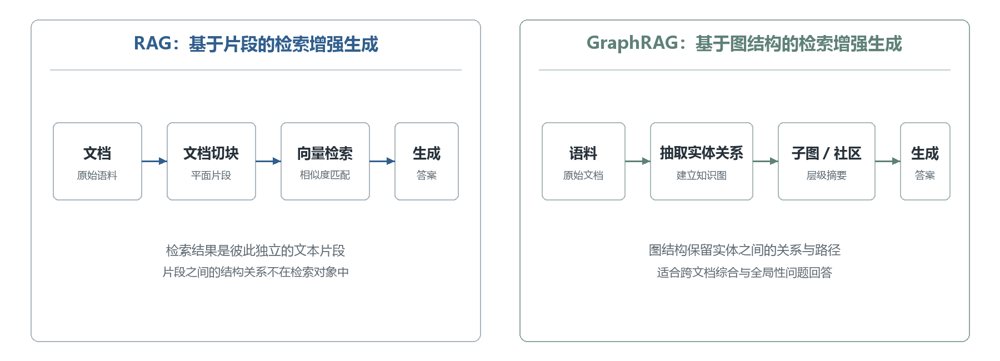

# 第 2 章 相关技术与理论基础

本文研究面向 AI 辅助软件开发的图谱驱动上下文工程方法，并设计实现了 wpw 原型系统。这一方法与系统建立在四类已有技术之上，本章依次介绍。大语言模型是 AI 编程智能体的能力基础，它的上下文窗口约束与知识固化边界，使外部知识供给成为智能体完成开发任务的必要条件；智能体则把模型能力落实为规划、工具调用与多步执行。围绕智能体的输入，上下文工程处理代码上下文的获取、组织与控制。知识图谱把项目中的实体与关系组织成可查询的结构，语义匹配负责找到与任务相关的知识点，图搜索负责在图上圈定相关知识范围。SDD 开发方法提供了用规格与流程制品约束智能体开发过程的工程实践。这些技术共同构成后续章节方法设计与系统实现的理论基础。

## 2.1 大语言模型与 AI 编程智能体

### 2.1.1 大语言模型的基本概念

2017 年，Vaswani 等人提出 Transformer 架构[43]，现代大语言模型普遍建立在它之上。其核心是自注意力机制。序列中每个位置直接关注其余位置，注意力权重由查询与键向量的相似度经缩放、归一化得到，再对值向量加权求和，多头机制把这一过程在多个子空间中并行展开。其计算可表示为

$$\mathrm{Attention}(Q, K, V) = \mathrm{softmax}\left(\frac{QK^{\mathrm{T}}}{\sqrt{d_k}}\right)V \tag{2-1}$$

其中 $Q$、$K$、$V$ 分别为查询、键、值矩阵，$d_k$ 为键向量维度。自注意力摆脱了循环网络对顺序计算的依赖，使大规模并行训练成为可能。模型以 Token 为基本单位处理文本与代码，单次交互可处理的信息总量由上下文窗口长度限定。经过大规模预训练以及指令微调、人类反馈优化等后训练过程，模型获得指令遵循、多轮对话、代码理解与生成等能力，Code Llama 等代码专用模型进一步强化了编程任务表现[30]。

这类能力在支撑多轮对话和代码生成的同时，也有很明确的能力边界。最核心的限制在于：单次交互可处理的信息受上下文窗口长度约束；参数中承载的知识在训练完成后基本固定，无法实时反映软件项目的动态变化；对于参数未覆盖的内容，生成过程还可能出现偏离事实的幻觉。因此，支撑模型的知识主要由三个方面构成，一是模型训练过程中沉淀在参数中的参数化知识，二是实际项目长期演化形成的外部项目知识，三是为完成当前任务临时组织的上下文。其中第二类知识无法从模型参数中获得，只能通过外部机制持续供给。

### 2.1.2 AI 编程智能体

大语言模型本身只会生成文本，它回答一个问题、补全一段代码，但不会自己去读文件、改代码、运行测试。软件开发恰恰由这些动作组成，而且要反复多轮：改了代码要跑测试，测试失败要定位原因再改。单轮问答完成不了这样的任务。智能体（Agent）正是为此出现的，它把大模型放进一个"观察—决策—行动"的循环里，模型每一步先决定做什么，再调用工具执行，观察执行结果后决定下一步。智能体要解决的问题，是让模型从"能回答"变成"能做事"：开发者给出任务目标，智能体自己拆分步骤、操作环境并把任务推进到完成。用于编程场景的智能体就是 AI 编程智能体，它处理的是真实代码库上的定位、修改与验证。

这种循环要跑起来，依赖三项能力。规划指把任务目标拆成可执行的步骤，并在执行中根据结果调整；工具使用指模型以函数调用、命令执行等方式操作外部环境，ReAct 把推理与行动交错组织，使模型边思考边观察地完成多步任务[45]，Toolformer 表明模型可以在训练中自己学会何时调用工具[46]；记忆指跨步骤、跨会话保存和复用中间结果与历史经验。这些能力由 Agent 运行框架（Agent Harness）封装为文件编辑、命令执行与状态维护接口，SWE-agent 对这类智能体与计算机之间的接口做了系统研究[17]。在此类框架之上，工程界出现了 Devin[32]、OpenHands[33]、Claude Code[28] 等具备端到端任务执行能力的编程智能体。

规划、工具调用和多步执行已有较成熟的工程基础，但智能体的产出与人类开发者相比仍有差距[3]，任务结果由执行能力和输入上下文质量共同决定。

图2-1 AI 编程智能体的执行循环

Figure 2-1 Execution Loop of an AI Coding Agent

## 2.2 面向软件工程的上下文工程

上下文工程指围绕智能体的任务目标，对外部知识、代码结构、执行状态等信息进行组织、选择、压缩与供给的方法。Mei 等人的综述把它归纳为上下文检索与生成、上下文处理、上下文管理三类环节，涵盖检索增强、记忆、工具集成推理等方向[55]。软件工程任务中的上下文通常是代码上下文，需求文档、接口定义、代码文件和测试用例分散在仓库各处。下面按代码上下文的处理链条介绍相关技术：先获取，再组织，然后说明为什么要控制、怎样控制。

图2-2 代码上下文的处理链条

Figure 2-2 Processing Chain of Code Context

代码上下文的获取围绕仓库展开。CodeSearchNet 定义了自然语言—代码检索任务并提供大规模数据集，语义代码检索研究由此系统化[12]。仓库级代码生成则把上下文获取与生成过程耦合起来。CodePlan 用计划把仓库级修改拆成相互依赖的编辑链，按依赖顺序逐个执行[35]；RepoHyper 构建仓库级代码结构超图，以"搜索—扩展—精炼"为补全位置选取相关子图[36]。知识图谱路线上，KGCompass 把 Issue、PR、文件、类和函数组织成仓库感知知识图谱，用图路径引导修复定位，图谱随仓库提交增量更新[38]；Repository Intelligence Graph 通过静态分析生成确定性的仓库架构图，供编程智能体作为稳定的架构层上下文使用[40]。ContextBench 等基准则为编码智能体的上下文检索提供评测手段[58]。

这些工作回答的都是任务到来时取什么的问题。检索方法按相似度汇集片段，图谱方法沿结构选取子图，取出的内容服务当次任务，知识一般不在任务之间传递。获取到的内容还只是候选材料，要组织成模型能用的输入形式，才能进入生成过程。

最直接的组织方式是把检索结果拼接进提示。RAG 把生成过程拆成两步：先从外部知识库中检索与问题相关的内容，再把检索结果注入提示供模型生成答案[5]。模型由此可以按需读取参数之外的知识，知识更新不再依赖重新训练。但拼接进提示的是切分后的平面文本片段，片段之间的结构关系不在其中。GraphRAG 则用实体—关系图组织检索与生成，先从语料抽取实体与关系建图，再利用图的社区划分和层级摘要回答需要跨文档综合的全局性问题[19]。RAG 与 GraphRAG 两种检索组织方式的差异如图 2-3 所示。GraphRAG 面向通用文档语料；软件项目的实体类型、关系语义和图谱更新方式有其自身特点，要在代码场景下专门设计。

图2-3 RAG 与 GraphRAG 的检索方式对比

Figure 2-3 Comparison of Retrieval Schemes in RAG and GraphRAG

无论拼接还是结构化组织，进入模型的内容都受上下文窗口约束，内容一多就要有所取舍。

窗口内的信息并不被同等利用。"Lost in the Middle"研究发现，相关信息位于长上下文中部时，模型对它的利用效果明显差于位于首尾的情况，呈 U 形位置效应[4]。同时，处理开销与调用成本随输入规模增长，过大的输入还会稀释关键信息。名义窗口长度与有效利用长度之间的差距说明，上下文问题不只是容量问题，还包括相关内容的选择、组织与压缩问题。因此获取和组织之后，还要对进入模型的上下文加以控制。

控制上下文的第一类手段是压缩，解决选定内容如何放进窗口的问题。抽取式压缩保留关键片段、删去冗余；生成式压缩把长文本改写成摘要；LLMLingua 等提示压缩方法在尽量不损失任务效果的前提下系统性删减提示 Token[56]。这些方法主要面向自然语言文本做 Token 级压缩。对于代码结构知识，压缩也可以先发生在图结构层，再落实到属性与序列化形式。

压缩的效果可以用压缩率来度量：

$$C = 1 - \frac{T_c}{T_f} \tag{2-2}$$

其中 $T_c$ 为实际生成上下文的 Token 数，$T_f$ 为对应全量上下文的 Token 数。压缩率刻画输入规模的缩减，上下文的最终价值还取决于它对任务相关信息的覆盖程度，两者需要在预算约束下一起权衡。

控制上下文的另一类手段是记忆。智能体记忆从时间维度扩展上下文，使智能体跨步骤、跨会话保存中间结果与历史经验[57]。Agent Workflow Memory 从编码智能体的历史执行记录中提炼可复用的工作流知识，用于支持后续任务[59]；记忆机制也被视为自演化编码智能体的核心资源[6]。已有记忆研究多以会话或任务为组织单位，保存的是执行经验。一项业务由哪些代码实现、需求变化影响了哪些关系这类项目级知识，并不是通用记忆机制直接保存的对象。

获取、组织与控制分别处理上下文的内容来源、结构形式和容量约束，记忆机制再从时间维度延伸，各自已有成熟积累。

## 2.3 知识图谱基础

知识图谱把软件项目中的实体与关系组织成图结构。用知识图谱支持一个具体任务，要依次解决两个问题：一是把自然语言的任务描述对应到图谱中的知识点，这依靠嵌入向量与语义匹配；二是从匹配到的知识点出发，在图上有效圈定相关知识点的范围，这依靠图模型与图搜索。本节按这一使用过程，先介绍知识图谱的基本概念，再依次介绍语义匹配与图搜索方法。

2012 年谷歌为了提高搜索引擎的语义理解能力，正式提出知识图谱的概念。知识图谱用实体、关系和属性显式组织领域知识[37]：实体表示领域中的对象，关系表示对象之间的关联，属性描述对象的特征，一条知识通常表示为 <头实体，关系，尾实体> 三元组。在软件项目中，模块、文件、函数都可以作为实体，包含、调用、实现等关系把实体连成网状结构，例如 <收藏管理，实现，addFavorite> 表示"收藏管理"这项能力由 addFavorite 函数实现，图 2-4 给出了一个软件项目知识图谱的局部示例。以三元组为基本单元的组织方式使知识可以被结构化查询和关联推理。

图2-4 软件项目知识图谱示例

Figure 2-4 An Example Knowledge Graph for a Software Project

知识图谱的构建通常包括本体设计、知识抽取和知识融合三个环节：本体确定实体类型、属性与关系的模式定义，抽取从数据源识别实体并建立关系，融合处理实体对齐与冲突消解。按覆盖范围划分，知识图谱可分为通用图谱与领域图谱：通用图谱面向开放领域，追求覆盖广度；领域图谱面向特定领域定制本体，追求知识的深度与精度。图谱中的关系还可以附带证据来源与置信度，使每条知识可追溯、可审核；图谱也可以随数据源变化局部更新，不必全量重建。存储上，Neo4j 等图数据库提供成熟的图查询能力，基于文件的轻量存储在部署成本与数据可控性上占优。

知识以三元组形式存入图谱后，使用它的第一步是找到与当前任务相关的知识点。图谱中的实体以符号命名，任务描述则是自然语言，两者之间的对齐依靠语义匹配。

嵌入向量是语义匹配的基础技术，它把文本或代码对象映射为低维稠密向量，使语义相近的对象在向量空间中相互邻近，如图 2-5 所示。例如任务描述"为用户增加收藏功能"与能力规范"收藏管理"的向量距离，会小于它与"订单结算"的距离。BERT 等预训练语言模型提升了句段级语义表示能力[44]；面向检索的文本嵌入模型把优化目标直接对齐为"相关文本向量相近"，C-Pack 提出的 BGE 系列是中文场景的代表[47]；代码侧，GraphCodeBERT 把数据流信息融入代码预训练表示[11]。

图2-5 嵌入向量空间中的语义邻近关系

Figure 2-5 Semantic Proximity in the Embedding Vector Space

两个向量的语义相近程度用余弦相似度度量：

$$\mathrm{sim}(u, v) = \frac{u \cdot v}{\|u\| \, \|v\|} \tag{2-3}$$

其中 $u$、$v$ 为两个对象的嵌入向量，$\mathrm{sim}(u, v)$ 取值越接近 1，表示两者语义越相近。工程上借助近似最近邻索引加速大规模向量检索。

语义匹配给出的是与任务最相近的入口节点。与任务相关的知识通常不止一个节点，而是入口周围的一片连通区域，要把这个范围有效地找出来，需要借助图结构与图搜索。

在图上圈定范围，先要用图模型描述结构。图由节点和边组成，边带有方向的图称为有向图，不含环路的有向图称为 DAG（Directed Acyclic Graph，有向无环图）。DAG 可以表达对象之间的先后依赖，若从节点 A 到节点 B 存在有向路径，A 就是 B 的前置。

图搜索是在图上圈定范围的基础操作。BFS（Breadth-First Search，宽度优先搜索）按与起点的距离逐层扩展节点，在无权图上可以找到最短路径；带权图上的经典方法有 Dijkstra 算法与最佳优先搜索；双向搜索从起点和目标集合同时扩展、中途会合，能缩小需要探索的搜索空间，适用于已知目标集合的大图检索。语义匹配确定入口、图搜索圈定范围，两者配合使知识图谱中的知识能够按任务粒度被取出使用。

## 2.4 SDD 开发方法

SDD 是针对 AI 开发过程约束问题形成的工作流路线。Piskala 把它概括为开发活动的组织方式从"代码即事实源"转向"规格作为首要制品"[7]。不同方法的严格程度不同，实践中形成规格先行、规格锚定、规格即事实源三种形态，共同点是把规格放在开发过程的组织核心。后续研究考察了规格制品的实际作用：规格约束可以提升大模型代码测试的效果[60]，规格优先的智能体工作流已有实证研究[61]，规格驱动智能体开发的生命周期与制品追踪也有系统梳理[62]。这条路线已经解决的问题，是用规格与流程制品约束智能体行为、让开发过程可检查。

工程社区已有多个代表性实现。GitHub Spec Kit 以项目级治理为定位，围绕 Constitution（项目规范）、Specification（功能规格）、Plan（技术计划）和 Tasks（任务分解）四类制品组织开发，各阶段之间设 Clarify、Checklist、Analyze、Converge 等质量门禁[8]。OpenSpec 以变更管理为定位，以动作（Action）为中心建模工作流与制品图，把 Change 作为软件演化的基本工作单元，围绕变更组织规格制品的生命周期，制品间的依赖关系作为使能条件而非强制关卡[8]。Superpowers 以执行纪律为定位，用可组合技能和强制工作流约束智能体执行，覆盖需求澄清、计划编写、子代理驱动开发、测试驱动开发和多层代码审查等环节[9]。三者共同表明，用规格与流程制品约束智能体开发是可行路线；Hill 同时提醒，SDD 能否降低缺陷要结合任务、流程执行质量和评价协议判断[66]。

## 2.5 本章小结

本章介绍了本文方法与 wpw 系统涉及的相关理论与关键技术。首先介绍了大语言模型的架构、能力边界和 AI 编程智能体的执行模式；然后介绍了代码上下文的获取与组织方式，以及窗口约束下的压缩与记忆等控制方法；接着按使用过程介绍了知识图谱的基本概念、对应知识点的语义匹配方法，以及圈定知识范围的图模型与图搜索；最后介绍了 SDD 开发方法的基本思想与代表性实现。这些技术分别对应方法设计与系统实现的不同侧面，为后续章节提供基础。

---

**本章参考文献映射**（正式写作时并入全文参考文献列表，编号待统一）：

> 本章复用第 1 章文献：[3][4][5][6][7][8][9][11][12][17][19][28][30][32][33][35][36][37][38][40]（清单见 `1.引言.md` 文末映射）；本章新增 [43]-[47]、[55]-[59]。原 [18]（代码属性图）随"代码结构与依赖分析"小节删除不再引用，[52]（tree-sitter）题录保留在本映射中，首次引用移至第 5 章 5.3.1。

- [43] Vaswani A, Shazeer N, Parmar N, et al. Attention Is All You Need[C]. NeurIPS 2017.
- [44] Devlin J, Chang M W, Lee K, Toutanova K. BERT: Pre-training of Deep Bidirectional Transformers for Language Understanding[C]. NAACL 2019.
- [45] Yao S, Zhao J, Yu D, et al. ReAct: Synergizing Reasoning and Acting in Language Models[C]. ICLR 2023.
- [46] Schick T, Dwivedi-Yu J, Dessì R, et al. Toolformer: Language Models Can Teach Themselves to Use Tools[C]. NeurIPS 2023.
- [47] Xiao S, Liu Z, Shao Y, et al. C-Pack: Packaged Resources To Advance General Chinese Embedding[C]. SIGIR 2024.
- [52] Brunsfeld J, et al. tree-sitter[EB/OL]. https://tree-sitter.github.io/tree-sitter/.
- [55] Mei L, Yao J, Ge Y, et al. A Survey of Context Engineering for Large Language Models[EB/OL]. arXiv:2507.13334, 2025.
- [56] Jiang H, Wu Q, Lin C Y, Yang Y, Qiu L. LLMLingua: Compressing Prompts for Accelerated Inference of Large Language Models[C]. EMNLP 2023.
- [57] Zhang Z, Zhang Y, Li K, et al. A Survey on Memory Mechanisms of Large Language Model based Agents[EB/OL]. arXiv:2404.13501, 2024.
- [58] 【待核实：ContextBench，编码智能体上下文检索评测基准，题录待补（作者/题名/年份/出处）】
- [59] 【待核实：Wang Z, et al. Agent Workflow Memory. arXiv:2409.07429, 2024.（从智能体历史执行经验中提炼可复用工作流记忆，需确认与正文表述的对应性）】

> 新增文献说明：[43]-[47] 为模型与嵌入方向奠基性文献，[52] 为解析工具官方资料（随"代码结构与依赖分析"小节删除，首次引用移至第 5 章），[55]-[57] 为上下文工程综述、提示压缩与智能体记忆文献，[58][59] 为仓库级上下文评测与编码智能体持久记忆文献；均按第 1 章"奠基性方法文献做源头引用、工具官方资料 [EB/OL] 并绑定版本"的原则处理。**[43]-[47][52][55]-[59] 尚未经逐条核实**，其中 [58][59] 题录本身待确认（本机网络受限无法查证，需用户提供准确出处后再定稿）。原 [48]-[51][53][54]（推荐系统经典文献与 Spring Boot/Vue 官方资料）随原 2.5 节删除而不再引用，全文合稿统一编号时从参考文献列表移除。编号在全文合稿时统一重排。
