# 面向 AI 辅助软件开发的图谱驱动上下文工程方法研究与系统实现

# 摘要

近几年大语言模型技术研究突飞猛进，在软件开发领域也逐步从最初的代码补全发展到现在以 AI（Artificial Intelligence，人工智能）智能体的角色贯穿从需求分析到测试交付的全流程。但受制于现有算力资源，智能体的上下文不是无限大的，目前主流模型的上下文上限大多在 1MB 左右，使得智能体在软件开发时需要一边自己搜索需要的文件内容，一边组织上下文，但这一过程通常需要分多次进行，会消耗大量的时间和 Token（大语言模型处理文本时的基本计量单位）。而且，组织好的上下文因为空间有限，在长对话过程中，如果模型上下文达到上限，就会挤掉最早开始时的上下文，造成“知识遗忘”，后续再次用到这些知识时，还需要重新搜索和组织。

针对这个问题，本文提出一种面向 AI 辅助开发的图谱驱动上下文工程方法。该方法首先从现有项目代码入手，建立代码模块、文件、调用方法之间的结构依赖关系索引，并以本地文件形式保存索引信息。然后将现有项目的功能需求拆分成能力知识单元，通过串联知识单元与代码模块之间的映射关系，形成知识图谱。这样智能体在执行任务时，只需要调用现有知识库中知识单元的语义匹配，就能拿到基于当前需求语义对应的代码结构最小生成子图，而不是自己盲目检索，从而降低上下文组织成本。同时，在需求迭代过程中，不断新增和更新本地保存的知识单元与代码结构索引关系，确保知识图谱长期迭代后的可用性和准确性。

以上述方法为基础，设计并实现了 WPW（Web Project Workflow，Web 项目开发工作流）系统，并通过系统功能测试验证了实现与预期行为的一致性。方法的应用效果以美食推荐系统为统一实验载体展开验证：先选取基础搭建、业务核心、迭代增强和连续需求四类典型开发任务，让 WPW 与 OpenSpec（开源的需求驱动开发工作流）从相同的前置版本出发完成同样的任务，比较两种方式的任务完成情况、Token 消耗和执行耗时；再在同一代码快照上提出一组代码定位问题，比较非图谱检索、图谱增强检索和完整 WPW 三种条件下的必要文件覆盖情况与 Token 开销。任务级的比较同时包含流程、知识供给和上下文组织几个方面的差别，还不能直接说明差异来自上下文搜索和组织，因此后两组实验专门考察上下文获取这一环节。在当前项目和实验范围内，使用 WPW 时完成任务的整体 Token 消耗更低，图谱条件下定位必要代码的开销有所减少，问答质量保持稳定，表明知识图谱能够降低上下文管理带来的额外开销。

关键词：大语言模型；上下文工程；AI 辅助软件开发；代码知识图谱

# ABSTRACT

In recent years, research on large language models has advanced rapidly. In software development, their role has expanded from the early use of code completion to AI agents that participate in the entire process from requirements analysis to testing and delivery. However, constrained by available computing resources, an agent's context is not unlimited. The context windows of most mainstream models are currently around 1 MB, so an agent working on a software project must search for the required file contents while also organizing them into context. This process often has to be repeated across multiple steps, consuming substantial time and tokens, where a token is the basic unit used by a large language model to process text. Moreover, because the organized context is also limited in size, a long conversation may reach the model's context limit and push out information from the beginning of the interaction. This causes the agent to lose previously acquired project knowledge and forces it to search for and organize the same knowledge again when it is needed later.

To address this problem, this thesis proposes a graph-driven context engineering method for AI-assisted software development. The method begins with the source code of an existing project and builds an index of structural dependencies among code modules, files, and methods, together with their call relationships, storing the index in local files. It then decomposes the functional requirements of the project into capability knowledge units and connects these units to code modules through mapping relationships to form a knowledge graph. During task execution, the agent can use semantic matching over the capability units in the existing knowledge base to obtain a minimal subgraph of the code structure relevant to the current requirement, rather than searching through the project blindly. This reduces the cost of organizing task context. As requirements evolve, the method continuously adds and updates the locally stored capability units and code-structure index, so that the knowledge graph remains usable and accurate over time.

Based on this method, we design and implement WPW (Web Project Workflow) and verify through system functional testing that the implementation behaves as intended. To evaluate how the method performs in practice, we use a food recommendation system as the unified experimental subject. We select four typical development tasks, namely basic setup, a core business function, an iterative enhancement and a continuous requirement, and have both WPW and OpenSpec, an open-source requirements-driven development workflow, complete the same tasks from the same starting version, comparing task completion, token consumption and execution time. We then pose a set of code-location questions on the same code snapshot and compare, under three conditions—non-graph retrieval, graph-enhanced retrieval and full WPW—how much of the required code is covered and how many tokens are spent. The task-level comparison differs in workflow, knowledge supply and context organization at the same time, so it cannot by itself establish that the difference comes from context search and organization; the code-location comparison isolates that step. Under the project and experimental conditions examined, completing the tasks costs fewer tokens with WPW, locating the required code costs less under graph conditions, and answer quality remains stable, indicating that the knowledge graph can reduce the additional overhead introduced by context management.

Key Words: Large Language Models; Context Engineering; AI-Assisted Software Development; Code Knowledge Graph

# 第 1 章 引言

## 1.1 研究背景

在软件工程实践中，开发者需要分析用户需求，确定系统功能，设计接口、数据结构和模块关系，编写代码并通过测试，在系统投入使用后，还要处理缺陷、调整接口、增加功能，并检查修改是否影响已有模块。通常一个功能的实现同时涉及需求文档、接口定义、数据模型、配置文件和多个代码模块，这些内容可能由不同人员在不同阶段维护，分别记录在需求文档、设计文档、代码文件、配置文件和测试用例中。开发者需要把它们对照起来，才能确定修改位置和影响范围。

AI 参与编程是从代码补全开始的。早期工具根据当前文件的上下文补全下一行代码或生成单个函数，模型只需要处理光标附近的内容[1]。这种方式节省了敲代码的时间，但需求怎么拆分成模块、代码按什么思路组织、改动会影响哪些地方，仍要开发者自己梳理和判断，整体效率的提升有限。随着代码模型能力增强，模型已经可以读取外部材料，根据自然语言查找代码，并按照计划修改多个文件[2-4]。开发者不再只向工具询问某个函数怎么写，也可以让它搜索项目、修改代码和运行测试。但是模型面对的是一整个代码库。把全部文件交给模型，会带入大量与当前任务无关的内容；只提供当前文件，又可能漏掉接口和依赖。长上下文研究也表明，输入变长并不能保证模型有效利用所有信息[5]。所以实际执行任务时，智能体仍要先搜索项目，再判断哪些内容需要保留。

后来，SWE-bench 开始用真实的 GitHub issue（问题报告）检验模型能否完成项目修改[6]，SWE-agent、Devin 和 OpenHands 等智能体让模型自己搜索文件、编辑代码、执行测试，再根据结果继续修改[7-9]。AI 编程已经进入真实开发环境，但开发者对输出准确性的信任仍然有限[10]。一次修改能否完成，不只取决于代码能否生成。智能体还要找到正确的文件，理解业务规则，并检查修改对其他模块的影响。

在国家层面，国务院于 2025 年发布《关于深入实施“人工智能+”行动的意见》，提出推动人工智能与各领域深度融合，加快智能体等应用落地[11]，AI 辅助软件开发由此获得明确的政策支持。

以“支持用户收藏菜品”为例，这个需求可能同时涉及用户模块、菜品模块、数据库表、接口、权限和页面状态。熟悉项目的开发者凭经验就能找到这些联系，智能体却要从需求文字、代码结构和历史修改中重新建立它们。如果这些判断只留在对话中，下一次任务还要重新搜索；如果只保存代码文本，又很难说明这些代码对应哪项业务能力。需求与代码之间缺少稳定的联系，智能体就难以在连续任务中沿用已有的判断。

为了不每次都重新搜索，已有工作开始把项目中的关系保存下来。一类做法把代码实体及其关联组织成图结构，用于仓库级问答与推理[12]；也有工作用程序血缘分析业务变动会影响哪些程序[13]；还有工作用规范文档和任务流程约束智能体的执行过程[14-16]。这些方法分别保存了代码结构、仓库关系或执行过程。但是一项业务由哪些代码实现，需求变化会影响哪些代码，以及这些判断怎样留给后续任务使用，这三个问题通常没有被同时回答。

需求文档描述业务目标，代码文件记录实现细节，接口、数据结构和模块调用把两者连接起来。本文把 Spec（Specification，需求规格说明）、业务能力、模块、文件和函数放入同一个项目知识模型，先记录一项业务由哪些代码实现；任务到来时，再根据任务描述选择相关内容，生成受 Token 预算约束的上下文；需求或代码发生变化后，只更新受影响的关系。这样就把需求规格、业务能力、代码实现、演化记录和任务上下文连成了一条知识链，可以减少智能体在连续任务中反复搜索和重新理解项目的工作。

## 1.2 研究意义

从代码补全到智能体执行完整的开发任务，AI 编程的能力快速提升，但智能体面对整个代码库时，仍要自己搜索项目、判断哪些内容与当前任务相关。需求与代码之间缺少稳定的联系，智能体在连续任务中只能反复搜索和重新理解项目，开发效率的提升因此受到限制。

本文围绕这一问题，建立 Spec 驱动的能力—代码双层知识组织模型，把需求规格、业务能力和代码结构放入同一个项目知识模型持续维护；在此基础上提出图谱驱动的任务上下文生成方法和 Spec 增量知识演化机制，并实现 WPW 原型系统，使智能体在连续任务中能够复用已有的项目认识。

在长期演化项目中引入这种知识组织方式具有以下实践意义：智能体不再每次临时搜索整个项目，减少了定位相关代码的时间，需求变更时也只需更新受影响的联系；智能体从同一份业务—代码知识出发定位任务内容，减少因搜索路径和任务写法不同带来的修改质量波动；开发者还可以反方向追溯一段代码对应哪项业务，确认一次修改涉及的业务范围，更好地保障项目的可维护性。

本研究的意义主要体现在工程应用与实践创新层面。针对智能体在连续任务中反复搜索、项目开发中已有的积累难以被有效利用的问题，本文将知识图谱与上下文工程方法同智能体开发流程相结合，在已有代码检索、需求追踪和仓库知识图谱研究的基础上，搭建了项目知识构建、任务上下文生成与增量维护的完整体系，并结合美食推荐系统的实际开发任务验证方法的可行性，形成了可复用、可落地的解决方案。该工作有助于推动上下文工程在 AI 辅助开发中的工程化落地，对长期演化项目中的智能体开发具有参考价值。

## 1.3 国内外研究现状

### 1.3.1 研究进展

大模型出现以后，模型开始从辅助编程走向执行完整的软件工程任务。2024 年提出的 SWE-bench 用真实 GitHub issue 检验模型能否完成项目修改[6]，SWE-agent 研究智能体与计算机之间的交互接口[7]，Devin[8]、OpenHands[9] 等系统把文件编辑、命令执行和错误修复放进连续执行过程。Hou 等人对 LLM4SE（Large Language Models for Software Engineering，大模型软件工程）文献的梳理也显示，大模型在软件工程中的应用已经由代码生成、补全和解释扩展到需求、设计、开发、质量保障和维护[17]。国内学者也从预训练模型在软件工程中的应用[18]、深度学习驱动的代码生成[19]、自动代码修复[20]、缺陷检测与修复[21]以及基于大模型的代码智能体[22]等方面进行了系统梳理。真实项目研究开始记录编程智能体的采用情况[23]，并讨论智能体作为软件工程团队成员对开发方式的影响[24]。与此同时，“Lost in the Middle”研究表明，即使模型能够接收长输入，信息所在位置仍会影响模型是否真正使用这些内容[5]，智能体要为任务找到并组织相关内容，不能只依赖扩大上下文窗口。针对智能体怎样获得并组织任务相关内容，现有研究大体可以分为三类：需求追踪与规格驱动开发方法、代码检索与结构表示方法、仓库知识图谱方法。下面按类别归纳、比较与评价。

（1）需求追踪与规格驱动开发方法

这类方法从需求侧入手，要么恢复需求与代码之间的追踪链接，要么把需求规格作为开发过程的核心制品来约束智能体。典型代表包括信息检索类追踪方法、TRIAD，以及 GitHub Spec Kit、OpenSpec、Superpowers 等规格驱动工具。

需求追踪研究关注需求与实现、验证这些需求的代码之间怎样建立对应关系。Cleland-Huang 等人在 2004 年前后研究了如何提高需求追踪的投入产出比[25]，后续工作尝试用群体智能和信息检索自动恢复需求制品与代码之间的链接[26]，Borg 等人在 2014 年对这一方向进行了系统梳理，信息检索由此成为恢复追踪链接的主流方法[27]。

TRIAD 是南京大学团队在大模型时代提出的追踪恢复方法[28]。它先从制品文本中提取共识词对，增强制品之间的语义关联，再沿制品间的传递链接推导，恢复需求到代码的追踪关系。这种方法不需要人工预先标注链接，能够恢复出直接匹配难以发现的间接追踪关系。但恢复出的链接服务当次追踪任务，链接本身不作为项目知识长期维护，需求变化后也不会随之更新。

规格驱动开发（Spec-Driven Development，SDD）把需求规格作为开发过程的核心制品，开发活动围绕规格的编写、确认与实现展开。Tufano 等人对规格优先的智能体工作流进行了实证研究[29]。

GitHub Spec Kit 用一组规范制品组织智能体的开发过程[14]。项目先以 Constitution 确定总体约束，再由 Specification 描述需求，Plan 把需求分解为实现方案，最后拆成任务交给智能体执行。这套制品让规范成为可检查的一等制品，智能体不再只凭对话中的临时指示工作。但规范记录的是“要做什么”，不记录“哪项业务由哪些代码实现”，规范与代码之间的对应关系并不在这套制品中。

OpenSpec 以 Change 为单元管理需求演化[16]。每次变更包含提案、设计、任务等制品，实施完成后归档并更新既有规格，变更的状态因此可以追踪。这种机制让需求演化有了明确的记录单元。但变更制品与代码之间的关联依靠流程和人工维护，业务—代码关系不会随变更自动建立，也不直接用于生成任务上下文。

Superpowers 用可组合技能和强制工作流约束智能体的执行过程[15]。需求澄清、计划、开发、测试和审查各阶段由相应技能定义，子代理按分工执行，执行纪律因此得到保证。但过程产物停留在流程记录与对话产物中，没有沉淀为可以查询的项目知识结构，后续任务无法直接复用。

总结下来，这类方法保存了需求与规格信息，让开发过程更容易检查和追踪，但追踪结果服务当次分析，规格制品面向流程管理，需求与代码的对应关系既不自动建立，也不直接用于生成任务上下文。Spec Kit、OpenSpec、Superpowers 仍在快速迭代，本文只讨论截至 2026 年 8 月检索到的版本。

（2）代码检索与结构表示方法

这类方法从代码侧入手，要么按文本或代码相似度检索相关片段，要么把代码实体之间的结构关系显式保存下来。典型代表包括 RAG、代码属性图、GraphCodeBERT 以及 RepoHyper 等。

代码检索研究根据文本或代码相似度返回相关片段。RAG（Retrieval-Augmented Generation，检索增强生成）在 2020 年把外部知识检索接入生成过程，使模型可以在执行任务时读取参数之外的信息[2]。国内研究对 RAG 的架构、检索策略与应用场景进行了多方面探索，包括检索增强生成在软件工程中的应用[30]、面向大模型的检索增强方法[31]、基于滑动窗口策略的检索增强生成系统[32]、面向大模型的检索增强生成综述[33]、RAG 驱动的知识服务[34]以及 RAG 在平行人与平行智能中的应用[35]。这类方法能在任务到来时快速汇集相关内容，但检索结果按相似度拼合，不说明代码之间的结构关系，知识也不在任务之间传递。

结构表示研究把代码实体之间的关系显式保存下来。Yamaguchi 等人在 2014 年提出代码属性图（Code Property Graph），把抽象语法树、控制流图和程序依赖图合并为可查询的图模型，用于漏洞挖掘[36]；GraphCodeBERT 把数据流加入代码表示学习[3]，知识图谱研究也系统总结了如何用实体、关系和属性组织领域知识[37]。随着代码模型能力提高，研究对象从单个函数扩展到整个代码仓库：CodePlan 用计划组织仓库级修改涉及的多个步骤[4]；浙江大学团队提出 CatCoder，把静态分析得到的类型信息与检索结果一起提供给模型，用于上下文感知的代码补全[38]。结构信息也开始直接服务检索与生成，RepoHyper 用代码结构超图执行“搜索—扩展—精炼”[39]。围绕代码结构与检索的结合，CoRAG 把抽象语法树检索与大模型结合用于代码重构[40]，叶子健把检索增强与智能体协同用于代码生成[41]；代码坏味检测与重构研究也表明，结构信息与多层次语义对代码理解具有价值[42-44]。CodeGeeX[1] 等工具把代码补全、解释和对话能力接入开发环境，为这类方法提供了模型与工具基础。

总结下来，这类方法改善了模型对仓库级代码的理解，但检索结果按相似度拼合，结构信息描述的是代码实体自身，需求语义不在其中。

（3）仓库知识图谱方法

近两年，代码结构知识与智能体执行开始直接结合，形成仓库知识图谱类方法。这类方法把仓库中的制品和代码实体组织成图，用图结构为智能体的定位、生成和问答提供仓库知识。代表性工作包括面向软件仓库问答的知识图谱方法[12]。

中国工商银行软件开发中心利用抽象语法树和字节码分析构建全链路程序血缘，用它判断交易变动会影响哪些程序[13]。

Abedu 等人研究了知识图谱如何支持软件仓库问答[12]，Jiang 等人把知识图谱作为复杂智能体推理和记忆的状态空间[45]。国内研究也关注知识图谱与大模型的结合：刘龙把增强型代理上下文工程用于网络威胁情报知识图谱构建[46]，李登飞等从基础层、核心层与应用层梳理大语言模型与知识图谱的融合范式[47]，郑艳萍等综述了大模型驱动的文本属性图学习进展[48]。

总结下来，这类方法已经把结构知识带入智能体的执行过程，部分还支持随仓库变化增量维护，但图中的主要对象仍是文件、类、函数、架构依赖等代码实体与制品，需求语义与代码实现之间的联系不在其中。

### 1.3.2 综述分析

从这三类方法的发展过程可以看到，国内外研究先建立代码检索、结构表示和需求追踪方法，然后把这些方法用于仓库级生成和智能体执行，近两年又开始用规格约束开发过程、用图结构提供仓库上下文。研究关心的问题也随之变化：早期关注一次查询能否找到相关代码，现在还要考虑任务结束后形成的知识能否保留下来，以及需求变化后业务语义与代码结构的联系能否继续使用。

现有方法已经覆盖这条链路的多个局部环节，代码语义检索、仓库级代码生成、代码知识图谱、软件制品追踪和智能体工作流都形成了一定积累。Spec Kit、OpenSpec、Superpowers 等工具也在工程实践中积累了各自的规范与变更制品。不过这些方法维护的核心对象不同，表 1-1 列出代表性工作流工具与本文方法所维护的知识对象。

表1-1 代表性工作流工具与本文方法的知识对象对比

Table 1-1 Comparison of Representative Workflow Tools and the Proposed Method by Knowledge Object

| 工具 | 核心制品/对象 | 上下文组织的主要形式 | 与本文的关系 |
|---|---|---|---|
| Spec Kit | 项目规范 / Spec / Plan | 规范制品与流程上下文 | 规范治理方向的对比对象 |
| OpenSpec | Change / 制品图 | 变更制品与状态管理 | 本文 Spec 演化机制的参照 |
| Superpowers | Skill / Plan / 子代理 | 执行工作流与任务上下文 | 执行纪律方向的对比对象 |
| 本文方法 | Capability / Code / 演化历史 | 持续维护的项目知识模型 | 本文重点 |

从知识对象看，现有工作多以代码实体、架构依赖或 Issue/PR 等仓库制品为中心。需求追踪和规格制品保存了需求侧的信息，但业务能力本身没有成为独立的知识对象，需求语义与代码实现之间的联系也就缺少稳定的挂靠点。从知识的生命周期看，CatCoder、TRIAD 等检索与追踪方法主要服务当次补全或链接恢复，任务结束后结果便不再维护；程序血缘等方法虽然持续维护图结构，维护的仍是代码实体与制品之间的关系。

从上下文进入任务的方式看，RAG、RepoHyper 等方法在任务到来时检索并拼接相关片段，每个任务重新进行，知识不在任务之间传递；Spec Kit、OpenSpec、Superpowers 用规格和变更制品约束开发过程，积累了项目认识，但这些积累主要面向流程检查与追踪，没有直接用于生成任务上下文。从对项目演化的响应看，OpenSpec 以 Change 管理制品演化，但规格变化与代码关系之间没有联动：规格变化不会触发代码关系的更新，图结构更新也不以需求为单元。

综合这几个角度可以看到，如何把 Spec/Change 作为知识演化单元，让业务能力处在需求语义和代码结构之间，在持续开发中维护这条联系，并据此生成受 Token 预算约束的任务上下文，目前还没有形成统一的方法。本文因此不重新提出代码图谱或代码检索，而是研究需求规格、业务能力、代码结构、项目演化和任务上下文这条长期知识链在 AI 编程智能体中的应用。

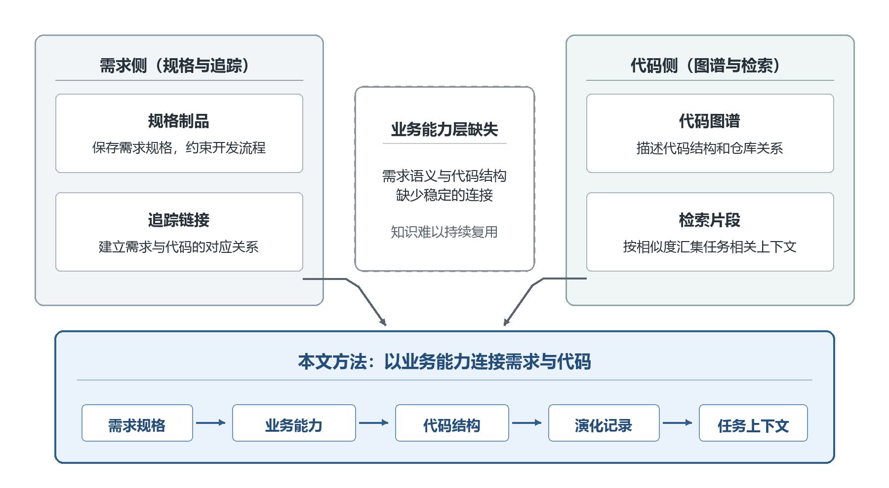

图1-1 研究现状与本文方法

## 1.4 研究内容

智能体参与长期项目开发时，每次任务到来都要先在项目中搜索相关文件，把找到的内容组织成当前任务所需的上下文。上下文窗口放不下整个项目，搜索和组织就要分多轮进行；对话变长以后，早期找到的内容被挤出窗口，下一个任务又得重新搜索一遍。一项业务由哪些代码实现、上次为什么这么改，这些判断只留在当次对话里，任务结束就丢了。智能体始终在用临时搜索的结果干活，项目做得越久，重复搜索和重新理解的成本越高。

本文要解决的，就是让这些判断留下来，并且能直接被后续任务使用。围绕这一问题，研究目标定为三件事：把业务能力和实现它的代码放进同一份项目知识里，可以随时查询和更新；任务到来时，从这份知识里选出与当前任务相关的部分，在 Token 预算内组织成上下文；需求或代码发生变化后，只更新受影响的部分，不用从头再来。本文不改动大模型本身，也不替代智能体的运行框架，只研究交给模型的上下文如何组织。开发过程按 BRD（Business Requirements Document，业务需求文档）、PRD（Product Requirements Document，产品需求文档）、Design、Plan、Test、Apply 六个阶段推进，每个阶段产出固定的文档，前一阶段完成后才能进入下一阶段；上下文在哪些阶段产生、哪些阶段使用，也随流程固定下来。本文核心研究内容如图1-2所示，涵盖以下四个层面。

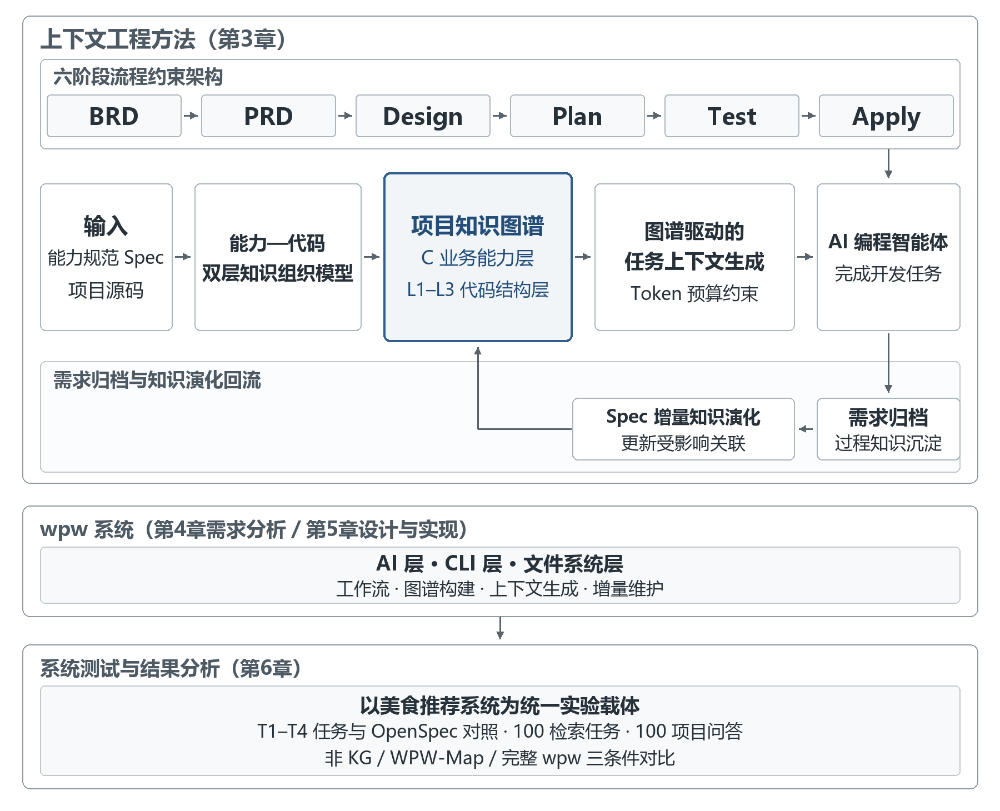

图1-2 核心研究内容

Figure 1-2 Core Research Content

（1）在知识建模层面，把业务能力和代码放进同一个项目知识模型。按文本或符号搜索代码，能找到相似的片段，却说不出一项业务由哪些代码实现、这些代码为什么这样组织。本文用 Spec 描述业务能力，用多语言源码解析得到模块、文件和函数三级代码结构，再从文档、命名、语义和 Git 历史四个方面收集业务与代码之间可能有关的证据，用 noisy-OR 概率模型把多份证据合成一条关联边，每条边都能回看它来自哪类证据。图谱用 JSONL 文件和本地向量索引保存，不需要单独部署数据库。后面的上下文生成和知识更新都建立在这份模型上。

（2）在上下文生成层面，按任务从图谱中取出够用的上下文。把整个代码库交给模型会带入大量无关内容，只靠人工挑选又慢又容易漏。本文先按任务描述在图谱中选定入口节点，再沿关联边向外扩展，取出与任务相关的一片子图；随后按节点离入口的远近决定保留多少细节，离得远的只留梗概；最后按预算选择压缩档位输出，放不下就再降一档，保住完成任务必须的内容。这样得到的上下文来自持续维护的项目知识，而不是一次任务的临时拼接。

（3）在知识演化层面，让项目知识跟着需求一轮轮更新。图谱如果只在项目开始时建一次，几轮需求之后就过时了。本文把需求 Spec 作为更新的触发单元：新项目先扫描源码、结合需求 Spec 建立初始图谱；已有项目来了新需求，先把需求写成 Spec，再把它和已有能力关联起来，只更新受影响的代码关系，不用每次重建整个图谱。项目知识就这样随开发过程沉淀下来，后续任务可以直接调用。

（4）在系统实现与方法验证层面，把上述做法做成 WPW 系统，并在真实开发任务中检验。WPW 分为 AI 层、CLI（Command Line Interface，命令行界面）层和文件系统层，实现工作流、图谱构建、上下文生成、增量维护和可视化控制台五个模块，由控制台把工作流状态、图谱和上下文结果呈现在页面上。验证借助一套用 AI 辅助开发完成的美食推荐系统，分三步开展：先做一组功能测试，检查各模块是否按预期运行；再设置基础搭建（T1）、业务核心（T2）、迭代增强（T3）和连续需求（T4）四类开发任务，共 12 个任务，让 OpenSpec 与 WPW 从相同的前置版本出发完成同样的任务，比较任务完成情况、模型 Token 消耗和执行耗时；最后在同一代码快照上开展项目场景检索与问答两组实验，检索实验包含 100 个信息需求，问答实验包含 100 个问题，均比较非 KG、WPW-Map 和完整 WPW 三种条件下的文件定位质量、回答正确性与上下文开销。评价指标和数据处理方式在实验前固定，结论以实际记录为准。

## 1.5 论文组织结构

本文共分为七章，各章内容安排如下。

第 1 章，引言。介绍研究背景与意义，梳理国内外研究现状，说明本文的研究内容。

第 2 章，相关技术与理论基础。介绍大语言模型的基本原理与能力边界，以及 AI 编程智能体的规划、工具调用和多步执行模式；梳理面向软件工程的上下文获取、组织、压缩与记忆方法；说明知识图谱的构成与构建过程，以及语义匹配和图搜索等关键技术；最后介绍以规格为核心制品的 SDD 方法及其代表性实现。

第 3 章，面向 AI 辅助开发的上下文工程方法。给出方法的总体框架，然后依次阐述知识建模、上下文生成、知识演化三项机制，以及将三者整合进开发过程的流程约束架构。

第 4 章，系统需求分析。分析 WPW 系统的功能需求与非功能需求，明确系统的使用者、使用场景和约束条件。

第 5 章，系统设计与实现。说明方法如何落地为 WPW 系统，包括三层架构以及工作流、图谱构建、上下文生成、增量维护和可视化控制台五个模块的设计与实现。

第 6 章，系统测试与结果分析。以美食推荐系统为统一实验载体，说明其业务规模、代码规模和实验条件；对 WPW 系统进行功能测试，然后比较 WPW 与 OpenSpec 完成典型开发任务的效果与成本，并通过图谱增强的上下文获取对比考察代码定位环节的开销与回答质量，最后讨论结果的适用范围与局限。

第 7 章，总结与展望。总结全文工作，展望后续研究方向。

# 第 2 章 相关技术与理论基础

本文研究面向 AI 辅助软件开发的图谱驱动上下文工程方法，并设计实现了 WPW 原型系统。这一方法与系统建立在四类已有技术之上，本章依次介绍。大语言模型是 AI 编程智能体的能力基础，它的上下文窗口约束与知识固化边界，使外部知识供给成为智能体完成开发任务的必要条件；智能体则把模型能力落实为规划、工具调用与多步执行。围绕智能体的输入，上下文工程处理代码上下文的获取、组织与控制。知识图谱把项目中的实体与关系组织成可查询的结构，语义匹配负责找到与任务相关的知识点，图搜索负责在图上圈定相关知识范围。SDD 开发方法提供了用规格与流程制品约束智能体开发过程的工程实践。这些技术共同构成后续章节方法设计与系统实现的理论基础。

## 2.1 大语言模型与 AI 编程智能体

### 2.1.1 大语言模型的基本概念

2017 年，Vaswani 等人提出 Transformer 架构[49]，现代大语言模型普遍建立在它之上。其核心是自注意力机制。序列中每个位置直接关注其余位置，注意力权重由查询与键向量的相似度经缩放、归一化得到，再对值向量加权求和，多头机制把这一过程在多个子空间中并行展开。其计算可表示为

$$\mathrm{Attention}(Q, K, V) = \mathrm{softmax}\left(\frac{QK^{\mathrm{T}}}{\sqrt{d_k}}\right)V \tag{2-1}$$

其中 $Q$、$K$、$V$ 分别为查询、键、值矩阵，$d_k$ 为键向量维度。自注意力摆脱了循环网络对顺序计算的依赖，使大规模并行训练成为可能。模型以 Token 为基本单位处理文本与代码，单次交互可处理的信息总量由上下文窗口长度限定。经过大规模预训练以及指令微调、人类反馈优化等后训练过程，模型获得指令遵循、多轮对话、代码理解与生成等能力。

这类能力在支撑多轮对话和代码生成的同时，也有很明确的能力边界。最核心的限制在于：单次交互可处理的信息受上下文窗口长度约束；参数中承载的知识在训练完成后基本固定，无法实时反映软件项目的动态变化；对于参数未覆盖的内容，生成过程还可能出现偏离事实的幻觉。因此，支撑模型的知识主要由三个方面构成，一是模型训练过程中沉淀在参数中的参数化知识，二是实际项目长期演化形成的外部项目知识，三是为完成当前任务临时组织的上下文。其中第二类知识无法从模型参数中获得，只能通过外部机制持续供给。

### 2.1.2 AI 编程智能体

大语言模型本身只会生成文本，它回答一个问题、补全一段代码，但不会自己去读文件、改代码、运行测试。软件开发恰恰由这些动作组成，而且要反复多轮：改了代码要跑测试，测试失败要定位原因再改。单轮问答完成不了这样的任务。智能体（Agent）正是为此出现的，它把大模型放进一个"观察—决策—行动"的循环里，模型每一步先决定做什么，再调用工具执行，观察执行结果后决定下一步。智能体要解决的问题，是让模型从"能回答"变成"能做事"：开发者给出任务目标，智能体自己拆分步骤、操作环境并把任务推进到完成。用于编程场景的智能体就是 AI 编程智能体，它处理的是真实代码库上的定位、修改与验证。

这种循环要跑起来，依赖三项能力。规划指把任务目标拆成可执行的步骤，并在执行中根据结果调整；工具使用指模型以函数调用、命令执行等方式操作外部环境，ReAct 把推理与行动交错组织，使模型边思考边观察地完成多步任务[50]，Toolformer 表明模型可以在训练中自己学会何时调用工具[51]；记忆指跨步骤、跨会话保存和复用中间结果与历史经验。这些能力由 Agent 运行框架（Agent Harness）封装为文件编辑、命令执行与状态维护接口，SWE-agent 对这类智能体与计算机之间的接口做了系统研究[7]。在此类框架之上，工程界出现了 Devin[8]、OpenHands[9]、Claude Code[52] 等具备端到端任务执行能力的编程智能体。

规划、工具调用和多步执行已有较成熟的工程基础，但智能体的产出与人类开发者相比仍有差距[24]，任务结果由执行能力和输入上下文质量共同决定。

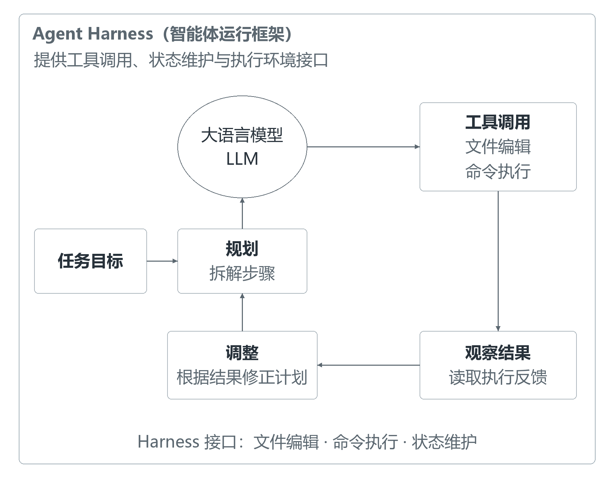

图2-1 AI 编程智能体的执行循环

Figure 2-1 Execution Loop of an AI Coding Agent

## 2.2 面向软件工程的上下文工程

上下文工程指围绕智能体的任务目标，对外部知识、代码结构、执行状态等信息进行组织、选择、压缩与供给的方法，其处理环节可以概括为上下文的检索与生成、上下文处理以及上下文管理。在软件工程场景中，已有工作把上下文工程用于网络威胁情报知识图谱构建[46]，或把检索增强与智能体协同用于代码生成[41]。软件工程任务中的上下文通常是代码上下文，需求文档、接口定义、代码文件和测试用例分散在仓库各处。下面按代码上下文的处理链条介绍相关技术：先获取，再组织，然后说明为什么要控制、怎样控制。

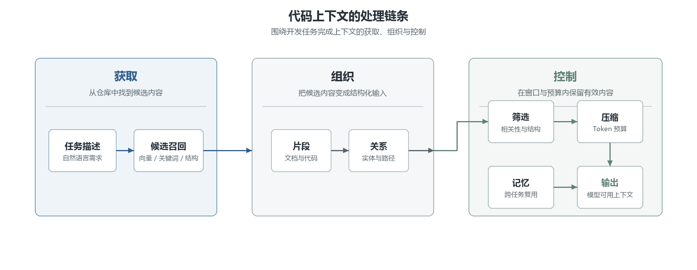

图2-2 代码上下文的处理链条

Figure 2-2 Processing Chain of Code Context

代码上下文的获取围绕仓库展开。CoRAG 进一步把抽象语法树检索与大模型结合用于代码重构[40]；检索增强生成在软件工程中的应用也已形成系统综述[30]。仓库级代码生成则把上下文获取与生成过程耦合起来。CodePlan 用计划把仓库级修改拆成相互依赖的编辑链，按依赖顺序逐个执行[4]；RepoHyper 构建仓库级代码结构超图，以"搜索—扩展—精炼"为补全位置选取相关子图[39]。

这些工作回答的都是任务到来时取什么的问题。检索方法按相似度汇集片段，图谱方法沿结构选取子图，取出的内容服务当次任务，知识一般不在任务之间传递。获取到的内容还只是候选材料，要组织成模型能用的输入形式，才能进入生成过程。

最直接的组织方式是把检索结果拼接进提示。RAG 把生成过程拆成两步：先从外部知识库中检索与问题相关的内容，再把检索结果注入提示供模型生成答案[2]。模型由此可以按需读取参数之外的知识，知识更新不再依赖重新训练。国内研究从检索增强方法[31]、滑动窗口策略[32]、综述梳理[33]、知识服务[34]以及平行智能应用[35]等角度对 RAG 进行了扩展。但拼接进提示的是切分后的平面文本片段，片段之间的结构关系不在其中。图结构检索则用实体—关系图组织知识，先从语料抽取实体与关系建图，再利用子图或社区结构回答需要跨文档综合的全局性问题。RAG 与图结构检索两种组织方式的差异如图 2-3 所示。图结构检索面向通用文档语料；软件项目的实体类型、关系语义和图谱更新方式有其自身特点，要在代码场景下专门设计。

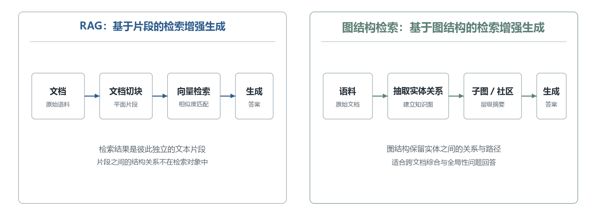

图2-3 RAG 与图结构检索的检索方式对比

Figure 2-3 Comparison of Retrieval Schemes in RAG and Graph-Structured Retrieval

无论拼接还是结构化组织，进入模型的内容都受上下文窗口约束，内容一多就要有所取舍。

窗口内的信息并不被同等利用。"Lost in the Middle"研究发现，相关信息位于长上下文中部时，模型对它的利用效果明显差于位于首尾的情况，呈 U 形位置效应[5]。同时，处理开销与调用成本随输入规模增长，过大的输入还会稀释关键信息。名义窗口长度与有效利用长度之间的差距说明，上下文问题不只是容量问题，还包括相关内容的选择、组织与压缩问题。因此获取和组织之后，还要对进入模型的上下文加以控制。

控制上下文的第一类手段是压缩，解决选定内容如何放进窗口的问题。抽取式压缩保留关键片段、删去冗余；生成式压缩把长文本改写成摘要；LLMLingua 等提示压缩方法在尽量不损失任务效果的前提下系统性删减提示 Token[53]。这些方法主要面向自然语言文本做 Token 级压缩。对于代码结构知识，压缩也可以先发生在图结构层，再落实到属性与序列化形式。

压缩的效果可以用压缩率来度量：

$$C = 1 - \frac{T_c}{T_f} \tag{2-2}$$

其中 $T_c$ 为实际生成上下文的 Token 数，$T_f$ 为对应全量上下文的 Token 数。压缩率刻画输入规模的缩减，上下文的最终价值还取决于它对任务相关信息的覆盖程度，两者需要在预算约束下一起权衡。

控制上下文的另一类手段是记忆。智能体记忆从时间维度扩展上下文，使智能体跨步骤、跨会话保存中间结果与历史经验[54]。Agent Workflow Memory 从编码智能体的历史执行记录中提炼可复用的工作流知识，用于支持后续任务[55]。已有记忆研究多以会话或任务为组织单位，保存的是执行经验。一项业务由哪些代码实现、需求变化影响了哪些关系这类项目级知识，并不是通用记忆机制直接保存的对象。

获取、组织与控制分别处理上下文的内容来源、结构形式和容量约束，记忆机制再从时间维度延伸，各自已有成熟积累。

## 2.3 知识图谱基础

知识图谱把软件项目中的实体与关系组织成图结构。用知识图谱支持一个具体任务，要依次解决两个问题：一是把自然语言的任务描述对应到图谱中的知识点，这依靠嵌入向量与语义匹配；二是从匹配到的知识点出发，在图上有效圈定相关知识点的范围，这依靠图模型与图搜索。本节按这一使用过程，先介绍知识图谱的基本概念，再依次介绍语义匹配与图搜索方法。

2012 年谷歌为了提高搜索引擎的语义理解能力，正式提出知识图谱的概念。知识图谱用实体、关系和属性显式组织领域知识[37]：实体表示领域中的对象，关系表示对象之间的关联，属性描述对象的特征，一条知识通常表示为 <头实体，关系，尾实体> 三元组。在软件项目中，模块、文件、函数都可以作为实体，包含、调用、实现等关系把实体连成网状结构，例如 <收藏管理，实现，addFavorite> 表示"收藏管理"这项能力由 addFavorite 函数实现，图 2-4 给出了一个软件项目知识图谱的局部示例。以三元组为基本单元的组织方式使知识可以被结构化查询和关联推理。国内综述对知识图谱的概念、构建与应用进行了系统梳理[56]，并进一步讨论了知识图谱与大语言模型的融合[47]以及大模型驱动的图学习[48]。

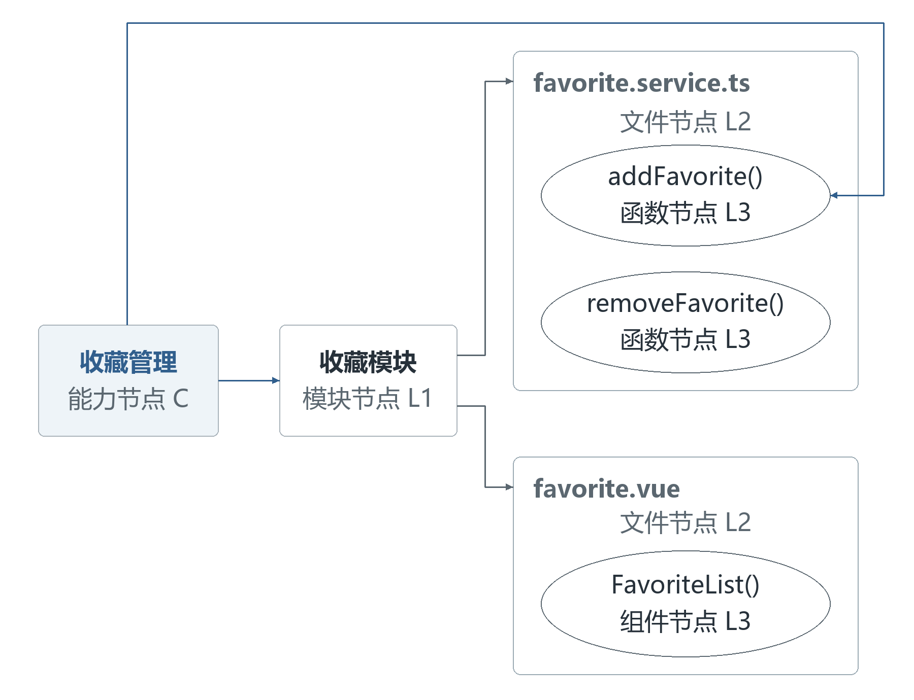

图2-4 软件项目知识图谱示例

Figure 2-4 An Example Knowledge Graph for a Software Project

知识图谱的构建通常包括本体设计、知识抽取和知识融合三个环节：本体确定实体类型、属性与关系的模式定义，抽取从数据源识别实体并建立关系，融合处理实体对齐与冲突消解。按覆盖范围划分，知识图谱可分为通用图谱与领域图谱：通用图谱面向开放领域，追求覆盖广度；领域图谱面向特定领域定制本体，追求知识的深度与精度。图谱中的关系还可以附带证据来源与置信度，使每条知识可追溯、可审核；图谱也可以随数据源变化局部更新，不必全量重建。存储上，Neo4j 等图数据库提供成熟的图查询能力，基于文件的轻量存储在部署成本与数据可控性上占优。

知识以三元组形式存入图谱后，使用它的第一步是找到与当前任务相关的知识点。图谱中的实体以符号命名，任务描述则是自然语言，两者之间的对齐依靠语义匹配。

嵌入向量是语义匹配的基础技术，它把文本或代码对象映射为低维稠密向量，使语义相近的对象在向量空间中相互邻近，如图 2-5 所示。例如任务描述"为用户增加收藏功能"与能力规范"收藏管理"的向量距离，会小于它与"订单结算"的距离。BERT 等预训练语言模型提升了句段级语义表示能力[57]；面向检索的文本嵌入模型把优化目标直接对齐为"相关文本向量相近"，C-Pack 提出的 BGE 系列是中文场景的代表[58]；代码侧，GraphCodeBERT 把数据流信息融入代码预训练表示[3]。

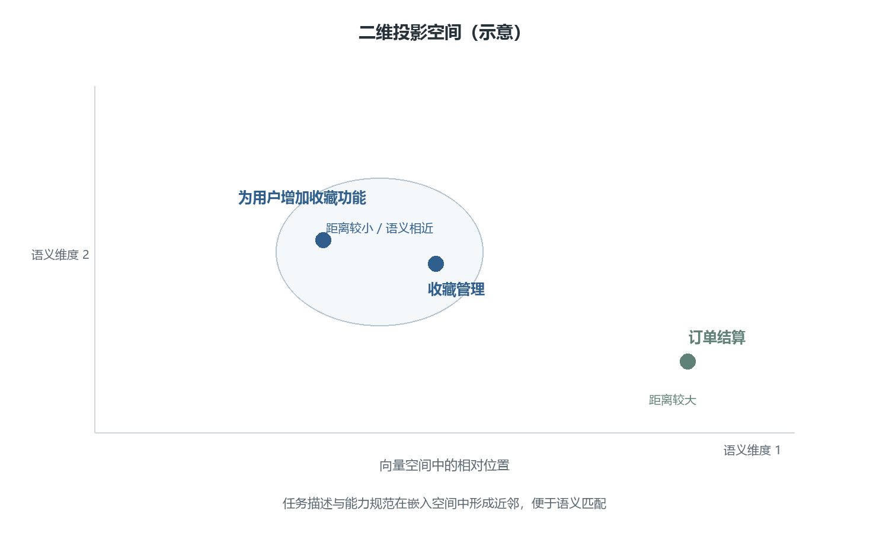

图2-5 嵌入向量空间中的语义邻近关系

Figure 2-5 Semantic Proximity in the Embedding Vector Space

两个向量的语义相近程度用余弦相似度度量：

$$\mathrm{sim}(u, v) = \frac{u \cdot v}{\|u\| \, \|v\|} \tag{2-3}$$

其中 $u$、$v$ 为两个对象的嵌入向量，$\mathrm{sim}(u, v)$ 取值越接近 1，表示两者语义越相近。工程上借助近似最近邻索引加速大规模向量检索。

语义匹配给出的是与任务最相近的入口节点。与任务相关的知识通常不止一个节点，而是入口周围的一片连通区域，要把这个范围有效地找出来，需要借助图结构与图搜索。

在图上圈定范围，先要用图模型描述结构。图由节点和边组成，边带有方向的图称为有向图，不含环路的有向图称为 DAG（Directed Acyclic Graph，有向无环图）。DAG 可以表达对象之间的先后依赖，若从节点 A 到节点 B 存在有向路径，A 就是 B 的前置。

图搜索是在图上圈定范围的基础操作。BFS（Breadth-First Search，宽度优先搜索）按与起点的距离逐层扩展节点，在无权图上可以找到最短路径；带权图上的经典方法有 Dijkstra 算法与最佳优先搜索；双向搜索从起点和目标集合同时扩展、中途会合，能缩小需要探索的搜索空间，适用于已知目标集合的大图检索。语义匹配确定入口、图搜索圈定范围，两者配合使知识图谱中的知识能够按任务粒度被取出使用。

## 2.4 SDD 开发方法

SDD 是针对 AI 开发过程约束问题形成的工作流路线，其共同点是把规格放在开发过程的组织核心，使开发活动围绕规格的编写、确认与实现展开。不同方法的严格程度不同，实践中形成规格先行、规格锚定、规格即事实源三种形态。后续研究考察了规格制品的实际作用：规格优先的智能体工作流已有实证研究[29]。这条路线已经解决的问题，是用规格与流程制品约束智能体行为、让开发过程可检查。

工程社区已有多个代表性实现。GitHub Spec Kit 以项目级治理为定位，围绕 Constitution（项目规范）、Specification（功能规格）、Plan（技术计划）和 Tasks（任务分解）四类制品组织开发，各阶段之间设 Clarify、Checklist、Analyze、Converge 等质量门禁[14]。OpenSpec 以变更管理为定位，以动作（Action）为中心建模工作流与制品图，把 Change 作为软件演化的基本工作单元，围绕变更组织规格制品的生命周期，制品间的依赖关系作为使能条件而非强制关卡[16]。Superpowers 以执行纪律为定位，用可组合技能和强制工作流约束智能体执行，覆盖需求澄清、计划编写、子代理驱动开发、测试驱动开发和多层代码审查等环节[15]。三者共同表明，用规格与流程制品约束智能体开发是可行路线。

## 2.5 本章小结

本章介绍了本文方法与 WPW 系统涉及的相关理论与关键技术。首先介绍了大语言模型的架构、能力边界和 AI 编程智能体的执行模式；然后介绍了代码上下文的获取与组织方式，以及窗口约束下的压缩与记忆等控制方法；接着按使用过程介绍了知识图谱的基本概念、对应知识点的语义匹配方法，以及圈定知识范围的图模型与图搜索；最后介绍了 SDD 开发方法的基本思想与代表性实现。这些技术分别对应方法设计与系统实现的不同侧面，为后续章节提供基础。

# 第 3 章 面向 AI 辅助开发的上下文工程方法

用 AI 编程智能体开发一个长期演化的项目时，每次任务开始，智能体都要自己搜索文件、读代码，把和当前需求相关的内容组织成上下文。项目代码量大、上下文窗口放不下时，这个过程要分多轮进行；对话变长后，早期读到的内容被挤出窗口，智能体又得重新搜索。更根本的问题在于，一项业务由哪些代码实现、上次需求为什么这么改，这些判断只留在当次对话里，会话结束就丢了，下一个需求到来时一切从头再来。项目知识不积累，重复搜索和重复理解的成本就越来越高。

本章针对这一现状提出面向 AI 辅助开发的上下文工程方法，思路是把上下文供给从"按任务临场构造"变成"以持续维护的项目知识为底座"。方法先把项目知识组织起来：用能力规范描述项目的业务能力，用源码解析得到模块、文件、函数三级代码结构，再把业务能力和代码映射到同一张知识图谱里，形成能力-代码双层知识模型。任务到来时，上下文生成方法在图谱上定位与任务相关的部分，裁剪、压缩成不超过 Token 预算的任务上下文交给智能体。需求完成归档时，当次开发产生的知识沉淀回能力规范，图谱只更新受影响的部分，项目知识随需求迭代持续积累。三项机制不是孤立运行的，六阶段流程约束架构把它们固定在 BRD、PRD、设计、计划、测试、实施的开发过程里，规定上下文在哪个阶段产生、被谁消费、何时更新。这样，上下文不再是每次任务重新搜索得来的临时产物，项目知识也不再随会话结束流失。

方法由 WPW 系统实现，其中知识组织与上下文生成机制接受实验评价，增量维护的长期效益不作独立实证结论。本章依次阐述方法总体框架、三项核心机制与流程约束架构。

## 3.1 方法总体框架

### 3.1.1 设计思路与总体闭环

方法的出发点，是把开发过程中的上下文供给从"按任务临时构造、用后即弃"转变为"以持续维护的项目知识模型为底座"。方法的总体框架如图3-1所示，其运行逻辑构成一个闭环：需求进入六阶段流程约束架构，被逐步规格化为阶段制品并沉淀为能力规范；能力规范生成知识图谱的业务能力层，与多语言源码解析得到的代码结构层建立关联，形成双层项目知识模型；开发任务到来时，上下文生成流水线在图谱上执行锚点选择、子图裁剪与压缩序列化，产出任务级上下文供给智能体；智能体在流程约束下完成实施后，代码变更与需求归档又反馈回知识模型，触发关联的增量更新。项目知识由此随开发过程循环积累，而非随任务结束流失。

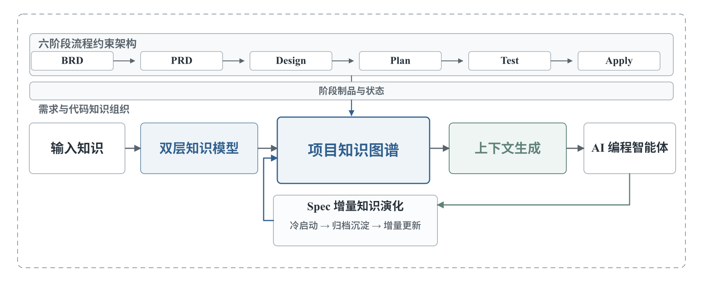

图3-1 方法总体框架

Figure 3-1 Overall Framework of the Method

从知识流动的角度，框架自底向上分为三层：数据来源层提供能力规范、需求过程文档、源码与 Git 历史四类原始知识；知识组织层通过解析、结构化与多源证据融合，将原始知识沉淀为稳态知识库与知识图谱；智能体消费层经上下文生成流水线把知识转化为智能体可消费的任务上下文。项目知识按生命周期特征分为两类：描述项目长期业务能力、随需求归档持续沉淀的稳态知识，与服务于当前开发任务、随六阶段流程产生的过程知识。两类知识的划分与转化是 Spec 增量知识演化机制的基础：过程知识在需求归档时经沉淀机制并入稳态知识，使业务知识不随需求结束而流失。

### 3.1.2 机制构成与流程整合

方法由知识建模、上下文生成、知识演化三项机制和作为整合框架的流程约束架构组成，四者分工不同。知识建模机制把业务能力和代码放进同一个项目知识模型：用能力规范描述业务能力，用源码解析得到模块、文件、函数三级结构，再把业务与代码之间的映射建立为图谱中的关联边，一项业务由哪些代码实现由此可以随时查询。上下文生成机制在任务到来时工作：按任务描述在图谱中选定入口节点，沿关联边扩展取出相关子图，再按 Token 预算压缩成任务上下文交给智能体，上下文来自持续维护的项目知识，而不是当次任务的临时拼接。知识演化机制在需求完成时工作：以需求 Spec 为更新单元，把当次开发产生的知识沉淀回能力规范，只重建图谱中受影响的部分，项目知识随需求一轮轮积累下来。流程约束架构不直接产生知识，它把三项机制固定进开发过程，规定上下文在哪个阶段产生、被谁消费、何时更新，使三项机制嵌入真实开发流程，而不是游离于开发之外的独立工具。

在验证设计上，实验部分分三步考察方法：先用一组功能测试检查系统实现与设计是否一致；再在任务级开发实验中，让 WPW 与 OpenSpec 从相同的前置版本出发完成同样的开发任务，比较任务完成情况、模型 Token 消耗和执行耗时；最后在同一代码快照上，用相同的题集、评分规则和运行配置，分别在非 KG、WPW-Map 和完整 WPW 三种条件下运行项目场景检索与问答任务，比较文件定位质量、回答正确性和上下文开销。任务级比较同时包含流程、知识供给和上下文组织几个方面的差别，给出的是两套方法配置的整体结果；图谱在上下文获取环节的作用由第三步单独考察。流程约束在开发实验中作为共同基础，并通过过程记录说明其执行情况，而不与无流程方法混合比较。Spec 增量维护作为系统能力保留，但本文不以单一项目中的短序列实验宣称其长期有效性。以下各节依次阐述三项核心机制，最后阐述将三者整合进开发过程的流程约束架构。

## 3.2 知识建模

本节的知识建模定位与以代码本身为建模对象的代码属性图（Code Property Graph）[36]等代码结构图谱不同：本文的知识模型在代码结构层之上引入业务能力层，将业务能力节点作为上层语义锚点，使模型不仅能够回答"代码结构是什么"，还能够回答"这段代码服务于什么业务能力"。这一定位针对现有研究的空白：智能体任务上下文的生成需要业务语义与代码结构的双重知识，而非单纯的代码关系图。

### 3.2.1 本体设计：双层四层结构

知识模型采用"能力-结构"双层四层本体：C 层为业务能力节点，表达项目长期稳定的业务语义；L1 层为模块节点（业务模块，带 frontend/backend 侧别属性）；L2 层为文件节点；L3 层为代码元素节点（函数、类、接口、常量及各状态管理生态元素）。

C 层节点的数据来源是能力规范。能力规范以 OpenSpec 规格格式组织，每个能力对应一个子目录及其 spec.md 文件，采用 Purpose（能力目的）、Requirements（需求条目）、Scenarios（验收场景）三段式结构，描述项目长期存在的业务能力（如"用户认证""订单管理"）。能力规范既是业务能力层的唯一数据来源，也是业务-代码关联映射的语义基准。结构层节点则由源码解析生成：源码目录结构经模块推断生成 L1 节点，文件解析生成 L2 节点，文件内代码元素解析生成 L3 节点。

结构层划分为三层而非单层或两层，是因为三个粒度分别对应智能体开发任务中的三类定位需求：模块层承担**业务边界定位**（影响范围分析--"该需求波及哪些业务模块"），文件层承担**代码物理定位**（文件检索--"修改发生在哪些文件"），元素层承担**修改粒度定位**（代码编辑--"具体修改哪个函数/类"）。三层缺一，任务上下文即缺失一级定位能力；C 层则在三者之上提供业务语义锚点，使自然语言任务描述能够经"能力 -> 模块 -> 文件 -> 元素"的路径逐级落地到代码。

以"用户认证"能力为例：C 层节点 user-auth（携带能力描述与功能条目）经 business_map 边映射至 L1 模块 auth（business_map 权重 0.85，溯源标签 doc-extract）；auth 模块经 contain 边包含 L2 文件 login.vue 与 auth.service.ts；login.vue 经 contain 边包含 L3 元素 handleLogin()（携带 filePath 与 parentName 属性）。当智能体接受"修改登录逻辑"类任务时，语义检索命中 user-auth 能力节点后，即可沿该路径展开结构完整的任务上下文。

结构层内部以 contain（包含）边构成层级树（L1 ⊃ L2 ⊃ L3），以 import（导入）边表达文件间依赖，以 call（调用）边表达组件对状态管理 action 的调用；C 层与结构层之间以 business_map（业务映射）边连接，**不使用 contain 边**--业务能力与代码结构是"映射"而非"包含"关系，这是本模型与单一层级代码图谱（如以文件系统包含关系为主体的代码属性图[36]）在语义上的本质区别，也是业务能力节点能够作为上层语义锚点参与检索与裁剪的前提。图谱的边类型定义如表3-1所示。

表3-1 图谱边类型

Table 3-1 Graph Edge Types

| 边类型 | 语义 | 方向 | 权重 | 来源 |
|---|---|---|---|---|
| contain | 层级包含（模块⊃文件⊃元素） | 上层 -> 下层 | 0.9 | 结构解析 |
| import | 文件间导入依赖 | 导入方 -> 被导入方 | 0.75 | 结构解析 |
| call | 组件调用状态管理 action | 调用方 -> action | 0.6 | 结构解析 |
| business_map | 业务能力映射到结构层节点 | C -> L1/L2/L3 | noisy-OR 聚合（≤0.95） | 多源证据融合 |

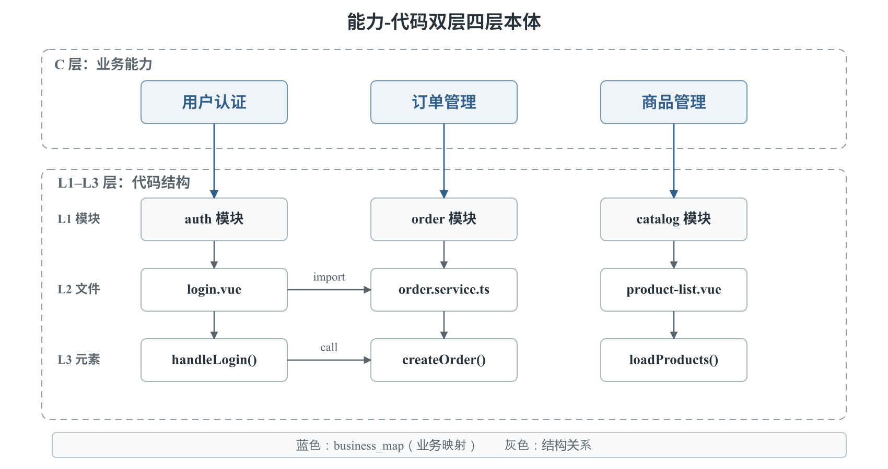

图3-2 能力-代码双层本体模型

Figure 3-2 Capability-Code Two-Layer Ontology Model

### 3.2.2 结构层构建：多语言源码解析与存储

结构层节点的抽取基于 web-tree-sitter 的语法树解析完成。选择 tree-sitter 而非 Babel Parser、TypeScript Compiler API 等单语言 AST 工具作为统一解析基础，基于四点考虑：其一，多语言统一接口--tree-sitter 为不同语言提供一致的节点遍历与字段访问 API（Application Programming Interface，应用程序接口），使解析器可按统一模式扩展至 TS/JS/Vue/Java 等语言，而单语言工具需为每门语言维护独立适配层；其二，增量解析能力--tree-sitter 原生支持基于旧语法树的增量重解析，与图谱的增量更新机制天然契合；其三，容错性--其在语法错误处仍能产出局部可用的语法树，适合解析真实项目中不完整或含方言的代码；其四，跨语言一致性--面向前后端全栈项目需要统一的多语言解析管线。

在解析策略上，考虑到不同语言的解析成本差异，系统采用"快速预检 + 完整解析"的两级策略：先以轻量级特征检测（路径特征与内容特征，如 Pinia store 文件的 defineStore 调用特征）判断文件是否属于特定扩展类型，命中后再调用对应解析器执行完整的语法树解析，避免对所有文件无差别执行重解析。解析覆盖范围为：TypeScript/TSX/JavaScript/JSX 提取函数、类、接口、常量与导入关系；Vue 单文件组件提取 script 块并复用 TS/JS 解析；Java（Spring Boot）提取类型（class/interface/enum/record）、方法、常量、注解与 REST 端点元信息；Pinia/Vuex/Redux 提取 store、action、getter、state 等状态管理元素；小程序与 uni-app 提取页面、组件、生命周期与路由关系。

同名代码元素（如多个组件中的 onSubmit 函数）是代码检索与语义匹配的主要噪声来源。为此，所有 L3 元素节点在生成时强制携带两类上下文属性：filePath（所属文件相对路径）与 parentName（所属上层容器名，如类名、store 名或模块文件名）。该设计使后续的向量富化与检索结果展示能够以"容器/元素"的形式区分同名实体，其作用在冻结检索题集的定位指标和项目场景问答的证据覆盖中进行检验。L3 节点的完整属性定义如表3-2所示。

表3-2 L3 代码元素节点属性定义

Table 3-2 Attribute Definitions of L3 Code Element Nodes

| 字段 | 类型 | 说明 |
|---|---|---|
| id | string | 节点唯一标识（类型前缀 + 内容哈希） |
| type | enum | function / class / interface / constant 及状态管理元素类型 |
| name | string | 元素名称（方法节点带父容器前缀，如 `UserService.findById`） |
| filePath | string | 所属文件相对路径（去歧义） |
| parentName | string | 父容器名：类名/store 名/模块文件名（去歧义） |
| signature | string | 函数签名或类型声明摘要 |
| params | array | 参数列表（名称与类型） |
| returnType | string | 返回类型 |
| annotations | array | 装饰器/注解（Java Spring 注解等） |
| jsDoc | string | JSDoc/Javadoc 注释摘要（参与向量富化） |
| lineStart/lineEnd | number | 源码行号范围 |

实体抽取上，C 层实体由能力规范解析器遍历能力规范目录生成，节点名取能力目录名，携带 description 与 features 属性；结构层实体由上述多语言解析器从语法树抽取。所有节点 ID 采用"类型前缀 + 内容哈希（SHA-256 前 12 位十六进制）"的确定性生成方式，相同内容必然生成相同 ID，保证图谱重建的幂等性，也为增量更新提供基础。语义匹配所需的节点向量在实体抽取后构建：向量输入文本对节点类型分层富化，L3 元素节点的向量文本为"文件路径 + 父容器名 + 节点名 + 注释文本"的拼接，中文注释（JSDoc/Javadoc）的纳入显著提升了中文业务语句与代码元素之间的语义检索效果。

知识模型采用纯文件系统存储，不引入数据库：能力规范以 Markdown 加结构化字段存储；知识图谱的节点与边以 JSONL 逐行存储；语义向量以二进制文件存储并配合映射索引；构建元数据（schema 版本、文件哈希快照、扫描根、项目类型等）存于元数据文件。文件系统存储使知识库天然具备版本可控（可随代码一同提交至 Git）、人机可读、零部署成本的特性，与图谱的增量更新机制相配合，普通开发环境即可运行。

### 3.2.3 业务-代码关联：多源证据融合

知识模型构建的关键问题是建立 C 层业务能力与 L1/L2/L3 结构层节点之间的关联（business_map 边）。需求-代码追踪研究表明，人工建立并维护此类关联的成本高昂[25,27]，自动追踪方法则长期面临准确率与召回率的权衡[26]。本文的定位并非提出新的追踪算法，而是面向智能体上下文生成场景，将多类启发式证据以概率模型融合，以较低成本获得"可用且可溯源"的业务-代码关联，并通过权重剪枝控制噪声。business_map 边的生成流程为：能力节点 -> 候选召回 -> 四类证据计算 -> noisy-OR 融合 -> 阈值过滤 -> business_map 边，如图3-3所示。

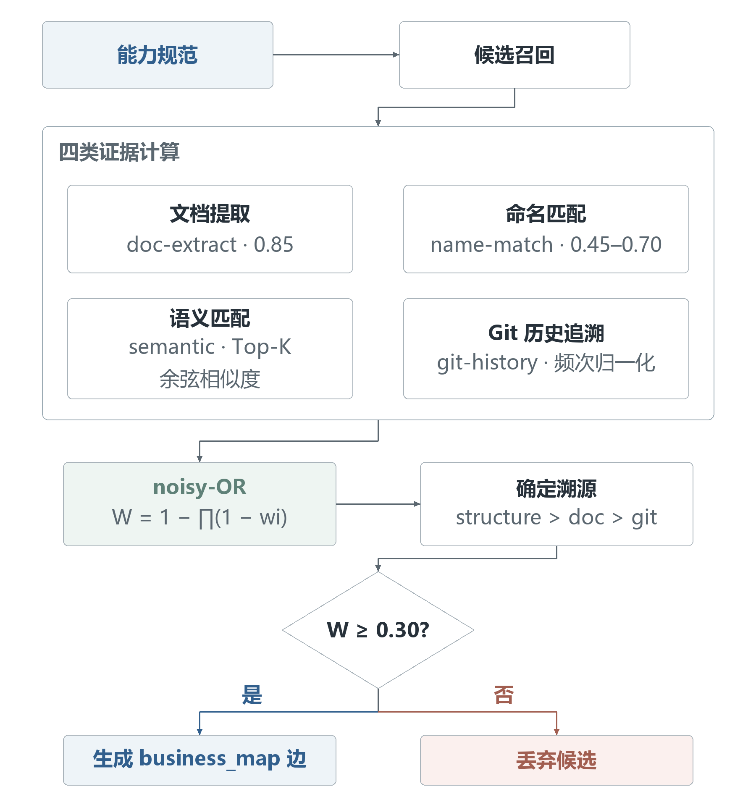

图3-3 business_map 生成流程

Figure 3-3 business_map Generation Process

**（1）证据源设计**。系统实现了四类自动化证据源，各证据源的机制与权重参数如表3-3所示。

表3-3 多源证据体系

Table 3-3 Multi-Source Evidence System

| 证据源 | 机制 | 基础权重 | 权重上限 |
|---|---|---|---|
| 文档提取（doc-extract） | 从能力规范的 Purpose/Requirements 章节抽取模块名与关键词，直接匹配图谱中的 L1/L2 节点 | 0.85 | 0.85 |
| 命名匹配（name-match） | 中英文词典（≥30 词条）翻译匹配 + 前缀/包含匹配，命中能力名与节点名 | 0.45（词典）~0.60（直接包含） | 0.70 |
| 语义匹配（semantic） | 能力节点与 L1/L2 节点向量的余弦相似度线性映射，每能力取 Top-K（K=5）候选 | 相似度线性映射 | 0.70 |
| Git 历史追溯（git-history） | 以能力名与关键词检索提交历史，统计匹配提交修改文件的频次并归一化（频次 ≥2 方可作为证据） | 频次归一化映射 | 0.70 |

四类证据源分别从"文档明示""命名约定""语义相似""演化关联"四个独立视角建立关联假设，其证据特征彼此互补：文档提取权威性最高但覆盖受限于规范书写完整度；语义匹配覆盖面广但受向量表示质量影响；Git 历史反映长期实践关联但对新项目（冷启动）失效。表中基础权重与上限为启发式经验设置的初始值，其取值在实验前固定，作为固定实现使用，不在正式运行中调整；本文的重点不在事后调参，而在检验图谱增强的任务上下文能否降低代码定位与获取的开销。

**（2）noisy-OR 权重聚合**。同一目标节点被多个证据源命中时，采用 noisy-OR 概率模型聚合各源权重：

$$W = 1 - \prod_{i=1}^{n}(1 - w_i) \tag{3-1}$$

其中 $w_i$ 为第 $i$ 个证据源对该目标的基础权重，$W$ 为聚合权重，上限截断为 0.95。采用 noisy-OR 的依据是：将各证据源视为对"该节点属于该业务能力"这一事件的独立概率化支持，多源命中的可信度应严格高于任一单源（除非已达上限），该性质与证据互补的设计意图一致。例如，某文件节点同时被文档提取（$w_1=0.85$）与语义匹配（$w_2=0.60$）命中，则聚合权重 $W = 1-(1-0.85)(1-0.60) = 0.94$，高于任一单源。相对于最大权重、加权平均等聚合方式，noisy-OR 对多源确认更敏感且无需预设源间权重超参。本文将该聚合规则作为固定实现，不在冻结的题集上事后选择参数；它对任务上下文的实际作用，通过图谱增强的上下文获取对比一并观察。

**（3）证据权威性排名与溯源**。不同证据源的可信度存在差异，系统为每条 business_map 边记录支撑该边的最权威证据源，权威性排名为：structure（结构证据）> doc-extract > ai-refine（预留）> git-history > semantic > name-match。该排名在多源命中时决定边溯源标签的取值，使每条业务映射边可回溯至其最可信的证据来源，支撑可追溯性维度的评估。

**（4）低权重剪枝**。聚合权重低于 0.3 的候选关联不生成边，以控制图谱噪声规模。剪枝阈值与各源权重参数共同构成映射质量的调控面，其取值在实验前固定，不随实验过程调整。

### 3.2.4 与相关工作的区别

结构化仓库知识服务智能体已成为经过验证的技术路线，本节从知识对象与生命周期角度给出本模型与代表性相关工作的显式对比，如表3-4所示。

表3-4 与代表性相关工作的知识模型对比

Table 3-4 Comparison of Knowledge Models with Representative Related Work

| 方法 | 核心知识对象 | 业务语义 | 需求演化 | 上下文生成方式 |
|---|---|---|---|---|
| 代码属性图[36] | 函数/类等代码实体及其结构关系 | 无（定义于程序结构层面） | 不涉及（面向静态分析任务） | 不提供（分析查询为主） |
| 需求追踪方法[25-27] | 需求条目与代码制品的链接 | 需求侧语义，作为追踪目标 | 多为一次性恢复，非持续维护 | 不提供 |
| 本文模型 | 业务能力（Spec 驱动）+ 模块/文件/元素 | 业务能力为一等知识对象与语义锚点 | Spec/Change 为触发单元的增量演化 | 图谱驱动任务级上下文生成 |

与本文关注的业务能力—代码关联相近，刘龙把上下文工程用于知识图谱构建[46]，CoRAG 把 AST 检索用于代码重构[40]，检索增强与智能体协同的方法把检索结果用于代码生成[41]；这些工作在知识对象或演化机制上与本模型不同。

从对比可见，本模型与代码结构图谱的区别在于在代码实体之上引入业务能力层；与需求追踪方法的区别在于关联面向项目长期演化持续维护而非一次性恢复；与仓库知识图谱方法的区别在于知识对象与驱动方式--后者的节点是代码实体、架构依赖或 Issue-PR 等开发制品，回答"项目架构与制品结构是什么"，本模型以业务能力为长期语义锚点，回答"项目有哪些业务能力、由什么代码实现、如何随需求演化、如何进入任务上下文"。本文的创新不在于采用知识图谱这一技术形式，而在于面向 AI 编程智能体定义的 Capability-Code 知识结构，及其随 Spec 演化持续更新的组织机制：业务能力作为显式的一等知识对象，其生命周期由 Spec/Change 驱动，这正是表中"需求演化"一列的差异所在，也是演化机制的设计前提。

## 3.3 上下文生成

### 3.3.1 从文本检索到结构感知生成

常规 RAG 方法将文档切片后以向量相似度检索并拼接注入[2]；在代码场景中，已有工作把 AST 检索用于重构[40]，检索增强生成在软件工程中的应用也已有系统综述[30]，但该范式应用于代码场景仍存在两个不适配：其一，代码的语义不仅存在于文本，更存在于结构（调用、包含、导入关系）之中[3,36]，纯文本检索无法保证返回的任务上下文在结构上连贯；其二，检索结果的注入规模缺乏结构化的预算控制，容易重现"Lost in the Middle"[5]的信息利用问题。因此，本文的上下文生成方法不采用"检索文档片段"的思路，而是**在知识图谱上执行结构约束的子图裁剪**：以图结构保证上下文的连通性与层次完整性，以图算法（而非人工整理）控制注入规模。本方法并非替代向量检索，而是在向量检索提供候选入口（锚点）之后，引入代码结构图约束完成上下文的组织、裁剪与压缩--向量检索解决"从哪里进入图谱"，图结构约束解决"进入后取什么、取多少"。

该方法的目标不是检索代码，而是为智能体生成**最小充分上下文**：给定自然语言任务描述 $q$、Token 预算 $B$ 和项目知识图谱 $G=(V,E)$，从图谱中选取并压缩产出上下文 $C$，在 $\mathrm{tokens}(C) \le B$ 的约束下最大化 $C$ 与 $q$ 的任务相关性。生成流水线分为四个阶段：锚点选择 -> 子图裁剪 -> 骨架抽取 -> 序列化输出；当序列化结果超过预算时，沿五级降级链回到子图裁剪阶段重新生成，直至满足预算约束，如图3-4所示。

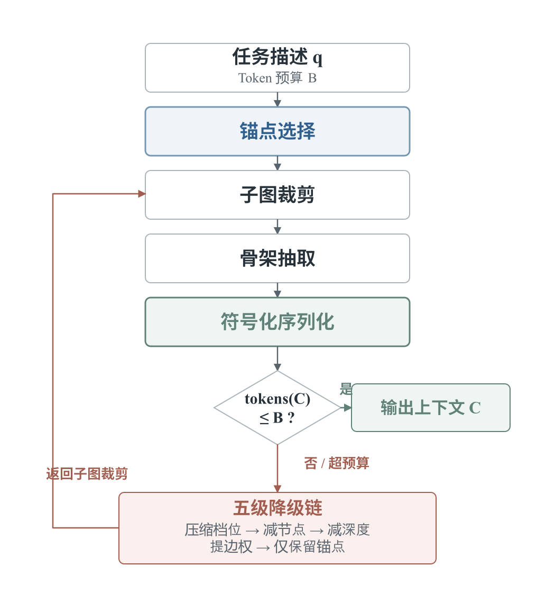

图3-4 图谱驱动的任务上下文生成流水线

Figure 3-4 Graph-Driven Task-Context Generation Pipeline

### 3.3.2 置信度衰减加权的锚点选择

锚点（anchor）是上下文生成的起点节点。给定自然语言任务描述，系统通过语义检索在图谱中定位初始锚点候选；对于业务能力类任务，以能力节点（C 层）为入口，经 business_map 边扩展至结构层锚点。能力节点 $c$ 的置信度 $\mathrm{Conf}_C$ 由其关联的 business_map 边证据强度聚合而来：

$$\mathrm{Conf}_C = 1 - \prod_{e \in E_c}(1 - W_e) \tag{3-2}$$

其中 $E_c$ 为能力节点 $c$ 关联的 business_map 边集合，$W_e$ 为边 $e$ 的聚合权重。$\mathrm{Conf}_C$ 越高，表明该能力与代码结构的映射越被多源证据确认。

锚点扩展面临模块膨胀问题：若某能力的置信度已经很高，继续向 L1 模块层扩展锚点会引入大量低相关模块；反之若置信度低，仅靠能力入口召回不足。为此引入置信度衰减加权：

$$w_{L1} = \exp(-\alpha \cdot \mathrm{Conf}_C), \quad \alpha = 3.0 \tag{3-3}$$

其中 $w_{L1}$ 为 L1 层锚点的扩展权重，$\mathrm{Conf}_C \in [0,1]$ 为能力置信度。高置信能力抑制模块层扩展（其映射已足够聚焦），低置信能力放开扩展以保证召回；冷启动场景（能力规范缺失、Conf_C 不可得）时退化为纯结构检索，不阻塞流程。

### 3.3.3 加权双向 BFS 子图裁剪

从多个锚点出发，在图上执行加权双向广度优先搜索：既沿出边（下游依赖）也沿入边（上游依赖）扩展，支持经 business_map 边跨层扩展。选择 BFS 而非其他图遍历策略基于任务特性考量：其一，相对于深度优先搜索--后者容易沿单条依赖链进入局部深层的传递依赖（如工具函数的层层调用），偏离任务主体，而代码任务的影响范围通常集中在锚点附近的浅层邻域；其二，相对于 Dijkstra 类最短路径算法--其精确距离计算在大图上的成本较高，而上下文生成对"跳数级别的近似距离"已足够敏感（距离衰减因子按跳数设计）；其三，BFS 按层扩展的特性天然与"距离锚点越近越重要"的骨架分级假设一致，且扩展深度即为预算控制参数，二者统一。

以模块节点为锚点向相邻文件和函数节点扩展的示例如图3-5所示。

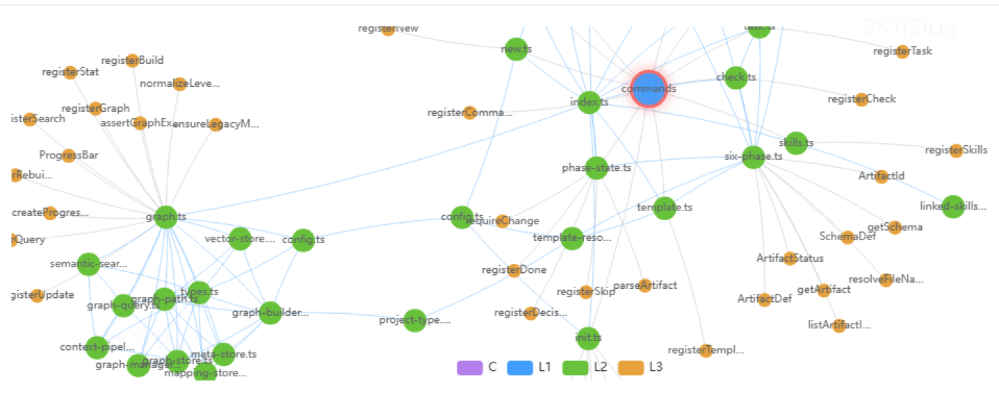

图3-5 加权双向 BFS 子图扩展示意

Figure 3-5 Weighted Bidirectional BFS Subgraph Expansion

扩展过程中每个候选节点按复合评分排序：

$$\mathrm{score}(v) = \lambda_s \cdot \mathrm{sem}(v) + \lambda_t \cdot \mathrm{struct}(v), \quad \lambda_s = 0.6,\ \lambda_t = 0.4 \tag{3-4}$$

$$\mathrm{sem}(v) = \mathrm{sim}(q, v) \cdot \exp(-\beta \cdot d(v)), \quad \mathrm{struct}(v) = \mathrm{deg}(v) \text{ 归一化} \tag{3-5}$$

其中 $\mathrm{sim}(q,v)$ 为任务描述与节点向量的余弦相似度，$d(v)$ 为节点到最近锚点的跳数（距离衰减因子 $\beta$ 控制语义分随距离的衰减），$\mathrm{struct}(v)$ 为节点结构重要度（以度数归一化近似）。裁剪受三类预算约束：最大深度（默认 3）、最小边权重（默认 0.7，低于该权重的边不沿其扩展）与节点上限（默认 100）。

### 3.3.4 骨架抽取、序列化与 Token 预算控制

裁剪后的子图仍包含大量与锚点距离较远的细节节点，直接序列化会造成信息稀释。骨架抽取按节点到锚点的距离分级保留信息：距离 0（锚点）保留完整属性与签名；距离 1 保留标准信息（名称、类型、关键属性）；距离 ≥2 仅保留最小骨架（名称与层级）。序列化输出采用层级符号化表示，以 ⊃ 表达包含、-> 表达依赖、⇄ 表达双向关联，◉ 标记锚点，使同等信息量下的 Token 占用显著低于自然语言描述或 JSON 全量输出。

在骨架分级基础上提供三档压缩等级（loose/standard/extreme），档位递进时提高距离阈值、削减保留属性、收紧 Token 上限，供上层按任务预算选择，三档的参数对比如表3-5所示；其三档参数在实验前固定，压缩后的上下文 Token 与必要文件覆盖在上下文获取对比中随图谱增强的一组一并记录。

表3-5 三档压缩策略参数对比

Table 3-5 Parameter Comparison of Three Compression Levels

| 压缩档位 | 节点规模（默认） | 信息保留粒度 | 典型 Token 上限（参考） |
|---|---|---|---|
| loose | 约 100 节点 | 锚点与距离 1 节点保留较完整属性与签名 | 约 8K |
| standard | 约 60 节点 | 锚点完整、距离 1 标准、其余骨架 | 约 4K |
| extreme | 约 30 节点 | 仅锚点标准信息，其余最小骨架 | 约 2K |

注：表中节点数与 Token 上限为默认参考值，实际由 Token 预算迭代控制动态决定；具体数值以实验实测为准。

固定示例的节点规模为 100 时，三档输出的属性保留粒度与 Token 占用如图3-6所示；图中数字仅反映该示例，不代表各档位的默认节点数或实验均值。

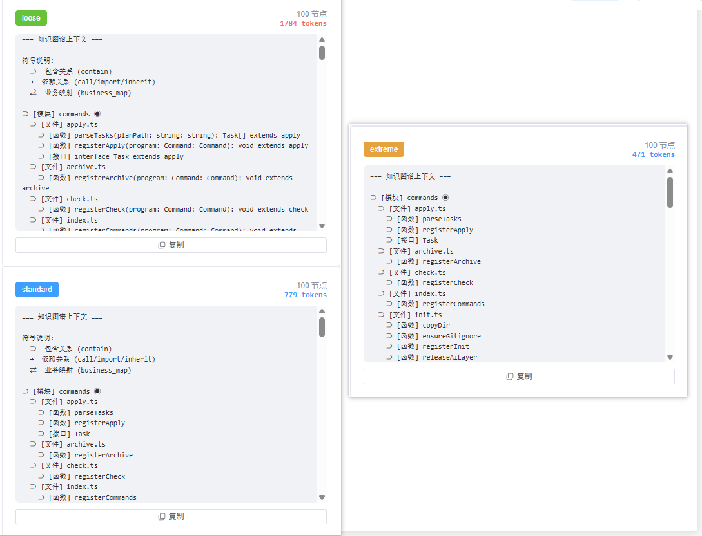

图3-6 三档压缩对比

Figure 3-6 Comparison of Three Compression Levels

给定用户或上层指定的 Token 预算，序列化输出若超预算，按五级降级链迭代执行直至满足：降低压缩档位 -> 削减节点数 -> 削减扩展深度 -> 提高边权重阈值 -> 仅保留锚点；锚点在任何降级层级下始终保留，保证上下文不失去任务焦点。此外流水线设三级系统级降级：向量索引缺失时退化为结构检索；图谱缺失时退化为文件系统提示；序列化失败时输出锚点清单，确保上下文生成环节不阻塞开发流程。

## 3.4 知识演化

### 3.4.1 演化触发单元与总体流程

软件项目的知识价值随演化积累，而知识模型只有在与开发过程同步更新时才能保持时效。与面向网络威胁情报等特定领域的知识图谱构建[46]相比，本文的关注点不是一次性建图，而是知识随开发过程持续演化。本文提出的 Spec 增量知识演化机制并非一般意义上的图谱增量更新，其核心是把需求 Spec 及其变更（Change）作为知识演化的触发单元：需求是业务知识变化的源头，一个需求要么为项目引入新能力，要么增强已有能力，要么引发结构调整，知识模型中业务语义侧的每次变化都应能追溯到一个具体的 Spec/Change。

演化机制覆盖存量项目的完整流程如下：新需求进入六阶段流程后，先被规格化为 Spec 提案；归档阶段对已交付需求进行能力归属分析--若需求归属于已有能力，其增量内容以 delta 方式合并入对应能力规范，若属于新能力领域，则创建新的能力规范；能力规范的变更同步触发知识图谱更新，C 层节点随规范增删改，业务-代码关联边随规范内容与代码变更重新计算，代码结构层则由文件级增量解析维护。在此流程中，Capability 层承担稳定中间层的角色：具体需求易变、代码实现常改，而业务能力相对稳定，以能力为锚点使"需求 -> 能力 -> 代码"的关联在持续变更中保持连续，避免知识模型随每次需求更替而碎片化。

### 3.4.2 知识冷启动

演化机制以既有知识模型为前提，新项目或不具备能力规范的存量项目则需要知识冷启动：由"源码扫描 + 需求 Spec"生成初始知识模型。源码扫描对项目源码全量执行多语言解析，构建完整的 L1/L2/L3 结构层；需求侧则从项目已有的需求文档或首轮六阶段流程产出的 BRD/PRD 中提炼初始能力规范，生成 C 层节点并计算业务-代码关联。冷启动阶段的知识模型具有明显的证据局限：项目尚无或很少有 Git 历史，git-history 证据源失效；能力规范初建、书写不完整，doc-extract 证据覆盖受限，关联主要依赖语义匹配与命名匹配建立。随着项目在流程约束下持续交付需求，规范和提交历史可能逐步补充四类证据源；这一长期质量变化属于后续工作，本文不作实证结论。

### 3.4.3 过程知识沉淀与图谱增量更新

演化机制的落点有二：过程知识向稳态知识的沉淀，与知识图谱的增量更新。

在知识沉淀方面，六阶段流程在执行过程中产出需求文档、能力规格提案、技术方案、开发计划与测试方案等过程知识，服务于当前开发任务；归档时系统能力归属分析与 delta 合并机制把已交付需求的业务内容并入能力规范，完成过程知识向稳态知识的转化，使业务知识以机器可解析的规格形式持续积累，而非散落在一次性过程文档中。能力归属分析与合并由 AI 层在流程约束下执行并经用户确认，系统提供目录约定、格式校验与图谱增量更新保障其落盘一致性。

在图谱增量更新方面，全量重建对中型项目成本较高，系统支持基于文件哈希快照的增量更新：对比当前源码文件哈希与元数据中记录的历史快照，仅对新增与变更文件重新解析并重建其关联节点与出边；同时检测能力规范的增删改，同步更新 C 层节点及其关联边。节点 ID 的确定性生成保证了未变更部分在增量更新前后保持一致。已知局限是：被引用方（如被重命名或删除的类）自身的变更不会触发引用它的其他未变更文件的入边重建，可能产生悬挂引用；系统在完整性校验阶段对此输出告警，并建议在结构性重构后执行全量重建。

该机制是工程化的知识积累而非机器学习过程：不依赖训练数据与模型更新，知识增长完全由开发过程中的规格化、解析与证据计算等确定性或可审计操作驱动。本文验证系统能否执行增量更新，不进一步宣称多轮积累必然降低上下文构建时间、Token 消耗或提高召回率。

## 3.5 流程约束架构

### 3.5.1 设计动机与六阶段开发流程

大语言模型的生成过程具有非确定性，而软件工程流程要求确定性的阶段推进与可审计的过程状态。在无约束的对话式开发中，智能体的行为状态隐含在对话历史里：需求理解、方案选择与实施进度对外不可见，一旦对话上下文膨胀或会话中断，过程状态即不可恢复，返工与需求遗漏也难以定位。流程约束架构针对这一问题，把开发过程组织为显式的阶段流转，使智能体的行为状态成为可检查、可恢复的项目资产。

WPW 将开发过程组织为 BRD、PRD、Design（技术设计）、Plan（开发计划）、Test（测试方案）、Apply（编码实施）六个核心阶段，另有可选的 Explore（技术探索）阶段。每个阶段产出明确的阶段制品：业务需求文档、产品需求文档、技术设计文档、开发计划、测试方案与代码变更，探索阶段产出探索报告。阶段间的推进受三类控制：**强依赖检查**要求前置阶段完成后才能进入下一阶段；**弱依赖**允许设计阶段在探索报告缺失时跳过读取；**拍板门禁**要求探索报告落盘后由用户显式拍板，方可进入设计阶段。依赖与门禁由系统而非智能体自律保证：智能体不能跳过未完成的前置阶段，阶段推进必须经系统校验。由此，开发过程从"智能体自由规划路径"转变为"系统约束下的阶段流转"，每一阶段何时进入、产出什么、由谁确认都是确定的。

### 3.5.2 三段式编排契约与状态留痕

每个阶段的执行遵循统一的三段式编排契约。**准备段**由系统完成阶段工作区创建、依赖检查与模板下发；**生成段**由智能体按模板生成阶段制品，输出大纲经用户确认后落盘；**收尾段**由系统校验产物、更新阶段状态并触发后续处理（如代码审查）。三段式契约把确定性操作与生成性操作分开：状态变更、依赖判定、文件组织等确定性逻辑全部收归系统，智能体只承担理解与生成，且不直接修改过程状态文件。这一职责划分从机制上避免了智能体隐式改写状态造成的过程漂移，也使流程对任意底层模型保持一致的行为约束。

与阶段流转相配合的是状态留痕：项目级阶段状态显式记录于状态文件，每次阶段完成、跳过与拍板均留下可追溯记录，任意时点的项目状态可查询、可恢复。流程约束的整体设计遵循四条原则：状态确定性，即状态变更必经系统、显式留痕；权限边界，即智能体不直接修改状态文件，制品落盘前必须经用户确认；人机协同，即拍板等关键决策由人执行，智能体负责生成与建议；可恢复性，即支持断点续作，知识设施缺失时降级容错、不阻塞开发。流程约束架构的目标是控制智能体的行为状态与过程可审计性，而非提升单次生成效率；它不替代 Agent 运行框架的执行能力，研究的是执行过程之上的流程组织与上下文供给方式。

### 3.5.3 流程中的上下文请求与消费

流程约束架构同时规定了上下文在开发过程中的请求与消费方式，这也是其作为方法整合框架的角色所在。其一，阶段制品本身构成受控的上下文载体：后续阶段自动获得前序制品，如产品需求阶段读取业务需求文档、设计阶段读取产品需求文档，智能体无需在对话中重复携带项目背景，过程知识随流程定向流动而非在对话中逐轮膨胀。其二，实施阶段的上下文由知识模型供给：实施准备阶段返回任务清单与上下文文件清单，前文的上下文生成流水线嵌入其中，为编码任务提供任务级结构化上下文。其三，需求归档触发知识更新：归档时过程知识经沉淀机制并入能力规范，知识图谱同步增量更新，完成过程知识向稳态知识的转化。

流程约束架构在制品化与门禁化等设计思想上借鉴了 Spec 驱动开发方法，两者的不同在于知识对象的生命周期：已有方法的规格制品服务于当次开发过程，需求交付后即归档沉寂；本文将 Spec 及其变更从过程制品进一步扩展为项目长期知识演化的触发单元，使流程不仅约束智能体行为，还持续生产与更新项目知识。这一扩展由双层知识模型与增量演化机制承载，前文已分别阐述。

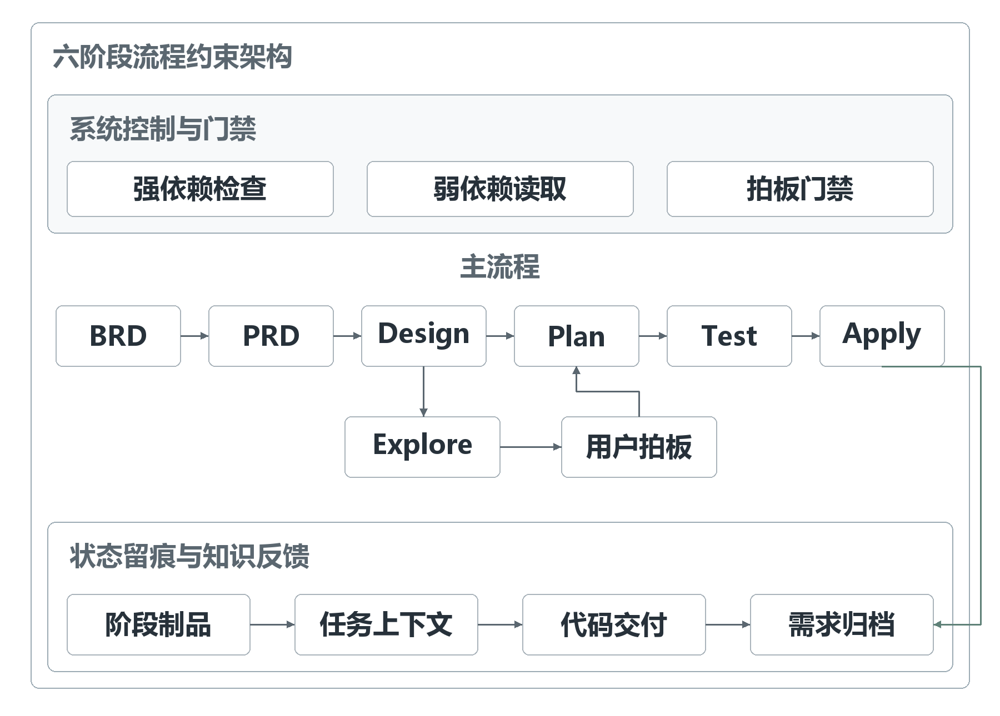

图3-7 六阶段流程约束架构

Figure 3-7 Six-Stage Process-Constrained Architecture

## 3.6 本章小结

本章提出了面向 AI 辅助开发的上下文工程方法。方法总体框架以"需求 -> 流程 -> 知识 -> 上下文 -> 执行 -> 反馈"的闭环组织：能力-代码双层知识模型以 C/L1/L2/L3 四层结构与 business_map 映射边建立业务语义与代码结构的统一表示，业务-代码关联由文档提取、命名匹配、语义匹配与 Git 历史四类证据源经 noisy-OR 概率融合自动建立，每条关联可溯源至最权威证据；图谱驱动的任务上下文生成方法经置信度衰减加权锚点选择、加权双向 BFS 子图裁剪、距离感知骨架抽取与多档压缩序列化，在 Token 预算约束下生成任务相关、结构连贯、可解释的上下文；Spec 增量知识演化机制以需求 Spec/Change 为触发单元、以能力层为稳定中间层，通过知识冷启动、归档沉淀与图谱增量更新维护项目知识，使上下文所依据的项目知识随需求迭代保持时效；六阶段流程约束架构以阶段制品、依赖门禁与三段式编排契约约束智能体的行为状态，把三项机制固定进开发过程，规定了上下文在开发过程中的请求、消费与更新方式。实验部分先用功能测试检查实现与设计是否一致，再通过任务级开发比较评价完成典型开发任务的效果与成本，并在同一代码快照上比较非 KG、WPW-Map 与完整 WPW 三种条件下的文件定位质量、回答正确性和上下文开销；Spec 增量维护的长期效益不作为本文的独立实证结论。

# 第 4 章 WPW 系统需求分析

第 3 章提出了面向 AI 辅助开发的上下文工程方法，包括流程约束架构、能力-代码双层知识模型、图谱驱动的任务上下文生成和 Spec 增量知识演化。方法要发挥作用，需要一套可运行的系统把它承载下来：阶段约束要落在可检查的状态上，知识模型要落在可持久化的文件上，上下文生成要落在可调用的命令上。同时，过程状态、图谱结构和上下文生成结果分散在文件和命令输出中，开发者难以直接查看，系统还需要一个可视化控制台把这些内容集中呈现出来。本章分析这个系统——WPW——的需求：先从总体上说明系统的定位、使用者和典型使用场景，再按模块分析功能需求，然后分析非功能需求，最后明确系统约束与建设边界，为第 5 章的设计与实现划定范围。

## 4.1 总体需求分析

WPW 是第 3 章方法的工程载体。它的定位不是替代大模型或智能体的运行框架，而是在智能体已经具备代码生成和工具调用能力的前提下，为长期演化项目提供可维护的过程制品、项目知识和任务级上下文。系统以三种形式运行：命令行工具负责状态读写、图谱构建和上下文生成；智能体阶段命令把各阶段的执行规则交给智能体；可视化控制台以本地 Web 页面的形式呈现工作流状态、知识图谱、上下文生成过程和已积累的知识资产。过程制品、能力规范和知识图谱均以本地文件保存，不要求部署独立的数据库服务；控制台读取这些文件或命令的结构化输出，本身不另建一套状态。

系统有两类使用者。第一类是开发者，负责提出需求、确认各阶段制品、在技术探索的候选方案中拍板、验证实施结果并决定是否归档。控制台主要服务这类使用者：阶段进展、图谱规模、上下文消耗和归档产物都在页面上可见，开发者不必逐条执行命令来核对状态。第二类是 AI 编程智能体，负责生成阶段制品、调用系统命令、按任务请求上下文并实施代码修改。两类使用者的职责需要明确分开：智能体的生成行为不能直接改写项目状态，项目状态的每一次变化都要经过确定性程序记录。这样，模型可以被替换，会话可以中断，而项目状态和已积累的知识仍然完整可查。

系统的典型使用场景是长期演化的 Web 项目。项目接入系统时，先对现有代码做一次全量解析，建立模块、文件和代码元素的结构索引，并结合已有需求规范形成初始知识图谱。此后每次需求变更作为一个独立的过程实例进入系统，经历业务需求、产品需求、技术设计、开发计划、测试和实施的完整流程；实施过程中，智能体按任务向图谱请求与当前需求相关的代码上下文；需求完成归档时，已确认的需求增量被沉淀到能力规范中，图谱随之增量更新。在这一周期反复执行的过程中，控制台提供持续的观测入口：开发者在工作流看板上推进阶段、在图谱页核对业务与代码的映射、在上下文演示页检查一次任务实际拿到的上下文，并通过对话页对比注入项目上下文前后模型回答的差异。系统的价值不在单次任务，而在这一周期随项目演化反复执行后，知识仍然可用、上下文成本仍然可控，且整个过程对开发者透明。

两类使用者与系统各功能模块之间的主要交互关系如图4-1所示。

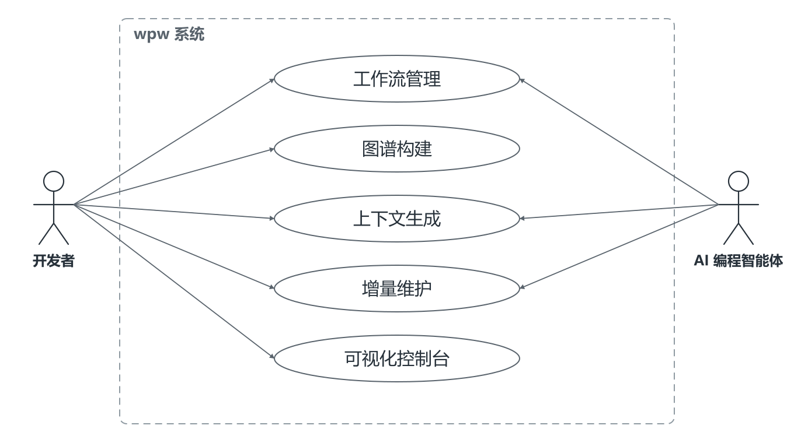

图4-1 WPW 系统总体用例图

Figure 4-1 Overall Use Case Diagram of WPW

## 4.2 功能需求分析

功能需求按模块组织。第 3 章方法的四个组成部分分别落在四个模块上：流程约束架构对应工作流管理模块，双层知识模型对应图谱构建模块，任务上下文生成方法对应上下文生成模块，Spec 增量知识演化对应增量维护模块；在此之上，可视化控制台模块把过程状态、图谱内容和上下文生成结果呈现给开发者。以下分别说明各模块的功能需求与主要用例。

### 4.2.1 工作流管理模块

工作流管理模块是流程约束架构对系统的要求。模块需要把一次需求变更当作一个独立的过程实例来管理，而不是依赖一段连续对话：实例创建时即固定需求名称、工作目录和初始状态，名称的格式和全局重名在创建时校验，后续命令凭实例标识定位，而不需要从聊天记录推断当前处于哪个阶段。

阶段推进需要可检查的门禁。模块为每个阶段提供统一的制品模板，进入任一阶段前先检查其强依赖阶段的制品是否已确认，未满足时阻止进入并说明缺失项，制品经开发者确认后记录状态，作为后续门禁判定的依据。业务需求、产品需求、技术设计、开发计划和实施构成主链，技术探索和测试作为可选环节。可选阶段允许跳过，但跳过必须是显式记录的决定；技术探索已形成候选方案而未拍板时，系统应在后续阶段给出可见警告，而不是静默放行。

实施阶段以开发计划中的任务清单为单位推进。模块需要支持任务级进度标记，使已完成和剩余任务可随时查询；会话中断后，智能体应能凭状态文件和阶段制品恢复现场，继续执行剩余任务。需求完成并经开发者验证后，模块提供归档处理，将过程工作区迁移到归档目录，并把这次变更中确认的需求增量交给知识维护流程。

该模块的主要用例如图4-2所示。

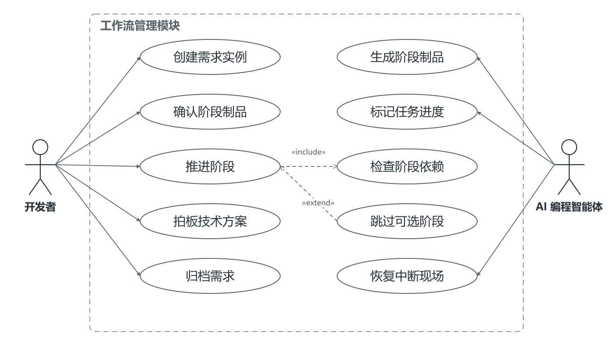

图4-2 工作流管理模块用例图

Figure 4-2 Use Case Diagram of Workflow Management Module

### 4.2.2 图谱构建模块

图谱构建模块是双层知识模型对系统的要求。模块需要解析项目源代码，建立模块、文件、代码元素三个结构层级，并识别导入、调用和继承等关系。项目接入时不应假设单一语言或单一框架，常见的 Web 项目形态，如前后端分离、状态管理单元和单文件组件，都应在解析范围内；构建前还需按文件类型和内容特征预检，避免把构建产物、依赖目录和文档资料混入代码结构层。

能力层来自能力规范文件。模块需要从规范中解析出业务能力的名称、用途、需求和场景，形成能力节点，并汇聚多源证据生成能力与代码结构之间的映射边：文档中提取的显式关联、命名上的对应、语义上的相似以及版本历史中能力与代码的共同变更，都可以作为证据；证据经合成后形成带权重的映射边，并记录主要证据来源以备检查。某一证据来源不可用时，其余证据仍应能形成映射，而不是导致构建失败。

图谱的持久化需要统一的数据模型。不同层级、不同语言解析器产生的节点和边应以同一格式保存、索引和传递，使上下文生成模块无需关心节点的来源语言。图谱文件、索引和元数据都应落在本地文件中，并记录构建时间、节点与边的规模和配置摘要，便于核查与重建。

该模块的主要用例如图4-3所示。

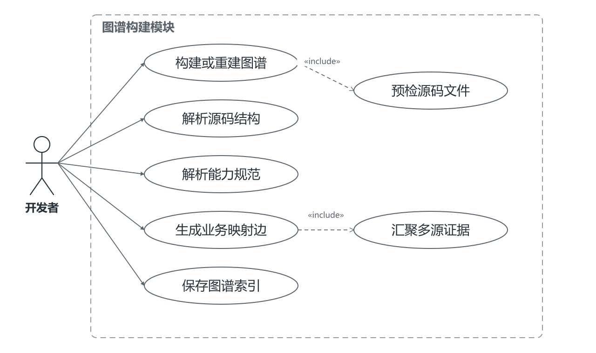

图4-3 图谱构建模块用例图

Figure 4-3 Use Case Diagram of Graph Construction Module

### 4.2.3 上下文生成模块

上下文生成模块是任务级子图生成方法对系统的要求。模块接受两类任务输入：智能体以自然语言描述任务时，系统通过语义检索找到候选锚点；调用方已知相关模块、文件或元素标识时，可以直接指定锚点，跳过语义检索。

从锚点出发，模块沿图谱的结构边和业务映射边扩展，得到与任务相关的候选子图。扩展必须受深度、边权重和节点数量的约束，并按语义相关性、结构重要性和到锚点的距离裁剪，避免把无关代码带入上下文。裁剪后的子图按能力、模块、文件、元素的层次组织输出，锚点保留较完整的属性与签名，较远节点只保留名称、类型和必要关系，以紧凑形式减少重复 Token。

Token 预算是上下文生成的输入约束，而不是隐藏在提示词中的经验参数。调用方给出预算后，系统应在超预算时逐级降低信息粒度，并在各级降级中始终保留锚点；如果连只含锚点的最小上下文仍超出预算，系统应明确报告预算不足，而不是静默截断，使调用方能够察觉并调整任务粒度。

该模块的主要用例如图4-4所示。

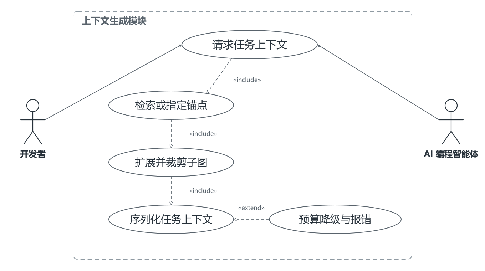

图4-4 上下文生成模块用例图

Figure 4-4 Use Case Diagram of Context Generation Module

### 4.2.4 增量维护模块

增量维护模块是 Spec 增量知识演化对系统的要求。长期项目中，每次代码修改都全量重建图谱会让知识维护本身成为负担。模块需要保存源码文件的哈希快照，在更新时识别新增、修改和删除的文件，只重建受影响文件的节点和关系，未变化的部分保留。能力规范发生变化时，模块重新解析并与既有能力节点比对，处理能力的新增、修改和删除，并重新计算受影响的映射边。

更新以数据结构版本兼容为前提。尚未存在历史图谱，或发现主版本不兼容时，系统应自动转为全量构建，并提供显式的重建命令以应对结构性重构。能力沉淀与归档流程衔接：需求归档时，模块依据已确认的需求制品和实施结果，将需求增量合并到既有能力规范，或按统一结构创建新的能力规范，随后触发图谱更新，使本次变更的知识进入项目知识库。

该模块的主要用例如图4-5所示。

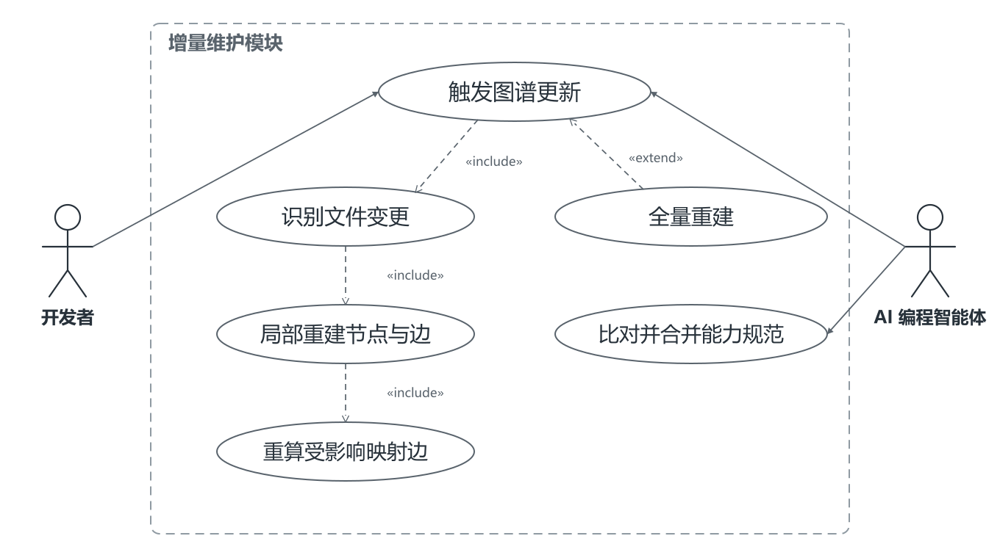

图4-5 增量维护模块用例图

Figure 4-5 Use Case Diagram of Incremental Maintenance Module

### 4.2.5 可视化控制台模块

前面四个模块的输出——阶段状态、图谱文件、上下文结果和归档内容——都以文件和命令输出形式存在。开发者要知道项目现在处于什么状态、图谱里有什么、一次任务实际拿到了哪些上下文，就需要逐条执行命令并阅读文本输出，状态一多就难以形成整体认识。可视化控制台模块的需求由此而来：把这些分散的结果集中呈现在页面上，让开发者直接看到系统的运行状态，并在看板上完成推进、跳过、拍板这类本来就由开发者负责的决定。

工作流看板是控制台的核心页面。看板需要列出全部活跃需求，以阶段图的形式展示每个需求各阶段的状态，已完成、待处理和已跳过要可区分，强依赖和可选依赖也要可区分；进入单个需求后，展示开发计划的任务进度和技术探索的拍板记录。看板不能只读。开发者应能对当前阶段执行操作：标记完成、跳过可选阶段、为技术探索录入拍板结果、勾选实施任务，并能看到每个阶段的依赖检查结果——缺少哪些前置、存在什么警告。门禁判定规则必须与命令行内置的阶段定义一致，控制台不另建一套规则，避免页面上能推进、命令行却拦截的两面状态。看板上的操作还应给出对应的智能体阶段命令，供复制后在开发环境中执行，使页面操作和命令行操作可以混用。同时，阶段状态的每次变更要留痕为带快照的历史记录，支持回溯到任一历史状态。

知识与上下文相关的能力需要对应的展示页面。图谱可视化页以图形渲染能力、模块、文件、代码元素四个层级的节点和边，层级与边类型要可视觉区分，支持按层级和类型过滤、按名称检索定位节点，选中节点时展示其属性，业务映射边可以单独高亮，便于核对一项业务能力究竟关联了哪些代码。上下文演示页接受自然语言任务输入，分步展示锚点命中、子图扩展和多档压缩的输出及各自的 Token 估算，并提供预算调节，使第 3 章的上下文生成方法可以被直观检查和演示。演示需要覆盖从能力层出发的完整链路：以"调整购物车中收藏商品的展示逻辑"这类任务为例，页面先展示语义检索命中的能力层锚点"购物车与收藏管理"及其匹配得分，再展示从该能力节点沿业务映射边扩展到关联模块、文件和函数，经裁剪后得到的任务子图，最后并排给出宽松、标准、极限三档压缩的输出与各自的节点数和 Token 估算。开发者借此可以直接检查一次任务拿到的上下文是否真的来自这项业务能力对应的代码，而不是只能看到最终文本。知识库页列出全部能力规范并渲染其内容，同时展示图谱与向量索引等构建产物的元信息；归档中心按月份组织已归档需求，支持阅读其各阶段文档；Token 统计页按需求、阶段、时间三个维度展示输入与输出消耗，为第 6 章的实验分析提供观测入口。

控制台还需要直接的模型交互能力。系统应提供大模型接口的配置页，支持配置接口地址、密钥和模型并进行连接测试，密钥必须脱敏显示且不能写入纳入版本管理的文件。配置完成后，对话页支持流式对话，并提供"注入项目上下文"开关：开启时提问附带图谱检索得到的上下文，界面上可见本次注入的规模；同一问题还应能以双栏形式并列展示纯模型回答和图谱增强回答，使上下文工程带来的差异可以直接对比。

最后，控制台的数据来源需要与命令行保持同一契约。页面前端通过统一的数据访问层取数，各数据结构（需求状态、图谱、统计结果）与命令行的结构化输出一致；本地数据服务未就绪时以静态模拟数据顶替，服务就绪后只切换请求地址而不改动页面。这样，控制台可以先于数据服务完成开发和演示，也为第 6 章的实验演示提供稳定的界面。

该模块的主要用例如图4-6所示。

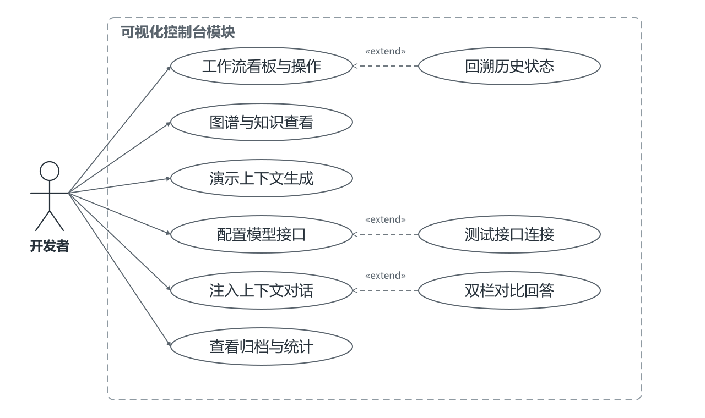

图4-6 可视化控制台模块用例图

Figure 4-6 Use Case Diagram of Visualization Console Module

## 4.3 非功能需求分析

功能需求规定系统做什么，非功能需求规定系统以什么方式存在和运行。WPW 服务于长期演化项目，其非功能需求围绕部署成本、过程可靠性和行为可验证性展开。表4-1 汇总了主要的非功能需求。

表4-1 WPW 非功能需求汇总

Table 4-1 Summary of Non-Functional Requirements of WPW

| 类别 | 需求描述 |
|---|---|
| 部署与存储 | 零数据库：图谱、索引和状态均以本地文件保存，随项目目录迁移，不要求独立服务；控制台以静态页面交付，可直接在浏览器打开，也可由本地命令提供数据服务 |
| 可靠性 | 状态文件与阶段文档构成可恢复的过程快照，会话中断后从显式状态恢复；文件写入采用临时文件加原子重命名，避免半成品文件 |
| 状态唯一性 | 项目状态的唯一真源是文件系统中的状态文件与阶段文档；控制台和命令行读写同一份状态，门禁判定使用同一套阶段定义 |
| 可降级性 | 图谱未构建、向量索引缺失或本地语义模型不可用时，回退到显式锚点或人工读取文件，不构成流程硬阻塞；数据服务未就绪时控制台以静态模拟数据运行 |
| 可扩展性 | 阶段规则集中于统一的模式定义，解析器按语言扩展，阶段模板允许项目级覆盖 |
| 可验证性 | 命令输出结构化结果，测试以持久化状态和文件为判据，不以单次模型回答为判据；控制台数据结构与命令行结构化输出保持同一契约 |
| 密钥安全 | 大模型接口密钥脱敏显示，不写入任何纳入版本管理的文件 |
| 环境约束 | 运行环境为 Node.js 18 及以上，控制台在现代浏览器中运行；版本信息、配置摘要和图谱模式版本可记录、可锁定 |

部署上，系统不引入独立数据库。图谱以行式文本文件保存，向量索引以二进制文件保存，连同状态文件都放在项目目录内。这样项目迁移、备份和版本管理都不需要额外的数据导出步骤，也使实验环境易于复现。控制台遵循同样的思路：前端构建为纯静态页面，不依赖独立的前端服务，打开即用；需要真实数据时由本地命令提供访问入口。

可靠性上，系统的状态变更必须由确定性程序完成并留下记录。需求名称、各阶段状态、任务进度和归档位置共同构成过程快照；智能体与开发者的会话可以中断、重来，项目状态不因此丢失。图谱和元数据文件的写入应先写临时文件再重命名，避免写入中断留下不完整文件。控制台引入后，这条要求扩展为状态唯一性：页面上看到的和命令行查到的是同一份状态，页面上的操作最终也落到同一份状态记录，不出现两处各自维护进度的情况。

可降级性上，知识服务是流程的增强而非前提。图谱不存在、向量索引缺失或锚点未命中时，系统给出提示并回退到显式锚点查询或人工读取文件，开发流程可以继续推进。这一要求直接影响设计：所有依赖图谱的命令都需要定义无图谱时的行为。控制台同样遵循可降级原则，数据服务未就绪时以与真实接口结构一致的静态数据运行，页面功能不受影响。

可验证性上，系统命令应输出结构化结果，功能测试以命令输出、状态转换和持久化文件为判据。控制台的数据结构与命令行结构化输出保持同一契约，页面呈现的内容因此可以追溯到具体的命令输出。这样系统行为可以被脚本化检查，也为第 6 章的系统测试和实验记录提供统一的数据来源。

## 4.4 系统约束与建设边界

系统建设受三方面约束。技术环境方面，系统以 Node.js 和 TypeScript 实现，源码解析以 tree-sitter 为基础，当前适配 TypeScript、JavaScript、Vue 单文件组件和 Java；未适配的语言不进入图谱，但不影响工作流的使用。控制台前端以 Vue 3 和 Vite 实现，构建为静态页面，不引入独立的前端部署环节。项目形态方面，系统面向有阶段制品和版本管理的软件项目，长期演化、多轮需求迭代的项目更能体现知识积累的价值；一次性、短周期项目也可以使用工作流，但图谱构建的投入相对收益有限。运行方式方面，系统以命令行工具和智能体阶段命令的形式挂载在智能体运行框架之上，不要求改造智能体本身；控制台面向本地单机使用，不引入多用户和权限体系。

建设边界同时是本文的研究边界在系统层面的落实。其一，系统不改动基础模型，不进行训练或微调；图谱构建中的多源证据只是工程化的关联依据，证据的强弱不影响模型本身的能力。其二，系统不替代智能体的运行框架，智能体的推理与执行仍由其运行框架负责，系统只管理过程制品、项目知识和任务上下文。其三，系统不评价下游任务的算法效果；后续实验载体中的推荐算法仅用于构成真实的开发任务，其准确率不是研究变量。其四，系统输出的是与任务相关的结构化上下文，帮助智能体和开发者更快定位相关代码，但不替代开发者对关键源码的精读与判断；能力沉淀的质量也依赖开发者对需求制品和合并结果的审阅。其五，控制台是观测与交互入口，不是新的状态来源：页面呈现的状态来自命令行和状态文件，页面操作通过同一套状态记录生效，门禁规则与命令行内置的阶段定义保持一致。

## 4.5 本章小结

本章分析了 WPW 系统的需求。系统面向开发者和 AI 编程智能体两类使用者，服务于长期演化项目的完整开发周期。功能需求按工作流管理、图谱构建、上下文生成、增量维护和可视化控制台五个模块组织：前四个模块分别承载第 3 章方法的四个组成部分，可视化控制台模块把过程状态、图谱内容和上下文生成结果集中到页面，并提供看板操作、模型对话和双栏对比等交互能力；本章给出了系统总体用例图和各模块用例图，明确了两类使用者与各模块的交互关系。非功能需求要求系统零数据库部署、状态可恢复、服务可降级、行为可验证，并要求控制台与命令行共享同一份状态和同一套数据契约；系统约束与建设边界明确了系统的技术环境、适用项目形态，以及不改动基础模型、不替代智能体运行框架、不评价下游算法效果的边界。第 5 章将按照这些需求，说明系统的三层架构以及工作流、图谱构建、上下文生成、增量维护和可视化控制台五个模块的设计与实现。

# 第 5 章 WPW 系统设计与实现

第 4 章分析了 WPW 的需求，功能需求落在工作流管理、图谱构建、上下文生成、增量维护和可视化控制台五个模块上。本章说明这五个模块怎么设计、怎么实现。系统以 Node.js 和 TypeScript 实现，整体分三层：AI 层、CLI 层和文件系统层，可视化控制台作为呈现入口挂在 CLI 层之上。这样分层，是要把智能体的生成行为和项目状态的变更分开：模型可以替换，会话可以中断，而状态记录和积累下来的项目知识不能跟着丢。5.1 节先讲总体设计，5.2 到 5.6 节按模块展开。

## 5.1 系统总体设计

### 5.1.1 设计目标与总体架构

设计时主要面对四个问题。智能体的会话随时可能中断，阶段推进不能依赖聊天记录，所以开发阶段、阶段产物和推进条件都要落成显式的文件和状态；项目做得越久，新任务越需要用到之前积累的业务知识，所以能力规范和代码结构要组织进同一份图谱；上下文窗口放不下整个项目，所以任务上下文要按任务和 Token 预算从图谱里选出来，而不是把大量文件直接拼进提示词；需求和代码一直在变，图谱要跟着增量更新，图谱暂时不可用时开发流程也不能卡住。

如图5-1 所示，系统在实现上仍分为 AI 层、CLI 层和文件系统层；为区分服务职责、持久化数据与外部输入，图中将三层展开为应用层、服务层、知识与过程数据层、基础设施层四个视觉层。AI 层以主 Skill 和 `/wpw:xxx` 阶段命令组织智能体的生成和交互行为；CLI 层提供项目初始化、阶段状态维护、任务追踪、归档和图谱服务等命令；文件系统层用 `wpw/active/`、`wpw/archived/`、`wpw/specs/`、`wpw/knowledge/` 等目录保存过程文档、能力规范和图谱构建产物，项目级配置放在 `workflow.config.yaml` 里。图谱和向量索引都是本地文件，不需要单独部署数据库。控制台和 AI 层并列为 CLI 层的两类调用方：AI 层通过命令读写状态，控制台通过统一的数据访问层读取命令的结构化输出和状态文件；在控制台上执行的阶段操作，最终也经 CLI 的同一个状态入口写回，门禁判定复用同一套阶段定义，页面上不会出现和命令行不一致的判定结果。

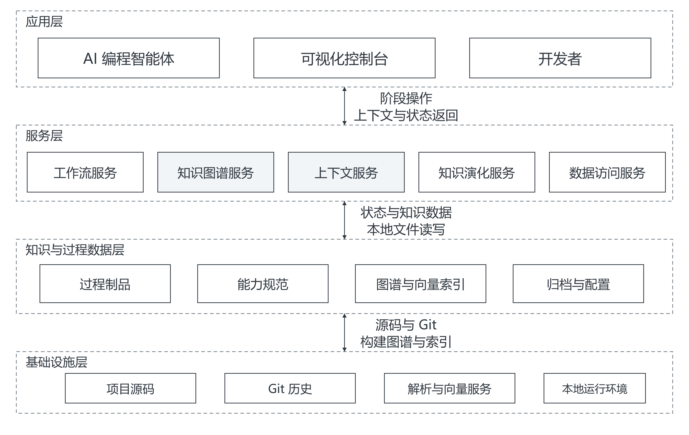

图5-1 WPW 系统总体架构

Figure 5-1 Overall Architecture of WPW

表5-1 给出各层的主要职责。AI 层不直接改过程状态文件，状态更新都经 CLI 命令写入并留下记录；进入新阶段前，`check` 和 Apply 命令先做依赖检查。这样即使会话中断或模型误操作，项目状态也不会和实际文件脱节。控制台也不是状态来源：页面上看到的进度来自状态文件，页面上的操作经同一个状态入口生效。

表5-1 WPW 逻辑分层的主要组成与职责

Table 5-1 Main Components and Responsibilities of the Logical Layers

| 层次 | 主要组成 | 输入与输出 | 职责边界 |
|---|---|---|---|
| AI 层 | 主 Skill、阶段命令、联动 Skill | 需求描述、阶段模板、任务上下文；输出阶段制品和代码修改建议 | 负责理解、生成、交互与复核，不直接变更过程状态 |
| 控制台（呈现入口） | Vue 前端页面、数据访问层、本地数据服务 | CLI 结构化输出、状态与图谱文件；输出页面呈现与阶段操作请求 | 负责呈现与交互，不另建状态，门禁判定复用 CLI 阶段定义 |
| CLI 层 | `wpw` 命令、图谱服务、配置与状态模块 | 命令参数、文件路径、状态与图谱数据；输出校验结果和结构化查询结果 | 负责确定性逻辑、门禁、路径解析、图谱构建与上下文生成 |
| 文件系统层 | `wpw/` 工作区、`workflow.config.yaml`、本地图谱文件 | 阶段文档、能力 Spec、图谱与索引文件 | 保存可追溯的项目制品和可持久化知识 |

表5-1 划分的是职责边界，图5-2 再从功能的角度给出系统的功能结构。五个功能模块与第 4 章的五项功能需求一一对应，每个模块向下细分出若干子功能：工作流管理模块覆盖需求创建与初始化、阶段门禁与依赖检查、阶段制品模板下发、阶段状态更新与恢复、任务实施与进度同步、归档与工作区迁移；图谱构建模块覆盖能力规范解析、源码结构解析、业务映射合成、图谱本地存储与向量索引构建；上下文生成模块覆盖锚点检索与选择、子图扩展与裁剪、骨架抽取与序列化、Token 预算控制与分档压缩；增量维护模块覆盖文件哈希差异识别、变更局部重建、能力规范增量更新、归档驱动的能力沉淀、版本兼容检查与全量回退；可视化控制台模块覆盖工作流看板与阶段操作、图谱可视化与统计、上下文生成演示、知识库与归档浏览、Token 统计与模型对话。

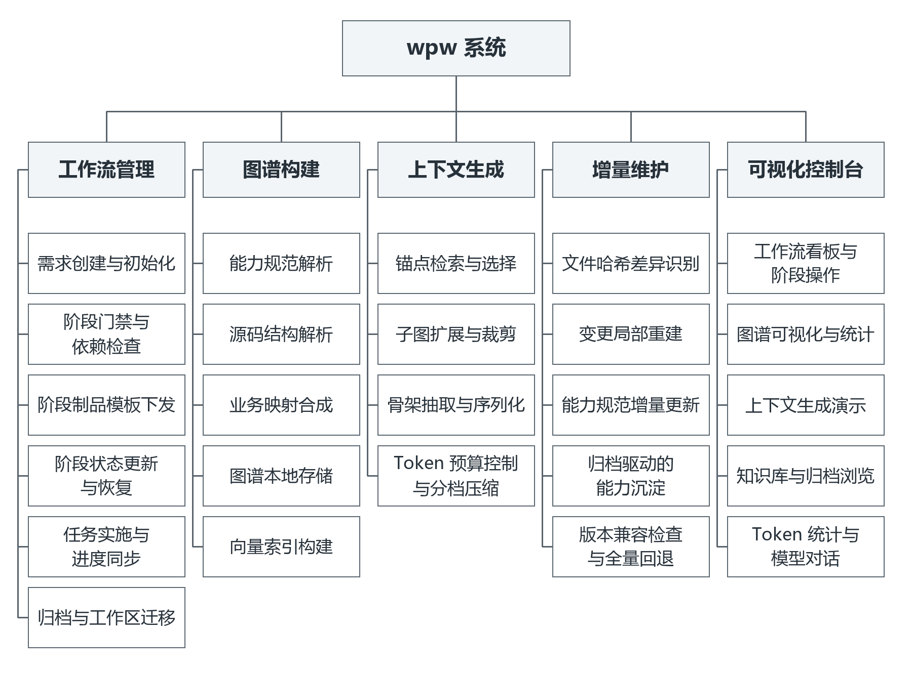

图5-2 WPW 系统功能图

Figure 5-2 Function Diagram of WPW

### 5.1.2 系统数据模型设计

WPW 不引入独立数据库，持久化数据全部是本地文件，但文件背后的数据模型是统一的。逻辑上可以把这些数据分成四组。第一组是过程数据：一次需求变更对应一个需求实例，实例下面挂着各阶段的文档和计划任务，需求完成后整个工作区迁移为一条归档记录。第二组是知识数据：能力规范是跨需求复用的稳定知识单元，解析后生成图谱的 C 层节点。第三组是图谱数据：节点和边用统一模型保存，图谱元数据记录一次构建的版本、规模和文件哈希快照。第四组是观测数据：Token 消耗按需求、阶段和日期记录，供控制台统计展示。四组数据之间的逻辑关系如图5-3 所示。

需求实例和阶段文档、计划任务之间是一对多的包含关系；能力规范解析后生成 C 层节点，归档时需求实例又通过能力沉淀和能力规范建立多对多的关联；图谱节点是图谱边两个端点的引用方，图谱元数据对应一次构建产生的全部节点和边。模型里没有控制台的私有实体：页面配置里的接口密钥只保存在浏览器本地，不写进任何项目数据文件，这是密钥安全要求在数据模型上的直接体现。各组数据的物理形态——状态文件、Markdown 文档、JSONL 图谱、二进制向量索引——分别在 5.2 至 5.5 节随模块说明。

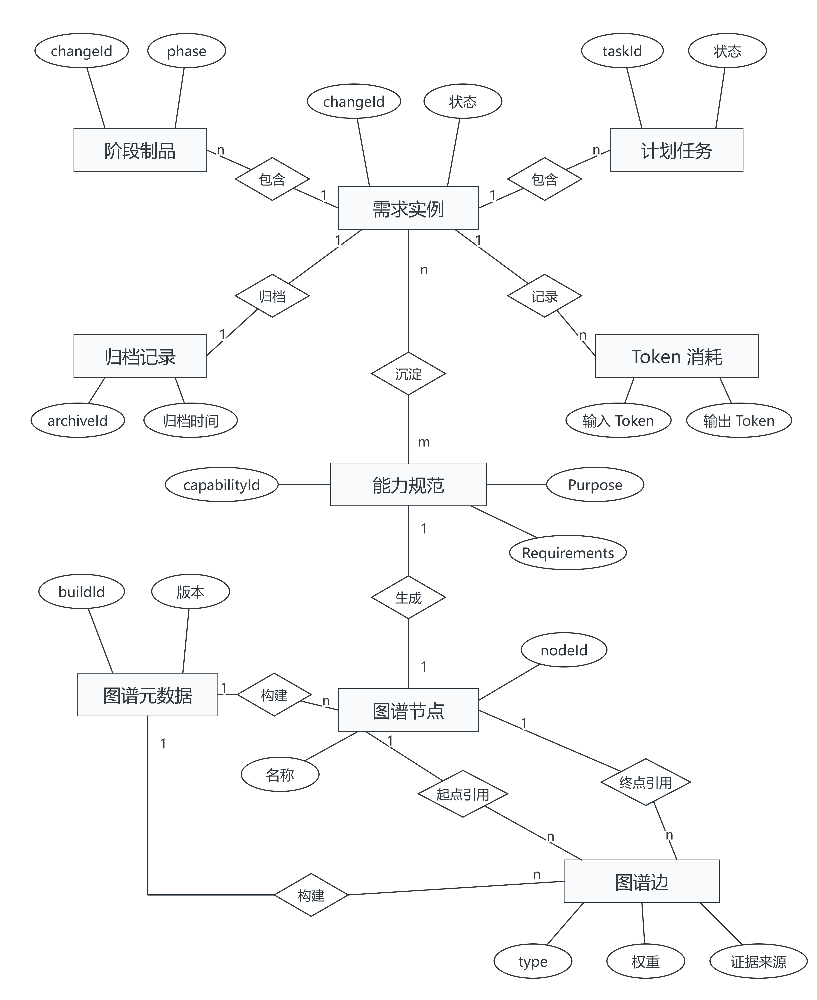

图5-3 系统逻辑 ER 图

Figure 5-3 Logical ER Diagram of WPW

### 5.1.3 软件运行流程

一次需求变更在 WPW 里是一个独立的过程实例，而不是一段连续对话。流程从创建需求开始。开发者向智能体提出需求，智能体生成符合 kebab-case 规则的需求标识，调用 `wpw new` 创建 `wpw/active/<change>/` 工作区和初始 `.WPW.yaml`；CLI 在创建时校验名称格式和全局重名，读取项目类型，为所有阶段写入 `pending` 状态。需求名称、工作目录、工作流 Schema 和初始状态在这一步就固定下来，后面的命令凭 `<change>` 找到这个实例，不用从对话历史里推断。

之后 BRD、PRD、Explore、Design、Plan、Test 和 Apply 按 Schema 定义的依赖关系推进。每到一个阶段，系统先取出这个阶段需要的前序文档和模板，智能体再生成内容并和开发者确认；文档确认保存后，CLI 才记录状态。Explore 和 Test 是可选环节，一个出方案候选，一个出测试用例，两者不做不会破坏主链，但设计会失去决策依据，实施会失去测试保障。整个过程中，开发者可以在控制台的工作流看板上看到每个需求走到哪个阶段、任务完成了多少；推进、跳过、拍板这些操作也可以在控制台上做，和命令行操作的是同一份状态。

进入 Apply 后，系统以 Plan 文档里的任务项为单位实施，向智能体返回已完成的阶段文档、待执行任务、当前进度和测试警告。每完成一个任务，CLI 就地更新 Plan 里的任务标记，把汇总进度写回状态文件。开发者验证通过后，归档命令把工作区移动到按月组织的 `wpw/archived/` 目录；归档前智能体把这次确认过的需求增量沉淀到能力规范，归档后触发图谱更新。这次需求形成的过程知识，到这一步就变成了后续任务可以直接用的稳定知识。

## 5.2 工作流管理模块

### 5.2.1 工作流模型与初始化

工作流管理模块用一个内置 Schema 描述一次需求变更的静态结构。Schema 把 BRD、PRD、Explore、Design、Plan 和 Test 定义为阶段制品，把 Apply 定义为消费 Plan 任务的实施入口；每个阶段记录标识、制品文件名、强依赖 `dependsOn`、弱依赖 `optionalDeps`、可跳过属性 `skippable` 和人工确认属性。阶段规则集中在这一处注册表里，依赖检查、模板解析和状态更新都从这里读规则，同一套约束就不会在提示词和命令里各写一遍。控制台看板的门禁判定也从这份定义出发，页面和命令行的判定结果因此始终一致。

需求创建是工作流实例化的起点。智能体根据需求生成名称后调用 `wpw new <change>`；CLI 校验名称是不是 2 到 30 个字符的 kebab-case，检查活跃需求和已归档需求里有没有重名，然后读取项目类型、创建需求目录、写入状态文件。初始状态里所有阶段都是 `pending`，同时保存 Schema 名称、创建时间、项目类型和空的任务进度。

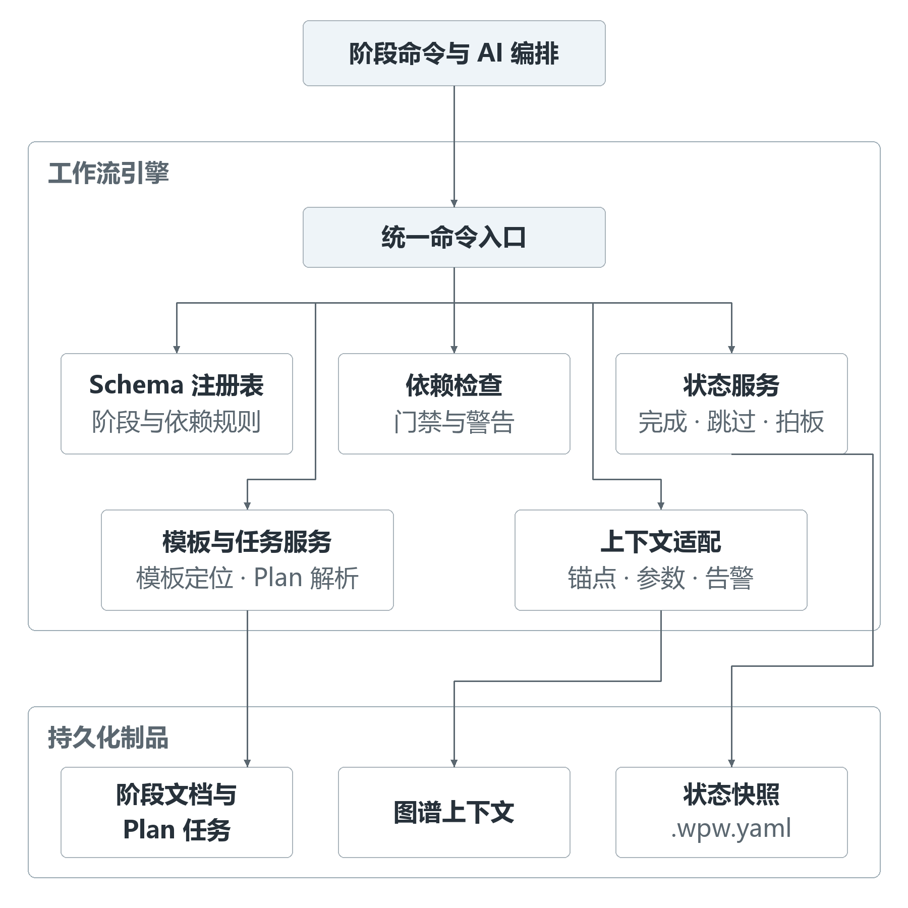

图5-4 工作流引擎实现架构

Figure 5-4 Implementation Architecture of the Workflow Engine

### 5.2.2 阶段制品的生成与确认

每个文档阶段都按"准备、生成、收尾"三步走。准备阶段执行 `wpw new`、`wpw check <phase>` 和 `wpw template <phase>`：第一个保证工作区存在，后两个分别返回当前阶段能不能继续和对应的模板路径。依赖检查发现缺前置阶段时，智能体停止本次编排，提示开发者先补齐前序文档；检查返回警告时，把警告连同相关文档交给开发者处理。准备阶段只做路径、规则和状态这些确定性处理，不生成任何需求或设计内容。

生成阶段由智能体消费已完成的文档、阶段模板和必要的图谱上下文。以 Design 为例，智能体先读 PRD，Explore 已完成时再读探索报告和拍板结果；然后先写出技术设计大纲，等开发者确认，再把确认后的内容写进文件。BRD、PRD、Design、Plan 和 Test 走的都是这个模式，只是输入的文档和模板不同。Apply 不生成新的文档，而是从 Plan 解析任务，按任务粒度取代码上下文并实施修改。

收尾阶段由 CLI 写入过程状态。文档保存后，`wpw done <phase>` 把阶段置为 `done`；可选阶段不采用时，`wpw skip <phase>` 写入 `skipped`；Explore 形成候选方案后，开发者用 `wpw decision explore --option <choice>` 记录选定方案。走完这三步，模型管的是内容生成和命令调用，开发者管确认和拍板，CLI 管保存可以查询的过程事实。

图5-5 给出这三步的处理流程；图5-6 从参与者交互的角度给出同一过程的时序，两张图可以对照着看：前者回答系统内部按什么顺序处理，后者回答开发者、智能体、CLI 和文件系统之间按什么顺序交换消息。

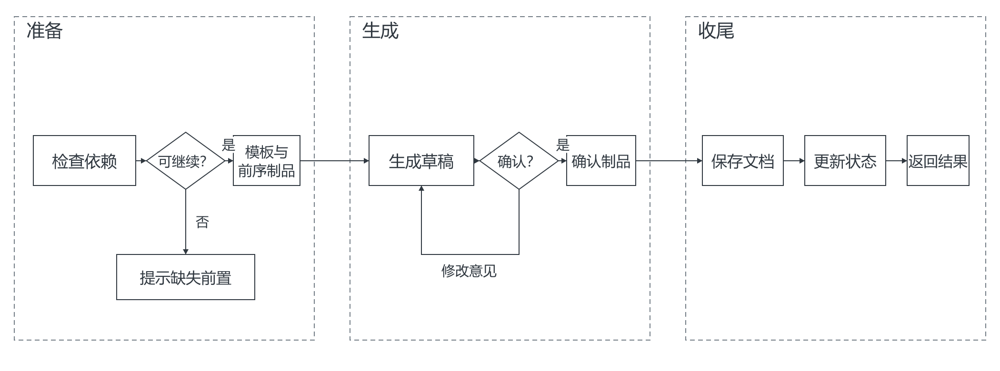

图5-5 阶段制品生成与确认流程

Figure 5-5 Stage-Artifact Generation and Confirmation Flow

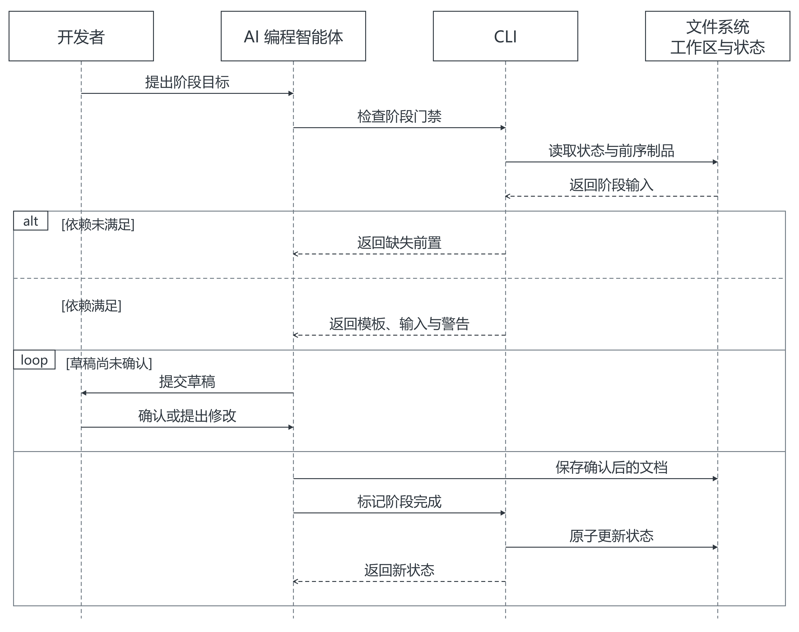

图5-6 阶段制品生成与确认时序图

Figure 5-6 Sequence Diagram of Stage-Artifact Generation and Confirmation

### 5.2.3 DAG 驱动的阶段门禁与状态转换

六阶段流程被编码为一张 DAG，节点是阶段制品，边是前置条件。主链为 BRD 到 PRD、Design、Plan 和 Apply；Explore 从 PRD 引出，是 Design 的可选输入；Test 同时依赖 Design 与 Plan，并作为 Apply 的可选测试输入。这张 DAG 不规定智能体怎么想，只规定阶段制品什么时候能被读、什么时候允许开始下一阶段。

对目标阶段 $v$，设其强前置集合为 $D(v)$，状态文件中的阶段状态为 $s(u)$，则依赖检查的硬门禁判定为：

$$
\mathrm{canProceed}(v)=\bigwedge_{u\in D(v)}[s(u)=\mathrm{done}] \tag{5-1}
$$

`wpw check` 按这个规则返回 `canProceed`、缺失的前置阶段和警告信息；强依赖没满足时以非零退出状态结束，智能体不得继续生成目标阶段。Apply 还直接检查 Plan 是否完成，保证实施任务有明确来源。弱依赖不改变硬门禁结果，但会改变智能体的输入。比如 Explore 已完成却没记录选定方案时，检查结果会带上警告，Design 命令据此要求开发者先拍板或明确跳过探索结果；Test 被跳过时 Apply 仍可进入，但会返回未经测试用例驱动开发的质量风险提示。强依赖、可选信息和人工决策，分别落在不同的状态条件上。

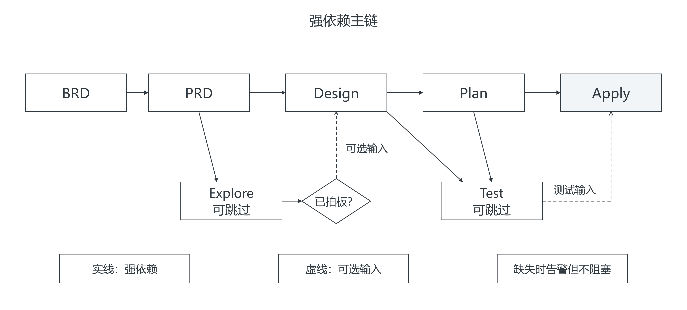

图5-7 DAG 驱动的阶段门禁

Figure 5-7 DAG-Driven Stage Gates

六阶段 DAG 的整体结构与门禁路径如图5-7 所示，表5-2 列出 DAG 中各阶段的制品、依赖和控制方式。

表5-2 六阶段工作流及其实现约束

Table 5-2 Six-Stage Workflow and Its Implementation Constraints

| 阶段 | 主要制品 | 主要前置条件 | 实现中的控制方式 |
|---|---|---|---|
| BRD | 业务需求文档 | 无 | 创建需求工作区并初始化状态 |
| PRD | 产品需求文档 | BRD 完成 | 强依赖校验 |
| Explore（可选） | 技术探索报告 | PRD 完成 | 可跳过；完成后可形成待拍板的候选方案 |
| Design | 技术设计文档 | PRD 完成；Explore 为可选输入 | 强依赖 PRD；若 Explore 已完成但未拍板，要求记录决策后继续编排 |
| Plan | 开发计划 | Design 完成 | 强依赖校验与模板下发 |
| Test | 测试方案 | Design、Plan 完成 | 可跳过；完成时为 Apply 提供测试用例输入 |
| Apply | 代码变更与任务状态 | Plan 完成 | 硬门禁检查；Test 未完成时返回质量风险提示 |

### 5.2.4 任务实施、状态恢复与归档反馈

每项需求在 `wpw/active/<change>/` 下都有自己的 `.WPW.yaml`。状态文件保存需求名称、Schema 名称、各阶段状态、Explore 的选定方案、任务总数和已完成数；阶段文档加上状态文件，就是一个可以恢复的过程快照。CLI 是约定的状态更新入口：`done` 记阶段完成，`skip` 只作用于 Schema 里声明可跳过的阶段，`decision` 只记 Explore 的选定方案；能不能进入下一阶段，仍由编排前的依赖检查判定。

Plan 阶段把开发计划写成 Markdown 任务清单，作为 Apply 的任务来源。`wpw apply` 先校验 Plan 状态，再返回已完成阶段的文档路径、解析出的任务列表、已完成与剩余任务数，以及 Test 未完成时的警告。智能体开始一个任务时调用 `wpw task --mark <id> --state in-progress`，完成后用同一命令标记 `done`；CLI 只替换目标任务那一行的复选标记，重新统计任务数，把进度同步回 `.WPW.yaml`。会话中断了也不要紧，智能体用 `apply --from <task>` 重新拿到剩余任务和阶段文档，从显式状态恢复现场，而不是靠翻聊天记录。

工作流管理模块还规定了上下文在哪些环节产生和消费。Explore、Design 和 Plan 在准备阶段可以查询已有能力和模块边界；Apply 在每个任务实施前，按已知文件或语义任务描述向图谱请求上下文；Test 和代码审查沿上下游关系确定回归范围；Sync 在代码变更后沿业务映射关系定位可能需要同步的文档。图谱没构建、向量索引缺失或者锚点没命中时，系统给出提示并回退到人工读取文件，流程不会被知识服务卡死。

开发者验证通过后，归档流程把需求工作区移动到 `wpw/archived/YYYY-MM/<change>/`。归档前，智能体依据已确认的 PRD、Design 和实施结果更新或新建相关能力规范；归档命令随后检测图谱是否已构建，可用时调用增量更新，把能力规范和代码结构的变化反映进项目知识库。工作流的终点在这里接上增量维护模块，归档和沉淀的详细时序在 5.5 节给出。

## 5.3 图谱构建模块

### 5.3.1 C-L1-L2-L3 知识模型的工程落地

图谱构建模块把第 3 章定义的 C-L1-L2-L3 双层知识模型落到代码上。C 层节点从 `wpw/specs/<capability>/spec.md` 的能力规范里解析出来，提取能力名称、Purpose、Requirements 和场景这些业务语义；L1、L2、L3 层节点分别是代码模块、源文件和代码元素。源文件解析完后，系统建立模块、文件、元素之间的包含关系，再补上导入、调用、继承和 `business_map` 等关系边。节点和边都带稳定标识和属性，后面查询、重建和溯源都要用到。

源码解析以 tree-sitter[59] 为基础，对 TypeScript、JavaScript、Vue 单文件组件和 Java 等已适配语言构建统一的元素表示；针对状态管理和跨端项目的常见组织形式，解析器另外识别相应的模块或状态单元。构建前先按文件类型和内容特征预检，再对候选文件做 AST 解析。这样能把解析范围限制在源代码文件上，构建目录、依赖目录和一般文本资料不会混进代码结构层。

`business_map` 是能力层和结构层之间的业务映射，不是代码包含关系。有了它，任务可以从业务能力进入代码结构，也可以从改动的代码反向找到相关能力。不同层级、不同语言解析器产生的节点要能按同一种方式保存、索引和传给上下文生成模块，系统为此定义了统一的 JSON 数据模型。

### 5.3.2 节点 JSON 数据模型与属性设计

图谱的语义层级由 C、L1、L2、L3 表示，但持久化时不为各层分别定义文件格式，统一用 `GraphNode` 对象。设节点为 $n$，其基本结构可表示为：

$$
n=(id, level, type, name, attrs, createdAt, updatedAt) \tag{5-2}
$$

其中，`level` 表示节点在能力--代码知识结构中的层级，`type` 表示该层级内的具体实体类型，`attrs` 保存随实体类型变化的扩展属性。层级和类型分开，是因为两者用途不同：前者用于按 C--L1--L2--L3 层次做图遍历、裁剪和序列化，后者用于区分函数、类、接口、组件和状态管理单元这些异构代码实体，支持按类型过滤检索。

表5-3 给出所有节点共有的字段。节点标识由实体的稳定识别信息经 SHA-256 摘要截断生成，形如“类型前缀:12 位十六进制摘要”；同样的输入得到同样的标识，重建或增量更新时节点依然可以定位。时间字段记录本次图谱构建中节点的创建和更新时间，不承担源代码提交历史的语义。

表5-3 `GraphNode` 的公共 JSON 字段

Table 5-3 Common JSON Fields of GraphNode

| 字段 | 类型 | 含义 |
|---|---|---|
| `id` | string | 图谱内唯一标识，用于边的端点引用、索引和增量定位 |
| `level` | string | 知识层级，取值为 `C`、`L1`、`L2` 或 `L3` |
| `type` | string | 具体节点类型，如 `capability`、`module`、`file`、`function`、`class` 或 `pinia-store` |
| `name` | string | 面向开发者阅读的实体名称；成员方法可包含所属类型名称以避免同名歧义 |
| `attrs` | object | 与节点类型相关的扩展属性对象，缺失属性不序列化为固定空值 |
| `createdAt` | number | 节点写入图谱时的 Unix 毫秒时间戳 |
| `updatedAt` | number | 节点最近一次更新时的 Unix 毫秒时间戳 |

以下以一个 Java 服务方法为例，说明 L3 节点的 JSON 形式，如图5-8所示。示例中的标识和时间戳只用于说明字段组织，实际值由解析器和节点构建器生成。

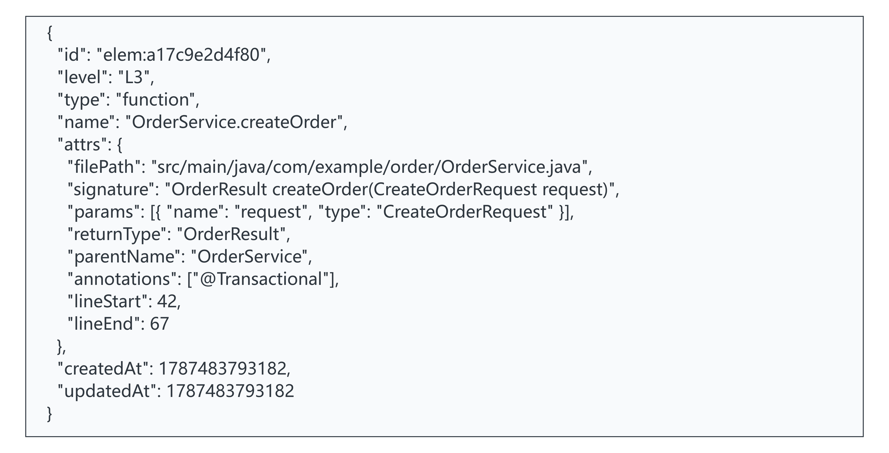

图5-8 L3 节点 JSON 实例

Figure 5-8 JSON Instance of an L3 Node

`attrs` 用可扩展对象，而不是预先固定所有层级的宽表结构。这样既能装下能力规范的业务描述，也能装下 AST 解析得到的签名、参数和源码位置，还能适配 Vue、Pinia、Vuex、Redux、小程序和 Spring Boot 等项目形态。表5-4 按层级归纳当前实现写入的主要属性；表中的“可选”由语言、框架或源文件内容决定，节点构建器不会补造。

表5-4 各层节点的主要 `attrs` 属性

Table 5-4 Main attrs Attributes of Nodes at Each Level

| 层级 | 典型类型 | 主要属性 | 属性来源与用途 |
|---|---|---|---|
| C | `capability` | `description`、`features` | 从 `spec.md` 的 Purpose 和 Requirements 解析；`features` 保存需求编号、名称、优先级和描述，作为能力检索与映射依据 |
| L1 | `module` | `side`、`dir`、`description`（可选） | 由模块目录推断或项目配置给出；标识前端、后端、共享或未知端，以及模块根目录 |
| L2 | `file`、`pinia-store`、`vuex-store`、`redux-slice` 等 | `filePath`、`language`、`fileHash`；状态单元还可包含 `storeName`、`namespaced` 等 | 由文件扫描和状态管理解析器生成；用于文件定位、语言路由和增量更新时的哈希比较 |
| L3 | `function`、`class`、`interface`、`constant`、`component` 及状态成员类型 | `filePath`、`signature`、`params`、`returnType`、`parentName`、`lineStart`、`lineEnd`、`isExported`、`annotations`、`jsDoc` 等（按实体可选） | 由 AST 解析提取；支持定位代码元素、形成紧凑骨架及在上下文中保留必要签名信息 |

节点模型只保存能从规范、文件结构和源码里确定的事实。边的方向、权重和映射证据不塞进节点的 `attrs`，而是用独立的 `GraphEdge` 记录，避免同一个实体在不同关系里的属性互相混杂。表5-5 给出实现中保存的主要节点和边类型。

表5-5 图谱的主要节点和边类型

Table 5-5 Main Node and Edge Types in the Knowledge Graph

| 类别 | 类型 | 含义 |
|---|---|---|
| 节点 | C | 来自能力 Spec 的业务能力 |
| 节点 | L1 | 业务或技术模块 |
| 节点 | L2 | 源文件、组件或状态管理文件 |
| 节点 | L3 | 函数、类、接口、类型或状态管理元素 |
| 边 | `contain` | L1 到 L2、L2 到 L3 的从属关系 |
| 边 | `import`、`call`、`inherit` | 静态分析得到的结构关系 |
| 边 | `business_map` | C 层能力与代码结构节点的跨层关联 |

### 5.3.3 多源映射与本地存储

能力--代码映射由文档提取、命名匹配、语义相似度和 Git 历史等可用证据共同生成。系统先收集同一能力对目标节点的候选证据，再按第 3 章的 noisy-OR 规则汇聚成边权重；边上同时记录权威性最高的证据来源，方便后续检查。向量索引或 Git 历史缺失时，对应的证据源不参与计算，靠已有的结构和文本证据照样能成图。这些证据只是工程上的关联依据，不涉及对基础模型的训练或更新。

图谱数据以 JSONL 保存，节点和边按行序列化；元数据文件保存 schema 版本、构建时间、节点数、边数、配置摘要和文件哈希快照；向量索引以二进制浮点数组保存，通过 JSON 映射文件关联到图谱节点。JSONL 和元数据都先写临时文件再重命名，避免写到一半留下不完整的图谱。本地 Embedding 可用时，系统构建向量索引用于语义锚点选择；不可用时，结构化查询和显式锚点查询仍然能用。

## 5.4 上下文生成模块

### 5.4.1 从任务输入到子图

上下文生成模块实现第 3 章的任务级子图生成流程。任务是自然语言描述时，系统先在本地向量索引里检索候选锚点；调用方已经知道相关模块、文件或元素的标识时，直接指定锚点，跳过语义检索。候选锚点按层级、相关性和能力映射置信度处理，然后沿图中的入边和出边做受深度、边权重和节点数约束的扩展，得到结构连贯的候选子图。图5-9 展示多锚点加权双向 BFS 的扩展路径和距离合并过程。

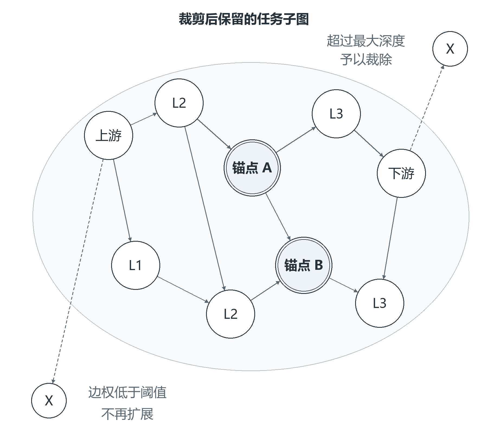

图5-9 加权双向 BFS 子图扩展示意

Figure 5-9 Weighted Bidirectional BFS Subgraph Expansion

裁剪阶段保留锚点，其余节点按语义相关性、结构重要性和到锚点的距离排序取舍。深度、最小边权重、节点上限、层级过滤和类型过滤都暴露为命令参数，阶段命令可以按任务粒度控制上下文范围。上下文只负责把相关代码带到眼前，关键源码的精读和判断仍是开发者的工作。

### 5.4.2 骨架抽取、序列化与预算控制

裁剪后的子图进入骨架抽取和层级序列化。锚点保留较完整的属性和签名，近邻节点保留标准属性，较远的节点只留名称、类型和必要关系；序列化按能力、模块、文件、元素的层次组织，显式标注包含、依赖和业务映射关系。相同的结构信息用紧凑符号表达，不用自然语言反复叙述，以此减少重复 Token。

输出超过调用方给定的 Token 预算时，系统按第 3 章定义的优先级逐步提高压缩程度、减少节点规模、收缩扩展深度、提高边权重阈值，最后回退为只含锚点的最小上下文。每调整一轮，就重新做一遍骨架抽取和序列化，再检查估算的 Token 数量。锚点在各级降级中始终保留；最小结果仍超预算时，返回预算不足提示而不是静默截断，调用方能察觉预算不够，再决定要不要缩小任务粒度。

一次完整的上下文生成涉及调用方、上下文流水线、向量索引和图谱存储之间的多轮交互，如图5-10 所示。

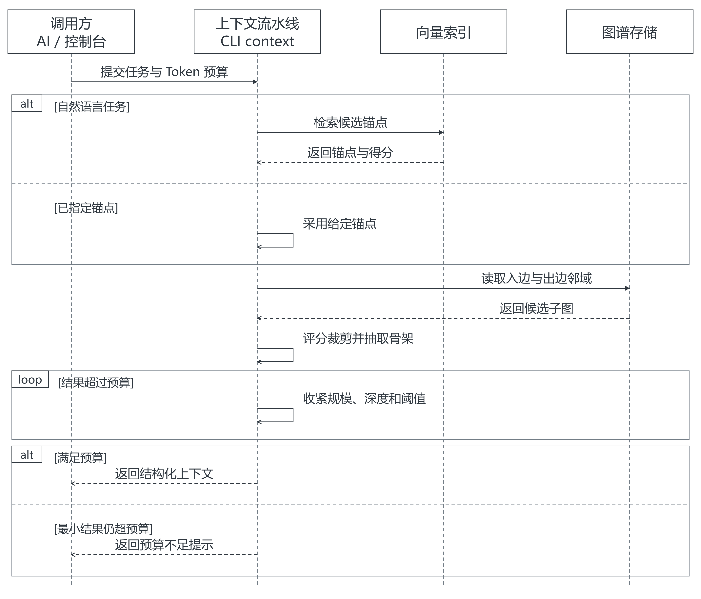

图5-10 任务上下文生成时序图

Figure 5-10 Sequence Diagram of Task Context Generation

## 5.5 增量维护模块

### 5.5.1 代码与能力规范的增量更新

长期项目里，每次改代码都全量重建图谱，知识维护本身就成了负担。WPW 在元数据里保存源码文件的哈希快照，`wpw graph update` 时把当前扫描结果和上次构建比对，识别新增、修改和删除的文件。变更文件原有的文件节点、元素节点和相关边先移除，重新解析后写回新的局部结构；没变的节点和边保留。能力规范也在更新时重新解析，和既有 C 层节点比对，处理能力的新增、修改和删除，受影响的 `business_map` 边一并重算。

增量更新以 schema 主版本兼容为前提。还没有历史图谱，或者发现主版本不兼容时，系统自动转成全量构建；遇到结构性重构这类可能影响大量依赖关系的情况，可以显式执行 `rebuild`。当前实现对向量索引采用“结构局部更新、向量全量重建”的折中方案，先保证图谱节点和语义索引一致，向量的增量维护留待后续工作。

### 5.5.2 归档驱动的能力沉淀

需求文档是阶段性的，能力规范则是跨需求复用的稳定知识单元。归档时，智能体根据 PRD、Design 和实施结果识别这次变更涉及的业务能力：已有对应能力规范的，把确认过的需求增量合并进去；没有的，按统一结构新建一份能力规范。然后执行图谱增量更新，新的或修订过的能力节点及其代码映射随之进入项目知识库。

这个过程的关键不是让系统自动推断业务结论，而是把已经在受控流程里形成的需求和设计文档，转成可以维护的规范。沉淀的质量仍依赖开发者对需求文档和合并结果的审阅；它的作用是给后续任务提供可以定位、可以更新的业务语义锚点。本文说明并验证增量更新流程能够运行，但不以短序列实验推断它的长期成本或召回收益。归档、沉淀与图谱更新的完整消息顺序如图5-11 所示。

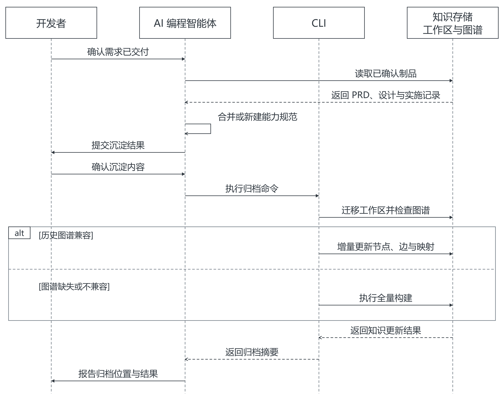

图5-11 归档与能力沉淀时序图

Figure 5-11 Sequence Diagram of Archiving and Capability Precipitation

## 5.6 可视化控制台模块

### 5.6.1 控制台架构与数据契约

可视化控制台用 Vue 3、Vite 和 Element Plus 实现，按 hash 路由构建为纯静态页面，浏览器直接打开就能用，不需要单独部署前端服务。前端内部分四层。页面层有总览、工作流看板、归档中心、图谱可视化、图谱统计、上下文演示、知识库、Token 统计、对话和 API 配置共十个页面；组件层沉淀了图谱画布、阶段 DAG、阶段操作抽屉和 Markdown 渲染这几个可复用组件；状态层用 Pinia 维护工作流看板和对话助手的页面状态；数据访问层把所有取数收敛到一个统一的 fetcher，页面组件不直接引用任何数据文件路径。

数据契约是控制台和 CLI 之间的核心约定。fetcher 里的每个数据结构——需求条目、需求详情、图谱、图谱统计、上下文演示、能力规范、归档记录和 Token 统计——都和 CLI 的 `--json` 结构化输出同名字段，mock 数据优先用真实命令的输出生成。本地数据服务没就绪时，fetcher 指向静态 mock 文件；服务就绪后，只把请求前缀从 mock 目录切到 `/api` 路由，页面代码一行不改。这样控制台可以先于数据服务做完开发和演示，页面上看到的内容也都能追溯到具体的命令输出。控制台的整体结构如图5-12 所示。

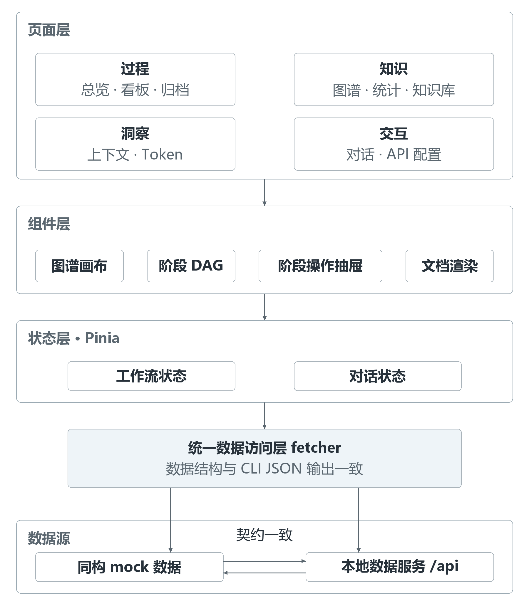

图5-12 可视化控制台模块架构

Figure 5-12 Architecture of the Visualization Console Module

图5-13 是控制台总览页的实际界面。页面顶部汇总活跃需求数、阶段完成度、图谱节点边规模和累计 Token 消耗四项全局指标，中部给出各需求阶段完成情况和近 7 日 Token 消耗，底部速览全部活跃需求。页面上的每一项数字都来自上述数据契约，本地数据服务就绪后与 CLI 查询结果一致。

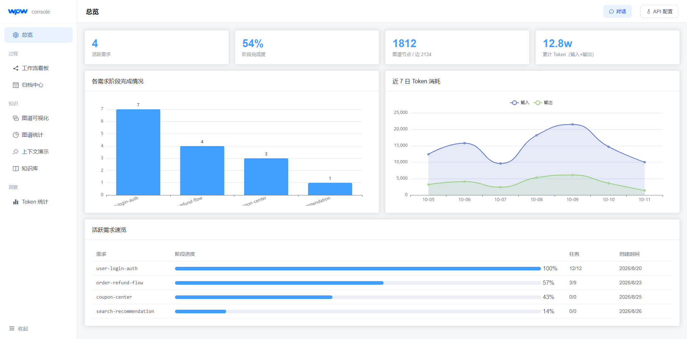

图5-13 控制台总览页界面

Figure 5-13 Console Overview Page

### 5.6.2 工作流看板与阶段操作

工作流看板列出全部活跃需求，每个需求的六阶段状态画成一张 DAG：pending、done、skipped 用不同标记区分，强依赖和可选依赖用不同线型区分。看板的实际界面如图5-14 所示。进入单个需求后，页面展示 Plan 任务清单和进度统计、Explore 的拍板记录，Test 没完成时给出质量风险提示。看板不是只读的。每个需求有“继续”入口，能定位到下一个可推进的阶段；点击 DAG 里任一阶段节点，会打开这个阶段的操作抽屉，里面展示依赖检查结果——能不能推进、缺哪些强前置、有什么警告——并按状态给出可用的操作：标记完成、跳过可跳过阶段、录入 Explore 拍板结果、勾选 Apply 任务。门禁判定直接用 CLI 内置 Schema 的 `dependsOn`、`optionalDeps` 和 `skippable` 定义，页面和命令行判出来的结果一样。抽屉里还给出对应的 `/wpw:xxx` 阶段命令，复制后可以在 IDE 里执行，页面操作和命令行操作可以混着用。

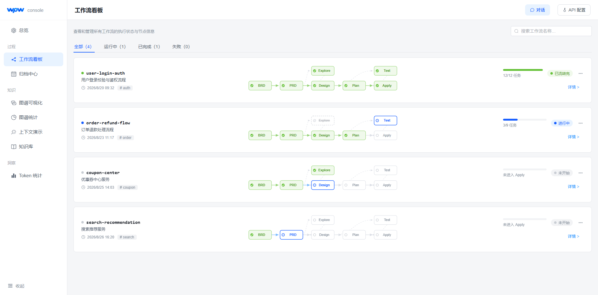

图5-14 控制台工作流看板页界面

Figure 5-14 Console Workflow Board Page

图5-15 给出一个处于 Apply 阶段的需求详情抽屉。抽屉顶部以醒目告警展示 Test 阶段未完成的质量风险提示，对应图5-7 中弱依赖不改变硬门禁、但改变提示信息的门禁语义；下方依次是 Schema 与项目类型等实例信息、Explore 拍板状态、Plan 任务清单——已完成的 3 项与待实施的 6 项逐条列出——以及各阶段制品的文件名。抽屉里的每一项都来自 `.WPW.yaml` 状态文件和阶段制品路径，与 CLI 查询返回的内容一致。

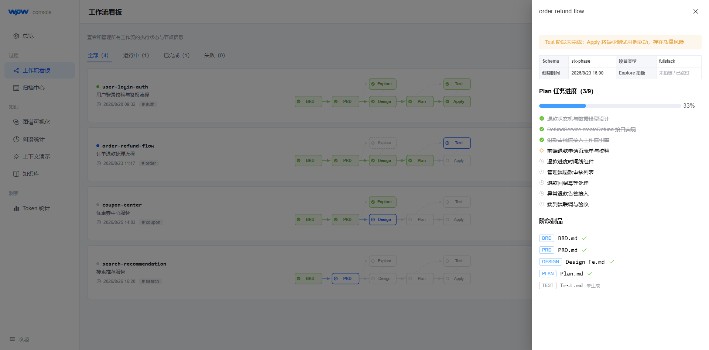

图5-15 控制台需求详情抽屉界面

Figure 5-15 Console Requirement Detail Drawer

看板还承担协同和回溯。操作抽屉内置“AI 对话”页签，会话按“需求 × 阶段”隔离，开发者可以用自然语言要求调整本阶段文档，每次调整生成文档的一个新版本；“阶段文档”页签能查看任意历史版本并回退。看板上的全部状态变更——阶段推进、跳过、拍板、任务勾选、文档修订和回退——都记成带状态快照的历史事件流，“历史回溯”页签按时间线展示，支持把需求回退到任一历史事件的状态。一期实现里，状态变更和版本链持久化在浏览器本地存储；二期由本地数据服务接管后改经 CLI 状态入口写回，页面代码不变。一次典型的看板阶段操作如图5-16 所示。

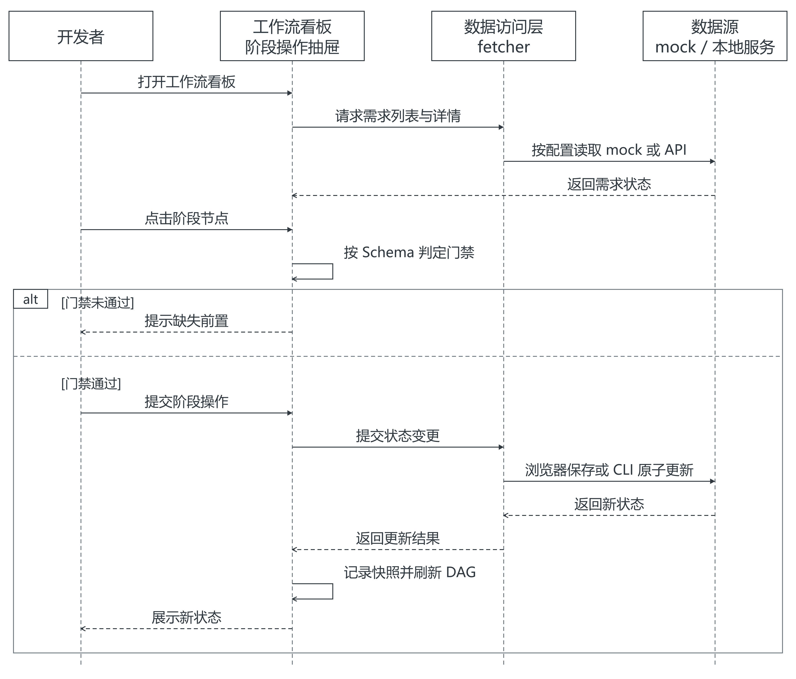

图5-16 工作流看板阶段操作时序图

Figure 5-16 Sequence Diagram of Stage Operations on the Workflow Board

### 5.6.3 图谱可视化与上下文演示

图谱可视化页用力导向布局渲染 C、L1、L2、L3 四层节点和五类边：四个层级用不同颜色区分，contain、import、call、inherit 和 business_map 五类边用不同颜色和线宽区分。页面支持按层级和边类型过滤、按名称检索定位节点，选中节点时在侧边展示它的标识、层级、类型和扩展属性；business_map 边可以一键高亮，方便核对一项业务能力究竟关联了哪些代码。图5-17 是图谱可视化页的实际界面，四层节点和跨层的业务映射边在力导向布局下一目了然。图谱统计页展示节点与边的规模、按层级和类型的分布、证据来源分布和能力覆盖率，作为构建质量的核查入口，页面如图5-18 所示。

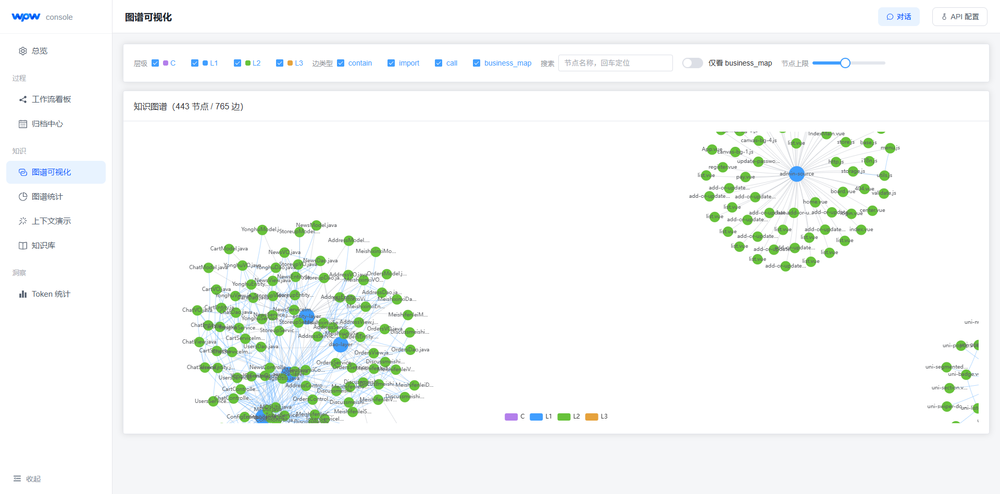

图5-17 控制台图谱可视化页界面

Figure 5-17 Console Graph Visualization Page

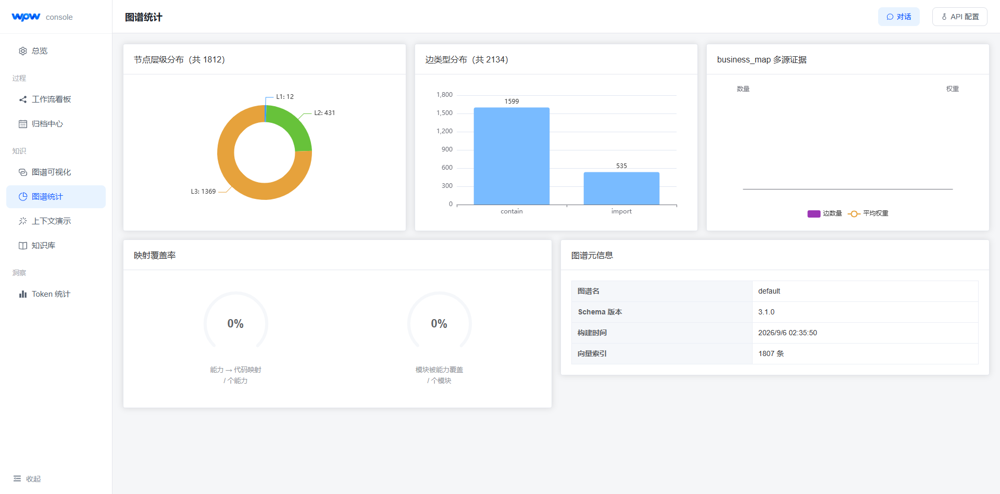

图5-18 控制台图谱统计页界面

Figure 5-18 Console Graph Statistics Page

上下文演示页把第 3 章的上下文生成流水线拆成看得见的三步。输入自然语言任务后，页面先展示语义检索命中的锚点和匹配得分；再用图谱画布展示从锚点扩展、裁剪后得到的任务子图；最后并排给出宽松、标准、极限三档压缩的输出，各自标注节点数和 Token 估算。Token 预算用滑块调节，超预算的结果用醒目颜色标出。演示数据覆盖从能力层出发的完整链路。以“调整购物车中收藏商品的展示逻辑”为例，命中的锚点是 C 层能力节点“购物车与收藏管理”；子图沿 business_map 边扩展到前端 web-cart 和后端 server-cart 两个模块，再沿 contain 边下钻到 Cart.vue、cart.ts、cart-routes.js 等文件和 toggleFavorite、setFavorite 等函数；三档压缩分别保留完整签名、只保留名称、再进一步裁掉外围元素。这一演示的实际界面如图5-19 所示：三步流水线自上而下排列，三档压缩的节点数与 Token 估算并排可比，宽松档超预算时以醒目颜色标出。开发者由此可以直接检查，一次任务拿到的上下文是不是真的来自这项业务能力对应的代码。

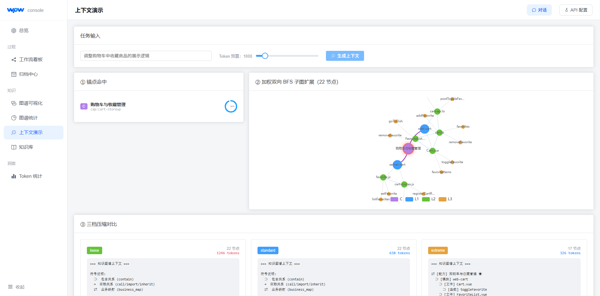

图5-19 控制台上下文演示页界面

Figure 5-19 Console Context Generation Demo Page

### 5.6.4 模型配置与对话

API 配置页配置大模型接口的 base_url、apikey 和 model 三项，并提供连接测试。apikey 保存后只显示脱敏形式（保留首尾少量字符），而且只写浏览器本地存储，不进任何纳入版本管理的文件。

配置完成后可以在对话页直接对话，模型响应以流式方式逐段呈现。页面提供“注入项目上下文”开关：开启后，提问先经图谱检索生成项目上下文，随问题一起发送，界面上能看到这次注入的上下文摘要和 Token 量。对话页还支持双栏对比，同一问题左右两栏分别给出纯模型回答和图谱增强回答，上下文工程带来的差异可以直接对比。知识库页、归档中心和 Token 统计页分别承担能力规范阅读（图5-20）、归档文档浏览（图5-21）和消耗维度分析（图5-22）：知识库页左侧列出全部能力规范、右侧渲染选中的规范正文；归档中心按月份组织已归档需求及其阶段制品；Token 统计页从需求、阶段和日期三个维度统计模型消耗。三个页面共同构成第 6 章实验演示和结果分析的观测入口。

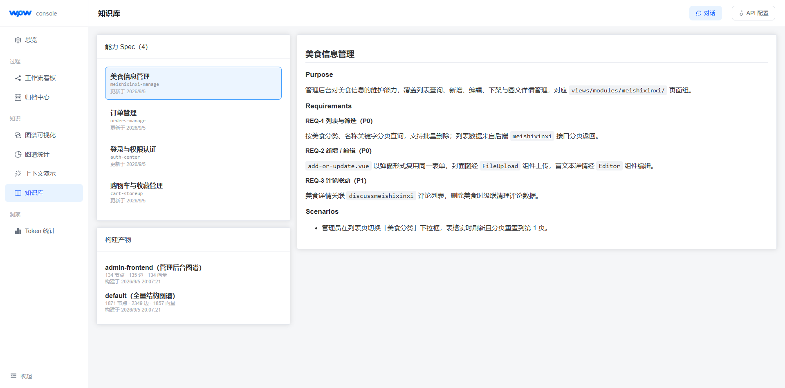

图5-20 控制台知识库页界面

Figure 5-20 Console Knowledge Base Page

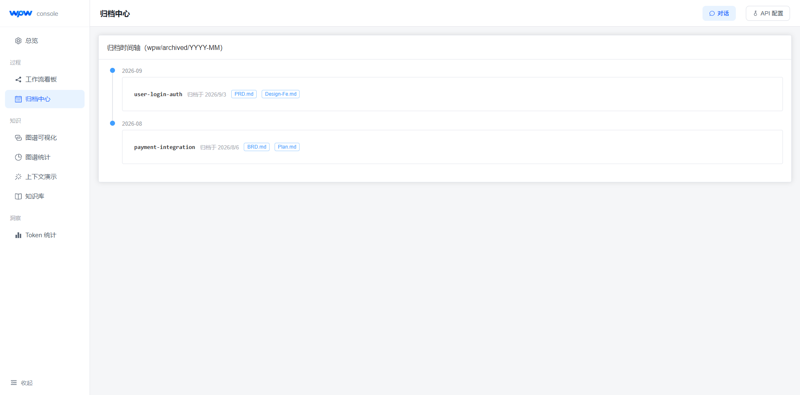

图5-21 控制台归档中心页界面

Figure 5-21 Console Archive Center Page


图5-22 控制台 Token 统计页界面

Figure 5-22 Console Token Statistics Page

## 5.7 本章小结

本章把第 3 章的上下文工程方法实现为 WPW 系统。系统分 AI 层、CLI 层和文件系统层三层，可视化控制台作为呈现入口挂在 CLI 层之上；过程管理走六阶段工作流，每个阶段按"准备、生成、收尾"三步推进，阶段门禁由 DAG 上的强依赖判定；项目知识由能力规范和源码解析共同构建，形成 C-L1-L2-L3 四层图谱，业务与代码之间的映射由多源证据合成并可溯源；任务上下文从锚点出发扩展子图，经骨架抽取和分档压缩控制在 Token 预算内；代码和需求变化后，按文件哈希和能力规范比对做增量更新，归档时把确认过的需求沉淀进能力规范；控制台用和 CLI 同一份数据契约，把状态、图谱和上下文生成过程呈现在页面上，并支持阶段操作、历史回溯、模型对话和双栏对比。

这些实现说明方法有了可运行的工程载体，但还不能证明方法有效。第 6 章先对 WPW 做一组功能测试，检查工作流管理、图谱构建、上下文生成、增量维护和可视化控制台是否按预期运行；再在统一配置下让 WPW 与 OpenSpec 从相同的前置版本出发完成同样的开发任务，比较任务完成情况、模型 Token 消耗和执行耗时；随后把范围收窄到上下文获取环节，在同一代码快照上比较非 KG、WPW-Map 与完整 WPW 三种条件下的文件定位质量、回答正确性和上下文开销。

# 第 6 章 系统测试与结果分析

第 5 章把第 3 章的上下文工程方法实现成了 WPW 系统。本章针对这套实现做测试，测试分两部分。一部分是 WPW 的常规功能测试，运行 CLI 命令、查看状态文件和图谱元数据、打开控制台页面，确认工作流、图谱构建、上下文生成、增量维护和可视化控制台按第 5 章的设计工作。另一部分在测试过程中检验这套方法在真实开发中是否可行、是否有效。开发任务对比让 OpenSpec 和 WPW 完成同一批任务，看模型总 Token 是否下降；如果有下降，再组织实验看它是否与更准的文件定位、更少的上下文供给有关系。本章表格中的测试数据在附录中给出汇总值或原始记录索引。

## 6.1 系统功能测试

功能测试在美食推荐系统上执行，不调用大模型判断回答质量。测试方式是运行 CLI 命令、查看状态文件和图谱元数据、打开控制台页面，用例的判据是命令输出、状态转换、持久化结果或页面呈现。测试用例按第 5 章 5.2—5.6 的 15 个实现小节组织，共 34 条；每条用例在表6-3 的“对应实现小节”列中标出它覆盖的实现位置。

### 6.1.1 测试对象与业务规模

功能测试用美食推荐系统来整体串流程，它同时也是后面两组实验的数据来源。系统用 Spring Boot、Vue 和 Uni-app 编写：用户端是 Uni-app 页面，管理端是 Vue 组件，后端是 Spring Boot 的控制器、服务、数据访问层和 Mapper XML。用户登录后进入首页，系统根据浏览和收藏这类行为生成个性化推荐；用户从详情页收藏、评论、加入购物车或直接下单；订单在待付款、待发货、配送中和已完成之间流转，完成后的评价又回到偏好计算，影响下一轮推荐。管理员负责维护用户、美食分类、美食信息和订单。

选择这个项目的理由，是它的业务从推荐、下单到订单流转形成了完整闭环，多个功能模块并存，需求也经历了多轮迭代。这样的条件让 WPW 的各个环节都有真实的材料可考验：多语言源码供图谱构建解析，真实存在的业务功能供业务—代码映射标注，足够大的代码规模让上下文的裁剪和压缩有实际意义。按图谱构建的口径，项目有 12 个模块、393 个源文件和 1,369 个代码元素；完整实验图谱另有 25 个能力节点和 300 条业务—代码映射边。表6-1 汇总这些规模。

表6-1 实验载体规模说明

Table 6-1 Scale of the Experimental Subject

| 维度 | 内容 |
|---|---|
| 系统角色 | 普通用户、管理员 |
| 用户端功能 | 注册登录、美食浏览与检索、个性化推荐、购物车、订单、收藏、评论、资讯、个人中心 |
| 管理端功能 | 用户、美食分类、美食信息、资讯、订单维护 |
| 技术栈 | 用户端 Uni-app，管理端 Vue，后端 Spring Boot，数据库 MySQL |
| 代码规模 | 12 个模块、393 个源文件、1,369 个代码元素 |
| 知识图谱 | 25 个能力节点、300 条业务—代码映射边（完整 WPW 条件） |

### 6.1.2 测试方式

测试在 Windows 11 上执行，WPW 的运行环境是 Node.js v20.20.2，被测的美食推荐系统后端为 Java 8。开发任务对比的大模型为 gpt-5.6，场景问答实验的回答模型为 gpt-5.4-mini，检索与问答的 Embedding 统一使用 `text-embedding-3-small`。CLI 与图谱用例和可视化控制台用例分两批跑：前者针对命令行行为，后者针对页面呈现和数据契约。表6-2 记录解析范围、映射与裁剪参数和执行入口，这些配置决定了被测行为。

表6-2 测试配置

Table 6-2 Test Configuration

| 项目 | 配置 | 说明 |
|---|---|---|
| 运行环境 | Windows 11；Node.js v20.20.2 | WPW CLI 与图谱模块的运行时 |
| 被测系统 | Java 8（Spring Boot 后端） | 美食推荐系统，源码只做解析、不被执行 |
| 大模型 | 开发任务对比用 gpt-5.6；场景问答用 gpt-5.4-mini；Embedding 为 `text-embedding-3-small` | 两类实验分别固定模型，运行记录的 model 字段与之对应 |
| 解析范围 | TypeScript、JavaScript、Vue、Java | 与图谱配置中的 `languages` 一致 |
| 映射与裁剪配置 | `mapping.mode=local`；深度 3；最小边权重 0.7；最大节点数 100 | 未设置项目覆盖配置时采用默认值 |
| 上下文压缩 | `standard` | 显式锚点测试不依赖向量索引 |
| 执行入口 | `npm run build`、`npx ts-node src/graph/__verify__.ts`、`npx ts-node src/test/integration.test.ts` | 保留终端输出作为测试证据 |

测试覆盖工作流状态、阶段依赖、任务追踪、图谱构建、能力解析、代码解析、多源映射、结构化查询、语义搜索、上下文生成、多图谱存储和增量更新。仓库里有综合验证脚本 `src/graph/__verify__.ts`，它在一个独立临时项目里执行构建、查询、更新和重建；另有单元测试和集成测试覆盖解析器、映射器、存储模块和命令接口。分模块用例以验证脚本、CLI 命令和页面检查为主要证据，不把测试文件的存在本身算作通过。

34 条用例按第 5 章的五个模块组织，每条用例的编号以模块缩写开头：工作流管理是 WF、知识图谱是 KG、上下文生成是 CTX、增量维护是 INC、可视化控制台是 UI，编号后接两位序号，如 WF-01、KG-06。从 5.2.1 到 5.6.4 的 15 个实现小节都有用例覆盖。5.2.2 的阶段文档内容生成和 5.5.2 的能力规范合并由智能体在受控流程中完成，属于提示词驱动的过程；对应用例验证的是这两节里的确定性命令、状态写回和归档与图谱更新联动，不把生成文本的质量算作功能测试结果。

### 6.1.3 测试结果

表6-3 WPW 分模块功能测试用例与结果

Table 6-3 Functional Test Cases and Results by Module

| 用例 | 模块 | 对应实现小节 | 测试项 | 输入与操作 | 预期结果 | 实际结果 | 结论 |
|---|---|---|---|---|---|---|---|
| WF-01 | 工作流 | 5.2.1 | 需求创建与初始化 | 执行 `wpw init`，再执行 `wpw new login` | 生成 `wpw/active/login/` 和 `.WPW.yaml`；六阶段初始为 `pending`，写入 Schema、项目类型和任务进度 | 目录与状态文件生成；`brd/prd/explore/design/plan/testplan` 均为 `pending`；`schema=wpw-six-phase`、`projectType=auto`、`totalTasks=0` | 通过 |
| WF-02 | 工作流 | 5.2.1 | 名称校验与幂等创建 | 执行 `wpw new "Bad Name"`；再次执行 `wpw new login` | 非法名称非零退出并提示 kebab-case 规则；重复名称幂等处理，不重复创建工作区 | 前者退出码 1，提示"需求名只能包含小写字母、数字和短横线"；后者输出"需求已存在: login（幂等跳过）"，退出码 0 | 通过 |
| WF-03 | 工作流 | 5.2.2 | 阶段模板下发 | 执行 `wpw template design --json`、`wpw template plan --json` | 返回阶段模板的绝对路径，且文件存在 | design 返回 `Design-Fe.md`、`Design-Server.md`；plan 返回 `Plan-Fe.md`、`Plan-Server.md` | 通过 |
| WF-04 | 工作流 | 5.2.3 | 强依赖门禁 | BRD 为 `pending` 时执行 `wpw check prd -c login --json`；BRD 置为 `done` 后重复 | 首次 `canProceed=false`、`missing=["brd"]`、非零退出；BRD 完成后允许推进 | 首次返回 `{"artifact":"prd","canProceed":false,"missing":["brd"],"warnings":[]}`，退出码 1；完成后 `canProceed=true`、`missing=[]` | 通过 |
| WF-05 | 工作流 | 5.2.2、5.2.3 | 可选 Explore 决策与跳过 | BRD、PRD、Explore 为 `done` 且未拍板时执行 `check design`；执行 `decision explore --option ...` 后重复；另建需求执行 `skip explore` 和 `skip design` | 未拍板时返回警告，拍板后警告消失；仅可跳过阶段允许跳过 | 未拍板时 `warnings` 含 1 条提示，拍板后为 `[]`；`skip explore` 将状态置为 `skipped` 且 Design 可继续；`skip design` 退出码 1，提示"阶段 design 不可跳过" | 通过 |
| WF-06 | 工作流 | 5.2.4 | 任务实施、进度同步与断点恢复 | Plan 含 3 个任务（1 个已完成）时执行 `wpw apply login --json`；执行 `wpw task login --mark 2 --state in-progress`、`--state done`；再执行 `wpw apply login --from 3 --json` | 返回已完成文档、任务和进度；任务标记同步 Plan 与 `.WPW.yaml`；`--from` 从指定任务恢复 | `state=ready`，3 个任务，进度 1/3，并返回 Test 未完成警告；第 2 项先变为 `[🔄]` 再变为 `[x]`，进度 2/3；`--from 3` 仅返回任务 3，`remaining=1` | 通过 |
| WF-07 | 工作流 | 5.2.4、5.5.2 | 归档与工作区迁移 | 执行 `wpw archive archive-demo` | 工作区迁移到 `wpw/archived/YYYY-MM/<change>/` | 输出"已归档: archive-demo -> WPW\archived\2026-10\archive-demo"；`wpw/active/` 下不再存在该目录 | 通过 |
| WF-08 | 工作流 | 5.2.2 | 阶段完成状态写回 | 新建 `done-demo` 后执行 `wpw done brd -c done-demo`，再执行 `wpw status done-demo` | `brd` 置为 `done`，其余阶段保持 `pending`；状态写入 `.WPW.yaml` | 输出"已标记 done-demo.brd = done"；`status` 显示 `brd done`、其余 `pending`；`.WPW.yaml` 的 `status.brd=done` | 通过 |
| KG-01 | 图谱构建 | 5.3.1 | 能力规范解析 | 在 `wpw/specs/user-auth/spec.md` 写入 Purpose 和 Requirements/Scenarios，构建后执行 `wpw graph query -l C --json` | 生成 C 层 capability 节点，含 `description` 和 `features` | 节点 `user-auth` 的 `description` 为 Purpose 首段；`features` 含 `R1 用户登录/P0`、`R2 会话校验/P2`，优先级按场景数计算 | 通过 |
| KG-02 | 图谱构建 | 5.3.1 | 多语言源码解析 | 使用验证脚本中的 `state.ts` 与 Spring Boot 风格 `UserController.java` | 生成 L2 文件与 L3 元素；Java 识别类、至少 2 个方法、至少 1 个常量和 import | `state.ts` 生成 19 个 L3 元素和 4 条 import；Java 生成 1 个 class、2 个 function、1 个 constant、2 条 import，并提取 `GET /api/user/{id}` | 通过 |
| KG-03 | 图谱构建 | 5.3.1 | 状态管理代码解析 | 在测试项目加入 `src/stores/auth.js`（Pinia `defineStore`），执行 `wpw graph update --json` | 生成 L2 store 节点及 state/getter/action 子节点 | 生成 `pinia-store useAuthStore`；L3 含 `pinia-state user/token`、`pinia-getter isLoggedIn`、`pinia-action login` | 通过 |
| KG-04 | 图谱构建 | 5.3.3 | 业务映射多源聚合 | 对含能力规范与源码的图谱执行全量构建，检查 `business_map` 边；执行 `edge-builder` 聚合用例 | 生成 C 到 L1/L2/L3 的 `business_map` 边，并记录权重与证据来源；多源命中按 noisy-OR 聚合 | `edge-builder` 用例 6/6 通过，覆盖三源 noisy-OR 聚合、权重上限 0.95 和单源保留；项目图谱中该边为 `cap:ef2a... -> mod:e27a...`，`weight=0.307`，`source=semantic` | 通过 |
| KG-05 | 图谱构建 | 5.3.3 | 图谱存储与索引 | 执行 `npx ts-node src/graph/__verify__.ts` 的存储层用例 | JSONL 图谱写入后可完整加载，索引包含全部节点 | 写入并加载 4 个节点、3 条边；`nodeMap.size=4`；C、L1、L2、L3 各 1 个节点 | 通过 |
| KG-06 | 图谱构建 | 5.3.1、5.3.3 | 全量构建与结构化查询 | 执行 `wpw graph build --json --no-progress`、`wpw graph query -l L1 --json` 和 `wpw graph query --downstream <mod> --depth 2 --json` | 构建成功、校验通过、元数据完整；查询返回模块及下游依赖 | `success=true`、`validation.passed=true`，C/L1/L2/L3 为 1/2/3/6，边为 contain 9、import 1、business_map 1；L1 查询返回 2 个模块，下游查询返回 8 个节点 | 通过 |
| KG-07 | 图谱构建 | 5.3.3 | 多图谱存储与命名 | 执行验证脚本的多图谱用例 | 支持 default/frontend/backend 等命名，名称格式校验生效，可列举图谱 | 三类路径生成正确；`my-graph` 合法，`Bad Name`、`-bad` 非法；default 图谱 574 节点、741 边 | 通过 |
| KG-08 | 图谱构建 | 5.3.3、5.4.1 | 语义检索 | 执行 `wpw graph search "登录" --json` | 返回相关节点及相似度得分 | 返回 C 层 `user-auth`，`score=0.7256` | 通过 |
| KG-09 | 图谱构建 | 5.3.2 | 节点 JSON 字段与边记录 | 执行验证脚本的全量构建后读取 `graph.jsonl`，抽查各层节点与边记录 | 节点含 `id/level/type/name/attrs/createdAt/updatedAt`；`id` 为"类型前缀:12 位摘要"；层级与类型分开；`attrs` 按实体类型可选；边以独立记录保存 `from/to/type/weight/source` | 574 个节点、741 条边均无缺失字段；节点标识全部符合"前缀:12 位十六进制"；L1 `module` 2、L2 `file` 81、L3 `interface/function/class` 111/370/10；L3 函数含 `signature/params/returnType/parentName/isExported/lineStart/lineEnd/filePath`；边为 contain 504、import 237，记录带权重与来源；该验证工作区无 C 层，C 层字段由 KG-01 验证 | 通过 |
| CTX-01 | 上下文生成 | 5.4.1 | 显式锚点与语义锚点 | 在 4 节点夹具上执行 `wpw graph context --anchors mod:test456 --depth 2 --max-nodes 30 --token-budget 1000 --json`；在含向量图上执行 `wpw graph context "登录" --min-weight 0.3` | 保留锚点并返回结构化子图；语义查询能解析出锚点 | 显式锚点返回 1 个锚点、4 个节点、3 条边、77 tokens；语义查询命中 `C/user-auth`，默认 `min-weight=0.7` 时权重 0.307 的 `business_map` 边被裁剪、仅剩锚点，放宽到 0.3 后得到 4 个节点、3 条边、77 tokens | 通过 |
| CTX-02 | 上下文生成 | 5.4.1 | 子图层级与类型过滤 | 以 L1 模块为锚点，分别加 `--level L2` 和 `--type file` | 层级和类型过滤生效，锚点保留 | 两者均返回 L1 `commands` 与 L2 `alpha.ts`、`beta.ts`、`order.ts`，4 个节点、3 条边、60 tokens | 通过 |
| CTX-03 | 上下文生成 | 5.4.2 | 分档压缩 | 以 L1 模块为锚点，分别设置 `--compression loose/standard/extreme` | 子图不变，估算 Token 随压缩等级提高而下降 | 9 个节点、8 条边不变；三档分别为 111、83、55 tokens | 通过 |
| CTX-04 | 上下文生成 | 5.4.2 | Token 预算降级 | 同一锚点分别设置 `--token-budget 100/60/30/10` | 超预算时逐级压缩、缩小节点规模或回退到锚点；仍超预算时给出提示 | 100 对应 83 tokens（9 节点）、60 对应 55（9 节点）、30 对应 22（仅锚点）、10 对应 35（仅锚点）；末档压缩文本以"[警告] Token 预算 (10) 不足，仅输出核心锚点"开头 | 通过 |
| CTX-05 | 上下文生成 | 5.3.3、5.4.2 | 向量索引缺失降级 | 删除 `index/vector.index` 与 `index/vector-mapping.json` 后，以显式锚点请求上下文 | 跳过语义检索仍返回结构化上下文，不发生硬阻塞 | 退出码 0，stderr 为空；返回 1 个锚点、9 个节点、8 条边、83 tokens | 通过 |
| INC-01 | 增量维护 | 5.5.1 | 无改动检测 | 构建后立即执行 `wpw graph update --json` | 识别无变化，返回 `updated=false` | 返回 `{"updated":false,"reason":"no changes detected"}` | 通过 |
| INC-02 | 增量维护 | 5.5.1 | 修改文件局部重建 | 修改 `alpha.ts` 新增 `alphaThree()` 后执行 update | 更新修改文件的哈希与 L2/L3 节点，未修改文件保留 | `alpha.ts` 哈希由 `11e21fb7...` 变为 `18073a5f...`；L3 由 5 变为 6，contain 边由 8 变为 9；`beta.ts`、`order.ts` 哈希不变 | 通过 |
| INC-03 | 增量维护 | 5.5.1 | 新增与删除文件 | 新增 `gamma.ts` 后执行 update，再删除后执行 update | 新增时局部加入节点和边，删除时移除，校验保持通过 | 新增后 L2 由 3 变为 4、L3 由 6 变为 7、contain 由 9 变为 11、向量由 12 变为 14；删除后恢复为 L2 3、L3 6、contain 9、向量 12，两次 `validation.passed=true` | 通过 |
| INC-04 | 增量维护 | 5.5.1 | 能力规范增量更新 | 在能力 Spec 中追加 Scenario 后执行 `wpw graph update --json`，随后执行 `wpw graph rebuild --json` | C 层节点重新解析，受影响的 `business_map` 边一并重算 | C 节点 `features` 更新（`会话校验` 由 P2 变为 P1）；`business_map` 边由 1 条变为 0 条，校验警告"1 个节点没有任何关联边"；执行 rebuild 后恢复 1 条 | 通过（update 不重算映射边，rebuild 后恢复，见 6.1.3 说明） |
| INC-05 | 增量维护 | 5.5.1 | Schema 主版本不兼容回退 | 将 `meta.json` 的 `schemaVersion` 改为 `4.0.0` 后执行 update | 主版本不兼容时自动全量重建，并写入当前版本 | 输出两条重建提示；`success=true`；`meta.json` 的 `schemaVersion=3.1.0` | 通过 |
| INC-06 | 增量维护 | 5.5.2 | 归档触发图谱更新 | 在含 `wpw/knowledge/graph/default/` 的工作区执行 `wpw archive archive-demo` | 归档迁移完成后触发图谱增量更新 | 工作区迁移成功；随后输出"知识图谱未构建，跳过更新（如需构建请执行 WPW graph build）" | 通过（多图谱布局下不触发更新，见 6.1.3 说明） |
| UI-01 | 可视化控制台 | 5.6.1 | 静态构建与路由 | 在 `viz` 目录执行 `npm run build`，用 `wpw viz` 托管 `dist` 后访问 10 个路由 | 构建成功，页面可加载 | vite build 退出码 0，18.34 s 完成；总览、工作流看板、归档中心、图谱可视化、图谱统计、上下文演示、知识库、Token 统计、对话、API 配置均可打开 | 通过 |
| UI-02 | 可视化控制台 | 5.6.2 | 总览与工作流看板 | 访问 `#/dashboard` 和 `#/workflow`，打开 `board-demo` 详情 | 总览显示活跃需求、阶段完成度和图谱规模；看板显示六阶段与任务进度；详情显示 Test 警告、Explore 拍板、Plan 任务和制品状态 | 总览显示 1 个活跃需求、71% 阶段完成度、12 节点/11 边、任务 1/3；看板显示六阶段加 Apply 和"进行中"；详情显示 Test 未完成警告、决策"方案A"、Plan 1/3 以及各阶段制品状态 | 通过 |
| UI-03 | 可视化控制台 | 5.6.3 | 图谱可视化与统计 | 访问 `#/graph` 和 `#/graph-stats` | 渲染节点和边，支持层级、边类型过滤；统计页显示分布、覆盖率和元信息 | 图谱页显示 12 节点/11 边，C/L1/L2/L3 与 contain/import/call/business_map 过滤项可用；统计页显示能力覆盖 1/1、模块覆盖 1/5、Schema 3.1.0、向量 12 条 | 通过 |
| UI-04 | 可视化控制台 | 5.6.3 | 上下文演示 | 在 `#/context` 输入"登录"，预算 1000，开启语义检索 | 展示锚点、子图和 loose/standard/extreme 三档压缩及 Token 估算 | 锚点为 C 层 `user-auth`；子图 10 个节点；三档分别为 172、122、84 tokens | 通过 |
| UI-05 | 可视化控制台 | 5.6.4 | 知识库、归档与配置页面 | 访问 `#/knowledge`、`#/archive`、`#/token-stats`、`#/api-config` 和 `#/chat` | 知识库渲染能力规范；归档中心按月份列出归档；Token 页给出统计维度或空态说明；配置页只保存到 localStorage；对话页支持上下文注入 | 知识库显示 1 份规范全文；归档中心显示 `2026-10/archive-demo`；Token 页提示无真实调用记录并说明 `.wpw-console/usage.jsonl`；配置页提示"API Key 仅保存在浏览器本地，不落盘"；对话页"注入项目上下文"开关默认开启，未配置模型时给出提示 | 通过 |
| UI-06 | 可视化控制台 | 5.6.1—5.6.4 | 真实项目规模页面复核 | 将美食推荐系统快照复制为独立工作区，补充 8 份能力规范、3 个活动需求与 7 个归档需求，重建图谱后运行 `wpw viz`，逐页访问总览、工作流看板、需求详情、图谱统计、上下文演示、知识库与归档中心 | 各页面从工作区真实读取需求、图谱与规范数据，无接口错误或空白页；页面数值与 `.WPW.yaml`、`meta.json` 和图谱文件一致 | 总览显示 3 个活动需求、43% 阶段完成度、1818 节点/2373 边；看板显示 3 个需求及六阶段状态，详情显示决策、Plan 2/4 与 6 份阶段制品；图谱统计显示 C 8/L1 10/L2 431/L3 1369、business_map 40、能力覆盖 8/8、Schema 3.1.0、向量 1813 条；上下文演示命中 5 个锚点并扩展 200 节点，预算 4000 时三档为 4859/2029/1677 tokens；知识库显示 8 份规范；归档中心显示 2026-08 至 2026-10 共 7 个归档需求 | 通过 |

表6-3 的 34 条用例全部通过，覆盖了工作流创建与门禁、阶段模板与状态写回、任务进度与断点恢复、能力与多语言源码解析、节点与边模型、业务映射、图谱存储与查询、多图谱命名、上下文锚点与过滤、压缩与预算降级，以及控制台的看板、图谱、上下文演示和知识库页面。其中 INC-04 和 INC-06 涉及的两处行为——能力规范变更后 update 不重算 `business_map` 边、多图谱布局下 archive 不触发图谱更新——需要显式执行 rebuild 或 update 才能生效，对后面实验的固定图谱没有影响。控制台在真实项目规模的图谱下也做了页面复核，过程与页面截图见附录 A.2。

## 6.2 数据统计

功能测试跑完后，美食推荐系统的工作区里留下了 WPW 运行产生的数据：各测试需求的六阶段状态、任务进度和归档记录都在；项目源码上构建出的完整知识图谱收录 12 个模块、393 个源文件和 1,369 个代码元素，25 个能力节点和 300 条业务—代码映射边把需求侧的能力连到代码上，全图 1,799 个节点、2,434 条边，向量索引 1,794 条。接下来比较这套方法的开销。模型总 Token 对应智能体开发中最直接的成本，先看 WPW 与 OpenSpec 完成同一批开发任务时各用了多少。

### 6.2.1 与 OpenSpec 的开发任务对比

开发实验把连续开发过程分成三个任务集：T1 基础搭建、T2 业务核心、T3 迭代增强，共 8 个任务。每个任务分别用 OpenSpec 和 WPW 完成，比较完成任务的模型总 Token。T4 是连续需求补充，依次做会员积分、优惠券、会员等级和配送规则，同样只统计模型总 Token。表6-4 列出 T1—T3 的任务。

表6-4 美食推荐系统开发任务

Table 6-4 Development Tasks for the Food Recommendation System

| 任务集 | 场景 | 任务数量 | 任务内容 |
|---|---|---:|---|
| T1 | 基础搭建 | 2 | 用户认证、美食分类和美食信息管理 |
| T2 | 业务核心 | 2 | 个性化推荐、购物车和订单流程 |
| T3 | 迭代增强 | 4 | 收藏、评论、美食资讯和个人中心 |

模型总 Token 统计任务执行期间的输入、输出和工具调用相关用量。WPW 的相对变化以同一任务的 OpenSpec 用量为基准：

$$
\mathrm{Reduction}=1-\frac{\mathrm{Token}_{\mathrm{WPW}}}{\mathrm{Token}_{\mathrm{OpenSpec}}}. \tag{6-1}
$$

开发记录里有几处协议例外。T1-2 的 WPW 用量含估算口径，T2-1 的精确 Token 只覆盖续跑阶段，T3 和 T4 的部分数值缺少完整原始运行记录（附录 B 已标注）。因此，本节只把开发数据解释为模型总 Token 的用量结果，不扩展为其他质量指标。

T1—T3 的 8 个配对任务中，OpenSpec 合计 71,141,143，WPW 合计 42,422,522，整体减少 40.37%，8 个任务的用量都下降。以任务为配对单位做精确 Wilcoxon 符号秩检验，得到 $W=0$、$p=0.00781$、配对秩二列相关 $r_{rb}=-1.000$。表6-5 列出每个任务的用量。

表6-5 T1—T3 开发任务模型总 Token 对照

Table 6-5 Comparison of Total Model Tokens for T1–T3 Development Tasks

| 任务 | 方法 | 模型总 Token | WPW 相对变化 |
|---|---|---:|---:|
| T1-1 用户注册与登录 | OpenSpec | 7,154,327 | — |
| T1-1 用户注册与登录 | WPW | 4,341,714 | -39.31% |
| T1-2 美食分类和美食信息管理 | OpenSpec | 11,162,207 | — |
| T1-2 美食分类和美食信息管理 | WPW | 3,549,765 | -68.20% |
| T2-1 个性化推荐接口 | OpenSpec | 5,953,742 | — |
| T2-1 个性化推荐接口 | WPW | 4,489,079 | -24.60% |
| T2-2 购物车与订单流程 | OpenSpec | 13,874,175 | — |
| T2-2 购物车与订单流程 | WPW | 9,723,130 | -29.92% |
| T3-1 收藏 | OpenSpec | 6,804,127 | — |
| T3-1 收藏 | WPW | 4,151,806 | -38.98% |
| T3-2 评论 | OpenSpec | 10,068,110 | — |
| T3-2 评论 | WPW | 5,945,317 | -40.95% |
| T3-3 美食资讯 | OpenSpec | 6,746,634 | — |
| T3-3 美食资讯 | WPW | 4,221,184 | -37.43% |
| T3-4 个人中心 | OpenSpec | 9,377,821 | — |
| T3-4 个人中心 | WPW | 6,000,527 | -36.01% |

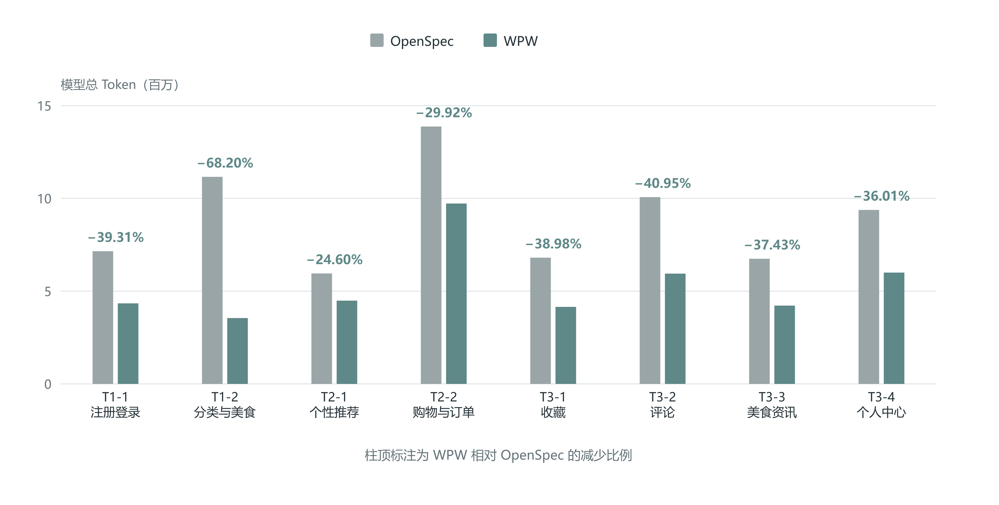

图6-1 T1—T3 八任务模型总 Token 对比

Figure 6-1 Total Model Tokens for Eight T1–T3 Tasks

T4 的四轮需求都下降，合计从 40,332,312 降到 25,732,630，减少 36.20%；表6-6 列出逐轮结果。

表6-6 T4 连续开发任务模型总 Token 对照

Table 6-6 Comparison of Total Model Tokens for the T4 Continuous Development Task

| 轮次 | 需求 | OpenSpec 模型总 Token | WPW 模型总 Token | WPW 相对减少 |
|---|---|---:|---:|---:|
| T4-1 | 会员积分 | 9,206,342 | 7,601,438 | 17.44% |
| T4-2 | 优惠券 | 12,794,815 | 6,536,772 | 48.90% |
| T4-3 | 会员等级 | 7,422,618 | 5,176,294 | 30.26% |
| T4-4 | 配送规则 | 10,908,537 | 6,418,126 | 41.16% |
| **合计** | — | **40,332,312** | **25,732,630** | **36.20%** |

把 T1—T4 的 12 个任务合起来，OpenSpec 为 111,473,455，WPW 为 68,155,152，整体减少 38.86%。到这里，开发实验回答的是“总用量是否更低”，答案是更低。但它还不能回答“为什么更低”：模型总 Token 受任务顺序、模型在某一轮的状态、是否需要返工、工具调用次数和上下文长度等很多因素影响，而开发实验只记录了最后的总量，没有在任务过程中记录每一次检索和每一段上下文。要回答这个问题，需要把上下文这一环单独拿出来，在同一份代码、同一套题集上比较不同条件。

### 6.2.2 上下文定位与供给的对照

为了进一步探究 Token 下降的原因，我们在实验数据的基础上设计了对照实验，分别验证文件定位是否更准、上下文供给是否更省、回答质量是否保持这三个方向有没有改进。对照实验在固定快照上做，图谱工作区由快照复制得到。表6-7 列出两种实验图谱的规模，WPW-Map 只有代码结构层，完整 WPW 在此基础上增加 25 个 C 层能力节点和 300 条 `business_map` 边。两张图都通过结构校验，代码结构层相同，差异只在业务—代码映射。

表6-7 实验图谱规模对照

Table 6-7 Comparison of Experimental Graph Sizes

| 图谱 | C 层能力节点 | L1 | L2 | L3 | 总边数 | business_map 边 | 向量数 | 构建结果 |
|---|---:|---:|---:|---:|---:|---:|---:|---|
| WPW-Map | 0 | 12 | 393 | 1,369 | 2,134 | 0 | 1,769 | 通过校验 |
| 完整 WPW | 25 | 12 | 393 | 1,369 | 2,434 | 300 | 1,794 | 通过校验 |

表6-8 是三种条件。三种条件使用同一份源码快照和同一组查询，区别只在排序时是否使用图谱。非 KG 关闭代码结构图和业务—代码映射，只用 BM25 对源码文件做文本检索；WPW-Map 保留代码结构图、关闭映射，在文本候选基础上加入图检索信号；完整 WPW 在此基础上再使用业务—代码映射和图谱摘要。检索和问答都在这三种条件下进行。

表6-8 检索与问答条件

Table 6-8 Retrieval and Question-Answering Conditions

| 条件 | 代码结构图 | 业务—代码映射 | 上下文组织 | 用途 |
|---|---|---|---|---|
| 非 KG | 关闭 | 关闭 | BM25 候选的相关行窗口 | BM25 词面检索基线 |
| WPW-Map | 保留 | 关闭 | 代码图导航与相关行窗口 | 检验代码结构图的作用 |
| 完整 WPW | 保留 | 保留 | 图谱摘要与候选文件相关行窗口 | 完整方法 |

实验分检索和问答两个子实验。（1）检索子实验有 100 个信息需求，按四类各 25 题组织：精确标识定位、业务关键词定位、同义或非代码命名表达、组合条件定位。每个需求配有人工标注的标准答案（Gold）：精确标识题只标声明目标符号的那一个实现文件，其余三类题标出实现目标功能的全部文件，范围按问题族确定；例如 `YonghuController.login` 的标准答案只有 `YonghuController.java`，而“用户登录与令牌签发”的标准答案包括该控制器、令牌服务及其实现。每题记录查询文本、信息需求、类别、问题族、快照提交标识和标准答案文件集合。（2）问答子实验有 100 个问题，覆盖现有功能解释、跨模块调用与数据流、权限与业务约束、变更影响分析、规格与实现核对五类，每类 20 题；问题必须依赖项目源码或规格证据才能回答，对于“未实现”或“证据不足”的问题，谨慎的否定结论可以是正确答案；问答题不设 Gold 文件，评分依据必答事实和盲评规则。

检索指标分别考察排序结果前 5 个候选和前 10 个候选的召回率，以及前 10 个候选的精确率；问答指标是盲评通过率、初始上下文 Token 和模型实际用量。两组指标的具体定义在下文给出，这里不再赘述。

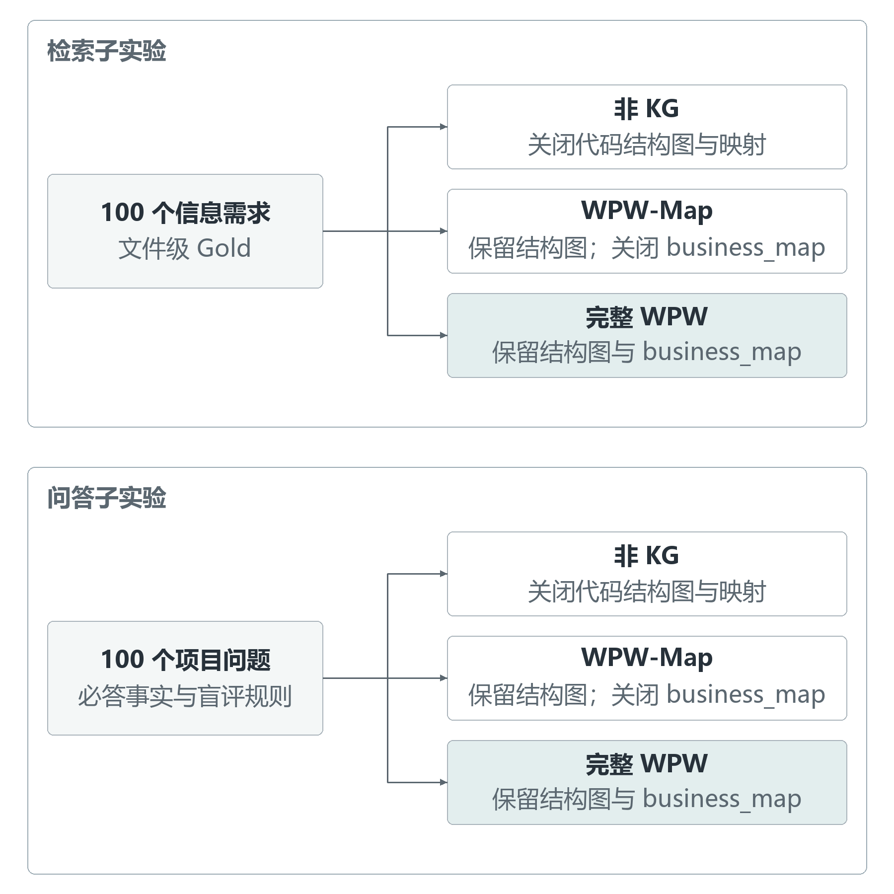

图6-2 题集与条件配对示意

Figure 6-2 Paired Datasets and Experimental Conditions

正式运行前，题目、标准答案、评分规则、检索参数、上下文预算和代码快照都已确定，运行过程中不再改动。三种条件使用同一模型、同一份只读快照、同一回答格式和相同的只读工具预算；每题在独立会话中完成。每个条件保存查询或问题 ID、条件开关、排序结果或回答、证据路径、上下文记录和评分结果。每题每条件只运行一次。

### 6.2.3 检索子实验

检索子实验评价 RAG 的前置阶段，也就是生成回答前的静态检索：给系统一个项目信息需求，看它能否把相关源码文件排进候选前列。每个查询在每种条件下得到一个按相关性排序的文件列表，评价其中的前 5 项和前 10 项。图谱增强检索和 BM25 都在这个阶段工作；本文选用目前 AI 应用中最常用的静态词面检索方法之一 BM25[60] 作为对照，比较图谱增强与纯词面检索的定位差异。评价之前先要确定每题的正确文件集合，这就是 Gold。Gold 根据固定源码、规格和测试证据人工标注，不由任何被测条件返回的结果反向定义。主指标采用文件粒度：同一文件里命中多个函数或节点只算一个结果；相关性看文件是否满足查询背后的信息需求，不看它是否机械包含查询词。

在这套 Gold 之上，检索结果用截断位置 k 上的召回率和精确率评价：本文把只看前 5 个候选的召回率记为 Recall@5，只看前 10 个候选的召回率记为 Recall@10，把前 10 个候选的精确率记为 Precision@10，后文用 @k 泛指截断位置。Recall@k 是召回率，计算前 k 个结果命中的相关文件数占该查询全部人工标注相关文件数的比例，衡量相关的文件有没有找全；Precision@k 是精确率，计算前 k 个结果中相关文件所占的比例，衡量找回来的文件有多少是相关的。例如某查询有 3 个相关文件，前 5 个结果命中 2 个，则 Recall@5 为 2/3；若前 10 个结果中有 2 个相关文件，则 Precision@10 为 2/10。形式化地，对于查询 q，令 $R_q$ 为人工标注的相关文件集合，$C_{q,k}$ 为排序结果前 k 个去重文件，$|\cdot|$ 表示集合中的文件数，$R_q\cap C_{q,k}$ 表示两个集合的交集，即既在标准答案中、又出现在前 k 个结果里的文件，则：

$$
\mathrm{Recall@}k(q)=\frac{|R_q\cap C_{q,k}|}{|R_q|}, \tag{6-2}
$$

$$
\mathrm{Precision@}k(q)=\frac{|R_q\cap C_{q,k}|}{|C_{q,k}|}. \tag{6-3}
$$

主报告用 Recall@5、Recall@10 和 Precision@10。把 10 作为主截断位置，是因为上下文供给阶段只取排序前 10 个文件：Recall@10 对应进入生成阶段的覆盖率，Precision@10 对应这些文件中的无关候选比例。5 是更严格的前置位置，只用召回率检查相关文件是否已经出现在前五位，用来区分增益来自排序整体前移，还是只在第 6—10 位补漏；精确率因此只在 10 处报告。表中的数值是 100 个查询逐题计算后的宏平均（先逐题计算，再对查询取平均），同时记录 Recall@10 为 0 的任务数和查询时间中位数[60]。如果前 k 个结果里没有任何 Gold 文件，Recall 和 Precision 都记 0。

按上述口径，三种条件的总体结果如表6-9 所示。

表6-9 场景检索总体结果

Table 6-9 Overall Results of Scenario Retrieval

| 条件 | Recall@5 | Recall@10 | Precision@10 | Recall@10=0 的任务数 | 查询时间中位数/ms |
|---|---:|---:|---:|---:|---:|
| 非 KG | 0.483 | 0.617 | 0.126 | 12 | 58.04 |
| WPW-Map | 0.666 | 0.798 | 0.182 | 6 | **48.32** |
| 完整 WPW | **0.692** | **0.815** | **0.185** | **3** | 50.74 |

完整 WPW 相对非 KG 的 Recall@5、Recall@10 和 Precision@10 分别提高 0.209、0.198 和 0.059，零召回任务从 12 个降到 3 个。每题平均有 2.38 个 Gold 文件，完整 WPW 的 Precision@10 为 0.185，达到当前题集理论上限 0.238 的 77.7%。按查询类别拆开的主口径结果如图6-3 所示；Recall@5 的总体结果见表6-9。

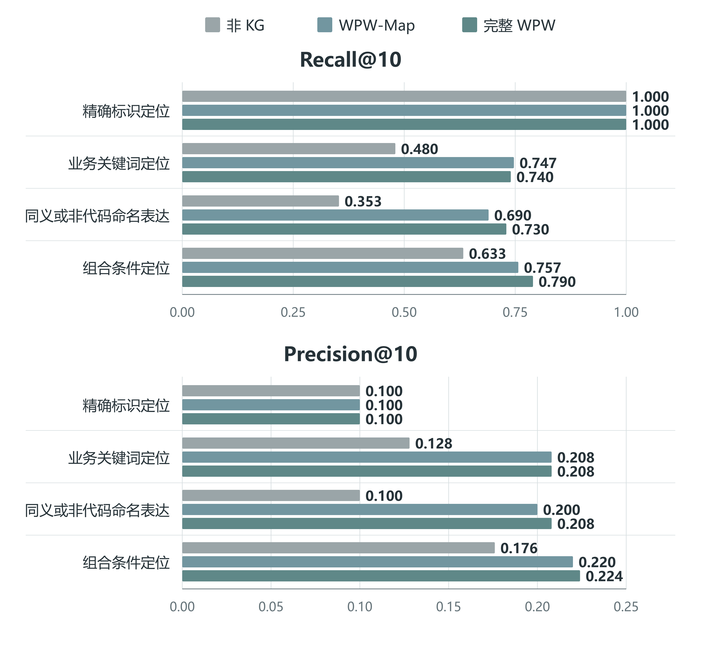

图6-3 按查询类别的检索结果

Figure 6-3 Retrieval Results by Query Category

精确标识题上三种方法都达到完整召回，差异主要来自自然语言查询。WPW-Map 和完整 WPW 在业务关键词、同义表达和组合条件题上都高于非 KG；完整 WPW 在同义表达和组合条件题上最高，在业务关键词题上略低于 WPW-Map。

为判断这些差异是否只是随机波动，本文把同一查询在三种条件下的结果视为配对观测。检索指标是 0—1 之间的比例，分布不保证正态，因此采用非参数检验：先用 Friedman 检验（弗里德曼检验）判断三种条件整体上是否存在差异，该检验按每个查询内部三种条件的相对高低排序比较；整体有差异后，再用 Wilcoxon 符号秩检验（威尔科克森符号秩检验）逐对比较，它看同一查询在两种条件下的差值，并按差值绝对值排序，判断具体是哪一对条件不同。每个指标要做三对比较，因此用 Holm 方法校正 p 值，降低多重比较造成的假阳性。100 个查询来自 25 个问题族，同一族内的查询并不独立，所以再把族内查询结果取平均，以 25 个族为单位重复上述检验。

Friedman 检验统计量的基本形式为：

$$
Q=\frac{12}{nk(k+1)}\sum_{j=1}^{k}R_j^2-3n(k+1), \tag{6-4}
$$

式中，$n$ 为查询数或问题族数，$k=3$ 为条件数，$R_j$ 为第 $j$ 个条件在全部查询中的秩和。存在并列时采用平均秩并对 $Q$ 作并列校正；$Q$ 近似服从自由度为 $k-1$ 的卡方分布。

Wilcoxon 符号秩检验的统计量和效应量为：

$$
W^{+}=\sum_{d_i>0}\mathrm{rank}(|d_i|),\quad
W^{-}=\sum_{d_i<0}\mathrm{rank}(|d_i|),\quad
r_{\mathrm{rb}}=\frac{W^{+}-W^{-}}{W^{+}+W^{-}}. \tag{6-5}
$$

式中，$d_i$ 为同一查询在两个条件下的指标差，$\mathrm{rank}(|d_i|)$ 为差值绝对值的秩；检验统计量取 $W=\min(W^{+},W^{-})$，p 值由配对差的秩分布给出。$r_{\mathrm{rb}}$ 为配对秩二列相关，符号表示差异方向，绝对值表示效应大小。Holm 校正按 p 值从小到大计算调整后的 p 值：

$$
\tilde p_{(i)}=\max_{j\le i}\min\left\{(m-j+1)p_{(j)},1\right\}, \tag{6-6}
$$

式中，$p_{(1)}\le\cdots\le p_{(m)}$ 为同一指标三对比较的原始 p 值，$m=3$；$\tilde p_{(i)}$ 为校正后的 p 值。本文以 0.05 为显著性水平。

问题族聚合后，两种图谱条件相对非 KG 都显著更高：WPW-Map 的三项校正 p 分别为 0.0032、0.00077 和 0.00045，完整 WPW 的为 0.0023、0.00033 和 0.00045；完整 WPW 相对非 KG 的配对秩二列相关绝对值为 0.729、0.844 和 0.846，均大于 0.5，属于较大效应。完整 WPW 与 WPW-Map 之间三项差异都不显著，校正 p 分别为 0.238、0.608 和 0.487。

这组结果可以概括为：非 KG（纯 BM25）与两种图谱条件都有显著差异，而两种图谱条件之间没有显著差异。因此它支持图谱增强检索相对 BM25 的定位增益，但不支持把总体增益进一步归因于业务—代码映射。更高的召回率和精确率意味着后面的问答更容易拿到必要文件，也少读一些无关文件；这是解释开发实验 Token 下降的第一层证据。

### 6.2.4 问答子实验

问答子实验评价回答质量。回答统一输出结论、关键事实、实际证据路径和不确定性说明。三个条件的回答在评分前按固定随机种子打乱并标成 A—C，评分器不知道条件名称。盲评由大模型评分器完成：评分器读取问题、打乱后的 A—C 回答、评分规则以及与引用文件对应的固定源码片段，逐份给出是否通过、机制覆盖度、证据支持和重大错误判断；评分模型为 gpt-5.4-mini，与回答生成使用同一模型。通过条件要求主要机制覆盖度达到预设标准、关键结论至少有一条源码证据支持，并且没有与问题有关的重大事实错误。路径存在不等于语义证据成立，评分要检查证据是否真的支撑回答。评分材料包括必答事实、支撑证据、可接受替代证据、重大错误定义和通过条件。

问答质量以盲评通过率为评价指标。上下文侧区分两个口径：初始上下文 Token 统计回答开始前一次性提供的导航文本、图谱摘要和相关源码窗口，用于衡量供给是否紧凑；模型输入 Token 直接取 API 用量，统计整次运行所有轮次的输入总量，包含初始上下文、工具输出和后续对话，用于衡量实际消耗。两者不能相减或互相替代。初始上下文报告中位数、四分位距和均值，并记录自主搜索或源码读取次数。IQR（Interquartile Range，四分位距）是第 75 百分位（P75）与第 25 百分位（P25）之差，即 $\mathrm{IQR}=P_{75}-P_{25}$，反映中间 50% 任务的用量跨度；它比极差更不容易受少数极端任务影响，图6-4 中箱体的高度就是 IQR。箱体的纵向位置，也就是中位数或均值所在的高度，表示该条件的典型供给量，位置越低说明回答前提供的上下文越少；箱体高度表示中间 50% 任务的用量跨度，越矮说明不同任务之间的供给越稳定。上下文减少不能单独代表质量提高，要和检索 Recall、Precision 以及盲评通过率一起看。

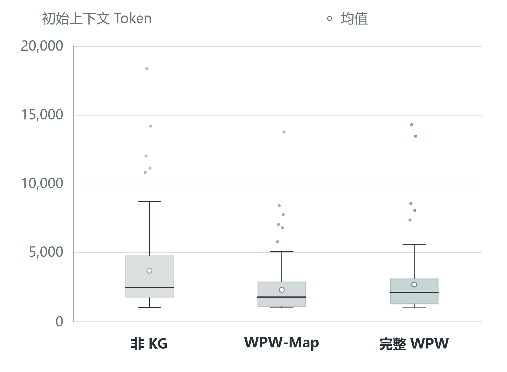

图6-4 三条件初始上下文 Token 箱线图

Figure 6-4 Initial Context Tokens by Condition

总体结果如表6-10 所示。

表6-10 项目场景问答总体结果

Table 6-10 Overall Results of Project-Scenario Question Answering

| 条件 | 盲评通过数 | 盲评通过率 | 初始上下文 Token 中位数 [P25, P75] | 初始上下文 Token 均值 | 模型输入 Token 均值 |
|---|---:|---:|---:|---:|---:|
| 非 KG | 83 | 83% | 2,465 [1,770, 4,773] | 3,698 | 87,207 |
| WPW-Map | 85 | 85% | **1,763 [1,058, 2,863]** | **2,298** | 86,949 |
| 完整 WPW | **91** | **91%** | 2,091 [1,273, 3,090] | 2,690 | **84,524** |

具体数值如上表所示。完整 WPW 的盲评通过率最高，WPW-Map 次之，非 KG 最低，但三者差距不大。两种图谱条件的初始上下文都低于非 KG，WPW-Map 的典型用量和波动都最小，完整 WPW 略高。模型输入方面，三种条件非常接近，完整 WPW 仅略低。由此可见，图谱条件主要压缩了回答前提供给模型的上下文，并未明显减少整次运行的实际输入，因此不能把初始上下文的下降直接当作模型总消耗的下降。

对表6-10 的三类指标以及另行统计的模型总 Token 分别做配对检验。盲评通过率是同题三条件下的二元结果，用 Cochran's Q 检验判断整体差异，统计量为

$$
Q_{\mathrm{C}}=\frac{(k-1)\left[k\sum_{j=1}^{k}T_j^2-\left(\sum_{j=1}^{k}T_j\right)^2\right]}{k\sum_{i=1}^{n}B_i-\sum_{i=1}^{n}B_i^2}, \tag{6-7}
$$

式中，$n=100$ 为题目数，$k=3$ 为条件数，$T_j$ 为第 $j$ 个条件的通过题数，$B_i$ 为第 $i$ 题在三个条件下通过的次数。原假设下 $Q_{\mathrm{C}}$ 近似服从自由度为 $k-1$ 的卡方分布。初始上下文、模型输入和模型总 Token 为数值型指标，沿用 6.2.3 的 Friedman 检验（式6-4）、Wilcoxon 符号秩检验（式6-5）和 Holm 校正（式6-6）。检验结果如下：

1. **盲评通过率**：$Q_{\mathrm{C}}(2)=4.00$，$p=0.135$，三条件之间无显著差异。
2. **初始上下文 Token**：Friedman 检验显著，$\chi^2(2)=20.48$，$p<0.001$。逐对比较中，非 KG 高于 WPW-Map（Holm 校正 $p<0.001$）和完整 WPW（Holm 校正 $p=0.014$），两种图谱条件之间无显著差异（Holm 校正 $p=0.123$）。
3. **模型输入 Token**：Friedman 检验不显著，$\chi^2(2)=0.98$，$p=0.613$。
4. **模型总 Token**：Friedman 检验不显著，$\chi^2(2)=0.38$，$p=0.827$。

四组检验中，能够成立的差异只在初始上下文供给：图谱条件减少了回答前的上下文，但两种图谱条件之间没有差别；回答质量和整次运行的实际模型用量都没有测到稳定变化。

到这里，场景实验给出了两组方向一致的结果：检索更容易命中必要文件，图谱条件在更紧凑的初始上下文供给下取得了更高的观察通过率；但实际模型输入 Token 与基线接近，因此还不能据此推断场景问答的总消耗下降。它们能否解释开发实验的 Token 下降，还要看机制对比和统计边界。

## 6.3 方法有效性分析

上述结果说明 WPW 在开发任务上总 Token 更低，在场景检索和问答上也有更好的观察值。接下来要分析这些差异与哪些机制有关，以及现有数据能支持到什么程度。

### 6.3.1 场景机制的对比结果

两组机制对比均在场景题集上进行，复用相同的 Gold、评分规则和代码快照。第一组对比 WPW-Map 与非 KG，考察图谱增强检索相对 BM25 的整体作用；第二组对比完整 WPW 与 WPW-Map，只切换业务—代码映射，考察它的独立增量。两组对比的指标变化和显著性如图6-5所示。

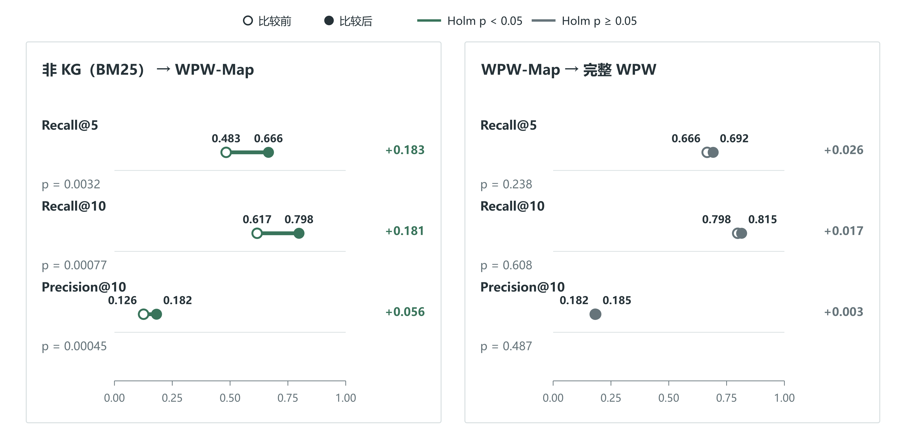

图6-5 场景检索的机制对比

Figure 6-5 Mechanism Comparisons in Scenario Retrieval

注：箭头上的三个数值依次为 Recall@5、Recall@10 和 Precision@10 的变化量；p 值为问题族聚合后的 Holm 校正值。

第一组对比的三项指标均显著，WPW-Map 相对非 KG 有稳定增益；但这一对比同时改变了语义检索和图结构，现有数据不能把增益单独归给代码结构图。第二组对比的三项指标均不显著，业务—代码映射未显示稳定的独立增量。问答侧，完整 WPW 的初始上下文均值低于非 KG，盲评通过率最高；但模型输入 Token 与两种基线接近，因此问答侧只能作为方向一致的观察，不能证明实际消耗下降。

把检索和问答放在一起看，图谱增强检索提高了必要文件的命中率，完整 WPW 在通过率不降的前提下降低了回答前的初始上下文供给，因此更准的文件定位和更紧凑的上下文供给可以视为开发任务 Token 降低的原因之一。上述结论是在当前项目和实验条件下得到的，能否推广到其他项目仍需进一步验证。

## 6.4 本章小结

本章先检验 WPW 的工程实现，再评估它在开发任务中的成本表现。功能测试按第 5 章的五个实现模块组织，覆盖工作流管理、知识图谱构建、任务上下文生成、增量维护和可视化控制台，并以命令输出、阶段状态转换、持久化结果和页面呈现作为判据。全部用例通过，说明这套方法已经具备可运行的工程载体，各模块能够按设计运行，也为后续的效果实验提供了稳定基础。

在功能可用的基础上，本章让 OpenSpec 与 WPW 完成同一批开发任务，比较两者在任务执行期间的模型总 Token。结果显示，WPW 的模型总 Token 低于 OpenSpec，说明该方案在完成同类开发任务时具有更低的模型消耗。开发实验只记录整次任务的用量总和，因此这一结果只能说明总成本更低，还不能说明差异具体来自哪个环节。为解释这一差异，本章进一步在同一代码快照和同一题集上比较不同上下文条件。结果表明，图谱增强检索提高了必要文件的定位质量，并降低了回答前的初始上下文供给，这两点可以视为开发任务 Token 下降的原因之一。业务—代码映射没有显示稳定的独立增量，语义检索与代码结构的贡献也尚未拆分。问答实验中各条件的盲评通过率没有显著差异，回答质量仍主要取决于模型自身能力，WPW 在问答场景中的收益主要体现在上下文供给和 Token 节省上。上述结论基于当前项目和实验条件，能否推广到其他项目仍需进一步验证。

# 第 7 章 总结与展望

## 7.1 总结

随着大语言模型参与需求分析、方案设计、编码实现和测试等开发环节，模型能否在有限上下文中获得与当前任务相关的项目知识，逐渐成为影响开发效率的重要因素。单纯依赖文本检索、文件拼接或人工摘要，难以同时表达业务语义、代码结构以及二者之间的关联，项目知识也会随着需求和代码的变化而逐渐失效。针对这一问题，本文以规格驱动开发流程为基础，研究项目知识的组织、检索、供给和演化机制，提出并实现了图谱驱动上下文工程方法及 WPW 系统。

本文的主要工作可以概括为以下四个方面。

（1）在方法层面，本文将项目知识组织为 C-L1-L2-L3 能力—代码双层知识模型，以能力规范中的能力节点作为业务语义与代码实现之间的稳定锚点，通过 `business_map` 建立能力与模块、文件和代码元素的关联。任务执行时，系统从任务描述和规格中识别锚点，沿图谱扩展相关子图，再经过骨架抽取、序列化和分档压缩生成受预算约束的任务上下文；需求或代码变化后，以能力规范和文件差异为依据增量更新项目知识。该方法不替代 SDD，而是在既有流程上补足项目知识的组织与供给能力。

（2）在系统层面，本文将上述方法实现为 WPW 工具链，将六阶段工作流、规格制品管理、图谱构建、业务—代码映射、上下文生成、知识增量维护和可视化控制台集成到统一工作区。系统以命令行和工作区文件为主要接口，持久化阶段状态、任务进度、能力规范和代码图谱，并提供控制台页面查看工作流、图谱与上下文生成过程。功能测试覆盖工作流管理、图谱构建、上下文生成、增量维护和可视化控制台等模块，全部用例通过，说明系统能够按设计运行，为效果实验提供了工程基础。

（3）在实验层面，本文将 WPW 与 OpenSpec 放在同一批开发任务上比较模型总 Token，并在固定代码快照和统一题集上比较不同上下文条件。开发实验表明，WPW 完成同类开发任务的模型总 Token 低于 OpenSpec；场景检索实验表明，图谱增强检索提高了必要文件的定位质量，完整 WPW 在回答前提供的初始上下文也更紧凑。机制对比显示，图谱增强检索相对非 KG（BM25）的增益在本次实验中稳定，而业务—代码映射尚未显示出稳定的独立增量；由于基线只使用词面检索，语义检索与代码结构各自的贡献尚未拆分。

（4）从整体效果看，WPW 在不改变规格驱动开发流程的前提下，把项目知识组织为可维护的图谱，并在任务执行前提供更聚焦的上下文，使开发任务的模型总 Token 低于 OpenSpec，场景检索也更容易命中必要文件。在上下文更紧凑的条件下，问答质量保持稳定。图谱上下文主要承担导航作用，回答质量仍主要取决于基础模型能力。

需要指出的是，本文实验只在一个美食推荐系统上完成，任务规模、运行次数和模型配置仍然有限，相关结论能否推广到其他项目还需进一步验证。

## 7.2 展望

本文实验验证了方法在当前场景下的有效性，但实验载体是一个以 Java 后端和 Vue 前端为主的美食推荐系统，业务范围、项目规模和技术栈都相对集中，尚不足以覆盖真实开发中的多样情况。方法中的图谱构建、业务—代码映射和上下文生成都与具体语言的语法结构及项目组织方式有关，面对其他编程语言、跨语言依赖、微服务拆分或遗留系统时，解析和映射规则还需要相应扩展。后续可在更多领域和规模的项目中检验方法的适用性，并逐步补充多语言解析与跨语言关系分析。同时，还需在真实团队中开展长周期应用，观察知识维护、流程接入和开发者使用习惯对实际效果的影响。

# 参考文献

[1] ZHENG Q, XIA X, ZOU X, et al. CodeGeeX: A Pre-Trained Model for Code Generation with Multilingual Benchmarking on HumanEval-X[C]//Proceedings of the 29th ACM SIGKDD Conference on Knowledge Discovery and Data Mining. 2023: 5673-5684. DOI: 10.1145/3580305.3599790.

[2] LEWIS P, PEREZ E, PIKTUS A, et al. Retrieval-Augmented Generation for Knowledge-Intensive NLP Tasks[C]//Advances in Neural Information Processing Systems. 2020: 9459-9474.

[3] GUO D, REN S, LU S, et al. GraphCodeBERT: Pre-training Code Representations with Data Flow[C]//International Conference on Learning Representations. 2021.

[4] BAIRI R, SONWANE A, KANADE A, et al. CodePlan: Repository-level Coding using LLMs and Planning[J]. Proceedings of the ACM on Software Engineering, 2024, 1(FSE): 675-698. DOI: 10.1145/3643757.

[5] LIU N F, LIN K, HEWITT J, et al. Lost in the Middle: How Language Models Use Long Contexts[J]. Transactions of the Association for Computational Linguistics, 2024, 12: 157-173. DOI: 10.1162/tacl_a_00638.

[6] JIMENEZ C E, YANG J, WETTIG A, et al. SWE-bench: Can Language Models Resolve Real-World GitHub Issues?[C]//International Conference on Learning Representations. 2024.

[7] YANG J, JIMENEZ C E, WETTIG A, et al. SWE-agent: Agent-Computer Interfaces Enable Automated Software Engineering[C]//Advances in Neural Information Processing Systems. 2024: 50528-50652. DOI: 10.52202/079017-1601.

[8] Cognition. Devin[EB/OL]. [2026-10-19]. https://devin.ai.

[9] All-Hands-AI. OpenHands[EB/OL]. [2026-10-19]. https://github.com/OpenHands/OpenHands.

[10] Stack Overflow. 2024 Developer Survey: AI[EB/OL]. (2024)[2026-10-19]. https://survey.stackoverflow.co/2024/ai.

[11] 国务院. 关于深入实施“人工智能+”行动的意见：国发〔2025〕11号[EB/OL]. (2025-08-26)[2026-10-19]. https://www.gov.cn/zhengce/content/202508/content_7037861.htm.

[12] ABEDU S, KHATOONABADI S H, SHIHAB E. Synergizing LLMs and Knowledge Graphs: A Novel Approach to Software Repository-Related Question Answering[J]. ACM Transactions on Software Engineering and Methodology, 2026, 35(10): 1-42. DOI: 10.1145/3796510.

[13] 中国工商银行软件开发中心北京技术部. 程序血缘分析技术在工商银行软件工程中的应用[J]. 中国金融电脑, 2025(1): 59-63.

[14] GitHub. GitHub Spec Kit[EB/OL]. [2026-10-19]. https://github.com/github/spec-kit.

[15] Obra. Superpowers: An Agentic Skills Framework & Software Development Methodology[EB/OL]. (2026)[2026-10-19]. https://github.com/obra/superpowers.

[16] Fission-AI. OpenSpec[EB/OL]. [2026-10-19]. https://github.com/Fission-AI/OpenSpec.

[17] HOU X, ZHAO Y, LIU Y, et al. Large Language Models for Software Engineering: A Systematic Literature Review[J]. ACM Transactions on Software Engineering and Methodology, 2024, 33(8): 1-79. DOI: 10.1145/3695988.

[18] 宫丽娜, 周易人, 乔羽, 等. 预训练模型在软件工程领域应用研究进展[J]. 软件学报, 2025, 36(1): 1-26. DOI: 10.13328/j.cnki.jos.007143.

[19] 杨泽洲, 陈思榕, 高翠芸, 等. 基于深度学习的代码生成方法研究进展[J]. 软件学报, 2024, 35(2): 604-628. DOI: 10.13328/j.cnki.jos.006981.

[20] 许鹏宇, 况博裕, 苏铓, 等. 基于大语言模型的自动代码修复综述[J]. 计算机研究与发展, 2025, 62(8): 2040-2057. DOI: 10.7544/issn1000-1239.202440467.

[21] 香佳宏, 徐霄阳, 孔繁初, 等. 大模型在软件缺陷检测与修复的应用发展综述[J]. 软件学报, 2025, 36(4): 1489-1529. DOI: 10.13328/j.cnki.jos.007268.

[22] 董益宏, 姜雪, 钱家如, 等. 基于大语言模型智能体的代码生成综述[J]. 软件学报, 2026, 37(8): 3089-3115. DOI: 10.13328/j.cnki.jos.007593.

[23] ROBBES R, MATRICON T, DEGUEULE T, et al. Agentic Much? Adoption of Coding Agents on GitHub[J/OL]. ACM Transactions on Software Engineering and Methodology, 2026[2026-10-19]. https://doi.org/10.1145/3822180.

[24] LI H, ZHANG H, HASSAN A E. Agentic Software Engineering (SE 3.0): The Rise of AI Teammates[C]//Proceedings of the 32nd ACM SIGKDD Conference on Knowledge Discovery and Data Mining. 2026: 13417-13418. DOI: 10.1145/3770855.3818242.

[25] CLELAND-HUANG J, ZEMONT G, LUKASIK W. A Heterogeneous Solution for Improving the Return on Investment of Requirements Traceability[C]//Proceedings of the 12th IEEE International Requirements Engineering Conference. 2004: 214-223. DOI: 10.1109/ICRE.2004.1335680.

[26] SULTANOV H, HAYES J H, KONG W K. Application of Swarm Techniques to Requirements Tracing[J]. Requirements Engineering, 2011, 16(3): 209-226. DOI: 10.1007/s00766-011-0121-4.

[27] BORG M, RUNESON P, ARDÖ A. Recovering from a Decade: A Systematic Mapping of Information Retrieval Approaches to Software Traceability[J]. Empirical Software Engineering, 2014, 19(6): 1565-1616. DOI: 10.1007/s10664-013-9255-y.

[28] GAO H, KUANG H, ASSUNÇÃO W K G, et al. TRIAD: Automated Traceability Recovery based on Biterm-enhanced Deduction of Transitive Links among Artifacts[C]//Proceedings of the 46th International Conference on Software Engineering. 2024: 2668-2680. DOI: 10.1145/3597503.3639164.

[29] TUFANO M, MCCLURE J, CAMBRONERO J, et al. Grounding AI Agents in Contracts: An Empirical Evaluation of Spec-Driven Test Generation[C]//Proceedings of the 1st International Workshop on Specification-Driven Development Life Cycle. 2026: 14-24. DOI: 10.1145/3842652.3843195.

[30] 张大俊, 谢杨, 房春荣, 等. 检索增强生成在软件工程中的应用综述[J]. 软件学报, 2026, 37(3): 1316-1339. DOI: 10.13328/j.cnki.jos.007567.

[31] 曹启航. 面向大语言模型的检索增强生成方法研究[D]. 贵阳: 贵州师范大学, 2025.

[32] 毕枫林, 张豈明, 张嘉睿, 等. 基于滑动窗口策略的大语言模型检索增强生成系统[J]. 计算机研究与发展, 2025, 62(7): 1597-1610. DOI: 10.7544/issn1000-1239.202440411.

[33] 刘雪颖, 云静, 李博, 等. 基于大型语言模型的检索增强生成综述[J]. 计算机工程与应用, 2025, 61(13): 1-25. DOI: 10.3778/j.issn.1002-8331.2410-0088.

[34] 王亮. 检索增强生成（RAG）驱动的知识服务: 原理、范式及评估[J]. 科技与出版, 2025, 44(4): 37-46.

[35] 田永林, 王兴霞, 王雨桐, 等. RAG-PHI: 检索增强生成驱动的平行人与平行智能[J]. 智能科学与技术学报, 2024, 6(1): 41-51. DOI: 10.11959/j.issn.2096-6652.2024015.

[36] YAMAGUCHI F, GOLDE N, ARP D, et al. Modeling and Discovering Vulnerabilities with Code Property Graphs[C]//Proceedings of the IEEE Symposium on Security and Privacy. 2014: 590-604. DOI: 10.1109/SP.2014.44.

[37] HOGAN A, BLOMQVIST E, COCHEZ M, et al. Knowledge Graphs[J]. ACM Computing Surveys, 2022, 54(4): 1-37. DOI: 10.1145/3447772.

[38] PAN Z, HU X, XIA X, et al. CatCoder: Repository-Level Code Generation with Relevant Code and Type Context[J]. ACM Transactions on Software Engineering and Methodology, 2026, 35(8): 1-25. DOI: 10.1145/3779217.

[39] PHAN H N, PHAN H N, NGUYEN T N, et al. RepoHyper: Search-Expand-Refine on Semantic Graphs for Repository-Level Code Completion[C]//Proceedings of the 2025 IEEE/ACM Second International Conference on AI Foundation Models and Software Engineering. 2025: 14-25. DOI: 10.1109/Forge66646.2025.00009.

[40] 袁利杰, 张杨. CoRAG: 大模型和AST检索增强的代码重构方法[J]. 计算机技术与发展, 2026, 36(7): 9-16. DOI: 10.20165/j.cnki.ISSN1673-629X.2026.0032.

[41] 叶子健. 基于检索增强与智能体协同的代码生成方法研究[D]. 济南: 山东师范大学, 2026.

[42] 张杨, 邵帅, 张冬雯. 基于下推自动机的细粒度锁自动重构方法[J]. 软件学报, 2021, 32(12): 3710-3727. DOI: 10.13328/j.cnki.jos.006132.

[43] 田迎晨, 李柯君, 王太明, 等. 代码坏味研究综述[J]. 软件学报, 2023, 34(1): 150-170. DOI: 10.13328/j.cnki.jos.006431.

[44] 张杨, 东春浩, 刘辉, 等. 基于预训练模型和多层次信息的代码坏味检测方法[J]. 软件学报, 2022, 33(5): 1551-1568. DOI: 10.13328/j.cnki.jos.006548.

[45] JIANG J, ZHOU K, ZHAO W X, et al. KG-Agent: An Efficient Autonomous Agent Framework for Complex Reasoning over Knowledge Graph[C]//Proceedings of the 63rd Annual Meeting of the Association for Computational Linguistics. 2025: 9505-9523. DOI: 10.18653/v1/2025.acl-long.468.

[46] 刘龙. 基于增强型代理上下文工程的网络威胁情报知识图谱的构建方法研究与实现[D]. 成都: 四川师范大学, 2026.

[47] 李登飞, 马怡然, 田念肸. 大语言模型与知识图谱融合范式研究进展[J]. 计算机系统应用, 2026, 35(10): 1-20. DOI: 10.15888/j.cnki.csa.010292.

[48] 郑艳萍, 季嘉蕊, 胡雨韦, 等. 大模型驱动的文本属性图学习研究进展[J]. 自动化学报, 2026, 52(8): 1557-1592. DOI: 10.16383/j.aas.c250499.

[49] VASWANI A, SHAZEER N, PARMAR N, et al. Attention Is All You Need[C]//Advances in Neural Information Processing Systems. 2017: 5998-6008.

[50] YAO S, ZHAO J, YU D, et al. ReAct: Synergizing Reasoning and Acting in Language Models[C]//International Conference on Learning Representations. 2023.

[51] SCHICK T, DWIVEDI-YU J, DESSÌ R, et al. Toolformer: Language Models Can Teach Themselves to Use Tools[C]//Advances in Neural Information Processing Systems. 2023: 68539-68551.

[52] Anthropic. Claude Code[EB/OL]. (2025)[2026-10-19]. https://docs.claude.com/en/docs/claude-code/overview.

[53] JIANG H, WU Q, LIN C Y, et al. LLMLingua: Compressing Prompts for Accelerated Inference of Large Language Models[C]//Proceedings of the 2023 Conference on Empirical Methods in Natural Language Processing. 2023: 13358-13376. DOI: 10.18653/v1/2023.emnlp-main.825.

[54] ZHANG Z, DAI Q, BO X, et al. A Survey on the Memory Mechanism of Large Language Model-based Agents[J]. ACM Transactions on Information Systems, 2025, 43(6): 1-47. DOI: 10.1145/3748302.

[55] WANG Z Z, MAO J, FRIED D, et al. Agent Workflow Memory[C]//Proceedings of the 42nd International Conference on Machine Learning. 2025: 63897-63911.

[56] 黄恒琪, 于娟, 廖晓, 等. 知识图谱研究综述[J]. 计算机系统应用, 2019, 28(6): 1-12. DOI: 10.15888/j.cnki.csa.007431.

[57] DEVLIN J, CHANG M W, LEE K, et al. BERT: Pre-training of Deep Bidirectional Transformers for Language Understanding[C]//Proceedings of the 2019 Conference of the North American Chapter of the Association for Computational Linguistics: Human Language Technologies. 2019: 4171-4186. DOI: 10.18653/v1/N19-1423.

[58] XIAO S, LIU Z, ZHANG P, et al. C-Pack: Packed Resources For General Chinese Embeddings[C]//Proceedings of the 47th International ACM SIGIR Conference on Research and Development in Information Retrieval. 2024: 641-649. DOI: 10.1145/3626772.3657878.

[59] BRUNSFELD M. tree-sitter[EB/OL]. [2026-10-19]. https://tree-sitter.github.io/tree-sitter/.

[60] MANNING C D, RAGHAVAN P, SCHÜTZE H. Introduction to Information Retrieval[M/OL]. Cambridge: Cambridge University Press, 2008[2026-10-19]. https://nlp.stanford.edu/IR-book/.

# 附录

本附录收录第 6 章验证过程的原始记录：系统功能测试、美食推荐系统开发任务、项目场景检索与问答，以及实验环境、快照和冻结参数。正文只报告汇总结果，题集、逐项结果和依据集中放在这里，便于复核。

有两处口径需要在阅读正文前说明。第一，项目场景问答先运行了四类各 8 题、共 32 题（含 WPW-Gen 四条件）作为中间过程，最终补完全部 100 题，并按非 KG、WPW-Map、完整 WPW 三条件汇总；正文表6-10 报告 100 题终版结果，中间过程的原始记录保留在附录 D 的 D.1 节。第二，T3 的四个任务与 T4 的四轮连续需求，正文表6-5、表6-6 给出了汇总值，但执行器 `sdd-eval` 归档的结果记录只到 T2-2，这八个任务的原始运行记录未随实验数据归档；附录 B 按正文汇总值转录并标注证据状态，这些数值无法独立复核。

## 附录 A 系统功能测试记录

第 6.1 节的系统功能测试在 2026-08-23 执行，覆盖工作流门禁、图谱构建与查询、上下文生成与预算约束、增量更新与降级行为。测试的通过条件是命令输出、状态转换和持久化结果符合预期，不以单次大模型回答作为判据。表A-1 记录执行环境，表A-2 记录测试项及证据留档位置，A.1 给出复跑时捕获的命令输出。

表A-1 WPW 系统测试环境与执行入口

Table A-1 Test Environment and Entry Points of the WPW System

| 项目 | 记录 | 获取方式 |
|---|---|---|
| 执行日期 | 2026-08-23 | 测试执行日期 |
| 操作系统 | Microsoft Windows 11 家庭版中文版 10.0.26200，64 位 | 系统信息 |
| Node.js | v20.20.2 | `node --version` |
| WPW 版本 | v0.1.8，提交 `a5ee173` | 发布版本与 Git 提交 |
| TypeScript | v5.9.3 | 依赖版本 |
| 图谱 Schema | v3.1.0 | `meta.json` 的 `schemaVersion` |
| 解析范围 | TypeScript、JavaScript、Vue、Java | 图谱配置 `languages` |
| 映射与裁剪配置 | `mapping.mode=local`；深度 3；最小边权重 0.7；最大节点数 100 | 未设置项目覆盖配置时取默认值 |
| 上下文压缩 | `standard` | 显式锚点测试不依赖向量索引 |
| 执行入口 | `npm run build`、`npx ts-node src/graph/__verify__.ts`、`npx ts-node src/test/integration.test.ts` | 终端输出；该版本 `tsconfig.json` 排除 `src/test`，`npm test` 输出 `no tests` |

表A-2 功能测试项与证据留档状态

Table A-2 Functional Test Items and Evidence Archival Status

| 序号 | 测试项 | 实际输出或持久化证据 | 证据留档 |
|---|---|---|---|
| 1 | 强依赖门禁 | {"artifact":"prd","canProceed":false,"missing":["brd"],"warnings":[]}；.WPW.yaml 中 PRD 仍为 pending | 证据 A-1 |
| 2 | 可选 Explore 决策 | canProceed=true，missing=[]，warnings 含 1 条 Explore 决策提示；记录决策后该警告消失 | 证据 A-2 |
| 3 | 图谱存储与索引 | 写入并加载 4 个节点、3 条边；nodeMap.size=4，C、L1、L2、L3 各 1 个节点 | 证据 A-3 |
| 4 | 代码与能力解析 | Java 用例得到 1 个类节点、至少 2 个方法节点、至少 1 个常量节点及 2 条导入；能力节点含 description 与可选 features | 证据 A-4 |
| 5 | 全量构建与结构查询 | success=true；validation.passed=true；meta.json 含 schemaVersion、节点数、边数和文件哈希快照 | 证据 A-5 |
| 6 | 上下文生成与预算约束 | 返回 1 个锚点、4 个子图节点、3 条边，estimatedTokens=77，小于 1000 | 证据 A-6 |
| 7 | 增量更新与 Schema 兼容 | 修改文件的 fileHash 与对应 L2/L3 节点更新，未修改文件保留；主版本不兼容时输出重建提示，新的 schemaVersion=3.1.0 | 证据 A-7 |
| 8 | 向量索引缺失降级 | 返回含锚点的结构化上下文；未发生状态文件写入失败或流程硬阻塞 | 证据 A-8 |
| 9 | 阶段完成状态写回 | `wpw done brd` 后 `brd=done`，其余阶段保持 pending，`.WPW.yaml` 同步 | 证据 A-9 |
| 10 | 节点 JSON 字段与边记录 | 574 个节点、741 条边均无缺失字段；节点标识、层级/类型、`attrs` 与独立边记录符合 5.3.2 节 | 证据 A-10 |

表A-2 的"证据留档"一列对应的命令输出见 A.1。原测试的终端输出与 CI 日志未随论文留档，正文第 6.1.3 节表6-3 记录的是当时的命令输出摘要；A.1 为按表A-1 执行入口在 `a5ee173` 版本上的复跑记录。第 6 章表6-3 后来扩展为 34 个分模块用例；A.1 保留表A-2 所列十项测试的完整输出，其余用例的命令输出与页面检查结果直接记在该表的"实际结果"列，控制台页面截图见 A.2。

### A.1 功能测试复跑证据

复跑于 2026-10-17 执行，代码固定在提交 `a5ee173`（WPW v0.1.8），Node.js 为 v20.20.2，操作系统为 Windows 11 10.0.26300，`npm run build`（即 `tsc`）无错误通过。除操作系统补丁版本外，环境与表A-1 相同。以下命令中的 `wpw` 均指该提交构建出的 `dist/index.js`。

需要说明执行入口的一处差异：该版本的 `tsconfig.json` 排除了 `src/test`，因此 `npm test` 输出 `"no tests"`；门禁的集成用例改用 `npx ts-node src/test/integration.test.ts` 执行，3 个用例全部通过（证据 A-2 末段）。

**证据 A-1 强依赖门禁**

在空项目中创建需求 `login` 后直接检查 `prd`：

```text
$ wpw check prd -c login --json
{
  "artifact": "prd",
  "canProceed": false,
  "missing": [
    "brd"
  ],
  "warnings": []
}
（退出码 1）

$ cat wpw/active/login/.wpw.yaml
status:
  brd: pending
  prd: pending
  explore: pending
  design: pending
  plan: pending
  testplan: pending
```

将 `brd` 标记为完成后再次检查，`canProceed` 变为 `true`，`missing` 为空。

**证据 A-2 可选 Explore 决策**

`brd`、`prd`、`explore` 均为 `done`，但 `decisions.explore.chosenOption` 为空时：

```text
$ wpw check design -c login --json
{
  "artifact": "design",
  "canProceed": true,
  "missing": [],
  "warnings": [
    "explore 已完成但未拍板（decisions.explore.chosenOption 为空），建议先执行 wpw decision explore --option <方案>"
  ]
}

$ wpw decision explore -c login --option "方案A：复用现有认证模块"
已记录 login.explore 决策: 方案A：复用现有认证模块

$ wpw check design -c login --json
{
  "artifact": "design",
  "canProceed": true,
  "missing": [],
  "warnings": []
}
```

```text
$ npx ts-node src/test/integration.test.ts
ok 1 - full flow: brd→prd→skip explore→design→plan→testplan
ok 2 - template resolution returns expected templates
ok 3 - explore done without decision blocks design with warning
# tests 3
# pass 3
# fail 0
```

其中第 3 个用例断言了上述"未拍板"警告，第 1 个用例覆盖了 `skipped` 的 Explore。

**证据 A-3 图谱存储与索引**

`npx ts-node src/graph/__verify__.ts` 用 C/L1/L2/L3 各 1 个节点、3 条边做读写与索引验证：

```text
2. 存储层验证...
   初始存在? false
   写入后存在? true
   加载节点数: 4
   加载边数: 3
   nodeMap 大小: 4
   C 层节点数: 1
   L1 节点数: 1
   L2 节点数: 1
   L3 节点数: 1
   ✅ 存储层验证通过
```

**证据 A-4 代码与能力解析**

同一验证脚本的解析器部分：

```text
5. 能力解析器验证...
   解析到能力数: 0          # wpw 仓库自身没有 wpw/specs，C 层为空
7. 源码解析器验证...
   文件节点: state.ts (L2, typescript)
   元素数量 (L3): 19
   import 数量: 4
7.5. Java 解析器验证...
   元素数量 (L3): 4
   import 数量: 2
   元素类型分布: {"class":1,"function":2,"constant":1}
   class 名: UserController
   endpoint: GET /api/user/{id}
```

能力节点的 `description` 与 `features` 另用一份 `wpw/specs/user-auth/spec.md` 验证，`wpw graph query -l C --json` 返回：

```json
{
  "level": "C",
  "type": "capability",
  "name": "user-auth",
  "attrs": {
    "description": "用户认证能力，负责注册、登录与会话校验，为上层业务提供统一身份入口。",
    "features": [
      {"id": "R1", "name": "用户登录", "priority": "P0"},
      {"id": "R2", "name": "会话校验", "priority": "P2"}
    ]
  }
}
```

`features` 由 spec 的 Requirements/Scenarios 抽取，`P0/P1/P2` 按 Scenario 数量计算。

**证据 A-5 全量构建与结构查询**

在测试项目上执行全量构建与结构化查询：

```text
$ wpw graph build --json --no-progress
{
  "success": true,
  "nodesByLevel": {"C": 1, "L1": 2, "L2": 3, "L3": 6},
  "edgesByType": {"contain": 9, "import": 1, "business_map": 1},
  "vectorCount": 11,
  "validation": {"passed": true, "errors": [], "warnings": []}
}

$ wpw graph query --downstream mod:<commands> --depth 2 --json
8 个下游节点：L2/alpha.ts、L2/beta.ts、L2/order.ts，
L3/alpha、L3/alphaTwo、L3/alphaThree、L3/Order、L3/validateOrder
```

`meta.json` 同时写入 `schemaVersion=3.1.0`、`totalNodes`、`totalEdges` 与每个源码文件的 `fileHashes` 快照。对 WPW 仓库自身的全量构建得到 574 个节点、741 条边，`validation.passed=true`，层级分布为 `{"C":0,"L1":2,"L2":81,"L3":491}`。

**证据 A-6 上下文生成与预算约束**

以 L1 模块为显式锚点，在 4 节点夹具上执行表A-2 所列命令：

```text
$ wpw graph context --anchors mod:test456 --depth 2 --max-nodes 30 --token-budget 1000 --json
{
  "anchors": [ ... ],
  "subgraph": { "nodes": [4 个], "edges": [3 条], "anchorIds": ["mod:test456"] },
  "compressedText": "...",
  "stats": {
    "anchorCount": 1,
    "nodeCount": 4,
    "edgeCount": 3,
    "estimatedTokens": 77,
    "compressionRatio": 0.4
  }
}
```

对 WPW 仓库的完整图谱以首个模块为锚点、同样参数运行，得到 1 个锚点、30 个节点、56 条边，`estimatedTokens=356`，同样小于 1000。

需要说明一处原始记录的差异：早期 v4 实验数据中的 `estimatedTokens=286` 取自另一组上下文统计（8 个锚点、29 个节点、35 条边，见 v4 记录 `qa_semantic_full_wpw_before_query_focus.json` 的 `pipeline.stats`），与表A-2 第 6 行所述"1 个锚点、4 个子图节点、3 条边"不是同一次运行。本次按表A-2 的结构复跑，实测 `estimatedTokens=77`；以完整仓库图、同样参数复跑得到 356，两者均低于 1000 的预算。表A-2 与第 6 章表6-3 均按复跑结构记为 77，286 作为另一组运行的记录保留在此说明中。

**证据 A-7 增量更新与 Schema 兼容**

对含 3 个源码文件、10 个节点的图谱连续执行三次更新：

```text
# 无改动
$ wpw graph update --json
{"updated":false,"reason":"no changes detected"}

# 修改 src/commands/alpha.ts，新增 alphaThree()
$ wpw graph update --json
{
  "updated": true,
  "success": true,
  "nodesByLevel": {"C": 0, "L1": 2, "L2": 3, "L3": 6},
  "edgesByType": {"contain": 9, "import": 1},
  "validation": {"passed": true}
}
```

更新前后 `meta.json` 的 `fileHashes`：

```text
src/commands/alpha.ts  11e21fb7c17a0804 -> 18073a5ff62cbe10  （已修改）
src/commands/beta.ts   cfd6adab9c9a7df3 -> cfd6adab9c9a7df3  （保持不变）
src/schema/order.ts    4d47d7f03720d961 -> 4d47d7f03720d961  （保持不变）
```

新增的 `alphaThree` 出现在 L3 节点中，`beta.ts` 的文件节点及其哈希原样保留。随后把 `meta.json` 的 `schemaVersion` 手工改为不兼容的 `4.0.0` 再执行更新：

```text
$ wpw graph update --json
[graph-builder] 图谱 schema 版本不兼容（当前: 4.0.0, 需要: 3.1.0），正在全量重建...
[graph-builder] 原因：图谱架构升级至 C+L1/L2/L3 三层结构，需重建以保证数据一致性。
（随后输出全量构建统计，success=true）

$ cat wpw/knowledge/graph/default/meta.json
"schemaVersion": "3.1.0"
```

**证据 A-8 向量索引缺失降级**

删除图谱目录下的 `index/vector.index` 与 `index/vector-mapping.json` 后，以显式锚点生成上下文：

```text
$ rm wpw/knowledge/graph/default/index/vector.index \
     wpw/knowledge/graph/default/index/vector-mapping.json

$ wpw graph context --anchors mod:<commands> --depth 2 --max-nodes 10 --token-budget 1000 --json
（退出码 0，stderr 无错误）
{
  "anchors": [ ... ],
  "subgraph": { "nodes": [9 个], "edges": [8 条] },
  "compressedText": "=== 知识图谱上下文 === ...",
  "stats": {"anchorCount": 1, "nodeCount": 9, "edgeCount": 8, "estimatedTokens": 83}
}
```

`ContextPipeline` 在向量索引不存在时跳过语义检索，保留显式锚点继续完成裁剪与压缩，未出现异常退出或状态文件写入失败。

**证据 A-9 阶段完成状态写回**

在空项目中创建需求 `done-demo` 并标记 BRD 阶段完成：

```text
$ wpw new done-demo
已创建需求: done-demo

$ wpw done brd -c done-demo
已标记 done-demo.brd = done

$ wpw status done-demo
需求: done-demo  (schema: wpw-six-phase)
阶段:
  brd        done
  prd        pending
  explore    pending
  design     pending
  plan       pending
  testplan   pending
进度: 0/0
```

对应的 `.WPW.yaml` 状态段：

```yaml
schema: wpw-six-phase
status:
  brd: done
  prd: pending
  explore: pending
  design: pending
  plan: pending
  testplan: pending
```

`wpw done` 只改动目标阶段，其他阶段与任务进度保持不变，与 5.2.2 节“收尾阶段由 CLI 写入过程状态”的实现一致。

**证据 A-10 节点 JSON 字段与边记录**

在 `a5ee173` 版本上完成验证脚本的全量构建后，读取 `wpw/knowledge/graph/default/graph.jsonl`（574 个节点、741 条边），抽取各层节点与边记录：

```json
{"_kind":"node","id":"mod:41291f2f4d9d","level":"L1","type":"module","name":"commands","attrs":{"side":"backend","dir":"src\\commands"},"createdAt":1792234055562,"updatedAt":1792234055562}
{"_kind":"node","id":"file:7c83405e0f3b","level":"L2","type":"file","name":"apply.ts","attrs":{"filePath":"src/commands/apply.ts","language":"typescript","fileHash":"23e21eba39cd9505"},"createdAt":1792234055573,"updatedAt":1792234055573}
{"_kind":"node","id":"elem:ff76d96a1924","level":"L3","type":"interface","name":"Task","attrs":{"signature":"interface Task","annotations":[],"isExported":false,"lineStart":12,"lineEnd":16,"filePath":"src/commands/apply.ts","parentName":"apply"},"createdAt":1792234055573,"updatedAt":1792234055573}
{"_kind":"edge","id":"mod:41291f2f4d9d->contain->file:7c83405e0f3b","from":"mod:41291f2f4d9d","to":"file:7c83405e0f3b","type":"contain","weight":0.9,"source":"structure"}
{"_kind":"edge","id":"file:7c83405e0f3b->import->file:674d4368c6ae","from":"file:7c83405e0f3b","to":"file:674d4368c6ae","type":"import","weight":0.75,"source":"structure"}
```

574 个节点均包含 `id`、`level`、`type`、`name`、`attrs`、`createdAt`、`updatedAt`，无缺失字段；节点标识全部符合“类型前缀:12 位十六进制摘要”的形式。L1 节点使用 `side/dir`，L2 节点使用 `filePath/language/fileHash`，L3 节点按实体类型使用 `signature/params/returnType/parentName/isExported/lineStart/lineEnd/filePath` 等属性。边以独立记录保存 `from/to/type/weight/source`，不写入节点 `attrs`；该图的边类型分布为 contain 504 条、import 237 条。该验证工作区没有能力规范，C 层节点数为 0，C 层的 `description/features` 由证据 A-4 验证。

### A.2 可视化控制台运行截图

第 6.1 节的分模块用例包含可视化控制台的构建与页面检查，其中 UI-06 在真实项目规模的图谱上复核了各页面的读取与渲染。本小节保留该次复核的完整过程与页面截图。

截图于 2026-10-17 使用提交 `1285f4c` 构建的控制台执行（`wpw viz --ui viz/dist`），浏览器视口为 1920×1080。数据基底为美食推荐系统源码快照（Git HEAD `afca51b`，与表6-1 的冻结快照一致）。为避免改动原工程，截图使用该快照的独立副本：保留原 `src`、`workflow.config.yaml` 与数据库脚本，按第 5 章的能力规范格式补充 8 份能力规范，并建立 3 个进行中需求和 7 个已归档需求作为演示数据；知识图谱使用当前 CLI 重新构建，共 1818 个节点、2373 条边（C 层 8、L1 层 10、L2 层 431、L3 层 1369；contain 1798、import 535、business_map 40），向量索引 1813 条。

需要说明，本小节截图用于展示控制台的读取与渲染效果，属于界面功能证据；其中的需求、任务与能力 spec 是为演示补充的数据，不属于第 6.2 节的实验记录。第 6.2 节的实验数据以检索与问答实验留档（v4、v5）和开发任务执行器 `sdd-eval` 的结果记录为准。


图A-1 展示总览页。页面从工作区读取到 3 个活跃需求、43% 的阶段完成度，以及 1818 个图谱节点和 2373 条边；下方柱状图按需求统计已完成阶段数，活跃需求表列出各需求的阶段进度与任务完成数。右侧“近 7 日 Token 消耗”为空，是因为该演示工作区未通过控制台发起大模型调用，`usage.jsonl` 中没有用量记录，并非页面读取失败。

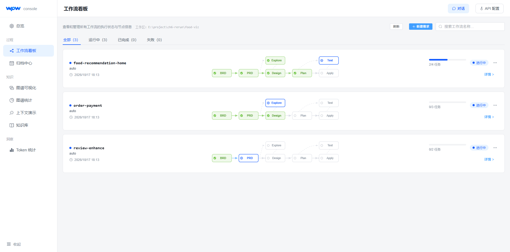

图A-2 展示工作流看板。三个活跃需求分别处于不同推进阶段：`food-recommendation-home` 已完成 BRD、PRD、Explore、Design、Plan，Test 待执行，任务进度 2/4；`order-payment` 已完成 BRD、PRD、Design；`review-enhance` 仅完成 BRD。阶段节点、跳过关系与依赖连线均按 `.WPW.yaml` 的状态渲染。


图A-3 展示 `food-recommendation-home` 的详情抽屉。抽屉给出 Test 阶段未完成的门禁提示、Explore 阶段拍板结论（方案B：物品协同过滤 + 热度兜底）、Plan 任务进度（2/4）以及六个阶段制品的生成状态；BRD、PRD、Explore、Design、Plan、TestPlan 文件均被正确识别并显示为已生成。


图A-4 展示图谱统计页。节点层级分布为 C 8、L1 10、L2 431、L3 1369；边类型分布为 contain 1798、import 535、business_map 40。右上角按边的来源拆分全部 2373 条边：结构边 2333 条（含 contain 与 import），语义边 40 条；语义边数与 business_map 边数一致。下方映射覆盖率显示能力到代码的映射为 8/8（100%），模块被能力覆盖为 3/441（1%）；元信息区显示 Schema 版本 3.1.0、构建时间和 1813 条向量索引。


图A-5 展示以“购物车”为任务输入的上下文生成过程。系统命中 5 个锚点（能力节点 `cart-orders` 及 `CartController`、`CartVO`、`CartController.page`、`CartEntity`），经加权双向 BFS 扩展到 200 个节点，并在右侧渲染子图。Token 预算设为 4000 时，loose 档约 4859 tokens，超过预算并给出降级提示；standard 档约 2029 tokens、extreme 档约 1677 tokens，均满足预算。该页同时验证了锚点命中、BFS 扩展、三档压缩与预算约束在真实大图上的行为。

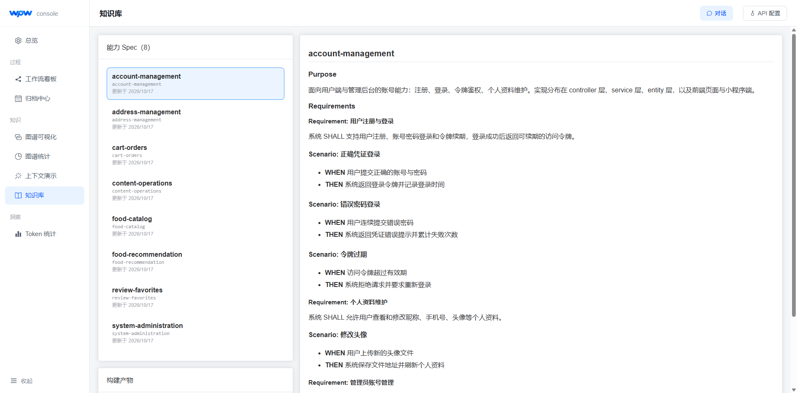

图A-6 展示知识库页面。左侧列出 8 份能力 spec，右侧渲染 `account-management` 的 Purpose、Requirement 与 Scenario 结构，说明控制台读取的是工作区中的原始规范文件，而非预置展示文本。

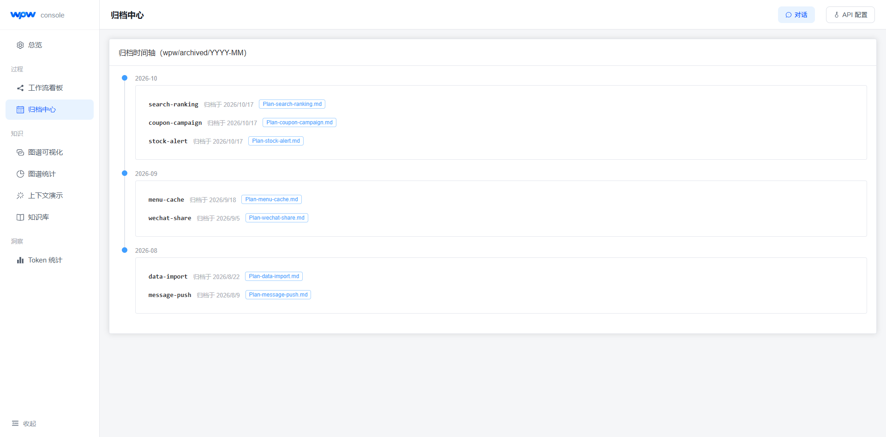

图A-7 展示归档中心时间轴。页面按 `wpw/archived/YYYY-MM` 目录聚合出 2026-08、2026-09、2026-10 三个月份，共 7 个已归档需求，并为每个需求提供计划制品入口，验证了归档目录的读取与时间轴渲染。

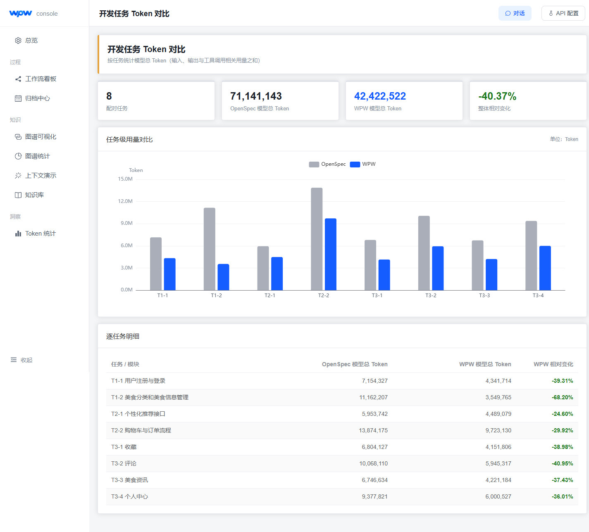

图A-8 展示开发任务的 Token 对比页。页面以任务为单位并列 OpenSpec 与 WPW 的模型总 Token，上方给出配对任务数、两种方法的合计与整体相对变化，下方逐任务列出用量和相对变化。该页的数据为演示用内置样例，用于展示对比视图；其中 T3 的数值与正文表6-5 一致，但不作为第 6.2 节开发实验的原始证据。真实的 Token 消耗统计页在无模型调用时显示空态说明，与本演示工作区 `usage.jsonl` 无记录的状态对应。

## 附录 B 开发任务运行记录

第 6.2.1 节的开发专项把美食推荐系统的连续开发过程划分为 T1 基础搭建、T2 业务核心和 T3 迭代增强三个任务集，另以 T4 的四轮连续需求作长期演化补充。本专项只统计模型总 Token，不计算检索或上下文质量指标。表B-1 列出任务构成，表B-2 与表B-3 给出两种方法的模型总 Token 对照，表B-4 记录逐次运行的元数据。

表B-1 美食推荐系统开发任务

Table B-1 Development Tasks for the Food Recommendation System

| 任务集 | 场景 | 任务数量 | 任务内容 |
|---|---|---:|---|
| T1 | 基础搭建 | 2 | 用户认证、美食分类和美食信息管理 |
| T2 | 业务核心 | 2 | 个性化推荐、购物车和订单流程 |
| T3 | 迭代增强 | 4 | 收藏、评论、美食资讯和个人中心 |
| T4 | 长期演化 | 4 | 会员积分、优惠券、会员等级、配送规则（四轮连续需求） |

表B-2 T1—T3 开发任务模型总 Token 对照

Table B-2 Total Model Tokens for T1–T3 Development Tasks

| 任务 | 方法 | 模型总 Token | WPW 相对变化 | 原始记录 |
|---|---|---:|---:|---|
| T1-1 用户注册与登录 | OpenSpec | 7,154,327 | — | results/T1-1-openspec-r01-20260905-175358.json |
| T1-1 用户注册与登录 | WPW | 4,341,714 | -39.31% | results/T1-1-wpw-r01-20260905-151814.json |
| T1-2 美食分类和美食信息管理 | OpenSpec | 11,162,207 | — | results/T1-2-openspec-r01-20260905-185750.json |
| T1-2 美食分类和美食信息管理 | WPW | ≈3,549,765 | -68.20% | results/T1-2-wpw-r01-20260905-163226.json（估算口径；记录文件按取整到百位为 3,549,700） |
| T2-1 个性化推荐接口 | OpenSpec | 5,953,742 | — | results/T2-1-openspec-r01-20260905-200235.json |
| T2-1 个性化推荐接口 | WPW | 4,489,079 | -24.60% | results/T2-1-wpw-r01-20260905-182808.json（续跑口径） |
| T2-2 购物车与订单流程 | OpenSpec | 13,874,175 | — | results/T2-2-openspec-r01-20260905-205019.json |
| T2-2 购物车与订单流程 | WPW | 9,723,130 | -29.92% | results/T2-2-wpw-r01-20260905-193859.json（作者订正；记录文件内为 14,723,130，订正依据未留档） |
| T3-1 收藏 | OpenSpec | 6,804,127 | — | 正文表6-5 汇总值；原始运行记录未归档 |
| T3-1 收藏 | WPW | 4,151,806 | -38.98% | 正文表6-5 汇总值；原始运行记录未归档 |
| T3-2 评论 | OpenSpec | 10,068,110 | — | 正文表6-5 汇总值；原始运行记录未归档 |
| T3-2 评论 | WPW | 5,945,317 | -40.95% | 正文表6-5 汇总值；原始运行记录未归档 |
| T3-3 美食资讯 | OpenSpec | 6,746,634 | — | 正文表6-5 汇总值；原始运行记录未归档 |
| T3-3 美食资讯 | WPW | 4,221,184 | -37.43% | 正文表6-5 汇总值；原始运行记录未归档 |
| T3-4 个人中心 | OpenSpec | 9,377,821 | — | 正文表6-5 汇总值；原始运行记录未归档 |
| T3-4 个人中心 | WPW | 6,000,527 | -36.01% | 正文表6-5 汇总值；原始运行记录未归档 |
| **T1—T3 合计** | **OpenSpec** | **71,141,143** | — | T1—T2 有原始记录；T3 为正文汇总值 |
| **T1—T3 合计** | **WPW** | **42,422,522** | **-40.37%** | 同上 |

表B-2 的 T1—T2 四个任务共 8 次运行有完整记录，数值取自执行器 `sdd-eval` 的 `results/` 结果 JSON。T3 的四个任务在 `src/tasks.ts` 中有任务定义，但 `results/` 中没有对应的运行记录；表中的 T3 数值转录自正文表6-5，无法独立复核。T1—T3 合计 71,141,143 与 42,422,522 由表中数值相加得到；其中 T1-2 的 WPW 采用正文的未取整估算值 3,549,765，记录文件按取整到百位为 3,549,700，两者相差 65 Token。

表B-3 T4 连续开发任务模型总 Token 对照

Table B-3 Total Model Tokens for the T4 Continuous Development Task

| 轮次 | 需求 | OpenSpec 模型总 Token | WPW 模型总 Token | WPW 相对减少 | 原始记录 |
|---|---|---:|---:|---:|---|
| T4-1 | 会员积分 | 9,206,342 | 7,601,438 | 17.44% | 正文表6-6 汇总值；原始运行记录未归档 |
| T4-2 | 优惠券 | 12,794,815 | 6,536,772 | 48.90% | 正文表6-6 汇总值；原始运行记录未归档 |
| T4-3 | 会员等级 | 7,422,618 | 5,176,294 | 30.26% | 正文表6-6 汇总值；原始运行记录未归档 |
| T4-4 | 配送规则 | 10,908,537 | 6,418,126 | 41.16% | 正文表6-6 汇总值；原始运行记录未归档 |
| **合计** | — | **40,332,312** | **25,732,630** | **36.20%** | 四轮相加 |

表B-3 的 T4 四轮同样没有留存原始运行记录；表中的四轮数值与合计转录自正文表6-6，无法由执行器结果独立复核。T1—T4 的合计 111,473,455 与 68,155,152 由 T1—T3 合计与 T4 合计相加得到，与正文一致。

表B-4 T1—T2 开发任务逐次运行元数据

Table B-4 Run Metadata of the T1–T2 Development Tasks

| 任务 | 方法 | 起始提交 | 状态 | 执行耗时/s | Recall | Precision | 返工次数 | 累计上下文 Token | 搜索/图谱/读取 | 模型标识 |
|---|---|---|---|---:|---:|---:|---:|---:|---|---|
| T1-1 用户注册与登录 | OpenSpec | 6e0157f1 | passed | 1359 | 1.000 | 1.000 | 0 | 1,410 | 9/0/20 | gpt-5.6-sol |
| T1-1 用户注册与登录 | WPW | 6c16075a | passed | 1716 | 1.000 | 1.000 | 0 | 1,929 | 4/3/21 | gpt-5.3-codex-spark |
| T1-2 美食分类和美食信息管理 | OpenSpec | f4c2f3db | passed | 1331 | 0.833 | 1.000 | 0 | 558 | 5/0/19 | 未记录（原记录写为「GPT-5 current session;…」） |
| T1-2 美食分类和美食信息管理 | WPW | 0b3e081c | passed | 1396 | 1.000 | 0.813 | 1 | 660 | 1/6/16 | 未记录 |
| T2-1 个性化推荐接口 | OpenSpec | 35b47d14 | passed | 1291 | 0.750 | 1.000 | 0 | 1,376 | 4/0/13 | 未记录 |
| T2-1 个性化推荐接口 | WPW | 6c16075a | passed | 2753 | 1.000 | 1.000 | 0 | 24,372 | 1/5/20 | 未记录 |
| T2-2 购物车与订单流程 | OpenSpec | 71888f2d | passed | 2185 | 1.000 | 1.000 | 3 | 1,515 | 4/0/23 | 未记录 |
| T2-2 购物车与订单流程 | WPW | 6c16075a | passed | 2441 | 0.800 | 1.000 | 2 | 3,749 | 4/5/24 | 未记录 |

T3 与 T4 的运行元数据未随实验数据归档，无法列入本表。表B-4 登记三处协议例外。其一，T1-2 的 WPW 与 T1-1 处于同一对话，模型总 Token 按 T1-1 的精确用量乘以耗时比例与探索事件比例的均值估算，Recall 与 Precision 亦为估算值；记录文件按取整到百位给出 3,549,700，表B-2 与正文采用未取整的 3,549,765，两者相差 65 Token。其二，T2-1 的 WPW 为续跑运行，当次会话开始前已存在规格与实现，精确 Token 只覆盖续跑阶段。其三，T2-2 的 WPW 起点含 T2-1 未提交的变更，正文采用的模型总 Token 为作者订正值 9,723,130，存档记录为 14,723,130；订正将记录值扣减 5,000,000 Token，订正依据未形成独立记录，无法由存档复核。上述例外在正文 6.2.1 节与本节一并登记。另外，T1-1 与 T1-2 的运行记录里模型标识栏的取值不同（分别为 `gpt-5.6-sol` 与 `gpt-5.3-codex-spark`），实验操作者确认两次运行使用同一模型，表B-4 按原记录照录。

T2-2 的订正值影响整体幅度。按订正值，T1—T3 合计 42,422,522、降幅 40.37%，T1—T4 合计 68,155,152、降幅 38.86%；按存档记录值 14,723,130，T1—T3 合计 47,422,522、降幅 33.34%，T1—T4 合计 73,155,152、降幅 34.37%。两种口径的方向一致，但降幅相差约 7 个百分点；正文采用订正值时，应保留这一敏感性说明，并补充订正依据。

## 附录 C 场景检索题集与结果

第 6.2.3 节的场景检索子实验包含 100 个信息需求，按四类各 25 题组织。表C-1 给出题集与人工标注的 Gold 文件，表C-2 给出三条件的总体结果，表C-3 按查询类别拆分，表C-4 给出配对检验，表C-5 逐题列出 Recall@10 与 Precision@10 两项指标。

表C-1 场景检索题集与 Gold 标注

Table C-1 Retrieval Task Set and Gold Annotation

| 编号 | 类别 | 问题族 | 信息需求 | 查询文本 | Gold 文件 |
|---|---|---|---|---|---|
| R1-01 | 精确标识定位 | user-login | 用户登录与令牌签发 | YonghuController.login | `src/main/java/com/controller/YonghuController.java` |
| R1-02 | 精确标识定位 | user-register | 用户注册 | YonghuController.register | `src/main/java/com/controller/YonghuController.java` |
| R1-03 | 精确标识定位 | admin-login | 后台管理员登录 | UsersController.login | `src/main/java/com/controller/UsersController.java` |
| R1-04 | 精确标识定位 | session-user | 当前登录用户信息 | getCurrUser session | `src/main/java/com/controller/YonghuController.java` |
| R1-05 | 精确标识定位 | auth-interceptor | 请求鉴权拦截 | AuthorizationInterceptor.preHandle | `src/main/java/com/interceptor/AuthorizationInterceptor.java` |
| R1-06 | 精确标识定位 | password-reset | 用户密码重置 | YonghuController.resetPass | `src/main/java/com/controller/YonghuController.java` |
| R1-07 | 精确标识定位 | food-category | 美食分类管理 | MeishifenleiController | `src/main/java/com/controller/MeishifenleiController.java` |
| R1-08 | 精确标识定位 | food-info | 美食信息管理 | MeishixinxiController | `src/main/java/com/controller/MeishixinxiController.java` |
| R1-09 | 精确标识定位 | popular-recommend | 热门美食推荐 | MeishixinxiController.autoSort | `src/main/java/com/controller/MeishixinxiController.java` |
| R1-10 | 精确标识定位 | personal-recommend | 个性化美食推荐 | MeishixinxiController.autoSort2 | `src/main/java/com/controller/MeishixinxiController.java` |
| R1-11 | 精确标识定位 | favorite | 美食收藏 | StoreupController | `src/main/java/com/controller/StoreupController.java` |
| R1-12 | 精确标识定位 | comment | 美食评论 | DiscussmeishixinxiController | `src/main/java/com/controller/DiscussmeishixinxiController.java` |
| R1-13 | 精确标识定位 | cart | 购物车管理 | CartController | `src/main/java/com/controller/CartController.java` |
| R1-14 | 精确标识定位 | order | 订单管理 | OrdersController | `src/main/java/com/controller/OrdersController.java` |
| R1-15 | 精确标识定位 | address | 收货地址与默认地址 | AddressController.defaultAddress | `src/main/java/com/controller/AddressController.java` |
| R1-16 | 精确标识定位 | news | 美食资讯管理 | NewsController | `src/main/java/com/controller/NewsController.java` |
| R1-17 | 精确标识定位 | chat | 在线客服会话 | ChatController | `src/main/java/com/controller/ChatController.java` |
| R1-18 | 精确标识定位 | file | 文件上传下载 | FileController.upload download | `src/main/java/com/controller/FileController.java` |
| R1-19 | 精确标识定位 | common-option | 通用下拉选项查询 | CommonController.getOption | `src/main/java/com/controller/CommonController.java` |
| R1-20 | 精确标识定位 | order-stats | 订单统计分析 | OrdersController.value group | `src/main/java/com/controller/OrdersController.java` |
| R1-21 | 精确标识定位 | payment | 支付宝支付配置 | AlipayConfig | `src/main/java/com/config/AlipayConfig.java` |
| R1-22 | 精确标识定位 | front-login | 用户端登录页面 | pages/login/login.vue | `src/main/resources/front/front/pages/login/login.vue` |
| R1-23 | 精确标识定位 | front-order-confirm | 前端订单确认与结算 | shop-order-confirm.onSubmitTap | `src/main/resources/front/front/pages/shop-order-confirm/shop-order-confirm.vue` |
| R1-24 | 精确标识定位 | front-order-state | 前端订单状态流转 | shop-order order.status | `src/main/resources/front/front/pages/shop-order/shop-order.vue` |
| R1-25 | 精确标识定位 | database-schema | 核心交易数据表 | CREATE TABLE orders cart address | `db/springboot7tr93.sql` |
| R2-01 | 业务关键词定位 | user-login | 用户登录与令牌签发 | 用户登录与令牌签发 | `src/main/java/com/controller/YonghuController.java`<br>`src/main/java/com/service/TokenService.java`<br>`src/main/java/com/service/impl/TokenServiceImpl.java` |
| R2-02 | 业务关键词定位 | user-register | 用户注册 | 用户注册 | `src/main/java/com/controller/YonghuController.java`<br>`src/main/java/com/entity/YonghuEntity.java`<br>`src/main/java/com/service/YonghuService.java` |
| R2-03 | 业务关键词定位 | admin-login | 后台管理员登录 | 后台管理员登录 | `src/main/java/com/controller/UsersController.java`<br>`src/main/java/com/entity/UsersEntity.java`<br>`src/main/java/com/service/TokenService.java` |
| R2-04 | 业务关键词定位 | session-user | 当前登录用户信息 | 当前登录用户信息 | `src/main/java/com/controller/YonghuController.java`<br>`src/main/java/com/interceptor/AuthorizationInterceptor.java` |
| R2-05 | 业务关键词定位 | auth-interceptor | 请求鉴权拦截 | 请求鉴权拦截 | `src/main/java/com/interceptor/AuthorizationInterceptor.java`<br>`src/main/java/com/config/InterceptorConfig.java`<br>`src/main/java/com/annotation/IgnoreAuth.java` |
| R2-06 | 业务关键词定位 | password-reset | 用户密码重置 | 用户密码重置 | `src/main/java/com/controller/YonghuController.java`<br>`src/main/java/com/entity/YonghuEntity.java` |
| R2-07 | 业务关键词定位 | food-category | 美食分类管理 | 美食分类管理 | `src/main/java/com/controller/MeishifenleiController.java`<br>`src/main/java/com/entity/MeishifenleiEntity.java`<br>`src/main/java/com/service/MeishifenleiService.java` |
| R2-08 | 业务关键词定位 | food-info | 美食信息管理 | 美食信息管理 | `src/main/java/com/controller/MeishixinxiController.java`<br>`src/main/java/com/entity/MeishixinxiEntity.java`<br>`src/main/java/com/service/MeishixinxiService.java` |
| R2-09 | 业务关键词定位 | popular-recommend | 热门美食推荐 | 热门美食推荐 | `src/main/java/com/controller/MeishixinxiController.java`<br>`src/main/java/com/entity/MeishixinxiEntity.java` |
| R2-10 | 业务关键词定位 | personal-recommend | 个性化美食推荐 | 个性化美食推荐 | `src/main/java/com/controller/MeishixinxiController.java`<br>`src/main/java/com/entity/OrdersEntity.java`<br>`src/main/java/com/service/OrdersService.java` |
| R2-11 | 业务关键词定位 | favorite | 美食收藏 | 美食收藏 | `src/main/java/com/controller/StoreupController.java`<br>`src/main/java/com/entity/StoreupEntity.java`<br>`src/main/java/com/service/StoreupService.java` |
| R2-12 | 业务关键词定位 | comment | 美食评论 | 美食评论 | `src/main/java/com/controller/DiscussmeishixinxiController.java`<br>`src/main/java/com/entity/DiscussmeishixinxiEntity.java`<br>`src/main/java/com/service/DiscussmeishixinxiService.java` |
| R2-13 | 业务关键词定位 | cart | 购物车管理 | 购物车管理 | `src/main/java/com/controller/CartController.java`<br>`src/main/java/com/entity/CartEntity.java`<br>`src/main/resources/front/front/pages/shop-cart/shop-cart.vue` |
| R2-14 | 业务关键词定位 | order | 订单管理 | 订单管理 | `src/main/java/com/controller/OrdersController.java`<br>`src/main/java/com/entity/OrdersEntity.java`<br>`src/main/resources/front/front/pages/shop-order-confirm/shop-order-confirm.vue` |
| R2-15 | 业务关键词定位 | address | 收货地址与默认地址 | 收货地址与默认地址 | `src/main/java/com/controller/AddressController.java`<br>`src/main/java/com/entity/AddressEntity.java`<br>`src/main/java/com/service/AddressService.java` |
| R2-16 | 业务关键词定位 | news | 美食资讯管理 | 美食资讯管理 | `src/main/java/com/controller/NewsController.java`<br>`src/main/java/com/entity/NewsEntity.java`<br>`src/main/resources/front/front/pages/news/list.vue` |
| R2-17 | 业务关键词定位 | chat | 在线客服会话 | 在线客服会话 | `src/main/java/com/controller/ChatController.java`<br>`src/main/java/com/entity/ChatEntity.java`<br>`src/main/java/com/service/ChatService.java` |
| R2-18 | 业务关键词定位 | file | 文件上传下载 | 文件上传下载 | `src/main/java/com/controller/FileController.java`<br>`src/main/java/com/utils/FileUtil.java` |
| R2-19 | 业务关键词定位 | common-option | 通用下拉选项查询 | 通用下拉选项查询 | `src/main/java/com/controller/CommonController.java`<br>`src/main/java/com/dao/CommonDao.java`<br>`src/main/resources/mapper/CommonDao.xml` |
| R2-20 | 业务关键词定位 | order-stats | 订单统计分析 | 订单统计分析 | `src/main/java/com/controller/OrdersController.java`<br>`src/main/java/com/service/OrdersService.java`<br>`src/main/resources/mapper/OrdersDao.xml` |
| R2-21 | 业务关键词定位 | payment | 支付宝支付配置 | 支付宝支付配置 | `src/main/java/com/config/AlipayConfig.java`<br>`src/main/resources/admin/admin/src/views/pay.vue` |
| R2-22 | 业务关键词定位 | front-login | 用户端登录页面 | 用户端登录页面 | `src/main/resources/front/front/pages/login/login.vue`<br>`src/main/resources/front/front/api/index.js`<br>`src/main/resources/front/front/api/http.js` |
| R2-23 | 业务关键词定位 | front-order-confirm | 前端订单确认与结算 | 前端订单确认与结算 | `src/main/resources/front/front/pages/shop-order-confirm/shop-order-confirm.vue`<br>`src/main/resources/front/front/api/index.js`<br>`src/main/java/com/controller/OrdersController.java` |
| R2-24 | 业务关键词定位 | front-order-state | 前端订单状态流转 | 前端订单状态流转 | `src/main/resources/front/front/pages/shop-order/shop-order.vue`<br>`src/main/java/com/controller/OrdersController.java`<br>`src/main/java/com/entity/OrdersEntity.java` |
| R2-25 | 业务关键词定位 | database-schema | 核心交易数据表 | 核心交易数据表 | `db/springboot7tr93.sql`<br>`src/main/java/com/entity/OrdersEntity.java`<br>`src/main/java/com/entity/CartEntity.java`<br>`src/main/java/com/entity/AddressEntity.java` |
| R3-01 | 同义或非代码命名表达 | user-login | 用户登录与令牌签发 | 普通用户验证账号后获取访问凭证 | `src/main/java/com/controller/YonghuController.java`<br>`src/main/java/com/service/TokenService.java`<br>`src/main/java/com/service/impl/TokenServiceImpl.java` |
| R3-02 | 同义或非代码命名表达 | user-register | 用户注册 | 新用户创建账号 | `src/main/java/com/controller/YonghuController.java`<br>`src/main/java/com/entity/YonghuEntity.java`<br>`src/main/java/com/service/YonghuService.java` |
| R3-03 | 同义或非代码命名表达 | admin-login | 后台管理员登录 | 后台账户进入管理端 | `src/main/java/com/controller/UsersController.java`<br>`src/main/java/com/entity/UsersEntity.java`<br>`src/main/java/com/service/TokenService.java` |
| R3-04 | 同义或非代码命名表达 | session-user | 当前登录用户信息 | 根据会话取得当前用户资料 | `src/main/java/com/controller/YonghuController.java`<br>`src/main/java/com/interceptor/AuthorizationInterceptor.java` |
| R3-05 | 同义或非代码命名表达 | auth-interceptor | 请求鉴权拦截 | 未登录请求返回 401 | `src/main/java/com/interceptor/AuthorizationInterceptor.java`<br>`src/main/java/com/config/InterceptorConfig.java`<br>`src/main/java/com/annotation/IgnoreAuth.java` |
| R3-06 | 同义或非代码命名表达 | password-reset | 用户密码重置 | 忘记密码后恢复默认密码 | `src/main/java/com/controller/YonghuController.java`<br>`src/main/java/com/entity/YonghuEntity.java` |
| R3-07 | 同义或非代码命名表达 | food-category | 美食分类管理 | 维护菜品所属类别 | `src/main/java/com/controller/MeishifenleiController.java`<br>`src/main/java/com/entity/MeishifenleiEntity.java`<br>`src/main/java/com/service/MeishifenleiService.java` |
| R3-08 | 同义或非代码命名表达 | food-info | 美食信息管理 | 维护菜品名称图片价格和库存 | `src/main/java/com/controller/MeishixinxiController.java`<br>`src/main/java/com/entity/MeishixinxiEntity.java`<br>`src/main/java/com/service/MeishixinxiService.java` |
| R3-09 | 同义或非代码命名表达 | popular-recommend | 热门美食推荐 | 按点击量排序展示菜品 | `src/main/java/com/controller/MeishixinxiController.java`<br>`src/main/java/com/entity/MeishixinxiEntity.java` |
| R3-10 | 同义或非代码命名表达 | personal-recommend | 个性化美食推荐 | 依据用户历史订单类别推荐菜品 | `src/main/java/com/controller/MeishixinxiController.java`<br>`src/main/java/com/entity/OrdersEntity.java`<br>`src/main/java/com/service/OrdersService.java` |
| R3-11 | 同义或非代码命名表达 | favorite | 美食收藏 | 用户保存或取消喜欢的菜品 | `src/main/java/com/controller/StoreupController.java`<br>`src/main/java/com/entity/StoreupEntity.java`<br>`src/main/java/com/service/StoreupService.java` |
| R3-12 | 同义或非代码命名表达 | comment | 美食评论 | 用户对菜品发布评论 | `src/main/java/com/controller/DiscussmeishixinxiController.java`<br>`src/main/java/com/entity/DiscussmeishixinxiEntity.java`<br>`src/main/java/com/service/DiscussmeishixinxiService.java` |
| R3-13 | 同义或非代码命名表达 | cart | 购物车管理 | 加入购物车并修改购买数量 | `src/main/java/com/controller/CartController.java`<br>`src/main/java/com/entity/CartEntity.java`<br>`src/main/resources/front/front/pages/shop-cart/shop-cart.vue` |
| R3-14 | 同义或非代码命名表达 | order | 订单管理 | 提交订单并维护订单状态 | `src/main/java/com/controller/OrdersController.java`<br>`src/main/java/com/entity/OrdersEntity.java`<br>`src/main/resources/front/front/pages/shop-order-confirm/shop-order-confirm.vue` |
| R3-15 | 同义或非代码命名表达 | address | 收货地址与默认地址 | 按当前用户选择唯一默认收货地址 | `src/main/java/com/controller/AddressController.java`<br>`src/main/java/com/entity/AddressEntity.java`<br>`src/main/java/com/service/AddressService.java` |
| R3-16 | 同义或非代码命名表达 | news | 美食资讯管理 | 发布和浏览美食资讯 | `src/main/java/com/controller/NewsController.java`<br>`src/main/java/com/entity/NewsEntity.java`<br>`src/main/resources/front/front/pages/news/list.vue` |
| R3-17 | 同义或非代码命名表达 | chat | 在线客服会话 | 用户与管理员交换咨询消息 | `src/main/java/com/controller/ChatController.java`<br>`src/main/java/com/entity/ChatEntity.java`<br>`src/main/java/com/service/ChatService.java` |
| R3-18 | 同义或非代码命名表达 | file | 文件上传下载 | 保存并下载项目图片文件 | `src/main/java/com/controller/FileController.java`<br>`src/main/java/com/utils/FileUtil.java` |
| R3-19 | 同义或非代码命名表达 | common-option | 通用下拉选项查询 | 按表和字段动态取得候选值 | `src/main/java/com/controller/CommonController.java`<br>`src/main/java/com/dao/CommonDao.java`<br>`src/main/resources/mapper/CommonDao.xml` |
| R3-20 | 同义或非代码命名表达 | order-stats | 订单统计分析 | 按状态分组或按时间统计已支付订单 | `src/main/java/com/controller/OrdersController.java`<br>`src/main/java/com/service/OrdersService.java`<br>`src/main/resources/mapper/OrdersDao.xml` |
| R3-21 | 同义或非代码命名表达 | payment | 支付宝支付配置 | 订单支付所需的支付宝参数 | `src/main/java/com/config/AlipayConfig.java`<br>`src/main/resources/admin/admin/src/views/pay.vue` |
| R3-22 | 同义或非代码命名表达 | front-login | 用户端登录页面 | 移动端提交登录并保存用户会话 | `src/main/resources/front/front/pages/login/login.vue`<br>`src/main/resources/front/front/api/index.js`<br>`src/main/resources/front/front/api/http.js` |
| R3-23 | 同义或非代码命名表达 | front-order-confirm | 前端订单确认与结算 | 确认地址后逐项创建订单并清理购物车 | `src/main/resources/front/front/pages/shop-order-confirm/shop-order-confirm.vue`<br>`src/main/resources/front/front/api/index.js`<br>`src/main/java/com/controller/OrdersController.java` |
| R3-24 | 同义或非代码命名表达 | front-order-state | 前端订单状态流转 | 支付取消退款收货与评价订单 | `src/main/resources/front/front/pages/shop-order/shop-order.vue`<br>`src/main/java/com/controller/OrdersController.java`<br>`src/main/java/com/entity/OrdersEntity.java` |
| R3-25 | 同义或非代码命名表达 | database-schema | 核心交易数据表 | 查看购物车订单地址的数据库字段 | `db/springboot7tr93.sql`<br>`src/main/java/com/entity/OrdersEntity.java`<br>`src/main/java/com/entity/CartEntity.java`<br>`src/main/java/com/entity/AddressEntity.java` |
| R4-01 | 组合条件定位 | user-login | 用户登录与令牌签发 | 登录认证与 TokenService 联合定位 | `src/main/java/com/controller/YonghuController.java`<br>`src/main/java/com/service/TokenService.java`<br>`src/main/java/com/service/impl/TokenServiceImpl.java` |
| R4-02 | 组合条件定位 | user-register | 用户注册 | 注册与用户表持久化联合定位 | `src/main/java/com/controller/YonghuController.java`<br>`src/main/java/com/entity/YonghuEntity.java`<br>`src/main/java/com/service/YonghuService.java` |
| R4-03 | 组合条件定位 | admin-login | 后台管理员登录 | 管理员登录与角色令牌联合定位 | `src/main/java/com/controller/UsersController.java`<br>`src/main/java/com/entity/UsersEntity.java`<br>`src/main/java/com/service/TokenService.java` |
| R4-04 | 组合条件定位 | session-user | 当前登录用户信息 | 会话 userId 与用户查询联合定位 | `src/main/java/com/controller/YonghuController.java`<br>`src/main/java/com/interceptor/AuthorizationInterceptor.java` |
| R4-05 | 组合条件定位 | auth-interceptor | 请求鉴权拦截 | IgnoreAuth 与 Token 校验联合定位 | `src/main/java/com/interceptor/AuthorizationInterceptor.java`<br>`src/main/java/com/config/InterceptorConfig.java`<br>`src/main/java/com/annotation/IgnoreAuth.java` |
| R4-06 | 组合条件定位 | password-reset | 用户密码重置 | 重置密码与用户更新联合定位 | `src/main/java/com/controller/YonghuController.java`<br>`src/main/java/com/entity/YonghuEntity.java` |
| R4-07 | 组合条件定位 | food-category | 美食分类管理 | 分类 CRUD 与分类实体联合定位 | `src/main/java/com/controller/MeishifenleiController.java`<br>`src/main/java/com/entity/MeishifenleiEntity.java`<br>`src/main/java/com/service/MeishifenleiService.java` |
| R4-08 | 组合条件定位 | food-info | 美食信息管理 | 美食 CRUD 与实体联合定位 | `src/main/java/com/controller/MeishixinxiController.java`<br>`src/main/java/com/entity/MeishixinxiEntity.java`<br>`src/main/java/com/service/MeishixinxiService.java` |
| R4-09 | 组合条件定位 | popular-recommend | 热门美食推荐 | 推荐与 clicknum 排序联合定位 | `src/main/java/com/controller/MeishixinxiController.java`<br>`src/main/java/com/entity/MeishixinxiEntity.java` |
| R4-10 | 组合条件定位 | personal-recommend | 个性化美食推荐 | 订单 goodtype 与推荐去重联合定位 | `src/main/java/com/controller/MeishixinxiController.java`<br>`src/main/java/com/entity/OrdersEntity.java`<br>`src/main/java/com/service/OrdersService.java` |
| R4-11 | 组合条件定位 | favorite | 美食收藏 | 收藏 userid 与 refid 联合定位 | `src/main/java/com/controller/StoreupController.java`<br>`src/main/java/com/entity/StoreupEntity.java`<br>`src/main/java/com/service/StoreupService.java` |
| R4-12 | 组合条件定位 | comment | 美食评论 | 评论 refid 与用户归属联合定位 | `src/main/java/com/controller/DiscussmeishixinxiController.java`<br>`src/main/java/com/entity/DiscussmeishixinxiEntity.java`<br>`src/main/java/com/service/DiscussmeishixinxiService.java` |
| R4-13 | 组合条件定位 | cart | 购物车管理 | 购物车 userid 与商品 goodid 联合定位 | `src/main/java/com/controller/CartController.java`<br>`src/main/java/com/entity/CartEntity.java`<br>`src/main/resources/front/front/pages/shop-cart/shop-cart.vue` |
| R4-14 | 组合条件定位 | order | 订单管理 | 订单 userid、status 与持久化联合定位 | `src/main/java/com/controller/OrdersController.java`<br>`src/main/java/com/entity/OrdersEntity.java`<br>`src/main/resources/front/front/pages/shop-order-confirm/shop-order-confirm.vue` |
| R4-15 | 组合条件定位 | address | 收货地址与默认地址 | 默认地址 isdefault 与 userid 联合定位 | `src/main/java/com/controller/AddressController.java`<br>`src/main/java/com/entity/AddressEntity.java`<br>`src/main/java/com/service/AddressService.java` |
| R4-16 | 组合条件定位 | news | 美食资讯管理 | 资讯 CRUD 与前端资讯页面联合定位 | `src/main/java/com/controller/NewsController.java`<br>`src/main/java/com/entity/NewsEntity.java`<br>`src/main/resources/front/front/pages/news/list.vue` |
| R4-17 | 组合条件定位 | chat | 在线客服会话 | 客服 isreply 与用户管理员联合定位 | `src/main/java/com/controller/ChatController.java`<br>`src/main/java/com/entity/ChatEntity.java`<br>`src/main/java/com/service/ChatService.java` |
| R4-18 | 组合条件定位 | file | 文件上传下载 | MultipartFile 与 upload 目录联合定位 | `src/main/java/com/controller/FileController.java`<br>`src/main/java/com/utils/FileUtil.java` |
| R4-19 | 组合条件定位 | common-option | 通用下拉选项查询 | option 与 follow 级联查询联合定位 | `src/main/java/com/controller/CommonController.java`<br>`src/main/java/com/dao/CommonDao.java`<br>`src/main/resources/mapper/CommonDao.xml` |
| R4-20 | 组合条件定位 | order-stats | 订单统计分析 | 订单 status 与 group/value 联合定位 | `src/main/java/com/controller/OrdersController.java`<br>`src/main/java/com/service/OrdersService.java`<br>`src/main/resources/mapper/OrdersDao.xml` |
| R4-21 | 组合条件定位 | payment | 支付宝支付配置 | 支付配置与订单支付页面联合定位 | `src/main/java/com/config/AlipayConfig.java`<br>`src/main/resources/admin/admin/src/views/pay.vue` |
| R4-22 | 组合条件定位 | front-login | 用户端登录页面 | 前端登录与 API session 联合定位 | `src/main/resources/front/front/pages/login/login.vue`<br>`src/main/resources/front/front/api/index.js`<br>`src/main/resources/front/front/api/http.js` |
| R4-23 | 组合条件定位 | front-order-confirm | 前端订单确认与结算 | 订单确认、地址与购物车删除联合定位 | `src/main/resources/front/front/pages/shop-order-confirm/shop-order-confirm.vue`<br>`src/main/resources/front/front/api/index.js`<br>`src/main/java/com/controller/OrdersController.java` |
| R4-24 | 组合条件定位 | front-order-state | 前端订单状态流转 | 订单状态与余额退款联合定位 | `src/main/resources/front/front/pages/shop-order/shop-order.vue`<br>`src/main/java/com/controller/OrdersController.java`<br>`src/main/java/com/entity/OrdersEntity.java` |
| R4-25 | 组合条件定位 | database-schema | 核心交易数据表 | orders、cart 与 address 表结构联合定位 | `db/springboot7tr93.sql`<br>`src/main/java/com/entity/OrdersEntity.java`<br>`src/main/java/com/entity/CartEntity.java`<br>`src/main/java/com/entity/AddressEntity.java` |

Gold 根据冻结源码、规格和测试证据人工标注，不由任何被测条件返回结果反向定义，判据是文件是否满足查询背后的信息需求而不是是否机械包含查询词。100 题共标注 238 个 Gold 文件，平均每题 2.38 个。冻结提交为 `afca51b09abd73c619986659a7af34b8d616d9b1`。

表C-2 场景检索总体结果

Table C-2 Overall Results of Scenario Retrieval

| 条件 | Recall@5 | Recall@10 | Precision@10 | Recall@10=0 的任务数 | 查询时间中位数/ms |
|---|---:|---:|---:|---:|---:|
| 非 KG | 0.483 | 0.617 | 0.126 | 12 | 58.04 |
| WPW-Map | 0.666 | 0.798 | 0.182 | 6 | 48.32 |
| 完整 WPW | 0.692 | 0.815 | 0.185 | 3 | 50.74 |

表C-3 不同查询类别的检索结果

Table C-3 Retrieval Results by Query Category

| 查询类别 | 条件 | Recall@10 | Precision@10 |
|---|---|---:|---:|
| 精确标识定位 | 非 KG | 1.000 | 0.100 |
| 精确标识定位 | WPW-Map | 1.000 | 0.100 |
| 精确标识定位 | 完整 WPW | 1.000 | 0.100 |
| 业务关键词定位 | 非 KG | 0.480 | 0.128 |
| 业务关键词定位 | WPW-Map | 0.747 | 0.208 |
| 业务关键词定位 | 完整 WPW | 0.740 | 0.208 |
| 同义或非代码命名表达 | 非 KG | 0.353 | 0.100 |
| 同义或非代码命名表达 | WPW-Map | 0.690 | 0.200 |
| 同义或非代码命名表达 | 完整 WPW | 0.730 | 0.208 |
| 组合条件定位 | 非 KG | 0.633 | 0.176 |
| 组合条件定位 | WPW-Map | 0.757 | 0.220 |
| 组合条件定位 | 完整 WPW | 0.790 | 0.224 |

表C-4 场景检索配对检验

Table C-4 Paired Tests of Scenario Retrieval

| 指标 | 查询级 Friedman χ² | p | 问题族聚合 Friedman χ² | p | 完整 WPW vs 非 KG（Holm 校正 p） | 配对秩二列相关（完整 vs 非 KG） |
|---|---:|---|---:|---|---:|---:|
| Recall@5 | 41.113 | <0.001 | 17.034 | <0.001 | 0.0023 | 0.729 |
| Recall@10 | 46.455 | <0.001 | 20.138 | <0.001 | 0.00033 | 0.844 |
| Precision@10 | 46.455 | <0.001 | 19.000 | <0.001 | 0.00045 | 0.846 |

检索指标以同一查询下的三个条件为配对观测。问题族聚合后，非 KG 与两种图谱条件均有显著差异：WPW-Map 相对非 KG 的 Holm 校正 p 分别为 0.0032、0.00077、0.00045，完整 WPW 相对非 KG 的分别为 0.0023、0.00033、0.00045；完整 WPW 与 WPW-Map 之间没有显著差异（Holm 校正 p 分别为 0.238、0.608、0.487）。因此结果支持图谱增强检索相对 BM25 的定位增益，但不支持把该增益进一步归因于 `business_map`。

表C-4 的问题族聚合采用族内宏平均口径：先对同一问题族的查询取条件均值，再以 25 个问题族为单位做 Friedman 与 Wilcoxon 检验。该口径可由 `retrieval_runs.json` 的逐题结果复算；早期归档中的 family_aggregated 记录值无法由原始逐题结果复现，故本表不采用。查询级检验、描述统计与逐题结果均与归档一致；两种族级口径的显著性结论相同，即完整 WPW 相对非 KG 的三项均显著，完整 WPW 相对 WPW-Map 的三项均不显著。

表C-5 逐题检索结果

Table C-5 Per-Query Retrieval Results

| 编号 | 类别 | 非 KG R@10 | 非 KG P@10 | WPW-Map R@10 | WPW-Map P@10 | 完整 WPW R@10 | 完整 WPW P@10 |
|---|---|---:|---:|---:|---:|---:|---:|
| R1-01 | 精确标识定位 | 1.000 | 0.100 | 1.000 | 0.100 | 1.000 | 0.100 |
| R1-02 | 精确标识定位 | 1.000 | 0.100 | 1.000 | 0.100 | 1.000 | 0.100 |
| R1-03 | 精确标识定位 | 1.000 | 0.100 | 1.000 | 0.100 | 1.000 | 0.100 |
| R1-04 | 精确标识定位 | 1.000 | 0.100 | 1.000 | 0.100 | 1.000 | 0.100 |
| R1-05 | 精确标识定位 | 1.000 | 0.100 | 1.000 | 0.100 | 1.000 | 0.100 |
| R1-06 | 精确标识定位 | 1.000 | 0.100 | 1.000 | 0.100 | 1.000 | 0.100 |
| R1-07 | 精确标识定位 | 1.000 | 0.100 | 1.000 | 0.100 | 1.000 | 0.100 |
| R1-08 | 精确标识定位 | 1.000 | 0.100 | 1.000 | 0.100 | 1.000 | 0.100 |
| R1-09 | 精确标识定位 | 1.000 | 0.100 | 1.000 | 0.100 | 1.000 | 0.100 |
| R1-10 | 精确标识定位 | 1.000 | 0.100 | 1.000 | 0.100 | 1.000 | 0.100 |
| R1-11 | 精确标识定位 | 1.000 | 0.100 | 1.000 | 0.100 | 1.000 | 0.100 |
| R1-12 | 精确标识定位 | 1.000 | 0.100 | 1.000 | 0.100 | 1.000 | 0.100 |
| R1-13 | 精确标识定位 | 1.000 | 0.100 | 1.000 | 0.100 | 1.000 | 0.100 |
| R1-14 | 精确标识定位 | 1.000 | 0.100 | 1.000 | 0.100 | 1.000 | 0.100 |
| R1-15 | 精确标识定位 | 1.000 | 0.100 | 1.000 | 0.100 | 1.000 | 0.100 |
| R1-16 | 精确标识定位 | 1.000 | 0.100 | 1.000 | 0.100 | 1.000 | 0.100 |
| R1-17 | 精确标识定位 | 1.000 | 0.100 | 1.000 | 0.100 | 1.000 | 0.100 |
| R1-18 | 精确标识定位 | 1.000 | 0.100 | 1.000 | 0.100 | 1.000 | 0.100 |
| R1-19 | 精确标识定位 | 1.000 | 0.100 | 1.000 | 0.100 | 1.000 | 0.100 |
| R1-20 | 精确标识定位 | 1.000 | 0.100 | 1.000 | 0.100 | 1.000 | 0.100 |
| R1-21 | 精确标识定位 | 1.000 | 0.100 | 1.000 | 0.100 | 1.000 | 0.100 |
| R1-22 | 精确标识定位 | 1.000 | 0.100 | 1.000 | 0.100 | 1.000 | 0.100 |
| R1-23 | 精确标识定位 | 1.000 | 0.100 | 1.000 | 0.100 | 1.000 | 0.100 |
| R1-24 | 精确标识定位 | 1.000 | 0.100 | 1.000 | 0.100 | 1.000 | 0.100 |
| R1-25 | 精确标识定位 | 1.000 | 0.100 | 1.000 | 0.100 | 1.000 | 0.100 |
| R2-01 | 业务关键词定位 | 0.333 | 0.100 | 0.667 | 0.200 | 0.333 | 0.100 |
| R2-02 | 业务关键词定位 | 0.333 | 0.100 | 0.667 | 0.200 | 0.333 | 0.100 |
| R2-03 | 业务关键词定位 | 0.000 | 0.000 | 0.333 | 0.100 | 0.333 | 0.100 |
| R2-04 | 业务关键词定位 | 0.500 | 0.100 | 0.500 | 0.100 | 0.500 | 0.100 |
| R2-05 | 业务关键词定位 | 0.333 | 0.100 | 0.333 | 0.100 | 0.667 | 0.200 |
| R2-06 | 业务关键词定位 | 1.000 | 0.200 | 1.000 | 0.200 | 0.500 | 0.100 |
| R2-07 | 业务关键词定位 | 0.333 | 0.100 | 1.000 | 0.300 | 1.000 | 0.300 |
| R2-08 | 业务关键词定位 | 0.333 | 0.100 | 1.000 | 0.300 | 1.000 | 0.300 |
| R2-09 | 业务关键词定位 | 1.000 | 0.200 | 1.000 | 0.200 | 1.000 | 0.200 |
| R2-10 | 业务关键词定位 | 0.333 | 0.100 | 0.333 | 0.100 | 0.667 | 0.200 |
| R2-11 | 业务关键词定位 | 0.333 | 0.100 | 1.000 | 0.300 | 1.000 | 0.300 |
| R2-12 | 业务关键词定位 | 0.667 | 0.200 | 1.000 | 0.300 | 1.000 | 0.300 |
| R2-13 | 业务关键词定位 | 1.000 | 0.300 | 0.667 | 0.200 | 1.000 | 0.300 |
| R2-14 | 业务关键词定位 | 0.333 | 0.100 | 0.667 | 0.200 | 1.000 | 0.300 |
| R2-15 | 业务关键词定位 | 0.333 | 0.100 | 1.000 | 0.300 | 1.000 | 0.300 |
| R2-16 | 业务关键词定位 | 0.000 | 0.000 | 0.667 | 0.200 | 0.667 | 0.200 |
| R2-17 | 业务关键词定位 | 1.000 | 0.300 | 1.000 | 0.300 | 1.000 | 0.300 |
| R2-18 | 业务关键词定位 | 0.500 | 0.100 | 1.000 | 0.200 | 1.000 | 0.200 |
| R2-19 | 业务关键词定位 | 0.000 | 0.000 | 0.000 | 0.000 | 0.000 | 0.000 |
| R2-20 | 业务关键词定位 | 0.333 | 0.100 | 0.667 | 0.200 | 0.667 | 0.200 |
| R2-21 | 业务关键词定位 | 1.000 | 0.200 | 1.000 | 0.200 | 1.000 | 0.200 |
| R2-22 | 业务关键词定位 | 0.333 | 0.100 | 1.000 | 0.300 | 0.333 | 0.100 |
| R2-23 | 业务关键词定位 | 0.667 | 0.200 | 0.667 | 0.200 | 1.000 | 0.300 |
| R2-24 | 业务关键词定位 | 1.000 | 0.300 | 1.000 | 0.300 | 1.000 | 0.300 |
| R2-25 | 业务关键词定位 | 0.000 | 0.000 | 0.500 | 0.200 | 0.500 | 0.200 |
| R3-01 | 同义或非代码命名表达 | 0.000 | 0.000 | 0.333 | 0.100 | 0.333 | 0.100 |
| R3-02 | 同义或非代码命名表达 | 0.667 | 0.200 | 1.000 | 0.300 | 0.333 | 0.100 |
| R3-03 | 同义或非代码命名表达 | 0.000 | 0.000 | 0.667 | 0.200 | 0.667 | 0.200 |
| R3-04 | 同义或非代码命名表达 | 0.000 | 0.000 | 0.000 | 0.000 | 0.500 | 0.100 |
| R3-05 | 同义或非代码命名表达 | 0.333 | 0.100 | 0.333 | 0.100 | 0.667 | 0.200 |
| R3-06 | 同义或非代码命名表达 | 0.500 | 0.100 | 1.000 | 0.200 | 1.000 | 0.200 |
| R3-07 | 同义或非代码命名表达 | 0.000 | 0.000 | 0.000 | 0.000 | 0.667 | 0.200 |
| R3-08 | 同义或非代码命名表达 | 0.333 | 0.100 | 0.667 | 0.200 | 0.667 | 0.200 |
| R3-09 | 同义或非代码命名表达 | 0.000 | 0.000 | 0.000 | 0.000 | 0.000 | 0.000 |
| R3-10 | 同义或非代码命名表达 | 0.333 | 0.100 | 1.000 | 0.300 | 1.000 | 0.300 |
| R3-11 | 同义或非代码命名表达 | 0.000 | 0.000 | 1.000 | 0.300 | 0.667 | 0.200 |
| R3-12 | 同义或非代码命名表达 | 0.333 | 0.100 | 1.000 | 0.300 | 1.000 | 0.300 |
| R3-13 | 同义或非代码命名表达 | 0.667 | 0.200 | 1.000 | 0.300 | 1.000 | 0.300 |
| R3-14 | 同义或非代码命名表达 | 0.333 | 0.100 | 0.667 | 0.200 | 1.000 | 0.300 |
| R3-15 | 同义或非代码命名表达 | 0.333 | 0.100 | 1.000 | 0.300 | 1.000 | 0.300 |
| R3-16 | 同义或非代码命名表达 | 0.333 | 0.100 | 0.667 | 0.200 | 0.667 | 0.200 |
| R3-17 | 同义或非代码命名表达 | 0.333 | 0.100 | 1.000 | 0.300 | 1.000 | 0.300 |
| R3-18 | 同义或非代码命名表达 | 0.500 | 0.100 | 0.500 | 0.100 | 1.000 | 0.200 |
| R3-19 | 同义或非代码命名表达 | 0.333 | 0.100 | 0.333 | 0.100 | 0.000 | 0.000 |
| R3-20 | 同义或非代码命名表达 | 0.333 | 0.100 | 0.667 | 0.200 | 0.667 | 0.200 |
| R3-21 | 同义或非代码命名表达 | 1.000 | 0.200 | 1.000 | 0.200 | 1.000 | 0.200 |
| R3-22 | 同义或非代码命名表达 | 0.333 | 0.100 | 1.000 | 0.300 | 0.667 | 0.200 |
| R3-23 | 同义或非代码命名表达 | 0.667 | 0.200 | 0.667 | 0.200 | 1.000 | 0.300 |
| R3-24 | 同义或非代码命名表达 | 0.667 | 0.200 | 1.000 | 0.300 | 1.000 | 0.300 |
| R3-25 | 同义或非代码命名表达 | 0.500 | 0.200 | 0.750 | 0.300 | 0.750 | 0.300 |
| R4-01 | 组合条件定位 | 1.000 | 0.300 | 1.000 | 0.300 | 1.000 | 0.300 |
| R4-02 | 组合条件定位 | 0.333 | 0.100 | 0.333 | 0.100 | 0.333 | 0.100 |
| R4-03 | 组合条件定位 | 0.000 | 0.000 | 0.333 | 0.100 | 0.667 | 0.200 |
| R4-04 | 组合条件定位 | 0.500 | 0.100 | 0.000 | 0.000 | 0.500 | 0.100 |
| R4-05 | 组合条件定位 | 0.667 | 0.200 | 0.667 | 0.200 | 1.000 | 0.300 |
| R4-06 | 组合条件定位 | 1.000 | 0.200 | 1.000 | 0.200 | 0.500 | 0.100 |
| R4-07 | 组合条件定位 | 0.333 | 0.100 | 1.000 | 0.300 | 1.000 | 0.300 |
| R4-08 | 组合条件定位 | 0.000 | 0.000 | 1.000 | 0.300 | 1.000 | 0.300 |
| R4-09 | 组合条件定位 | 1.000 | 0.200 | 1.000 | 0.200 | 1.000 | 0.200 |
| R4-10 | 组合条件定位 | 0.667 | 0.200 | 1.000 | 0.300 | 1.000 | 0.300 |
| R4-11 | 组合条件定位 | 0.333 | 0.100 | 1.000 | 0.300 | 1.000 | 0.300 |
| R4-12 | 组合条件定位 | 0.333 | 0.100 | 1.000 | 0.300 | 0.667 | 0.200 |
| R4-13 | 组合条件定位 | 0.667 | 0.200 | 1.000 | 0.300 | 1.000 | 0.300 |
| R4-14 | 组合条件定位 | 1.000 | 0.300 | 0.667 | 0.200 | 1.000 | 0.300 |
| R4-15 | 组合条件定位 | 0.667 | 0.200 | 1.000 | 0.300 | 1.000 | 0.300 |
| R4-16 | 组合条件定位 | 0.667 | 0.200 | 0.667 | 0.200 | 0.667 | 0.200 |
| R4-17 | 组合条件定位 | 0.667 | 0.200 | 1.000 | 0.300 | 1.000 | 0.300 |
| R4-18 | 组合条件定位 | 0.500 | 0.100 | 0.500 | 0.100 | 1.000 | 0.200 |
| R4-19 | 组合条件定位 | 1.000 | 0.300 | 0.333 | 0.100 | 0.333 | 0.100 |
| R4-20 | 组合条件定位 | 1.000 | 0.300 | 0.667 | 0.200 | 0.667 | 0.200 |
| R4-21 | 组合条件定位 | 1.000 | 0.200 | 0.000 | 0.000 | 1.000 | 0.200 |
| R4-22 | 组合条件定位 | 0.667 | 0.200 | 1.000 | 0.300 | 0.333 | 0.100 |
| R4-23 | 组合条件定位 | 0.667 | 0.200 | 1.000 | 0.300 | 0.333 | 0.100 |
| R4-24 | 组合条件定位 | 0.667 | 0.200 | 1.000 | 0.300 | 1.000 | 0.300 |
| R4-25 | 组合条件定位 | 0.500 | 0.200 | 0.750 | 0.300 | 0.750 | 0.300 |

## 附录 D 项目场景问答记录

第 6.2.4 节的问答子实验最终运行了全部 100 题（五类各 20 题），在非 KG、WPW-Map 和完整 WPW 三种条件下汇总，正文报告的就是这组终版结果。此前还有一个中间过程阶段，先行运行了 Q2—Q5 四类各前 8 题、共 32 题 × 四条件，其中包含 WPW-Gen——它与完整 WPW 仅上下文组织不同（候选文件截断原文，不做结构化行裁剪），不进入正文对比，其数据保留在 D.1 节作为原始记录。表D-1 给出条件设置，表D-2 列出题集定义，表D-3 与表D-4 给出 100 题终版的通过率与初始上下文规模，终版逐题记录见表D-8，中间过程的汇总与逐题记录见表D-5 至表D-7。

表D-1 检索与问答条件

Table D-1 Retrieval and Question-Answering Conditions

| 条件 | 代码结构图 | 业务—代码映射 | 上下文组织 | 用途 |
|---|---|---|---|---|
| 非 KG | 关闭 | 关闭 | 非图候选的相关行窗口 | 非图检索基线 |
| WPW-Map | 保留 | 关闭 | 代码图导航与相关行窗口 | 检验代码结构图的作用 |
| WPW-Gen | 保留 | 保留 | 候选文件截断原文，不做结构化行裁剪 | 检验上下文生成管线的作用（仅中间过程运行） |
| 完整 WPW | 保留 | 保留 | 图谱摘要与候选文件相关行窗口 | 完整方法 |

表D-2 场景问答题集

Table D-2 QA Task Set

| 编号 | 类别 | 问题族 | 问题 |
|---|---|---|---|
| Q1-01 | 现有功能解释 | user-login | 当前项目的“前台 yonghu 普通用户登录”是如何实现的？说明入口和关键处理。 |
| Q1-02 | 现有功能解释 | admin-login | 当前项目的“后台登录”是如何实现的？说明入口和关键处理。 |
| Q1-03 | 现有功能解释 | auth-interceptor | 当前项目的“请求鉴权”是如何实现的？说明入口和关键处理。 |
| Q1-04 | 现有功能解释 | user-register | 当前项目的“用户注册”是如何实现的？说明入口和关键处理。 |
| Q1-05 | 现有功能解释 | password-reset | 当前项目的“密码重置”是如何实现的？说明入口和关键处理。 |
| Q1-06 | 现有功能解释 | food-category | 当前项目的“美食分类”是如何实现的？说明入口和关键处理。 |
| Q1-07 | 现有功能解释 | food-info | 当前项目的“美食信息”是如何实现的？说明入口和关键处理。 |
| Q1-08 | 现有功能解释 | popular-recommend | 当前项目的“热门推荐”是如何实现的？说明入口和关键处理。 |
| Q1-09 | 现有功能解释 | personal-recommend | 当前项目的“个性化推荐”是如何实现的？说明入口和关键处理。 |
| Q1-10 | 现有功能解释 | favorite | 当前项目的“收藏”是如何实现的？说明入口和关键处理。 |
| Q1-11 | 现有功能解释 | comment | 当前项目的“评论”是如何实现的？说明入口和关键处理。 |
| Q1-12 | 现有功能解释 | cart | 当前项目的“购物车”是如何实现的？说明入口和关键处理。 |
| Q1-13 | 现有功能解释 | order | 当前项目的“订单”是如何实现的？说明入口和关键处理。 |
| Q1-14 | 现有功能解释 | address | 当前项目的“默认地址”是如何实现的？说明入口和关键处理。 |
| Q1-15 | 现有功能解释 | news | 当前项目的“美食资讯”是如何实现的？说明入口和关键处理。 |
| Q1-16 | 现有功能解释 | chat | 当前项目的“在线客服”是如何实现的？说明入口和关键处理。 |
| Q1-17 | 现有功能解释 | file | 当前项目的“文件传输”是如何实现的？说明入口和关键处理。 |
| Q1-18 | 现有功能解释 | common-option | 当前项目的“动态表字段选项（CommonController）”是如何实现的？说明入口和关键处理。 |
| Q1-19 | 现有功能解释 | order-stats | 当前项目的“订单统计”是如何实现的？说明入口和关键处理。 |
| Q1-20 | 现有功能解释 | front-order-state | 当前项目的“前端订单状态”是如何实现的？说明入口和关键处理。 |
| Q2-01 | 跨模块调用与数据流 | user-login | 一次“前台 yonghu 普通用户登录”操作从请求或页面到业务处理、数据访问经过哪些关键代码？ |
| Q2-02 | 跨模块调用与数据流 | admin-login | 一次“后台登录”操作从请求或页面到业务处理、数据访问经过哪些关键代码？ |
| Q2-03 | 跨模块调用与数据流 | auth-interceptor | 一次“请求鉴权”操作从请求或页面到业务处理、数据访问经过哪些关键代码？ |
| Q2-04 | 跨模块调用与数据流 | user-register | 一次“用户注册”操作从请求或页面到业务处理、数据访问经过哪些关键代码？ |
| Q2-05 | 跨模块调用与数据流 | password-reset | 一次“密码重置”操作从请求或页面到业务处理、数据访问经过哪些关键代码？ |
| Q2-06 | 跨模块调用与数据流 | food-category | 一次“美食分类”操作从请求或页面到业务处理、数据访问经过哪些关键代码？ |
| Q2-07 | 跨模块调用与数据流 | food-info | 一次“美食信息”操作从请求或页面到业务处理、数据访问经过哪些关键代码？ |
| Q2-08 | 跨模块调用与数据流 | popular-recommend | 一次“热门推荐”操作从请求或页面到业务处理、数据访问经过哪些关键代码？ |
| Q2-09 | 跨模块调用与数据流 | personal-recommend | 一次“个性化推荐”操作从请求或页面到业务处理、数据访问经过哪些关键代码？ |
| Q2-10 | 跨模块调用与数据流 | favorite | 一次“收藏”操作从请求或页面到业务处理、数据访问经过哪些关键代码？ |
| Q2-11 | 跨模块调用与数据流 | comment | 一次“评论”操作从请求或页面到业务处理、数据访问经过哪些关键代码？ |
| Q2-12 | 跨模块调用与数据流 | cart | 一次“购物车”操作从请求或页面到业务处理、数据访问经过哪些关键代码？ |
| Q2-13 | 跨模块调用与数据流 | order | 一次“订单”操作从请求或页面到业务处理、数据访问经过哪些关键代码？ |
| Q2-14 | 跨模块调用与数据流 | address | 一次“默认地址”操作从请求或页面到业务处理、数据访问经过哪些关键代码？ |
| Q2-15 | 跨模块调用与数据流 | news | 一次“美食资讯”操作从请求或页面到业务处理、数据访问经过哪些关键代码？ |
| Q2-16 | 跨模块调用与数据流 | chat | 一次“在线客服”操作从请求或页面到业务处理、数据访问经过哪些关键代码？ |
| Q2-17 | 跨模块调用与数据流 | file | 一次“文件传输”操作从请求或页面到业务处理、数据访问经过哪些关键代码？ |
| Q2-18 | 跨模块调用与数据流 | common-option | 一次“动态表字段选项（CommonController）”操作从请求或页面到业务处理、数据访问经过哪些关键代码？ |
| Q2-19 | 跨模块调用与数据流 | order-stats | 一次“订单统计”操作从请求或页面到业务处理、数据访问经过哪些关键代码？ |
| Q2-20 | 跨模块调用与数据流 | front-order-state | 一次“前端订单状态”操作从请求或页面到业务处理、数据访问经过哪些关键代码？ |
| Q3-01 | 权限与业务约束 | user-login | 当前“前台 yonghu 普通用户登录”有哪些登录、用户归属、状态或数据范围约束？若缺少专门约束也要明确说明。 |
| Q3-02 | 权限与业务约束 | admin-login | 当前“后台登录”有哪些登录、用户归属、状态或数据范围约束？若缺少专门约束也要明确说明。 |
| Q3-03 | 权限与业务约束 | auth-interceptor | 当前“请求鉴权”有哪些登录、用户归属、状态或数据范围约束？若缺少专门约束也要明确说明。 |
| Q3-04 | 权限与业务约束 | user-register | 当前“用户注册”有哪些登录、用户归属、状态或数据范围约束？若缺少专门约束也要明确说明。 |
| Q3-05 | 权限与业务约束 | password-reset | 当前“密码重置”有哪些登录、用户归属、状态或数据范围约束？若缺少专门约束也要明确说明。 |
| Q3-06 | 权限与业务约束 | food-category | 当前“美食分类”有哪些登录、用户归属、状态或数据范围约束？若缺少专门约束也要明确说明。 |
| Q3-07 | 权限与业务约束 | food-info | 当前“美食信息”有哪些登录、用户归属、状态或数据范围约束？若缺少专门约束也要明确说明。 |
| Q3-08 | 权限与业务约束 | popular-recommend | 当前“热门推荐”有哪些登录、用户归属、状态或数据范围约束？若缺少专门约束也要明确说明。 |
| Q3-09 | 权限与业务约束 | personal-recommend | 当前“个性化推荐”有哪些登录、用户归属、状态或数据范围约束？若缺少专门约束也要明确说明。 |
| Q3-10 | 权限与业务约束 | favorite | 当前“收藏”有哪些登录、用户归属、状态或数据范围约束？若缺少专门约束也要明确说明。 |
| Q3-11 | 权限与业务约束 | comment | 当前“评论”有哪些登录、用户归属、状态或数据范围约束？若缺少专门约束也要明确说明。 |
| Q3-12 | 权限与业务约束 | cart | 当前“购物车”有哪些登录、用户归属、状态或数据范围约束？若缺少专门约束也要明确说明。 |
| Q3-13 | 权限与业务约束 | order | 当前“订单”有哪些登录、用户归属、状态或数据范围约束？若缺少专门约束也要明确说明。 |
| Q3-14 | 权限与业务约束 | address | 当前“默认地址”有哪些登录、用户归属、状态或数据范围约束？若缺少专门约束也要明确说明。 |
| Q3-15 | 权限与业务约束 | news | 当前“美食资讯”有哪些登录、用户归属、状态或数据范围约束？若缺少专门约束也要明确说明。 |
| Q3-16 | 权限与业务约束 | chat | 当前“在线客服”有哪些登录、用户归属、状态或数据范围约束？若缺少专门约束也要明确说明。 |
| Q3-17 | 权限与业务约束 | file | 当前“文件传输”有哪些登录、用户归属、状态或数据范围约束？若缺少专门约束也要明确说明。 |
| Q3-18 | 权限与业务约束 | common-option | 当前“动态表字段选项（CommonController）”有哪些登录、用户归属、状态或数据范围约束？若缺少专门约束也要明确说明。 |
| Q3-19 | 权限与业务约束 | order-stats | 当前“订单统计”有哪些登录、用户归属、状态或数据范围约束？若缺少专门约束也要明确说明。 |
| Q3-20 | 权限与业务约束 | front-order-state | 当前“前端订单状态”有哪些登录、用户归属、状态或数据范围约束？若缺少专门约束也要明确说明。 |
| Q4-01 | 变更影响分析 | user-login | 如果修改“前台 yonghu 普通用户登录”的现有规则，哪些实现、持久化对象或页面必须检查？说明原因。 |
| Q4-02 | 变更影响分析 | admin-login | 如果修改“后台登录”的现有规则，哪些实现、持久化对象或页面必须检查？说明原因。 |
| Q4-03 | 变更影响分析 | auth-interceptor | 如果修改“请求鉴权”的现有规则，哪些实现、持久化对象或页面必须检查？说明原因。 |
| Q4-04 | 变更影响分析 | user-register | 如果修改“用户注册”的现有规则，哪些实现、持久化对象或页面必须检查？说明原因。 |
| Q4-05 | 变更影响分析 | password-reset | 如果修改“密码重置”的现有规则，哪些实现、持久化对象或页面必须检查？说明原因。 |
| Q4-06 | 变更影响分析 | food-category | 如果修改“美食分类”的现有规则，哪些实现、持久化对象或页面必须检查？说明原因。 |
| Q4-07 | 变更影响分析 | food-info | 如果修改“美食信息”的现有规则，哪些实现、持久化对象或页面必须检查？说明原因。 |
| Q4-08 | 变更影响分析 | popular-recommend | 如果修改“热门推荐”的现有规则，哪些实现、持久化对象或页面必须检查？说明原因。 |
| Q4-09 | 变更影响分析 | personal-recommend | 如果修改“个性化推荐”的现有规则，哪些实现、持久化对象或页面必须检查？说明原因。 |
| Q4-10 | 变更影响分析 | favorite | 如果修改“收藏”的现有规则，哪些实现、持久化对象或页面必须检查？说明原因。 |
| Q4-11 | 变更影响分析 | comment | 如果修改“评论”的现有规则，哪些实现、持久化对象或页面必须检查？说明原因。 |
| Q4-12 | 变更影响分析 | cart | 如果修改“购物车”的现有规则，哪些实现、持久化对象或页面必须检查？说明原因。 |
| Q4-13 | 变更影响分析 | order | 如果修改“订单”的现有规则，哪些实现、持久化对象或页面必须检查？说明原因。 |
| Q4-14 | 变更影响分析 | address | 如果修改“默认地址”的现有规则，哪些实现、持久化对象或页面必须检查？说明原因。 |
| Q4-15 | 变更影响分析 | news | 如果修改“美食资讯”的现有规则，哪些实现、持久化对象或页面必须检查？说明原因。 |
| Q4-16 | 变更影响分析 | chat | 如果修改“在线客服”的现有规则，哪些实现、持久化对象或页面必须检查？说明原因。 |
| Q4-17 | 变更影响分析 | file | 如果修改“文件传输”的现有规则，哪些实现、持久化对象或页面必须检查？说明原因。 |
| Q4-18 | 变更影响分析 | common-option | 如果修改“动态表字段选项（CommonController）”的现有规则，哪些实现、持久化对象或页面必须检查？说明原因。 |
| Q4-19 | 变更影响分析 | order-stats | 如果修改“订单统计”的现有规则，哪些实现、持久化对象或页面必须检查？说明原因。 |
| Q4-20 | 变更影响分析 | front-order-state | 如果修改“前端订单状态”的现有规则，哪些实现、持久化对象或页面必须检查？说明原因。 |
| Q5-01 | 规格与实现核对 | user-login | 核对当前快照是否实现下述行为：普通用户登录后由 YonghuController 调用 TokenService.generateToken 签发令牌。请给出肯定或否定结论和代码证据。 |
| Q5-02 | 规格与实现核对 | admin-login | 核对当前快照是否实现下述行为：后台账户由 UsersController.login 校验用户名密码并按角色签发令牌。请给出肯定或否定结论和代码证据。 |
| Q5-03 | 规格与实现核对 | auth-interceptor | 核对当前快照是否实现下述行为：AuthorizationInterceptor 从 Token 请求头取令牌，查询 TokenEntity 并把 userId、role、tableName、username 写入 session；IgnoreAuth 方法直接放行。请给出肯定或否定结论和代码证据。 |
| Q5-04 | 规格与实现核对 | user-register | 核对当前快照是否实现下述行为：YonghuController.register 检查账号是否存在后插入 YonghuEntity。请给出肯定或否定结论和代码证据。 |
| Q5-05 | 规格与实现核对 | password-reset | 核对当前快照是否实现下述行为：YonghuController.resetPass 将普通用户密码重置为 123456 并更新记录。请给出肯定或否定结论和代码证据。 |
| Q5-06 | 规格与实现核对 | food-category | 核对当前快照是否实现下述行为：MeishifenleiController 提供分类的分页、列表、详情、新增、更新和删除接口。请给出肯定或否定结论和代码证据。 |
| Q5-07 | 规格与实现核对 | food-info | 核对当前快照是否实现下述行为：MeishixinxiController 通过 MeishixinxiService 管理菜品并在详情访问时更新点击数据。请给出肯定或否定结论和代码证据。 |
| Q5-08 | 规格与实现核对 | popular-recommend | 核对当前快照是否实现下述行为：autoSort 将 sort 参数设为 clicknum，以点击量排序返回美食分页结果。请给出肯定或否定结论和代码证据。 |
| Q5-09 | 规格与实现核对 | personal-recommend | 核对当前快照是否实现下述行为：autoSort2 读取当前用户历史订单的 goodtype，按类别收集菜品并去重；无历史时退回普通分页。请给出肯定或否定结论和代码证据。 |
| Q5-10 | 规格与实现核对 | favorite | 核对当前快照是否实现下述行为：StoreupController.save 从 session 写入 userid 后插入收藏；page 对普通用户按 userid 限定。请给出肯定或否定结论和代码证据。 |
| Q5-11 | 规格与实现核对 | comment | 核对当前快照是否实现下述行为：DiscussmeishixinxiController 管理以 refid 关联菜品的评论记录。请给出肯定或否定结论和代码证据。 |
| Q5-12 | 规格与实现核对 | cart | 核对当前快照是否实现下述行为：CartController.save 从 session 写入 userid 后插入购物车；前端页面负责数量、限购、选择和删除。请给出肯定或否定结论和代码证据。 |
| Q5-13 | 规格与实现核对 | order | 核对当前快照是否实现下述行为：订单确认页组装 orders 数据并调用新增接口，OrdersController.save 写入当前 userid 后持久化。请给出肯定或否定结论和代码证据。 |
| Q5-14 | 规格与实现核对 | address | 核对当前快照是否实现下述行为：新增或更新默认地址前会把当前用户其他地址的 isdefault 改为否，default 接口按 userid 和 isdefault=是查询。请给出肯定或否定结论和代码证据。 |
| Q5-15 | 规格与实现核对 | news | 核对当前快照是否实现下述行为：NewsController 提供资讯的列表、详情和 CRUD，用户端 news/list.vue 展示列表。请给出肯定或否定结论和代码证据。 |
| Q5-16 | 规格与实现核对 | chat | 核对当前快照是否实现下述行为：ChatController 根据当前角色写入 userid 或 adminid，并用 isreply 标记回复状态。请给出肯定或否定结论和代码证据。 |
| Q5-17 | 规格与实现核对 | file | 核对当前快照是否实现下述行为：FileController.upload 把 MultipartFile 保存到 upload 目录，download 按 fileName 返回字节响应。请给出肯定或否定结论和代码证据。 |
| Q5-18 | 规格与实现核对 | common-option | 核对当前快照是否实现下述行为：CommonController 通过 CommonDao 对动态表字段提供 option、follow、group、value 等通用查询。请给出肯定或否定结论和代码证据。 |
| Q5-19 | 规格与实现核对 | order-stats | 核对当前快照是否实现下述行为：OrdersController 的 value、valueDay 和 group 对普通用户统计时只纳入已支付、已发货、已完成状态。请给出肯定或否定结论和代码证据。 |
| Q5-20 | 规格与实现核对 | front-order-state | 核对当前快照是否实现下述行为：shop-order.vue 在前端处理支付、取消、退款、确认收货和评价，并调用订单更新接口。请给出肯定或否定结论和代码证据。 |

100 题的类别分布为五类各 20 题，全部在正式运行中执行完毕。正式比较在非 KG、WPW-Map 和完整 WPW 三种条件下进行，总体结果见表D-3，分类别结果见表D-4。先行运行的中间过程（Q2—Q5 四类各前 8 题、共 32 题 × 四条件，含 WPW-Gen）记录在 D.1 节的表D-5 至表D-7。

表D-3 项目场景问答总体结果（100 题）

Table D-3 Overall Results of Project-Scenario Question Answering (100 Questions)

| 条件 | 盲评通过数 | 盲评通过率 | 初始上下文 Token 中位数 [P25, P75] | 初始上下文 Token 均值 | 模型输入 Token 均值 |
|---|---:|---:|---:|---:|---:|
| 非 KG | 83 | 83% | 2,465 [1,770, 4,773] | 3,698 | 87,207 |
| WPW-Map | 85 | 85% | 1,763 [1,058, 2,863] | 2,298 | 86,949 |
| 完整 WPW | 91 | 91% | 2,091 [1,273, 3,090] | 2,690 | 84,524 |

表D-3 与正文表6-10 同源同值，方括号内为第 1 四分位数（P25）和第 3 四分位数（P75）。初始上下文 Token 为回答前导航文本、图谱摘要和源码窗口之和；模型输入 Token 取 API 用量，包含工具输出和多轮上下文，两者口径不同。完整 WPW 的初始上下文均值低于非 KG，但模型输入均值与两种基线接近，见 6.2.4 的说明。

表D-4 不同问题类型的问答通过率（100 题）

Table D-4 Question-Answering Pass Rates by Question Type (100 Questions)

| 问题类型 | 非 KG | WPW-Map | 完整 WPW |
|---|---:|---:|---:|
| 现有功能解释 | 16/20（80%） | 20/20（100%） | 20/20（100%） |
| 跨模块调用与数据流 | 18/20（90%） | 14/20（70%） | 19/20（95%） |
| 权限与业务约束 | 16/20（80%） | 18/20（90%） | 18/20（90%） |
| 变更影响分析 | 15/20（75%） | 15/20（75%） | 17/20（85%） |
| 规格与实现核对 | 18/20（90%） | 18/20（90%） | 17/20（85%） |
| **合计** | **83/100（83%）** | **85/100（85%）** | **91/100（91%）** |

各列合计与表D-3 的盲评通过数一致；中间过程（每类 8 题）的分类别结果见表D-6。

### D.1 中间过程记录（32 题 × 四条件）

先行运行的中间过程覆盖 Q2—Q5 四类各前 8 题、共 32 题，非 KG、WPW-Map、WPW-Gen、完整 WPW 四条件各运行一次、共 128 条。本节三张表保留该阶段的汇总与逐题原始记录，供与表D-3 的 100 题终版结果对照。

表D-5 中间过程问答总体结果（32 题）

Table D-5 Overall QA Results of the Intermediate Stage (32 Questions)

| 条件 | 盲评通过 | 通过率 | 初始上下文 Token 中位数 [P25, P75] | 初始上下文 Token 均值 |
|---|---:|---:|---:|---:|
| 非 KG | 27/32 | 84.4% | 7,436 [4,948, 8,544] | 7,397 |
| WPW-Map | 27/32 | 84.4% | 6,523 [5,394, 6,800] | 6,208 |
| WPW-Gen | 27/32 | 84.4% | 9,967 [9,193, 10,546] | 9,724 |
| 完整 WPW | 29/32 | 90.6% | 6,986 [6,229, 7,116] | 6,510 |

本表样本数为 32，报告未归一化的实测值，方括号内为 P25 与 P75。正文表6-10 已改为 100 题终版结果（非 KG 83、WPW-Map 85、完整 WPW 91），与本表 27/27/29 属不同阶段，不按比例换算；本表与终版口径同为初始上下文 Token，只含回答前供给，不含工具输出。

表D-6 中间过程不同问题类型的问答通过率

Table D-6 QA Pass Rates by Question Type in the Intermediate Stage

| 问题类型 | 非 KG | WPW-Map | WPW-Gen | 完整 WPW |
|---|---:|---:|---:|---:|
| 跨模块调用与数据流 | 100.0% | 62.5% | 50.0% | 75.0% |
| 权限与业务约束 | 87.5% | 100.0% | 87.5% | 100.0% |
| 变更影响分析 | 62.5% | 75.0% | 100.0% | 87.5% |
| 规格与实现核对 | 87.5% | 100.0% | 100.0% | 100.0% |

表D-6 的每一类各 8 题，因此百分比均为 12.5% 的整数倍。类别结果方向并不完全一致，不能据此推断普遍优势。

表D-7 中间过程逐题问答结果

Table D-7 Per-Question QA Results of the Intermediate Stage

| 编号 | 类别 | 非 KG | WPW-Map | WPW-Gen | 完整 WPW |
|---|---|---|---|---|---|
| Q2-01 | 跨模块调用与数据流 | 通过（8,331） | 通过（6,587） | 未通过（9,326） | 未通过（7,259） |
| Q2-02 | 跨模块调用与数据流 | 通过（4,948） | 通过（6,687） | 通过（11,020） | 通过（6,986） |
| Q2-03 | 跨模块调用与数据流 | 通过（4,211） | 通过（4,009） | 未通过（7,557） | 通过（4,328） |
| Q2-04 | 跨模块调用与数据流 | 通过（9,509） | 未通过（7,073） | 未通过（8,794） | 未通过（5,531） |
| Q2-05 | 跨模块调用与数据流 | 通过（7,436） | 未通过（4,866） | 通过（10,917） | 通过（7,357） |
| Q2-06 | 跨模块调用与数据流 | 通过（12,776） | 未通过（6,459） | 通过（10,176） | 通过（6,661） |
| Q2-07 | 跨模块调用与数据流 | 通过（4,500） | 通过（6,123） | 通过（10,546） | 通过（7,052） |
| Q2-08 | 跨模块调用与数据流 | 通过（8,544） | 通过（6,800） | 未通过（9,959） | 通过（7,017） |
| Q3-01 | 权限与业务约束 | 通过（8,331） | 通过（6,587） | 通过（9,326） | 通过（7,259） |
| Q3-02 | 权限与业务约束 | 通过（4,948） | 通过（6,687） | 未通过（11,020） | 通过（6,986） |
| Q3-03 | 权限与业务约束 | 通过（4,211） | 通过（4,009） | 通过（7,557） | 通过（4,328） |
| Q3-04 | 权限与业务约束 | 通过（9,509） | 通过（7,073） | 通过（8,794） | 通过（5,531） |
| Q3-05 | 权限与业务约束 | 通过（7,436） | 通过（4,866） | 通过（10,917） | 通过（7,357） |
| Q3-06 | 权限与业务约束 | 通过（12,776） | 通过（6,459） | 通过（10,176） | 通过（6,661） |
| Q3-07 | 权限与业务约束 | 未通过（4,500） | 通过（6,123） | 通过（10,546） | 通过（7,052） |
| Q3-08 | 权限与业务约束 | 通过（8,544） | 通过（6,800） | 通过（9,959） | 通过（7,017） |
| Q4-01 | 变更影响分析 | 未通过（8,331） | 通过（6,587） | 通过（9,326） | 通过（7,259） |
| Q4-02 | 变更影响分析 | 未通过（4,948） | 通过（6,687） | 通过（11,020） | 未通过（6,986） |
| Q4-03 | 变更影响分析 | 通过（4,211） | 通过（4,009） | 通过（7,557） | 通过（4,328） |
| Q4-04 | 变更影响分析 | 通过（9,509） | 未通过（7,073） | 通过（8,794） | 通过（5,531） |
| Q4-05 | 变更影响分析 | 通过（7,436） | 通过（4,866） | 通过（10,917） | 通过（7,357） |
| Q4-06 | 变更影响分析 | 通过（12,776） | 通过（6,459） | 通过（10,176） | 通过（6,661） |
| Q4-07 | 变更影响分析 | 未通过（4,500） | 通过（6,123） | 通过（10,546） | 通过（7,052） |
| Q4-08 | 变更影响分析 | 通过（8,544） | 未通过（6,800） | 通过（9,959） | 通过（7,017） |
| Q5-01 | 规格与实现核对 | 通过（6,645） | 通过（5,397） | 通过（10,157） | 通过（6,512） |
| Q5-02 | 规格与实现核对 | 通过（6,527） | 通过（8,339） | 通过（9,974） | 通过（7,068） |
| Q5-03 | 规格与实现核对 | 通过（6,650） | 通过（5,385） | 通过（7,218） | 通过（4,874） |
| Q5-04 | 规格与实现核对 | 通过（5,152） | 通过（7,637） | 通过（10,842） | 通过（6,461） |
| Q5-05 | 规格与实现核对 | 通过（6,759） | 通过（5,877） | 通过（10,537） | 通过（7,693） |
| Q5-06 | 规格与实现核对 | 未通过（8,284） | 通过（7,685） | 通过（9,928） | 通过（7,263） |
| Q5-07 | 规格与实现核对 | 通过（5,597） | 通过（7,536） | 通过（9,709） | 通过（6,555） |
| Q5-08 | 规格与实现核对 | 通过（10,338） | 通过（4,994） | 通过（7,910） | 通过（5,322） |

表D-7 每格为盲评结论与该次运行的初始上下文 Token（未归一化）。初始上下文 Token 为导航文本、图谱摘要和源码窗口之和，不含工具输出。四条件的回答在评分前按固定随机种子打乱并标记为 A—D，评分器不知道条件名称。

### D.2 100 题终版逐题记录

表D-8 终版逐题问答结果

Table D-8 Per-Question QA Results of the Final Run

| 编号 | 类别 | 非 KG | WPW-Map | 完整 WPW |
|---|---|---|---|---|
| Q1-01 | 现有功能解释 | 通过（1,525） | 通过（1,679） | 通过（2,066） |
| Q1-02 | 现有功能解释 | 通过（2,116） | 通过（1,027） | 通过（3,518） |
| Q1-03 | 现有功能解释 | 通过（1,967） | 通过（2,942） | 通过（1,595） |
| Q1-04 | 现有功能解释 | 通过（10,824） | 通过（1,575） | 通过（1,138） |
| Q1-05 | 现有功能解释 | 未通过（2,902） | 通过（1,065） | 通过（1,071） |
| Q1-06 | 现有功能解释 | 通过（2,407） | 通过（995） | 通过（3,279） |
| Q1-07 | 现有功能解释 | 通过（2,504） | 通过（1,058） | 通过（1,133） |
| Q1-08 | 现有功能解释 | 通过（4,048） | 通过（2,944） | 通过（8,582） |
| Q1-09 | 现有功能解释 | 未通过（6,506） | 通过（5,800） | 通过（1,154） |
| Q1-10 | 现有功能解释 | 通过（2,425） | 通过（2,651） | 通过（2,461） |
| Q1-11 | 现有功能解释 | 通过（1,042） | 通过（1,056） | 通过（1,831） |
| Q1-12 | 现有功能解释 | 通过（2,063） | 通过（7,061） | 通过（2,463） |
| Q1-13 | 现有功能解释 | 通过（6,618） | 通过（981） | 通过（1,583） |
| Q1-14 | 现有功能解释 | 通过（1,568） | 通过（1,003） | 通过（4,970） |
| Q1-15 | 现有功能解释 | 通过（11,156） | 通过（1,965） | 通过（1,632） |
| Q1-16 | 现有功能解释 | 未通过（5,900） | 通过（1,593） | 通过（1,539） |
| Q1-17 | 现有功能解释 | 通过（2,605） | 通过（1,060） | 通过（2,037） |
| Q1-18 | 现有功能解释 | 未通过（1,570） | 通过（1,269） | 通过（2,257） |
| Q1-19 | 现有功能解释 | 通过（5,062） | 通过（3,830） | 通过（2,907） |
| Q1-20 | 现有功能解释 | 通过（7,699） | 通过（1,066） | 通过（2,780） |
| Q2-01 | 跨模块调用与数据流 | 通过（3,348） | 通过（1,040） | 通过（14,314） |
| Q2-02 | 跨模块调用与数据流 | 通过（3,024） | 通过（3,801） | 通过（2,372） |
| Q2-03 | 跨模块调用与数据流 | 通过（2,068） | 通过（8,425） | 通过（1,077） |
| Q2-04 | 跨模块调用与数据流 | 通过（14,215） | 未通过（4,123） | 通过（3,751） |
| Q2-05 | 跨模块调用与数据流 | 通过（3,239） | 通过（3,031） | 通过（1,038） |
| Q2-06 | 跨模块调用与数据流 | 通过（1,399） | 通过（1,245） | 通过（1,054） |
| Q2-07 | 跨模块调用与数据流 | 通过（2,053） | 通过（989） | 通过（2,116） |
| Q2-08 | 跨模块调用与数据流 | 通过（4,691） | 通过（1,217） | 通过（2,053） |
| Q2-09 | 跨模块调用与数据流 | 通过（2,419） | 通过（3,269） | 通过（3,285） |
| Q2-10 | 跨模块调用与数据流 | 通过（1,584） | 通过（2,525） | 通过（1,689） |
| Q2-11 | 跨模块调用与数据流 | 通过（4,736） | 通过（1,007） | 通过（3,127） |
| Q2-12 | 跨模块调用与数据流 | 通过（1,261） | 通过（2,837） | 通过（13,469） |
| Q2-13 | 跨模块调用与数据流 | 通过（6,850） | 通过（2,623） | 通过（4,142） |
| Q2-14 | 跨模块调用与数据流 | 通过（1,388） | 通过（1,961） | 通过（4,227） |
| Q2-15 | 跨模块调用与数据流 | 通过（4,354） | 通过（3,434） | 通过（1,221） |
| Q2-16 | 跨模块调用与数据流 | 通过（1,820） | 未通过（4,647） | 通过（1,206） |
| Q2-17 | 跨模块调用与数据流 | 未通过（18,413） | 未通过（1,260） | 通过（3,750） |
| Q2-18 | 跨模块调用与数据流 | 通过（1,065） | 未通过（2,365） | 通过（1,385） |
| Q2-19 | 跨模块调用与数据流 | 通过（5,414） | 未通过（2,827） | 通过（1,044） |
| Q2-20 | 跨模块调用与数据流 | 未通过（3,849） | 未通过（13,787） | 未通过（3,884） |
| Q3-01 | 权限与业务约束 | 通过（3,835） | 通过（6,809） | 通过（1,547） |
| Q3-02 | 权限与业务约束 | 通过（2,129） | 通过（1,141） | 通过（1,557） |
| Q3-03 | 权限与业务约束 | 通过（2,669） | 通过（1,800） | 通过（1,615） |
| Q3-04 | 权限与业务约束 | 通过（1,607） | 通过（1,186） | 通过（2,350） |
| Q3-05 | 权限与业务约束 | 通过（1,577） | 通过（1,051） | 通过（7,377） |
| Q3-06 | 权限与业务约束 | 通过（5,464） | 通过（2,169） | 通过（1,062） |
| Q3-07 | 权限与业务约束 | 通过（7,248） | 通过（1,891） | 通过（1,581） |
| Q3-08 | 权限与业务约束 | 通过（1,734） | 通过（1,035） | 通过（1,256） |
| Q3-09 | 权限与业务约束 | 未通过（6,731） | 未通过（1,979） | 通过（1,502） |
| Q3-10 | 权限与业务约束 | 通过（6,642） | 通过（3,075） | 通过（1,669） |
| Q3-11 | 权限与业务约束 | 通过（4,885） | 通过（1,050） | 通过（1,403） |
| Q3-12 | 权限与业务约束 | 通过（1,029） | 通过（2,660） | 未通过（1,863） |
| Q3-13 | 权限与业务约束 | 通过（1,898） | 通过（1,023） | 通过（2,329） |
| Q3-14 | 权限与业务约束 | 未通过（1,718） | 通过（1,708） | 通过（2,813） |
| Q3-15 | 权限与业务约束 | 通过（8,713） | 通过（1,758） | 通过（1,269） |
| Q3-16 | 权限与业务约束 | 未通过（2,104） | 通过（1,035） | 通过（4,569） |
| Q3-17 | 权限与业务约束 | 通过（1,679） | 通过（1,290） | 通过（2,531） |
| Q3-18 | 权限与业务约束 | 通过（1,961） | 通过（1,015） | 通过（1,075） |
| Q3-19 | 权限与业务约束 | 未通过（2,049） | 通过（1,523） | 未通过（2,184） |
| Q3-20 | 权限与业务约束 | 通过（1,035） | 未通过（3,395） | 通过（1,046） |
| Q4-01 | 变更影响分析 | 通过（5,417） | 通过（3,430） | 通过（1,268） |
| Q4-02 | 变更影响分析 | 通过（1,247） | 通过（2,539） | 通过（1,794） |
| Q4-03 | 变更影响分析 | 通过（2,082） | 通过（1,646） | 通过（8,083） |
| Q4-04 | 变更影响分析 | 通过（2,988） | 通过（1,055） | 通过（1,041） |
| Q4-05 | 变更影响分析 | 通过（2,190） | 通过（1,902） | 通过（2,648） |
| Q4-06 | 变更影响分析 | 通过（3,600） | 通过（1,438） | 通过（2,574） |
| Q4-07 | 变更影响分析 | 通过（2,942） | 通过（1,042） | 通过（2,535） |
| Q4-08 | 变更影响分析 | 未通过（1,019） | 通过（1,005） | 通过（3,077） |
| Q4-09 | 变更影响分析 | 未通过（5,043） | 未通过（2,394） | 未通过（4,341） |
| Q4-10 | 变更影响分析 | 通过（1,792） | 通过（1,008） | 通过（5,508） |
| Q4-11 | 变更影响分析 | 通过（4,552） | 通过（1,768） | 通过（5,242） |
| Q4-12 | 变更影响分析 | 通过（1,445） | 通过（1,977） | 通过（989） |
| Q4-13 | 变更影响分析 | 通过（7,500） | 通过（1,779） | 通过（1,811） |
| Q4-14 | 变更影响分析 | 未通过（2,041） | 未通过（5,092） | 通过（2,640） |
| Q4-15 | 变更影响分析 | 通过（7,285） | 通过（1,788） | 通过（5,332） |
| Q4-16 | 变更影响分析 | 未通过（1,416） | 未通过（1,779） | 通过（3,541） |
| Q4-17 | 变更影响分析 | 通过（2,350） | 未通过（3,006） | 未通过（1,059） |
| Q4-18 | 变更影响分析 | 通过（2,161） | 通过（1,064） | 通过（4,633） |
| Q4-19 | 变更影响分析 | 未通过（8,081） | 未通过（1,023） | 未通过（1,008） |
| Q4-20 | 变更影响分析 | 通过（1,867） | 通过（1,022） | 通过（2,493） |
| Q5-01 | 规格与实现核对 | 通过（3,218） | 通过（3,023） | 通过（1,011） |
| Q5-02 | 规格与实现核对 | 通过（3,075） | 通过（2,310） | 通过（2,561） |
| Q5-03 | 规格与实现核对 | 通过（2,359） | 通过（7,767） | 通过（2,695） |
| Q5-04 | 规格与实现核对 | 通过（5,440） | 通过（1,637） | 通过（5,581） |
| Q5-05 | 规格与实现核对 | 通过（2,388） | 通过（1,045） | 通过（2,232） |
| Q5-06 | 规格与实现核对 | 通过（4,361） | 通过（3,188） | 通过（1,042） |
| Q5-07 | 规格与实现核对 | 通过（1,782） | 通过（1,028） | 通过（1,468） |
| Q5-08 | 规格与实现核对 | 通过（1,353） | 通过（1,009） | 通过（2,151） |
| Q5-09 | 规格与实现核对 | 通过（4,283） | 通过（1,879） | 未通过（2,115） |
| Q5-10 | 规格与实现核对 | 通过（3,280） | 通过（1,004） | 通过（2,007） |
| Q5-11 | 规格与实现核对 | 通过（5,088） | 通过（2,104） | 通过（1,512） |
| Q5-12 | 规格与实现核对 | 通过（1,399） | 通过（3,616） | 未通过（1,018） |
| Q5-13 | 规格与实现核对 | 通过（12,047） | 未通过（1,061） | 通过（1,702） |
| Q5-14 | 规格与实现核对 | 未通过（1,441） | 通过（1,108） | 通过（1,166） |
| Q5-15 | 规格与实现核对 | 通过（3,573） | 通过（1,917） | 通过（1,274） |
| Q5-16 | 规格与实现核对 | 通过（1,002） | 通过（3,377） | 通过（1,198） |
| Q5-17 | 规格与实现核对 | 通过（3,335） | 未通过（1,019） | 通过（2,913） |
| Q5-18 | 规格与实现核对 | 通过（1,931） | 通过（3,363） | 通过（4,958） |
| Q5-19 | 规格与实现核对 | 未通过（1,353） | 通过（1,319） | 通过（2,728） |
| Q5-20 | 规格与实现核对 | 通过（3,645） | 通过（1,663） | 未通过（3,249） |

表D-8 每格为盲评结论与该次运行的初始上下文 Token（未归一化），与 100 题终版问答运行记录 `qa_runs_autonomous_scored.json` 逐条对应。初始上下文 Token 为导航文本、图谱摘要和源码窗口之和，不含工具输出。三条件的回答在评分前按固定随机种子打乱并标记为 A—C，评分器不知道条件名称。各列通过数合计为非 KG 83、WPW-Map 85、完整 WPW 91，与表D-3 一致。

## 附录 E 实验环境、快照与冻结记录

表E-1 记录实验载体与规范目录对应的快照，表E-2 记录正式运行前冻结的题集与参数，表E-3 记录两种实验图谱的规模。

表E-1 源码与规范快照

Table E-1 Source and Specification Snapshot

| 项目 | 规模 | 快照标识 |
|---|---|---|
| 源码仓库 | 12 个模块、393 个源文件、1,369 个代码元素（L2/L3 口径） | `afca51b09abd73c619986659a7af34b8d616d9b1` |
| 能力规范 | 25 份能力规范（`wpw/specs/<能力名>/spec.md`） | 与源码仓库同一快照 |
| 图谱构建产物 | 完整 WPW：1,799 节点、2,434 条边、1,794 条向量，Schema v3.1.0 | 与源码仓库同一快照 |
| 留档形式 | 压缩包 `snapshot-afca51b09abd.zip`，各条件从该快照复制独立工作区 | 检索与中间过程数据（v4）和 100 题问答终版数据（v5） |

表E-2 题集与参数固定记录

Table E-2 Fixed Question Sets and Parameters

| 项目 | 内容或取值 | 确定方式 |
|---|---|---|
| 开发任务与对照方法 | T1—T3 的 8 个配对任务与 T4 的 4 轮连续需求；OpenSpec 与 WPW 两种方法；每种方法每任务运行 1 次 | 见附录 B 表B-1 |
| 场景检索题集 | 100 题，四类各 25 题；每题人工标注 Gold；非 KG、WPW-Map、完整 WPW 三条件，共 300 次执行 | 见附录 C 表C-1 |
| 场景问答题集 | 100 题（五类各 20 题）全部运行；非 KG、WPW-Map、完整 WPW 三条件（另有中间过程 32 题 × 四条件，见附录 D D.1 节） | 见附录 D 表D-2 |
| 评分规则 | 盲评通过条件要求主要机制覆盖度达标、关键结论至少有一条源码证据支持、无重大事实错误 | 评分材料含必答事实、支撑证据、可接受替代证据与重大错误定义 |
| 检索参数 | 语义检索相似度阈值 0.6；每查询锚点上限 5；子图扩展深度 2；节点上限 200；结构边扩展最小权重 0.7，business_map 与 sibling 边按类型覆盖为 0.3 | 图谱默认配置与运行参数 |
| 上下文预算 | 压缩档位 `standard`；问答阶段各条件使用同一模型、同一只读快照、同一回答格式与相同只读工具预算 | 运行前确定 |

所有题目、标准答案、评分规则、检索参数、上下文预算和代码快照在正式执行前确定，执行过程中不再改动。

表E-3 实验图谱规模对照

Table E-3 Comparison of Experimental Graph Sizes

| 图谱 | C 层能力节点 | L1 | L2 | L3 | 总节点数 | 总边数 | business_map 边 | 向量数 | 构建结果 |
|---|---:|---:|---:|---:|---:|---:|---:|---:|---|
| WPW-Map | 0 | 12 | 393 | 1,369 | 1,774 | 2,134 | 0 | 1,769 | 通过校验 |
| 完整 WPW | 25 | 12 | 393 | 1,369 | 1,799 | 2,434 | 300 | 1,794 | 通过校验 |

两张图均构建自表E-1 的冻结快照，使用相同的代码结构层，完整 WPW 额外增加 Capability 节点及 business_map 边，用于检验业务语义映射的增量作用。
