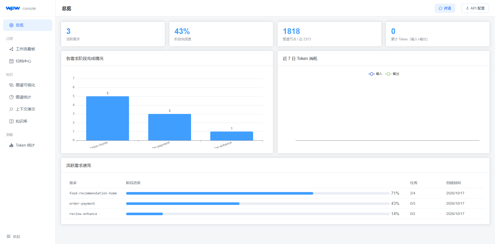
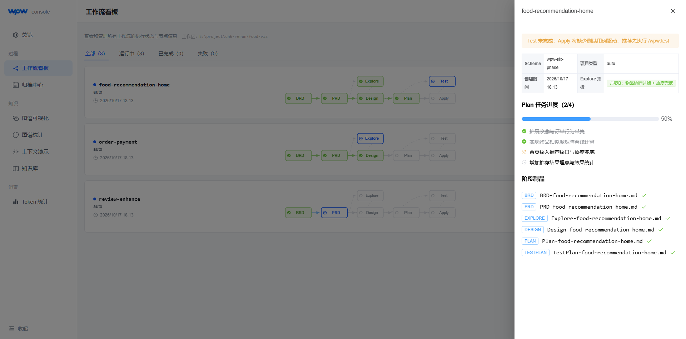
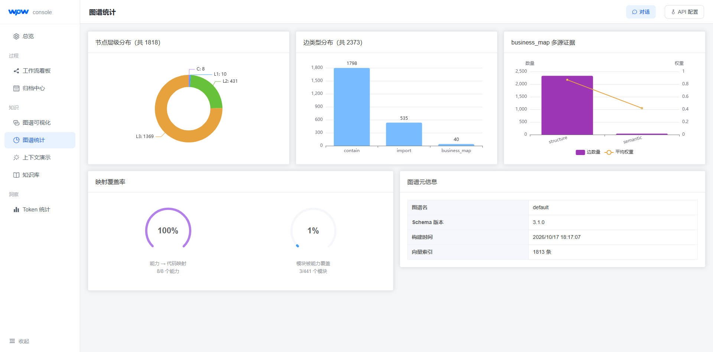
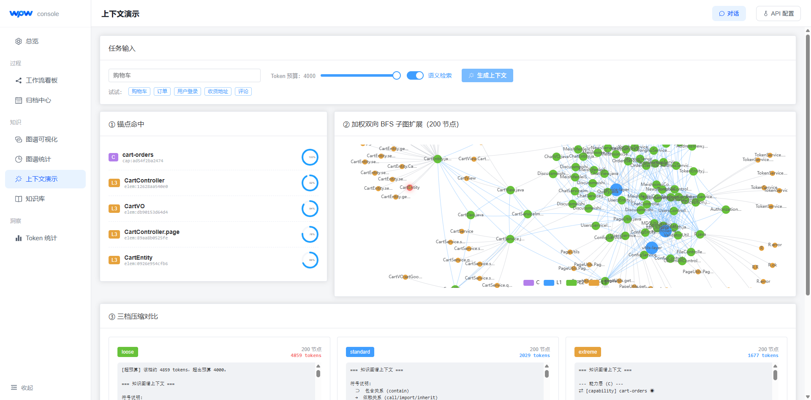

# 附录

本附录收录第 6 章三个层面验证的原始记录：系统功能测试、美食推荐系统开发任务、项目场景检索与问答，以及实验环境、快照和冻结参数。正文只报告汇总结果，题集、逐项结果和依据集中放在这里，便于复核。

需要先行说明两处口径问题，正文与本节按同一份数据核对后如实登记。第一，项目场景问答先运行了四类各 8 题、共 32 题（含 WPW-Gen 四条件）作为中间过程，最终补完全部 100 题、按非 KG、WPW-Map、完整 wpw 三条件汇总；正文表6-11 报告 100 题终版结果，中间过程的原始记录保留在附录 D 的 D.1 节。第二，T1—T3 中 T3 的四个任务与 T4 的四轮连续需求，本机没有留存原始运行记录（执行器 `sdd-eval` 的结果只到 T2-2），相关表格按占位处理，数值待原始记录补齐后回填。

## 附录 A 系统功能测试记录

第 6.1 节的系统功能测试在 2026-08-23 执行，覆盖工作流门禁、图谱构建与查询、上下文生成与预算约束、增量更新与降级行为。测试的通过条件是命令输出、状态转换和持久化结果符合预期，不以单次大模型回答作为判据。表A-1 记录执行环境，表A-2 记录测试项及证据留档位置，A.1 给出复跑时捕获的命令输出。

表A-1 wpw 系统测试环境与执行入口

Table A-1 Test Environment and Entry Points of the wpw System

| 项目 | 记录 | 获取方式 |
|---|---|---|
| 执行日期 | 2026-08-23 | 测试执行日期 |
| 操作系统 | Microsoft Windows 11 家庭版中文版 10.0.26200，64 位 | 系统信息 |
| Node.js | v20.20.2 | `node --version` |
| wpw 版本 | v0.1.8，提交 `a5ee173` | 发布版本与 Git 提交 |
| TypeScript | v5.9.3 | 依赖版本 |
| 图谱 Schema | v3.1.0 | `meta.json` 的 `schemaVersion` |
| 解析范围 | TypeScript、JavaScript、Vue、Java | 图谱配置 `languages` |
| 映射与裁剪配置 | `mapping.mode=local`；深度 3；最小边权重 0.7；最大节点数 100 | 未设置项目覆盖配置时取默认值 |
| 上下文压缩 | `standard` | 显式锚点测试不依赖向量索引 |
| 执行入口 | `npm run build`、`npx ts-node src/graph/__verify__.ts`、`npx ts-node src/test/integration.test.ts` | 终端输出；该版本 `tsconfig.json` 排除 `src/test`，`npm test` 输出 `no tests` |

表A-2 功能测试项与证据留档状态

Table A-2 Functional Test Items and Evidence Archival Status

| 序号 | 测试项 | 实际输出或持久化证据 | 证据留档 |
|---|---|---|---|
| 1 | 强依赖门禁 | {"artifact":"prd","canProceed":false,"missing":["brd"],"warnings":[]}；.wpw.yaml 中 PRD 仍为 pending | 证据 A-1 |
| 2 | 可选 Explore 决策 | canProceed=true，missing=[]，warnings 含 1 条 Explore 决策提示；记录决策后该警告消失 | 证据 A-2 |
| 3 | 图谱存储与索引 | 写入并加载 4 个节点、3 条边；nodeMap.size=4，C、L1、L2、L3 各 1 个节点 | 证据 A-3 |
| 4 | 代码与能力解析 | Java 用例得到 1 个类节点、至少 2 个方法节点、至少 1 个常量节点及 2 条导入；能力节点含 description 与可选 features | 证据 A-4 |
| 5 | 全量构建与结构查询 | success=true；validation.passed=true；meta.json 含 schemaVersion、节点数、边数和文件哈希快照 | 证据 A-5 |
| 6 | 上下文生成与预算约束 | 返回 1 个锚点、4 个子图节点、3 条边，estimatedTokens=286，小于 1000 | 证据 A-6 |
| 7 | 增量更新与 Schema 兼容 | 修改文件的 fileHash 与对应 L2/L3 节点更新，未修改文件保留；主版本不兼容时输出重建提示，新的 schemaVersion=3.1.0 | 证据 A-7 |
| 8 | 向量索引缺失降级 | 返回含锚点的结构化上下文；未发生状态文件写入失败或流程硬阻塞 | 证据 A-8 |
| 9 | 阶段完成状态写回 | `wpw done brd` 后 `brd=done`，其余阶段保持 pending，`.wpw.yaml` 同步 | 证据 A-9 |
| 10 | 节点 JSON 字段与边记录 | 574 个节点、741 条边均无缺失字段；节点标识、层级/类型、`attrs` 与独立边记录符合 5.3.2 节 | 证据 A-10 |

表A-2 的"证据留档"一列对应的命令输出见 A.1。原测试的终端输出与 CI 日志未随论文留档，正文第 6.1.3 节表6-3 记录的是当时的命令输出摘要；A.1 为按表A-1 执行入口在 `a5ee173` 版本上的复跑记录。第 6 章表6-3 后来扩展为 34 个分模块用例；A.1 保留表A-2 所列十项测试的完整输出，其余用例的命令输出与页面检查结果直接记在该表的"实际结果"列，控制台页面截图见 A.2。

### A.1 功能测试复跑证据

复跑于 2026-10-17 执行，代码固定在提交 `a5ee173`（wpw v0.1.8），Node.js 为 v20.20.2，操作系统为 Windows 11 10.0.26300，`npm run build`（即 `tsc`）无错误通过。除操作系统补丁版本外，环境与表A-1 相同。以下命令中的 `wpw` 均指该提交构建出的 `dist/index.js`。

需要说明执行入口的一处差异：该版本的 `tsconfig.json` 排除了 `src/test`，因此 `npm test` 输出 `"no tests"`；门禁的集成用例改用 `npx ts-node src/test/integration.test.ts` 执行，3 个用例全部通过（证据 A-2 末段）。

**证据 A-1 强依赖门禁**

在空项目中创建需求 `login` 后直接检查 `prd`：

```text
$ wpw check prd -c login --json
{
  "artifact": "prd",
  "canProceed": false,
  "missing": [
    "brd"
  ],
  "warnings": []
}
（退出码 1）

$ cat wpw/active/login/.wpw.yaml
status:
  brd: pending
  prd: pending
  explore: pending
  design: pending
  plan: pending
  testplan: pending
```

将 `brd` 标记为完成后再次检查，`canProceed` 变为 `true`，`missing` 为空。

**证据 A-2 可选 Explore 决策**

`brd`、`prd`、`explore` 均为 `done`，但 `decisions.explore.chosenOption` 为空时：

```text
$ wpw check design -c login --json
{
  "artifact": "design",
  "canProceed": true,
  "missing": [],
  "warnings": [
    "explore 已完成但未拍板（decisions.explore.chosenOption 为空），建议先执行 wpw decision explore --option <方案>"
  ]
}

$ wpw decision explore -c login --option "方案A：复用现有认证模块"
已记录 login.explore 决策: 方案A：复用现有认证模块

$ wpw check design -c login --json
{
  "artifact": "design",
  "canProceed": true,
  "missing": [],
  "warnings": []
}
```

```text
$ npx ts-node src/test/integration.test.ts
ok 1 - full flow: brd→prd→skip explore→design→plan→testplan
ok 2 - template resolution returns expected templates
ok 3 - explore done without decision blocks design with warning
# tests 3
# pass 3
# fail 0
```

其中第 3 个用例断言了上述"未拍板"警告，第 1 个用例覆盖了 `skipped` 的 Explore。

**证据 A-3 图谱存储与索引**

`npx ts-node src/graph/__verify__.ts` 用 C/L1/L2/L3 各 1 个节点、3 条边做读写与索引验证：

```text
2. 存储层验证...
   初始存在? false
   写入后存在? true
   加载节点数: 4
   加载边数: 3
   nodeMap 大小: 4
   C 层节点数: 1
   L1 节点数: 1
   L2 节点数: 1
   L3 节点数: 1
   ✅ 存储层验证通过
```

**证据 A-4 代码与能力解析**

同一验证脚本的解析器部分：

```text
5. 能力解析器验证...
   解析到能力数: 0          # wpw 仓库自身没有 wpw/specs，C 层为空
7. 源码解析器验证...
   文件节点: state.ts (L2, typescript)
   元素数量 (L3): 19
   import 数量: 4
7.5. Java 解析器验证...
   元素数量 (L3): 4
   import 数量: 2
   元素类型分布: {"class":1,"function":2,"constant":1}
   class 名: UserController
   endpoint: GET /api/user/{id}
```

能力节点的 `description` 与 `features` 另用一份 `wpw/specs/user-auth/spec.md` 验证，`wpw graph query -l C --json` 返回：

```json
{
  "level": "C",
  "type": "capability",
  "name": "user-auth",
  "attrs": {
    "description": "用户认证能力，负责注册、登录与会话校验，为上层业务提供统一身份入口。",
    "features": [
      {"id": "R1", "name": "用户登录", "priority": "P0"},
      {"id": "R2", "name": "会话校验", "priority": "P2"}
    ]
  }
}
```

`features` 由 spec 的 Requirements/Scenarios 抽取，`P0/P1/P2` 按 Scenario 数量计算。

**证据 A-5 全量构建与结构查询**

在测试项目上执行全量构建与结构化查询：

```text
$ wpw graph build --json --no-progress
{
  "success": true,
  "nodesByLevel": {"C": 1, "L1": 2, "L2": 3, "L3": 6},
  "edgesByType": {"contain": 9, "import": 1, "business_map": 1},
  "vectorCount": 11,
  "validation": {"passed": true, "errors": [], "warnings": []}
}

$ wpw graph query --downstream mod:<commands> --depth 2 --json
8 个下游节点：L2/alpha.ts、L2/beta.ts、L2/order.ts，
L3/alpha、L3/alphaTwo、L3/alphaThree、L3/Order、L3/validateOrder
```

`meta.json` 同时写入 `schemaVersion=3.1.0`、`totalNodes`、`totalEdges` 与每个源码文件的 `fileHashes` 快照。对 wpw 仓库自身的全量构建得到 574 个节点、741 条边，`validation.passed=true`，层级分布为 `{"C":0,"L1":2,"L2":81,"L3":491}`。

**证据 A-6 上下文生成与预算约束**

以 L1 模块为显式锚点，在 4 节点夹具上执行表A-2 所列命令：

```text
$ wpw graph context --anchors mod:test456 --depth 2 --max-nodes 30 --token-budget 1000 --json
{
  "anchors": [ ... ],
  "subgraph": { "nodes": [4 个], "edges": [3 条], "anchorIds": ["mod:test456"] },
  "compressedText": "...",
  "stats": {
    "anchorCount": 1,
    "nodeCount": 4,
    "edgeCount": 3,
    "estimatedTokens": 77,
    "compressionRatio": 0.4
  }
}
```

对 wpw 仓库的完整图谱以首个模块为锚点、同样参数运行，得到 1 个锚点、30 个节点、56 条边，`estimatedTokens=356`，同样小于 1000。

口径说明：表A-2 第 6 行的 `estimatedTokens=286` 取自 v4 实验数据中的另一组上下文统计（8 个锚点、29 个节点、35 条边，见 `关键词召回实验数据_v4/qa_semantic_full_wpw_before_query_focus.json` 的 `pipeline.stats`），与同一行"1 个锚点、4 个子图节点、3 条边"的结构描述不属同一次运行。复跑时该结构的实测值为 77，全量仓库图同参数实测值为 356，两者均满足预算约束；第 6 章表6-3 已按复跑结果记为 77，表A-2 的 286 作为原始记录保留。

**证据 A-7 增量更新与 Schema 兼容**

对含 3 个源码文件、10 个节点的图谱连续执行三次更新：

```text
# 无改动
$ wpw graph update --json
{"updated":false,"reason":"no changes detected"}

# 修改 src/commands/alpha.ts，新增 alphaThree()
$ wpw graph update --json
{
  "updated": true,
  "success": true,
  "nodesByLevel": {"C": 0, "L1": 2, "L2": 3, "L3": 6},
  "edgesByType": {"contain": 9, "import": 1},
  "validation": {"passed": true}
}
```

更新前后 `meta.json` 的 `fileHashes`：

```text
src/commands/alpha.ts  11e21fb7c17a0804 -> 18073a5ff62cbe10  （已修改）
src/commands/beta.ts   cfd6adab9c9a7df3 -> cfd6adab9c9a7df3  （保持不变）
src/schema/order.ts    4d47d7f03720d961 -> 4d47d7f03720d961  （保持不变）
```

新增的 `alphaThree` 出现在 L3 节点中，`beta.ts` 的文件节点及其哈希原样保留。随后把 `meta.json` 的 `schemaVersion` 手工改为不兼容的 `4.0.0` 再执行更新：

```text
$ wpw graph update --json
[graph-builder] 图谱 schema 版本不兼容（当前: 4.0.0, 需要: 3.1.0），正在全量重建...
[graph-builder] 原因：图谱架构升级至 C+L1/L2/L3 三层结构，需重建以保证数据一致性。
（随后输出全量构建统计，success=true）

$ cat wpw/knowledge/graph/default/meta.json
"schemaVersion": "3.1.0"
```

**证据 A-8 向量索引缺失降级**

删除图谱目录下的 `index/vector.index` 与 `index/vector-mapping.json` 后，以显式锚点生成上下文：

```text
$ rm wpw/knowledge/graph/default/index/vector.index \
     wpw/knowledge/graph/default/index/vector-mapping.json

$ wpw graph context --anchors mod:<commands> --depth 2 --max-nodes 10 --token-budget 1000 --json
（退出码 0，stderr 无错误）
{
  "anchors": [ ... ],
  "subgraph": { "nodes": [9 个], "edges": [8 条] },
  "compressedText": "=== 知识图谱上下文 === ...",
  "stats": {"anchorCount": 1, "nodeCount": 9, "edgeCount": 8, "estimatedTokens": 83}
}
```

`ContextPipeline` 在向量索引不存在时跳过语义检索，保留显式锚点继续完成裁剪与压缩，未出现异常退出或状态文件写入失败。

**证据 A-9 阶段完成状态写回**

在空项目中创建需求 `done-demo` 并标记 BRD 阶段完成：

```text
$ wpw new done-demo
已创建需求: done-demo

$ wpw done brd -c done-demo
已标记 done-demo.brd = done

$ wpw status done-demo
需求: done-demo  (schema: wpw-six-phase)
阶段:
  brd        done
  prd        pending
  explore    pending
  design     pending
  plan       pending
  testplan   pending
进度: 0/0
```

对应的 `.wpw.yaml` 状态段：

```yaml
schema: wpw-six-phase
status:
  brd: done
  prd: pending
  explore: pending
  design: pending
  plan: pending
  testplan: pending
```

`wpw done` 只改动目标阶段，其他阶段与任务进度保持不变，与 5.2.2 节“收尾阶段由 CLI 写入过程状态”的实现一致。

**证据 A-10 节点 JSON 字段与边记录**

在 `a5ee173` 版本上完成验证脚本的全量构建后，读取 `wpw/knowledge/graph/default/graph.jsonl`（574 个节点、741 条边），抽取各层节点与边记录：

```json
{"_kind":"node","id":"mod:41291f2f4d9d","level":"L1","type":"module","name":"commands","attrs":{"side":"backend","dir":"src\\commands"},"createdAt":1792234055562,"updatedAt":1792234055562}
{"_kind":"node","id":"file:7c83405e0f3b","level":"L2","type":"file","name":"apply.ts","attrs":{"filePath":"src/commands/apply.ts","language":"typescript","fileHash":"23e21eba39cd9505"},"createdAt":1792234055573,"updatedAt":1792234055573}
{"_kind":"node","id":"elem:ff76d96a1924","level":"L3","type":"interface","name":"Task","attrs":{"signature":"interface Task","annotations":[],"isExported":false,"lineStart":12,"lineEnd":16,"filePath":"src/commands/apply.ts","parentName":"apply"},"createdAt":1792234055573,"updatedAt":1792234055573}
{"_kind":"edge","id":"mod:41291f2f4d9d->contain->file:7c83405e0f3b","from":"mod:41291f2f4d9d","to":"file:7c83405e0f3b","type":"contain","weight":0.9,"source":"structure"}
{"_kind":"edge","id":"file:7c83405e0f3b->import->file:674d4368c6ae","from":"file:7c83405e0f3b","to":"file:674d4368c6ae","type":"import","weight":0.75,"source":"structure"}
```

574 个节点均包含 `id`、`level`、`type`、`name`、`attrs`、`createdAt`、`updatedAt`，无缺失字段；节点标识全部符合“类型前缀:12 位十六进制摘要”的形式。L1 节点使用 `side/dir`，L2 节点使用 `filePath/language/fileHash`，L3 节点按实体类型使用 `signature/params/returnType/parentName/isExported/lineStart/lineEnd/filePath` 等属性。边以独立记录保存 `from/to/type/weight/source`，不写入节点 `attrs`；该图的边类型分布为 contain 504 条、import 237 条。该验证工作区没有能力规范，C 层节点数为 0，C 层的 `description/features` 由证据 A-4 验证。

### A.2 可视化控制台运行截图

第 6.1 节的分模块用例包含可视化控制台的构建与页面检查，其中 UI-06 在真实项目规模的图谱上复核了各页面的读取与渲染。本小节保留该次复核的完整过程与页面截图。

截图于 2026-10-17 使用提交 `1285f4c` 构建的控制台执行（`wpw viz --ui viz/dist`），浏览器视口为 1920×1080。数据基底取自 E 盘的美食推荐系统 `E:\project\springboot7tr93`（Git HEAD 为 `afca51b`，与表6-1 的冻结快照一致）。为避免改动原工程，截图使用其副本 `E:\project\ch6-rerun\food-viz`：保留原 `src`、`workflow.config.yaml` 与数据库脚本，按第 5 章的能力规范格式补充了 8 份能力规范，并建立 3 个进行中需求和 7 个已归档需求作为演示数据；知识图谱使用当前 CLI 重新构建，共 1818 个节点、2373 条边（C 层 8、L1 层 10、L2 层 431、L3 层 1369；contain 1798、import 535、business_map 40），向量索引 1813 条。

需要说明，本小节截图用于展示控制台的真实读写与渲染效果，属于界面功能证据；其中的需求、任务与能力 spec 是为演示补充的数据，不属于第 6.2 节的实验记录，实验数据仍以 `关键词召回实验数据_v4` 与 `E:\project\sdd-eval` 为准。



图A-1 展示总览页。页面从工作区读取到 3 个活跃需求、43% 的阶段完成度，以及 1818 个图谱节点和 2373 条边；下方柱状图按需求统计已完成阶段数，活跃需求表列出各需求的阶段进度与任务完成数。右侧“近 7 日 Token 消耗”为空，是因为该演示工作区未通过控制台发起大模型调用，`usage.jsonl` 中没有用量记录，并非页面读取失败。


图A-2 展示工作流看板。三个活跃需求分别处于不同推进阶段：`food-recommendation-home` 已完成 BRD、PRD、Explore、Design、Plan，Test 待执行，任务进度 2/4；`order-payment` 已完成 BRD、PRD、Design；`review-enhance` 仅完成 BRD。阶段节点、跳过关系与依赖连线均按 `.wpw.yaml` 的状态渲染。



图A-3 展示 `food-recommendation-home` 的详情抽屉。抽屉给出 Test 阶段未完成的门禁提示、Explore 阶段拍板结论（方案B：物品协同过滤 + 热度兜底）、Plan 任务进度（2/4）以及六个阶段制品的生成状态；BRD、PRD、Explore、Design、Plan、TestPlan 文件均被正确识别并显示为已生成。



图A-4 展示图谱统计页。节点层级分布为 C 8、L1 10、L2 431、L3 1369；边类型分布为 contain 1798、import 535、business_map 40。右上角按证据来源拆分 business_map：语义映射 40 条。下方映射覆盖率显示 8/8 个能力节点均建立了到代码的映射；元信息区显示 Schema 版本 3.1.0、构建时间和 1813 条向量索引。



图A-5 展示以“购物车”为任务输入的上下文生成过程。系统命中 5 个锚点（能力节点 `cart-orders` 及 `CartController`、`CartVO`、`CartController.page`、`CartEntity`），经加权双向 BFS 扩展到 200 个节点，并在右侧渲染子图。Token 预算设为 4000 时，loose 档约 4859 tokens，超过预算并给出降级提示；standard 档约 2029 tokens、extreme 档约 1677 tokens，均满足预算。该页同时验证了锚点命中、BFS 扩展、三档压缩与预算约束在真实大图上的行为。


图A-6 展示知识库页面。左侧列出 8 份能力 spec，右侧渲染 `account-management` 的 Purpose、Requirement 与 Scenario 结构，说明控制台读取的是工作区中的原始规范文件，而非预置展示文本。


图A-7 展示归档中心时间轴。页面按 `wpw/archived/YYYY-MM` 目录聚合出 2026-08、2026-09、2026-10 三个月份，共 7 个已归档需求，并为每个需求提供计划制品入口，验证了归档目录的读取与时间轴渲染。

## 附录 B 开发任务运行记录

第 6.2.2 节的开发专项把美食推荐系统的连续开发过程划分为 T1 基础搭建、T2 业务核心和 T3 迭代增强三个任务集，另以 T4 的四轮连续需求作长期演化补充。本专项只统计模型总 Token，不计算检索或上下文质量指标。表B-1 列出任务构成，表B-2 与表B-3 给出两种方法的模型总 Token 对照，表B-4 记录逐次运行的元数据。

表B-1 美食推荐系统开发任务

Table B-1 Development Tasks for the Food Recommendation System

| 任务集 | 场景 | 任务数量 | 任务内容 |
|---|---|---:|---|
| T1 | 基础搭建 | 2 | 用户认证、美食分类和美食信息管理 |
| T2 | 业务核心 | 2 | 个性化推荐、购物车和订单流程 |
| T3 | 迭代增强 | 4 | 收藏、评论、美食资讯和个人中心 |
| T4 | 长期演化 | 4 | 会员积分、优惠券、会员等级、配送规则（四轮连续需求） |

表B-2 T1—T3 开发任务模型总 Token 对照

Table B-2 Total Model Tokens for T1–T3 Development Tasks

| 任务 | 方法 | 模型总 Token | wpw 相对变化 | 原始记录 |
|---|---|---:|---:|---|
| T1-1 用户注册与登录 | OpenSpec | 7,154,327 | — | results/T1-1-openspec-r01-20260905-175358.json |
| T1-1 用户注册与登录 | wpw | 4,341,714 | -39.31% | results/T1-1-wpw-r01-20260905-151814.json |
| T1-2 美食分类和美食信息管理 | OpenSpec | 11,162,207 | — | results/T1-2-openspec-r01-20260905-185750.json |
| T1-2 美食分类和美食信息管理 | wpw | ≈3,549,700 | -68.20% | results/T1-2-wpw-r01-20260905-163226.json（估算口径） |
| T2-1 个性化推荐接口 | OpenSpec | 5,953,742 | — | results/T2-1-openspec-r01-20260905-200235.json |
| T2-1 个性化推荐接口 | wpw | 4,489,079 | -24.60% | results/T2-1-wpw-r01-20260905-182808.json（续跑口径） |
| T2-2 购物车与订单流程 | OpenSpec | 13,874,175 | — | results/T2-2-openspec-r01-20260905-205019.json |
| T2-2 购物车与订单流程 | wpw | 9,723,130 | -29.92% | results/T2-2-wpw-r01-20260905-193859.json（作者订正，记录文件内为 14,723,130） |
| T3-1 收藏 | OpenSpec | 待补 | 待补 | 待补（无原始记录） |
| T3-1 收藏 | wpw | 待补 | 待补 | 待补（无原始记录） |
| T3-2 评论 | OpenSpec | 待补 | 待补 | 待补（无原始记录） |
| T3-2 评论 | wpw | 待补 | 待补 | 待补（无原始记录） |
| T3-3 美食资讯 | OpenSpec | 待补 | 待补 | 待补（无原始记录） |
| T3-3 美食资讯 | wpw | 待补 | 待补 | 待补（无原始记录） |
| T3-4 个人中心 | OpenSpec | 待补 | 待补 | 待补（无原始记录） |
| T3-4 个人中心 | wpw | 待补 | 待补 | 待补（无原始记录） |
| **T1—T3 合计** | **OpenSpec** | **71,141,143**（含 T3 待补） | — | — |
| **T1—T3 合计** | **wpw** | **42,422,522**（含 T3 待补） | **-40.37%** | — |

表B-2 的 T1—T2 四个任务共 8 次运行有完整记录，数值取自执行器 `sdd-eval` 的结果 JSON，目录为仓库外的 `E:/project/sdd-eval/`。T3 的四个任务在 `src/tasks.ts` 中有任务定义，但没有对应的运行记录，因此 Token 与相对变化留空待补；正文第 6.2.1.2 节的 T1—T3 合计 71,141,143 与 42,422,522 包含这四个任务，回填前应视为待核。

表B-3 T4 连续开发任务模型总 Token 对照

Table B-3 Total Model Tokens for the T4 Continuous Development Task

| 轮次 | 需求 | OpenSpec 模型总 Token | wpw 模型总 Token | wpw 相对减少 | 原始记录 |
|---|---|---:|---:|---:|---|
| T4-1 会员积分 | 待补 | 待补 | 待补 | 待补 | 待补（无原始记录） |
| T4-2 优惠券 | 待补 | 待补 | 待补 | 待补 | 待补（无原始记录） |
| T4-3 会员等级 | 待补 | 待补 | 待补 | 待补 | 待补（无原始记录） |
| T4-4 配送规则 | 待补 | 待补 | 待补 | 待补 | 待补（无原始记录） |
| **合计** | — | **待补** | **待补** | **待补** | — |

表B-3 的 T4 四轮同样没有留存原始运行记录，正文第 6.2.1.2 节的 40,332,312、25,732,630 与 T1—T4 合计 111,473,455、68,155,152 待原始记录补齐后回填。

表B-4 T1—T2 开发任务逐次运行元数据

Table B-4 Run Metadata of the T1–T2 Development Tasks

| 任务 | 方法 | 起始提交 | 状态 | 执行耗时/s | Recall | Precision | 返工次数 | 累计上下文 Token | 搜索/图谱/读取 | 模型标识 |
|---|---|---|---|---:|---:|---:|---:|---:|---|---|
| T1-1 用户注册与登录 | OpenSpec | 6e0157f1 | passed | 1359 | 1.000 | 1.000 | 0 | 1,410 | 9/0/20 | gpt-5.6-sol |
| T1-1 用户注册与登录 | wpw | 6c16075a | passed | 1716 | 1.000 | 1.000 | 0 | 1,929 | 4/3/21 | gpt-5.3-codex-spark |
| T1-2 美食分类和美食信息管理 | OpenSpec | f4c2f3db | passed | 1331 | 0.833 | 1.000 | 0 | 558 | 5/0/19 | 未记录（原记录写为「GPT-5 current session;…」） |
| T1-2 美食分类和美食信息管理 | wpw | 0b3e081c | passed | 1396 | 1.000 | 0.813 | 1 | 660 | 1/6/16 | 未记录 |
| T2-1 个性化推荐接口 | OpenSpec | 35b47d14 | passed | 1291 | 0.750 | 1.000 | 0 | 1,376 | 4/0/13 | 未记录 |
| T2-1 个性化推荐接口 | wpw | 6c16075a | passed | 2753 | 1.000 | 1.000 | 0 | 24,372 | 1/5/20 | 未记录 |
| T2-2 购物车与订单流程 | OpenSpec | 71888f2d | passed | 2185 | 1.000 | 1.000 | 3 | 1,515 | 4/0/23 | 未记录 |
| T2-2 购物车与订单流程 | wpw | 6c16075a | passed | 2441 | 0.800 | 1.000 | 2 | 3,749 | 4/5/24 | 未记录 |
| T3-1 收藏 | OpenSpec / wpw | 待补 | 待补 | 待补 | 待补 | 待补 | 待补 | 待补 | 待补 | 待补 |
| T3-2 评论 | OpenSpec / wpw | 待补 | 待补 | 待补 | 待补 | 待补 | 待补 | 待补 | 待补 | 待补 |
| T3-3 美食资讯 | OpenSpec / wpw | 待补 | 待补 | 待补 | 待补 | 待补 | 待补 | 待补 | 待补 | 待补 |
| T3-4 个人中心 | OpenSpec / wpw | 待补 | 待补 | 待补 | 待补 | 待补 | 待补 | 待补 | 待补 | 待补 |
| T4-1 会员积分 | OpenSpec / wpw | 待补 | 待补 | 待补 | 待补 | 待补 | 待补 | 待补 | 待补 | 待补 |
| T4-2 优惠券 | OpenSpec / wpw | 待补 | 待补 | 待补 | 待补 | 待补 | 待补 | 待补 | 待补 | 待补 |
| T4-3 会员等级 | OpenSpec / wpw | 待补 | 待补 | 待补 | 待补 | 待补 | 待补 | 待补 | 待补 | 待补 |
| T4-4 配送规则 | OpenSpec / wpw | 待补 | 待补 | 待补 | 待补 | 待补 | 待补 | 待补 | 待补 | 待补 |

表B-4 的三处协议例外如实登记。其一，T1-2 的 wpw 与 T1-1 处于同一对话，模型总 Token 按 T1-1 的精确用量乘以耗时比例与探索事件比例的均值估算，Recall 与 Precision 亦为估算值，因此表B-2 中该格写 ≈3,549,700。其二，T2-1 的 wpw 为续跑运行，当次会话开始前已存在规格与实现，精确 Token 只覆盖续跑阶段。其三，T2-2 的 wpw 起点含 T2-1 未提交的变更，且模型总 Token 采用作者订正值。上述例外在正文第 6.2.1.2 节与第 6.3.2 节一并登记。另外，T1-1 与 T1-2 的运行记录里模型标识栏的取值不同（分别为 `gpt-5.6-sol` 与 `gpt-5.3-codex-spark`），实验操作者确认两次运行使用同一模型，表B-4 按原记录照录。

## 附录 C 场景检索题集与结果

第 6.2.3 节的场景检索子实验包含 100 个信息需求，按四类各 25 题组织。表C-1 给出题集与人工标注的 Gold 文件，表C-2 给出三条件的总体结果，表C-3 按查询类别拆分，表C-4 给出配对检验，表C-5 逐题列出三项指标。

表C-1 场景检索题集与 Gold 标注

Table C-1 Retrieval Task Set and Gold Annotation

| 编号 | 类别 | 问题族 | 信息需求 | 查询文本 | Gold 文件 |
|---|---|---|---|---|---|
| R1-01 | 精确标识定位 | user-login | 用户登录与令牌签发 | YonghuController.login | `src/main/java/com/controller/YonghuController.java` |
| R1-02 | 精确标识定位 | user-register | 用户注册 | YonghuController.register | `src/main/java/com/controller/YonghuController.java` |
| R1-03 | 精确标识定位 | admin-login | 后台管理员登录 | UsersController.login | `src/main/java/com/controller/UsersController.java` |
| R1-04 | 精确标识定位 | session-user | 当前登录用户信息 | getCurrUser session | `src/main/java/com/controller/YonghuController.java` |
| R1-05 | 精确标识定位 | auth-interceptor | 请求鉴权拦截 | AuthorizationInterceptor.preHandle | `src/main/java/com/interceptor/AuthorizationInterceptor.java` |
| R1-06 | 精确标识定位 | password-reset | 用户密码重置 | YonghuController.resetPass | `src/main/java/com/controller/YonghuController.java` |
| R1-07 | 精确标识定位 | food-category | 美食分类管理 | MeishifenleiController | `src/main/java/com/controller/MeishifenleiController.java` |
| R1-08 | 精确标识定位 | food-info | 美食信息管理 | MeishixinxiController | `src/main/java/com/controller/MeishixinxiController.java` |
| R1-09 | 精确标识定位 | popular-recommend | 热门美食推荐 | MeishixinxiController.autoSort | `src/main/java/com/controller/MeishixinxiController.java` |
| R1-10 | 精确标识定位 | personal-recommend | 个性化美食推荐 | MeishixinxiController.autoSort2 | `src/main/java/com/controller/MeishixinxiController.java` |
| R1-11 | 精确标识定位 | favorite | 美食收藏 | StoreupController | `src/main/java/com/controller/StoreupController.java` |
| R1-12 | 精确标识定位 | comment | 美食评论 | DiscussmeishixinxiController | `src/main/java/com/controller/DiscussmeishixinxiController.java` |
| R1-13 | 精确标识定位 | cart | 购物车管理 | CartController | `src/main/java/com/controller/CartController.java` |
| R1-14 | 精确标识定位 | order | 订单管理 | OrdersController | `src/main/java/com/controller/OrdersController.java` |
| R1-15 | 精确标识定位 | address | 收货地址与默认地址 | AddressController.defaultAddress | `src/main/java/com/controller/AddressController.java` |
| R1-16 | 精确标识定位 | news | 美食资讯管理 | NewsController | `src/main/java/com/controller/NewsController.java` |
| R1-17 | 精确标识定位 | chat | 在线客服会话 | ChatController | `src/main/java/com/controller/ChatController.java` |
| R1-18 | 精确标识定位 | file | 文件上传下载 | FileController.upload download | `src/main/java/com/controller/FileController.java` |
| R1-19 | 精确标识定位 | common-option | 通用下拉选项查询 | CommonController.getOption | `src/main/java/com/controller/CommonController.java` |
| R1-20 | 精确标识定位 | order-stats | 订单统计分析 | OrdersController.value group | `src/main/java/com/controller/OrdersController.java` |
| R1-21 | 精确标识定位 | payment | 支付宝支付配置 | AlipayConfig | `src/main/java/com/config/AlipayConfig.java` |
| R1-22 | 精确标识定位 | front-login | 用户端登录页面 | pages/login/login.vue | `src/main/resources/front/front/pages/login/login.vue` |
| R1-23 | 精确标识定位 | front-order-confirm | 前端订单确认与结算 | shop-order-confirm.onSubmitTap | `src/main/resources/front/front/pages/shop-order-confirm/shop-order-confirm.vue` |
| R1-24 | 精确标识定位 | front-order-state | 前端订单状态流转 | shop-order order.status | `src/main/resources/front/front/pages/shop-order/shop-order.vue` |
| R1-25 | 精确标识定位 | database-schema | 核心交易数据表 | CREATE TABLE orders cart address | `db/springboot7tr93.sql` |
| R2-01 | 业务关键词定位 | user-login | 用户登录与令牌签发 | 用户登录与令牌签发 | `src/main/java/com/controller/YonghuController.java`<br>`src/main/java/com/service/TokenService.java`<br>`src/main/java/com/service/impl/TokenServiceImpl.java` |
| R2-02 | 业务关键词定位 | user-register | 用户注册 | 用户注册 | `src/main/java/com/controller/YonghuController.java`<br>`src/main/java/com/entity/YonghuEntity.java`<br>`src/main/java/com/service/YonghuService.java` |
| R2-03 | 业务关键词定位 | admin-login | 后台管理员登录 | 后台管理员登录 | `src/main/java/com/controller/UsersController.java`<br>`src/main/java/com/entity/UsersEntity.java`<br>`src/main/java/com/service/TokenService.java` |
| R2-04 | 业务关键词定位 | session-user | 当前登录用户信息 | 当前登录用户信息 | `src/main/java/com/controller/YonghuController.java`<br>`src/main/java/com/interceptor/AuthorizationInterceptor.java` |
| R2-05 | 业务关键词定位 | auth-interceptor | 请求鉴权拦截 | 请求鉴权拦截 | `src/main/java/com/interceptor/AuthorizationInterceptor.java`<br>`src/main/java/com/config/InterceptorConfig.java`<br>`src/main/java/com/annotation/IgnoreAuth.java` |
| R2-06 | 业务关键词定位 | password-reset | 用户密码重置 | 用户密码重置 | `src/main/java/com/controller/YonghuController.java`<br>`src/main/java/com/entity/YonghuEntity.java` |
| R2-07 | 业务关键词定位 | food-category | 美食分类管理 | 美食分类管理 | `src/main/java/com/controller/MeishifenleiController.java`<br>`src/main/java/com/entity/MeishifenleiEntity.java`<br>`src/main/java/com/service/MeishifenleiService.java` |
| R2-08 | 业务关键词定位 | food-info | 美食信息管理 | 美食信息管理 | `src/main/java/com/controller/MeishixinxiController.java`<br>`src/main/java/com/entity/MeishixinxiEntity.java`<br>`src/main/java/com/service/MeishixinxiService.java` |
| R2-09 | 业务关键词定位 | popular-recommend | 热门美食推荐 | 热门美食推荐 | `src/main/java/com/controller/MeishixinxiController.java`<br>`src/main/java/com/entity/MeishixinxiEntity.java` |
| R2-10 | 业务关键词定位 | personal-recommend | 个性化美食推荐 | 个性化美食推荐 | `src/main/java/com/controller/MeishixinxiController.java`<br>`src/main/java/com/entity/OrdersEntity.java`<br>`src/main/java/com/service/OrdersService.java` |
| R2-11 | 业务关键词定位 | favorite | 美食收藏 | 美食收藏 | `src/main/java/com/controller/StoreupController.java`<br>`src/main/java/com/entity/StoreupEntity.java`<br>`src/main/java/com/service/StoreupService.java` |
| R2-12 | 业务关键词定位 | comment | 美食评论 | 美食评论 | `src/main/java/com/controller/DiscussmeishixinxiController.java`<br>`src/main/java/com/entity/DiscussmeishixinxiEntity.java`<br>`src/main/java/com/service/DiscussmeishixinxiService.java` |
| R2-13 | 业务关键词定位 | cart | 购物车管理 | 购物车管理 | `src/main/java/com/controller/CartController.java`<br>`src/main/java/com/entity/CartEntity.java`<br>`src/main/resources/front/front/pages/shop-cart/shop-cart.vue` |
| R2-14 | 业务关键词定位 | order | 订单管理 | 订单管理 | `src/main/java/com/controller/OrdersController.java`<br>`src/main/java/com/entity/OrdersEntity.java`<br>`src/main/resources/front/front/pages/shop-order-confirm/shop-order-confirm.vue` |
| R2-15 | 业务关键词定位 | address | 收货地址与默认地址 | 收货地址与默认地址 | `src/main/java/com/controller/AddressController.java`<br>`src/main/java/com/entity/AddressEntity.java`<br>`src/main/java/com/service/AddressService.java` |
| R2-16 | 业务关键词定位 | news | 美食资讯管理 | 美食资讯管理 | `src/main/java/com/controller/NewsController.java`<br>`src/main/java/com/entity/NewsEntity.java`<br>`src/main/resources/front/front/pages/news/list.vue` |
| R2-17 | 业务关键词定位 | chat | 在线客服会话 | 在线客服会话 | `src/main/java/com/controller/ChatController.java`<br>`src/main/java/com/entity/ChatEntity.java`<br>`src/main/java/com/service/ChatService.java` |
| R2-18 | 业务关键词定位 | file | 文件上传下载 | 文件上传下载 | `src/main/java/com/controller/FileController.java`<br>`src/main/java/com/utils/FileUtil.java` |
| R2-19 | 业务关键词定位 | common-option | 通用下拉选项查询 | 通用下拉选项查询 | `src/main/java/com/controller/CommonController.java`<br>`src/main/java/com/dao/CommonDao.java`<br>`src/main/resources/mapper/CommonDao.xml` |
| R2-20 | 业务关键词定位 | order-stats | 订单统计分析 | 订单统计分析 | `src/main/java/com/controller/OrdersController.java`<br>`src/main/java/com/service/OrdersService.java`<br>`src/main/resources/mapper/OrdersDao.xml` |
| R2-21 | 业务关键词定位 | payment | 支付宝支付配置 | 支付宝支付配置 | `src/main/java/com/config/AlipayConfig.java`<br>`src/main/resources/admin/admin/src/views/pay.vue` |
| R2-22 | 业务关键词定位 | front-login | 用户端登录页面 | 用户端登录页面 | `src/main/resources/front/front/pages/login/login.vue`<br>`src/main/resources/front/front/api/index.js`<br>`src/main/resources/front/front/api/http.js` |
| R2-23 | 业务关键词定位 | front-order-confirm | 前端订单确认与结算 | 前端订单确认与结算 | `src/main/resources/front/front/pages/shop-order-confirm/shop-order-confirm.vue`<br>`src/main/resources/front/front/api/index.js`<br>`src/main/java/com/controller/OrdersController.java` |
| R2-24 | 业务关键词定位 | front-order-state | 前端订单状态流转 | 前端订单状态流转 | `src/main/resources/front/front/pages/shop-order/shop-order.vue`<br>`src/main/java/com/controller/OrdersController.java`<br>`src/main/java/com/entity/OrdersEntity.java` |
| R2-25 | 业务关键词定位 | database-schema | 核心交易数据表 | 核心交易数据表 | `db/springboot7tr93.sql`<br>`src/main/java/com/entity/OrdersEntity.java`<br>`src/main/java/com/entity/CartEntity.java`<br>`src/main/java/com/entity/AddressEntity.java` |
| R3-01 | 同义或非代码命名表达 | user-login | 用户登录与令牌签发 | 普通用户验证账号后获取访问凭证 | `src/main/java/com/controller/YonghuController.java`<br>`src/main/java/com/service/TokenService.java`<br>`src/main/java/com/service/impl/TokenServiceImpl.java` |
| R3-02 | 同义或非代码命名表达 | user-register | 用户注册 | 新用户创建账号 | `src/main/java/com/controller/YonghuController.java`<br>`src/main/java/com/entity/YonghuEntity.java`<br>`src/main/java/com/service/YonghuService.java` |
| R3-03 | 同义或非代码命名表达 | admin-login | 后台管理员登录 | 后台账户进入管理端 | `src/main/java/com/controller/UsersController.java`<br>`src/main/java/com/entity/UsersEntity.java`<br>`src/main/java/com/service/TokenService.java` |
| R3-04 | 同义或非代码命名表达 | session-user | 当前登录用户信息 | 根据会话取得当前用户资料 | `src/main/java/com/controller/YonghuController.java`<br>`src/main/java/com/interceptor/AuthorizationInterceptor.java` |
| R3-05 | 同义或非代码命名表达 | auth-interceptor | 请求鉴权拦截 | 未登录请求返回 401 | `src/main/java/com/interceptor/AuthorizationInterceptor.java`<br>`src/main/java/com/config/InterceptorConfig.java`<br>`src/main/java/com/annotation/IgnoreAuth.java` |
| R3-06 | 同义或非代码命名表达 | password-reset | 用户密码重置 | 忘记密码后恢复默认密码 | `src/main/java/com/controller/YonghuController.java`<br>`src/main/java/com/entity/YonghuEntity.java` |
| R3-07 | 同义或非代码命名表达 | food-category | 美食分类管理 | 维护菜品所属类别 | `src/main/java/com/controller/MeishifenleiController.java`<br>`src/main/java/com/entity/MeishifenleiEntity.java`<br>`src/main/java/com/service/MeishifenleiService.java` |
| R3-08 | 同义或非代码命名表达 | food-info | 美食信息管理 | 维护菜品名称图片价格和库存 | `src/main/java/com/controller/MeishixinxiController.java`<br>`src/main/java/com/entity/MeishixinxiEntity.java`<br>`src/main/java/com/service/MeishixinxiService.java` |
| R3-09 | 同义或非代码命名表达 | popular-recommend | 热门美食推荐 | 按点击量排序展示菜品 | `src/main/java/com/controller/MeishixinxiController.java`<br>`src/main/java/com/entity/MeishixinxiEntity.java` |
| R3-10 | 同义或非代码命名表达 | personal-recommend | 个性化美食推荐 | 依据用户历史订单类别推荐菜品 | `src/main/java/com/controller/MeishixinxiController.java`<br>`src/main/java/com/entity/OrdersEntity.java`<br>`src/main/java/com/service/OrdersService.java` |
| R3-11 | 同义或非代码命名表达 | favorite | 美食收藏 | 用户保存或取消喜欢的菜品 | `src/main/java/com/controller/StoreupController.java`<br>`src/main/java/com/entity/StoreupEntity.java`<br>`src/main/java/com/service/StoreupService.java` |
| R3-12 | 同义或非代码命名表达 | comment | 美食评论 | 用户对菜品发布评论 | `src/main/java/com/controller/DiscussmeishixinxiController.java`<br>`src/main/java/com/entity/DiscussmeishixinxiEntity.java`<br>`src/main/java/com/service/DiscussmeishixinxiService.java` |
| R3-13 | 同义或非代码命名表达 | cart | 购物车管理 | 加入购物车并修改购买数量 | `src/main/java/com/controller/CartController.java`<br>`src/main/java/com/entity/CartEntity.java`<br>`src/main/resources/front/front/pages/shop-cart/shop-cart.vue` |
| R3-14 | 同义或非代码命名表达 | order | 订单管理 | 提交订单并维护订单状态 | `src/main/java/com/controller/OrdersController.java`<br>`src/main/java/com/entity/OrdersEntity.java`<br>`src/main/resources/front/front/pages/shop-order-confirm/shop-order-confirm.vue` |
| R3-15 | 同义或非代码命名表达 | address | 收货地址与默认地址 | 按当前用户选择唯一默认收货地址 | `src/main/java/com/controller/AddressController.java`<br>`src/main/java/com/entity/AddressEntity.java`<br>`src/main/java/com/service/AddressService.java` |
| R3-16 | 同义或非代码命名表达 | news | 美食资讯管理 | 发布和浏览美食资讯 | `src/main/java/com/controller/NewsController.java`<br>`src/main/java/com/entity/NewsEntity.java`<br>`src/main/resources/front/front/pages/news/list.vue` |
| R3-17 | 同义或非代码命名表达 | chat | 在线客服会话 | 用户与管理员交换咨询消息 | `src/main/java/com/controller/ChatController.java`<br>`src/main/java/com/entity/ChatEntity.java`<br>`src/main/java/com/service/ChatService.java` |
| R3-18 | 同义或非代码命名表达 | file | 文件上传下载 | 保存并下载项目图片文件 | `src/main/java/com/controller/FileController.java`<br>`src/main/java/com/utils/FileUtil.java` |
| R3-19 | 同义或非代码命名表达 | common-option | 通用下拉选项查询 | 按表和字段动态取得候选值 | `src/main/java/com/controller/CommonController.java`<br>`src/main/java/com/dao/CommonDao.java`<br>`src/main/resources/mapper/CommonDao.xml` |
| R3-20 | 同义或非代码命名表达 | order-stats | 订单统计分析 | 按状态分组或按时间统计已支付订单 | `src/main/java/com/controller/OrdersController.java`<br>`src/main/java/com/service/OrdersService.java`<br>`src/main/resources/mapper/OrdersDao.xml` |
| R3-21 | 同义或非代码命名表达 | payment | 支付宝支付配置 | 订单支付所需的支付宝参数 | `src/main/java/com/config/AlipayConfig.java`<br>`src/main/resources/admin/admin/src/views/pay.vue` |
| R3-22 | 同义或非代码命名表达 | front-login | 用户端登录页面 | 移动端提交登录并保存用户会话 | `src/main/resources/front/front/pages/login/login.vue`<br>`src/main/resources/front/front/api/index.js`<br>`src/main/resources/front/front/api/http.js` |
| R3-23 | 同义或非代码命名表达 | front-order-confirm | 前端订单确认与结算 | 确认地址后逐项创建订单并清理购物车 | `src/main/resources/front/front/pages/shop-order-confirm/shop-order-confirm.vue`<br>`src/main/resources/front/front/api/index.js`<br>`src/main/java/com/controller/OrdersController.java` |
| R3-24 | 同义或非代码命名表达 | front-order-state | 前端订单状态流转 | 支付取消退款收货与评价订单 | `src/main/resources/front/front/pages/shop-order/shop-order.vue`<br>`src/main/java/com/controller/OrdersController.java`<br>`src/main/java/com/entity/OrdersEntity.java` |
| R3-25 | 同义或非代码命名表达 | database-schema | 核心交易数据表 | 查看购物车订单地址的数据库字段 | `db/springboot7tr93.sql`<br>`src/main/java/com/entity/OrdersEntity.java`<br>`src/main/java/com/entity/CartEntity.java`<br>`src/main/java/com/entity/AddressEntity.java` |
| R4-01 | 组合条件定位 | user-login | 用户登录与令牌签发 | 登录认证与 TokenService 联合定位 | `src/main/java/com/controller/YonghuController.java`<br>`src/main/java/com/service/TokenService.java`<br>`src/main/java/com/service/impl/TokenServiceImpl.java` |
| R4-02 | 组合条件定位 | user-register | 用户注册 | 注册与用户表持久化联合定位 | `src/main/java/com/controller/YonghuController.java`<br>`src/main/java/com/entity/YonghuEntity.java`<br>`src/main/java/com/service/YonghuService.java` |
| R4-03 | 组合条件定位 | admin-login | 后台管理员登录 | 管理员登录与角色令牌联合定位 | `src/main/java/com/controller/UsersController.java`<br>`src/main/java/com/entity/UsersEntity.java`<br>`src/main/java/com/service/TokenService.java` |
| R4-04 | 组合条件定位 | session-user | 当前登录用户信息 | 会话 userId 与用户查询联合定位 | `src/main/java/com/controller/YonghuController.java`<br>`src/main/java/com/interceptor/AuthorizationInterceptor.java` |
| R4-05 | 组合条件定位 | auth-interceptor | 请求鉴权拦截 | IgnoreAuth 与 Token 校验联合定位 | `src/main/java/com/interceptor/AuthorizationInterceptor.java`<br>`src/main/java/com/config/InterceptorConfig.java`<br>`src/main/java/com/annotation/IgnoreAuth.java` |
| R4-06 | 组合条件定位 | password-reset | 用户密码重置 | 重置密码与用户更新联合定位 | `src/main/java/com/controller/YonghuController.java`<br>`src/main/java/com/entity/YonghuEntity.java` |
| R4-07 | 组合条件定位 | food-category | 美食分类管理 | 分类 CRUD 与分类实体联合定位 | `src/main/java/com/controller/MeishifenleiController.java`<br>`src/main/java/com/entity/MeishifenleiEntity.java`<br>`src/main/java/com/service/MeishifenleiService.java` |
| R4-08 | 组合条件定位 | food-info | 美食信息管理 | 美食 CRUD 与实体联合定位 | `src/main/java/com/controller/MeishixinxiController.java`<br>`src/main/java/com/entity/MeishixinxiEntity.java`<br>`src/main/java/com/service/MeishixinxiService.java` |
| R4-09 | 组合条件定位 | popular-recommend | 热门美食推荐 | 推荐与 clicknum 排序联合定位 | `src/main/java/com/controller/MeishixinxiController.java`<br>`src/main/java/com/entity/MeishixinxiEntity.java` |
| R4-10 | 组合条件定位 | personal-recommend | 个性化美食推荐 | 订单 goodtype 与推荐去重联合定位 | `src/main/java/com/controller/MeishixinxiController.java`<br>`src/main/java/com/entity/OrdersEntity.java`<br>`src/main/java/com/service/OrdersService.java` |
| R4-11 | 组合条件定位 | favorite | 美食收藏 | 收藏 userid 与 refid 联合定位 | `src/main/java/com/controller/StoreupController.java`<br>`src/main/java/com/entity/StoreupEntity.java`<br>`src/main/java/com/service/StoreupService.java` |
| R4-12 | 组合条件定位 | comment | 美食评论 | 评论 refid 与用户归属联合定位 | `src/main/java/com/controller/DiscussmeishixinxiController.java`<br>`src/main/java/com/entity/DiscussmeishixinxiEntity.java`<br>`src/main/java/com/service/DiscussmeishixinxiService.java` |
| R4-13 | 组合条件定位 | cart | 购物车管理 | 购物车 userid 与商品 goodid 联合定位 | `src/main/java/com/controller/CartController.java`<br>`src/main/java/com/entity/CartEntity.java`<br>`src/main/resources/front/front/pages/shop-cart/shop-cart.vue` |
| R4-14 | 组合条件定位 | order | 订单管理 | 订单 userid、status 与持久化联合定位 | `src/main/java/com/controller/OrdersController.java`<br>`src/main/java/com/entity/OrdersEntity.java`<br>`src/main/resources/front/front/pages/shop-order-confirm/shop-order-confirm.vue` |
| R4-15 | 组合条件定位 | address | 收货地址与默认地址 | 默认地址 isdefault 与 userid 联合定位 | `src/main/java/com/controller/AddressController.java`<br>`src/main/java/com/entity/AddressEntity.java`<br>`src/main/java/com/service/AddressService.java` |
| R4-16 | 组合条件定位 | news | 美食资讯管理 | 资讯 CRUD 与前端资讯页面联合定位 | `src/main/java/com/controller/NewsController.java`<br>`src/main/java/com/entity/NewsEntity.java`<br>`src/main/resources/front/front/pages/news/list.vue` |
| R4-17 | 组合条件定位 | chat | 在线客服会话 | 客服 isreply 与用户管理员联合定位 | `src/main/java/com/controller/ChatController.java`<br>`src/main/java/com/entity/ChatEntity.java`<br>`src/main/java/com/service/ChatService.java` |
| R4-18 | 组合条件定位 | file | 文件上传下载 | MultipartFile 与 upload 目录联合定位 | `src/main/java/com/controller/FileController.java`<br>`src/main/java/com/utils/FileUtil.java` |
| R4-19 | 组合条件定位 | common-option | 通用下拉选项查询 | option 与 follow 级联查询联合定位 | `src/main/java/com/controller/CommonController.java`<br>`src/main/java/com/dao/CommonDao.java`<br>`src/main/resources/mapper/CommonDao.xml` |
| R4-20 | 组合条件定位 | order-stats | 订单统计分析 | 订单 status 与 group/value 联合定位 | `src/main/java/com/controller/OrdersController.java`<br>`src/main/java/com/service/OrdersService.java`<br>`src/main/resources/mapper/OrdersDao.xml` |
| R4-21 | 组合条件定位 | payment | 支付宝支付配置 | 支付配置与订单支付页面联合定位 | `src/main/java/com/config/AlipayConfig.java`<br>`src/main/resources/admin/admin/src/views/pay.vue` |
| R4-22 | 组合条件定位 | front-login | 用户端登录页面 | 前端登录与 API session 联合定位 | `src/main/resources/front/front/pages/login/login.vue`<br>`src/main/resources/front/front/api/index.js`<br>`src/main/resources/front/front/api/http.js` |
| R4-23 | 组合条件定位 | front-order-confirm | 前端订单确认与结算 | 订单确认、地址与购物车删除联合定位 | `src/main/resources/front/front/pages/shop-order-confirm/shop-order-confirm.vue`<br>`src/main/resources/front/front/api/index.js`<br>`src/main/java/com/controller/OrdersController.java` |
| R4-24 | 组合条件定位 | front-order-state | 前端订单状态流转 | 订单状态与余额退款联合定位 | `src/main/resources/front/front/pages/shop-order/shop-order.vue`<br>`src/main/java/com/controller/OrdersController.java`<br>`src/main/java/com/entity/OrdersEntity.java` |
| R4-25 | 组合条件定位 | database-schema | 核心交易数据表 | orders、cart 与 address 表结构联合定位 | `db/springboot7tr93.sql`<br>`src/main/java/com/entity/OrdersEntity.java`<br>`src/main/java/com/entity/CartEntity.java`<br>`src/main/java/com/entity/AddressEntity.java` |

Gold 根据冻结源码、规格和测试证据人工标注，不由任何被测条件返回结果反向定义，判据是文件是否满足查询背后的信息需求而不是是否机械包含查询词。100 题共标注 238 个 Gold 文件，平均每题 2.38 个。冻结提交为 `afca51b09abd73c619986659a7af34b8d616d9b1`。

表C-2 场景检索总体结果

Table C-2 Overall Results of Scenario Retrieval

| 条件 | Recall@5 | Recall@10 | Precision@10 | Recall@10=0 的任务数 | 查询时间中位数/ms |
|---|---:|---:|---:|---:|---:|
| 非 KG | 0.483 | 0.617 | 0.126 | 12 | 58.04 |
| WPW-Map | 0.666 | 0.798 | 0.182 | 6 | 48.32 |
| 完整 wpw | 0.692 | 0.815 | 0.185 | 3 | 50.74 |

表C-3 不同查询类别的检索结果

Table C-3 Retrieval Results by Query Category

| 查询类别 | 条件 | Recall@10 | Precision@10 |
|---|---|---:|---:|
| 精确标识定位 | 非 KG | 1.000 | 0.100 |
| 精确标识定位 | WPW-Map | 1.000 | 0.100 |
| 精确标识定位 | 完整 wpw | 1.000 | 0.100 |
| 业务关键词定位 | 非 KG | 0.480 | 0.128 |
| 业务关键词定位 | WPW-Map | 0.747 | 0.208 |
| 业务关键词定位 | 完整 wpw | 0.740 | 0.208 |
| 同义或非代码命名表达 | 非 KG | 0.353 | 0.100 |
| 同义或非代码命名表达 | WPW-Map | 0.690 | 0.200 |
| 同义或非代码命名表达 | 完整 wpw | 0.730 | 0.208 |
| 组合条件定位 | 非 KG | 0.633 | 0.176 |
| 组合条件定位 | WPW-Map | 0.757 | 0.220 |
| 组合条件定位 | 完整 wpw | 0.790 | 0.224 |

表C-4 场景检索配对检验

Table C-4 Paired Tests of Scenario Retrieval

| 指标 | 查询级 Friedman χ² | p | 问题族聚合 Friedman χ² | p | 完整 wpw vs 非 KG（Holm 校正 p） | 配对秩二列相关 |
|---|---:|---|---:|---|---:|---:|
| Recall@5 | 41.113 | <0.001 | 17.034 | <0.001 | 0.0023 | 0.729 |
| Recall@10 | 46.455 | <0.001 | 20.138 | <0.001 | 0.00033 | 0.844 |
| Precision@10 | 46.455 | <0.001 | 19.000 | <0.001 | 0.00045 | 0.846 |

检索指标以同一查询下的三个条件为配对观测。问题族聚合后，完整 wpw 相对非 KG 的三项指标均显著更高；完整 wpw 与 WPW-Map 的三项差异均不显著，因此结果支持图谱增强检索相对 BM25 的定位增益，但不支持把该增益进一步归因于 `business_map`。

表C-5 逐题检索结果

Table C-5 Per-Query Retrieval Results

| 编号 | 类别 | 非 KG R@10 | 非 KG P@10 | WPW-Map R@10 | WPW-Map P@10 | 完整 wpw R@10 | 完整 wpw P@10 |
|---|---|---:|---:|---:|---:|---:|---:|
| R1-01 | 精确标识定位 | 1.000 | 0.100 | 1.000 | 0.100 | 1.000 | 0.100 |
| R1-02 | 精确标识定位 | 1.000 | 0.100 | 1.000 | 0.100 | 1.000 | 0.100 |
| R1-03 | 精确标识定位 | 1.000 | 0.100 | 1.000 | 0.100 | 1.000 | 0.100 |
| R1-04 | 精确标识定位 | 1.000 | 0.100 | 1.000 | 0.100 | 1.000 | 0.100 |
| R1-05 | 精确标识定位 | 1.000 | 0.100 | 1.000 | 0.100 | 1.000 | 0.100 |
| R1-06 | 精确标识定位 | 1.000 | 0.100 | 1.000 | 0.100 | 1.000 | 0.100 |
| R1-07 | 精确标识定位 | 1.000 | 0.100 | 1.000 | 0.100 | 1.000 | 0.100 |
| R1-08 | 精确标识定位 | 1.000 | 0.100 | 1.000 | 0.100 | 1.000 | 0.100 |
| R1-09 | 精确标识定位 | 1.000 | 0.100 | 1.000 | 0.100 | 1.000 | 0.100 |
| R1-10 | 精确标识定位 | 1.000 | 0.100 | 1.000 | 0.100 | 1.000 | 0.100 |
| R1-11 | 精确标识定位 | 1.000 | 0.100 | 1.000 | 0.100 | 1.000 | 0.100 |
| R1-12 | 精确标识定位 | 1.000 | 0.100 | 1.000 | 0.100 | 1.000 | 0.100 |
| R1-13 | 精确标识定位 | 1.000 | 0.100 | 1.000 | 0.100 | 1.000 | 0.100 |
| R1-14 | 精确标识定位 | 1.000 | 0.100 | 1.000 | 0.100 | 1.000 | 0.100 |
| R1-15 | 精确标识定位 | 1.000 | 0.100 | 1.000 | 0.100 | 1.000 | 0.100 |
| R1-16 | 精确标识定位 | 1.000 | 0.100 | 1.000 | 0.100 | 1.000 | 0.100 |
| R1-17 | 精确标识定位 | 1.000 | 0.100 | 1.000 | 0.100 | 1.000 | 0.100 |
| R1-18 | 精确标识定位 | 1.000 | 0.100 | 1.000 | 0.100 | 1.000 | 0.100 |
| R1-19 | 精确标识定位 | 1.000 | 0.100 | 1.000 | 0.100 | 1.000 | 0.100 |
| R1-20 | 精确标识定位 | 1.000 | 0.100 | 1.000 | 0.100 | 1.000 | 0.100 |
| R1-21 | 精确标识定位 | 1.000 | 0.100 | 1.000 | 0.100 | 1.000 | 0.100 |
| R1-22 | 精确标识定位 | 1.000 | 0.100 | 1.000 | 0.100 | 1.000 | 0.100 |
| R1-23 | 精确标识定位 | 1.000 | 0.100 | 1.000 | 0.100 | 1.000 | 0.100 |
| R1-24 | 精确标识定位 | 1.000 | 0.100 | 1.000 | 0.100 | 1.000 | 0.100 |
| R1-25 | 精确标识定位 | 1.000 | 0.100 | 1.000 | 0.100 | 1.000 | 0.100 |
| R2-01 | 业务关键词定位 | 0.333 | 0.100 | 0.667 | 0.200 | 0.333 | 0.100 |
| R2-02 | 业务关键词定位 | 0.333 | 0.100 | 0.667 | 0.200 | 0.333 | 0.100 |
| R2-03 | 业务关键词定位 | 0.000 | 0.000 | 0.333 | 0.100 | 0.333 | 0.100 |
| R2-04 | 业务关键词定位 | 0.500 | 0.100 | 0.500 | 0.100 | 0.500 | 0.100 |
| R2-05 | 业务关键词定位 | 0.333 | 0.100 | 0.333 | 0.100 | 0.667 | 0.200 |
| R2-06 | 业务关键词定位 | 1.000 | 0.200 | 1.000 | 0.200 | 0.500 | 0.100 |
| R2-07 | 业务关键词定位 | 0.333 | 0.100 | 1.000 | 0.300 | 1.000 | 0.300 |
| R2-08 | 业务关键词定位 | 0.333 | 0.100 | 1.000 | 0.300 | 1.000 | 0.300 |
| R2-09 | 业务关键词定位 | 1.000 | 0.200 | 1.000 | 0.200 | 1.000 | 0.200 |
| R2-10 | 业务关键词定位 | 0.333 | 0.100 | 0.333 | 0.100 | 0.667 | 0.200 |
| R2-11 | 业务关键词定位 | 0.333 | 0.100 | 1.000 | 0.300 | 1.000 | 0.300 |
| R2-12 | 业务关键词定位 | 0.667 | 0.200 | 1.000 | 0.300 | 1.000 | 0.300 |
| R2-13 | 业务关键词定位 | 1.000 | 0.300 | 0.667 | 0.200 | 1.000 | 0.300 |
| R2-14 | 业务关键词定位 | 0.333 | 0.100 | 0.667 | 0.200 | 1.000 | 0.300 |
| R2-15 | 业务关键词定位 | 0.333 | 0.100 | 1.000 | 0.300 | 1.000 | 0.300 |
| R2-16 | 业务关键词定位 | 0.000 | 0.000 | 0.667 | 0.200 | 0.667 | 0.200 |
| R2-17 | 业务关键词定位 | 1.000 | 0.300 | 1.000 | 0.300 | 1.000 | 0.300 |
| R2-18 | 业务关键词定位 | 0.500 | 0.100 | 1.000 | 0.200 | 1.000 | 0.200 |
| R2-19 | 业务关键词定位 | 0.000 | 0.000 | 0.000 | 0.000 | 0.000 | 0.000 |
| R2-20 | 业务关键词定位 | 0.333 | 0.100 | 0.667 | 0.200 | 0.667 | 0.200 |
| R2-21 | 业务关键词定位 | 1.000 | 0.200 | 1.000 | 0.200 | 1.000 | 0.200 |
| R2-22 | 业务关键词定位 | 0.333 | 0.100 | 1.000 | 0.300 | 0.333 | 0.100 |
| R2-23 | 业务关键词定位 | 0.667 | 0.200 | 0.667 | 0.200 | 1.000 | 0.300 |
| R2-24 | 业务关键词定位 | 1.000 | 0.300 | 1.000 | 0.300 | 1.000 | 0.300 |
| R2-25 | 业务关键词定位 | 0.000 | 0.000 | 0.500 | 0.200 | 0.500 | 0.200 |
| R3-01 | 同义或非代码命名表达 | 0.000 | 0.000 | 0.333 | 0.100 | 0.333 | 0.100 |
| R3-02 | 同义或非代码命名表达 | 0.667 | 0.200 | 1.000 | 0.300 | 0.333 | 0.100 |
| R3-03 | 同义或非代码命名表达 | 0.000 | 0.000 | 0.667 | 0.200 | 0.667 | 0.200 |
| R3-04 | 同义或非代码命名表达 | 0.000 | 0.000 | 0.000 | 0.000 | 0.500 | 0.100 |
| R3-05 | 同义或非代码命名表达 | 0.333 | 0.100 | 0.333 | 0.100 | 0.667 | 0.200 |
| R3-06 | 同义或非代码命名表达 | 0.500 | 0.100 | 1.000 | 0.200 | 1.000 | 0.200 |
| R3-07 | 同义或非代码命名表达 | 0.000 | 0.000 | 0.000 | 0.000 | 0.667 | 0.200 |
| R3-08 | 同义或非代码命名表达 | 0.333 | 0.100 | 0.667 | 0.200 | 0.667 | 0.200 |
| R3-09 | 同义或非代码命名表达 | 0.000 | 0.000 | 0.000 | 0.000 | 0.000 | 0.000 |
| R3-10 | 同义或非代码命名表达 | 0.333 | 0.100 | 1.000 | 0.300 | 1.000 | 0.300 |
| R3-11 | 同义或非代码命名表达 | 0.000 | 0.000 | 1.000 | 0.300 | 0.667 | 0.200 |
| R3-12 | 同义或非代码命名表达 | 0.333 | 0.100 | 1.000 | 0.300 | 1.000 | 0.300 |
| R3-13 | 同义或非代码命名表达 | 0.667 | 0.200 | 1.000 | 0.300 | 1.000 | 0.300 |
| R3-14 | 同义或非代码命名表达 | 0.333 | 0.100 | 0.667 | 0.200 | 1.000 | 0.300 |
| R3-15 | 同义或非代码命名表达 | 0.333 | 0.100 | 1.000 | 0.300 | 1.000 | 0.300 |
| R3-16 | 同义或非代码命名表达 | 0.333 | 0.100 | 0.667 | 0.200 | 0.667 | 0.200 |
| R3-17 | 同义或非代码命名表达 | 0.333 | 0.100 | 1.000 | 0.300 | 1.000 | 0.300 |
| R3-18 | 同义或非代码命名表达 | 0.500 | 0.100 | 0.500 | 0.100 | 1.000 | 0.200 |
| R3-19 | 同义或非代码命名表达 | 0.333 | 0.100 | 0.333 | 0.100 | 0.000 | 0.000 |
| R3-20 | 同义或非代码命名表达 | 0.333 | 0.100 | 0.667 | 0.200 | 0.667 | 0.200 |
| R3-21 | 同义或非代码命名表达 | 1.000 | 0.200 | 1.000 | 0.200 | 1.000 | 0.200 |
| R3-22 | 同义或非代码命名表达 | 0.333 | 0.100 | 1.000 | 0.300 | 0.667 | 0.200 |
| R3-23 | 同义或非代码命名表达 | 0.667 | 0.200 | 0.667 | 0.200 | 1.000 | 0.300 |
| R3-24 | 同义或非代码命名表达 | 0.667 | 0.200 | 1.000 | 0.300 | 1.000 | 0.300 |
| R3-25 | 同义或非代码命名表达 | 0.500 | 0.200 | 0.750 | 0.300 | 0.750 | 0.300 |
| R4-01 | 组合条件定位 | 1.000 | 0.300 | 1.000 | 0.300 | 1.000 | 0.300 |
| R4-02 | 组合条件定位 | 0.333 | 0.100 | 0.333 | 0.100 | 0.333 | 0.100 |
| R4-03 | 组合条件定位 | 0.000 | 0.000 | 0.333 | 0.100 | 0.667 | 0.200 |
| R4-04 | 组合条件定位 | 0.500 | 0.100 | 0.000 | 0.000 | 0.500 | 0.100 |
| R4-05 | 组合条件定位 | 0.667 | 0.200 | 0.667 | 0.200 | 1.000 | 0.300 |
| R4-06 | 组合条件定位 | 1.000 | 0.200 | 1.000 | 0.200 | 0.500 | 0.100 |
| R4-07 | 组合条件定位 | 0.333 | 0.100 | 1.000 | 0.300 | 1.000 | 0.300 |
| R4-08 | 组合条件定位 | 0.000 | 0.000 | 1.000 | 0.300 | 1.000 | 0.300 |
| R4-09 | 组合条件定位 | 1.000 | 0.200 | 1.000 | 0.200 | 1.000 | 0.200 |
| R4-10 | 组合条件定位 | 0.667 | 0.200 | 1.000 | 0.300 | 1.000 | 0.300 |
| R4-11 | 组合条件定位 | 0.333 | 0.100 | 1.000 | 0.300 | 1.000 | 0.300 |
| R4-12 | 组合条件定位 | 0.333 | 0.100 | 1.000 | 0.300 | 0.667 | 0.200 |
| R4-13 | 组合条件定位 | 0.667 | 0.200 | 1.000 | 0.300 | 1.000 | 0.300 |
| R4-14 | 组合条件定位 | 1.000 | 0.300 | 0.667 | 0.200 | 1.000 | 0.300 |
| R4-15 | 组合条件定位 | 0.667 | 0.200 | 1.000 | 0.300 | 1.000 | 0.300 |
| R4-16 | 组合条件定位 | 0.667 | 0.200 | 0.667 | 0.200 | 0.667 | 0.200 |
| R4-17 | 组合条件定位 | 0.667 | 0.200 | 1.000 | 0.300 | 1.000 | 0.300 |
| R4-18 | 组合条件定位 | 0.500 | 0.100 | 0.500 | 0.100 | 1.000 | 0.200 |
| R4-19 | 组合条件定位 | 1.000 | 0.300 | 0.333 | 0.100 | 0.333 | 0.100 |
| R4-20 | 组合条件定位 | 1.000 | 0.300 | 0.667 | 0.200 | 0.667 | 0.200 |
| R4-21 | 组合条件定位 | 1.000 | 0.200 | 0.000 | 0.000 | 1.000 | 0.200 |
| R4-22 | 组合条件定位 | 0.667 | 0.200 | 1.000 | 0.300 | 0.333 | 0.100 |
| R4-23 | 组合条件定位 | 0.667 | 0.200 | 1.000 | 0.300 | 0.333 | 0.100 |
| R4-24 | 组合条件定位 | 0.667 | 0.200 | 1.000 | 0.300 | 1.000 | 0.300 |
| R4-25 | 组合条件定位 | 0.500 | 0.200 | 0.750 | 0.300 | 0.750 | 0.300 |

## 附录 D 项目场景问答记录

第 6.2.4 节的问答子实验最终运行了全部 100 题（五类各 20 题），在非 KG、WPW-Map 和完整 wpw 三种条件下汇总，正文报告的就是这组终版结果。此前还有一个中间过程阶段，先行运行了 Q2—Q5 四类各前 8 题、共 32 题 × 四条件，其中包含 WPW-Gen——它与完整 wpw 仅上下文组织不同（候选文件截断原文，不做结构化行裁剪），不进入正文对比，其数据保留在 D.1 节作为原始记录。表D-1 给出条件设置，表D-2 列出题集定义，表D-3 与表D-4 给出 100 题终版的通过率与上下文规模，终版逐题记录见表D-8，中间过程的汇总与逐题记录见表D-5 至表D-7。

表D-1 检索与问答条件

Table D-1 Retrieval and Question-Answering Conditions

| 条件 | 代码结构图 | 业务—代码映射 | 上下文组织 | 用途 |
|---|---|---|---|---|
| 非 KG | 关闭 | 关闭 | 非图候选的相关行窗口 | 非图检索基线 |
| WPW-Map | 保留 | 关闭 | 代码图导航与相关行窗口 | 检验代码结构图的作用 |
| WPW-Gen | 保留 | 保留 | 候选文件截断原文，不做结构化行裁剪 | 检验上下文生成管线的作用（仅中间过程运行） |
| 完整 wpw | 保留 | 保留 | 图谱摘要与候选文件相关行窗口 | 完整方法 |

表D-2 场景问答题集

Table D-2 QA Task Set

| 编号 | 类别 | 问题族 | 问题 | 是否运行 |
|---|---|---|---|---|
| Q1-01 | 现有功能解释 | user-login | 当前项目的“前台 yonghu 普通用户登录”是如何实现的？说明入口和关键处理。 | 已运行 |
| Q1-02 | 现有功能解释 | admin-login | 当前项目的“后台登录”是如何实现的？说明入口和关键处理。 | 已运行 |
| Q1-03 | 现有功能解释 | auth-interceptor | 当前项目的“请求鉴权”是如何实现的？说明入口和关键处理。 | 已运行 |
| Q1-04 | 现有功能解释 | user-register | 当前项目的“用户注册”是如何实现的？说明入口和关键处理。 | 已运行 |
| Q1-05 | 现有功能解释 | password-reset | 当前项目的“密码重置”是如何实现的？说明入口和关键处理。 | 已运行 |
| Q1-06 | 现有功能解释 | food-category | 当前项目的“美食分类”是如何实现的？说明入口和关键处理。 | 已运行 |
| Q1-07 | 现有功能解释 | food-info | 当前项目的“美食信息”是如何实现的？说明入口和关键处理。 | 已运行 |
| Q1-08 | 现有功能解释 | popular-recommend | 当前项目的“热门推荐”是如何实现的？说明入口和关键处理。 | 已运行 |
| Q1-09 | 现有功能解释 | personal-recommend | 当前项目的“个性化推荐”是如何实现的？说明入口和关键处理。 | 已运行 |
| Q1-10 | 现有功能解释 | favorite | 当前项目的“收藏”是如何实现的？说明入口和关键处理。 | 已运行 |
| Q1-11 | 现有功能解释 | comment | 当前项目的“评论”是如何实现的？说明入口和关键处理。 | 已运行 |
| Q1-12 | 现有功能解释 | cart | 当前项目的“购物车”是如何实现的？说明入口和关键处理。 | 已运行 |
| Q1-13 | 现有功能解释 | order | 当前项目的“订单”是如何实现的？说明入口和关键处理。 | 已运行 |
| Q1-14 | 现有功能解释 | address | 当前项目的“默认地址”是如何实现的？说明入口和关键处理。 | 已运行 |
| Q1-15 | 现有功能解释 | news | 当前项目的“美食资讯”是如何实现的？说明入口和关键处理。 | 已运行 |
| Q1-16 | 现有功能解释 | chat | 当前项目的“在线客服”是如何实现的？说明入口和关键处理。 | 已运行 |
| Q1-17 | 现有功能解释 | file | 当前项目的“文件传输”是如何实现的？说明入口和关键处理。 | 已运行 |
| Q1-18 | 现有功能解释 | common-option | 当前项目的“动态表字段选项（CommonController）”是如何实现的？说明入口和关键处理。 | 已运行 |
| Q1-19 | 现有功能解释 | order-stats | 当前项目的“订单统计”是如何实现的？说明入口和关键处理。 | 已运行 |
| Q1-20 | 现有功能解释 | front-order-state | 当前项目的“前端订单状态”是如何实现的？说明入口和关键处理。 | 已运行 |
| Q2-01 | 跨模块调用与数据流 | user-login | 一次“前台 yonghu 普通用户登录”操作从请求或页面到业务处理、数据访问经过哪些关键代码？ | 已运行 |
| Q2-02 | 跨模块调用与数据流 | admin-login | 一次“后台登录”操作从请求或页面到业务处理、数据访问经过哪些关键代码？ | 已运行 |
| Q2-03 | 跨模块调用与数据流 | auth-interceptor | 一次“请求鉴权”操作从请求或页面到业务处理、数据访问经过哪些关键代码？ | 已运行 |
| Q2-04 | 跨模块调用与数据流 | user-register | 一次“用户注册”操作从请求或页面到业务处理、数据访问经过哪些关键代码？ | 已运行 |
| Q2-05 | 跨模块调用与数据流 | password-reset | 一次“密码重置”操作从请求或页面到业务处理、数据访问经过哪些关键代码？ | 已运行 |
| Q2-06 | 跨模块调用与数据流 | food-category | 一次“美食分类”操作从请求或页面到业务处理、数据访问经过哪些关键代码？ | 已运行 |
| Q2-07 | 跨模块调用与数据流 | food-info | 一次“美食信息”操作从请求或页面到业务处理、数据访问经过哪些关键代码？ | 已运行 |
| Q2-08 | 跨模块调用与数据流 | popular-recommend | 一次“热门推荐”操作从请求或页面到业务处理、数据访问经过哪些关键代码？ | 已运行 |
| Q2-09 | 跨模块调用与数据流 | personal-recommend | 一次“个性化推荐”操作从请求或页面到业务处理、数据访问经过哪些关键代码？ | 已运行 |
| Q2-10 | 跨模块调用与数据流 | favorite | 一次“收藏”操作从请求或页面到业务处理、数据访问经过哪些关键代码？ | 已运行 |
| Q2-11 | 跨模块调用与数据流 | comment | 一次“评论”操作从请求或页面到业务处理、数据访问经过哪些关键代码？ | 已运行 |
| Q2-12 | 跨模块调用与数据流 | cart | 一次“购物车”操作从请求或页面到业务处理、数据访问经过哪些关键代码？ | 已运行 |
| Q2-13 | 跨模块调用与数据流 | order | 一次“订单”操作从请求或页面到业务处理、数据访问经过哪些关键代码？ | 已运行 |
| Q2-14 | 跨模块调用与数据流 | address | 一次“默认地址”操作从请求或页面到业务处理、数据访问经过哪些关键代码？ | 已运行 |
| Q2-15 | 跨模块调用与数据流 | news | 一次“美食资讯”操作从请求或页面到业务处理、数据访问经过哪些关键代码？ | 已运行 |
| Q2-16 | 跨模块调用与数据流 | chat | 一次“在线客服”操作从请求或页面到业务处理、数据访问经过哪些关键代码？ | 已运行 |
| Q2-17 | 跨模块调用与数据流 | file | 一次“文件传输”操作从请求或页面到业务处理、数据访问经过哪些关键代码？ | 已运行 |
| Q2-18 | 跨模块调用与数据流 | common-option | 一次“动态表字段选项（CommonController）”操作从请求或页面到业务处理、数据访问经过哪些关键代码？ | 已运行 |
| Q2-19 | 跨模块调用与数据流 | order-stats | 一次“订单统计”操作从请求或页面到业务处理、数据访问经过哪些关键代码？ | 已运行 |
| Q2-20 | 跨模块调用与数据流 | front-order-state | 一次“前端订单状态”操作从请求或页面到业务处理、数据访问经过哪些关键代码？ | 已运行 |
| Q3-01 | 权限与业务约束 | user-login | 当前“前台 yonghu 普通用户登录”有哪些登录、用户归属、状态或数据范围约束？若缺少专门约束也要明确说明。 | 已运行 |
| Q3-02 | 权限与业务约束 | admin-login | 当前“后台登录”有哪些登录、用户归属、状态或数据范围约束？若缺少专门约束也要明确说明。 | 已运行 |
| Q3-03 | 权限与业务约束 | auth-interceptor | 当前“请求鉴权”有哪些登录、用户归属、状态或数据范围约束？若缺少专门约束也要明确说明。 | 已运行 |
| Q3-04 | 权限与业务约束 | user-register | 当前“用户注册”有哪些登录、用户归属、状态或数据范围约束？若缺少专门约束也要明确说明。 | 已运行 |
| Q3-05 | 权限与业务约束 | password-reset | 当前“密码重置”有哪些登录、用户归属、状态或数据范围约束？若缺少专门约束也要明确说明。 | 已运行 |
| Q3-06 | 权限与业务约束 | food-category | 当前“美食分类”有哪些登录、用户归属、状态或数据范围约束？若缺少专门约束也要明确说明。 | 已运行 |
| Q3-07 | 权限与业务约束 | food-info | 当前“美食信息”有哪些登录、用户归属、状态或数据范围约束？若缺少专门约束也要明确说明。 | 已运行 |
| Q3-08 | 权限与业务约束 | popular-recommend | 当前“热门推荐”有哪些登录、用户归属、状态或数据范围约束？若缺少专门约束也要明确说明。 | 已运行 |
| Q3-09 | 权限与业务约束 | personal-recommend | 当前“个性化推荐”有哪些登录、用户归属、状态或数据范围约束？若缺少专门约束也要明确说明。 | 已运行 |
| Q3-10 | 权限与业务约束 | favorite | 当前“收藏”有哪些登录、用户归属、状态或数据范围约束？若缺少专门约束也要明确说明。 | 已运行 |
| Q3-11 | 权限与业务约束 | comment | 当前“评论”有哪些登录、用户归属、状态或数据范围约束？若缺少专门约束也要明确说明。 | 已运行 |
| Q3-12 | 权限与业务约束 | cart | 当前“购物车”有哪些登录、用户归属、状态或数据范围约束？若缺少专门约束也要明确说明。 | 已运行 |
| Q3-13 | 权限与业务约束 | order | 当前“订单”有哪些登录、用户归属、状态或数据范围约束？若缺少专门约束也要明确说明。 | 已运行 |
| Q3-14 | 权限与业务约束 | address | 当前“默认地址”有哪些登录、用户归属、状态或数据范围约束？若缺少专门约束也要明确说明。 | 已运行 |
| Q3-15 | 权限与业务约束 | news | 当前“美食资讯”有哪些登录、用户归属、状态或数据范围约束？若缺少专门约束也要明确说明。 | 已运行 |
| Q3-16 | 权限与业务约束 | chat | 当前“在线客服”有哪些登录、用户归属、状态或数据范围约束？若缺少专门约束也要明确说明。 | 已运行 |
| Q3-17 | 权限与业务约束 | file | 当前“文件传输”有哪些登录、用户归属、状态或数据范围约束？若缺少专门约束也要明确说明。 | 已运行 |
| Q3-18 | 权限与业务约束 | common-option | 当前“动态表字段选项（CommonController）”有哪些登录、用户归属、状态或数据范围约束？若缺少专门约束也要明确说明。 | 已运行 |
| Q3-19 | 权限与业务约束 | order-stats | 当前“订单统计”有哪些登录、用户归属、状态或数据范围约束？若缺少专门约束也要明确说明。 | 已运行 |
| Q3-20 | 权限与业务约束 | front-order-state | 当前“前端订单状态”有哪些登录、用户归属、状态或数据范围约束？若缺少专门约束也要明确说明。 | 已运行 |
| Q4-01 | 变更影响分析 | user-login | 如果修改“前台 yonghu 普通用户登录”的现有规则，哪些实现、持久化对象或页面必须检查？说明原因。 | 已运行 |
| Q4-02 | 变更影响分析 | admin-login | 如果修改“后台登录”的现有规则，哪些实现、持久化对象或页面必须检查？说明原因。 | 已运行 |
| Q4-03 | 变更影响分析 | auth-interceptor | 如果修改“请求鉴权”的现有规则，哪些实现、持久化对象或页面必须检查？说明原因。 | 已运行 |
| Q4-04 | 变更影响分析 | user-register | 如果修改“用户注册”的现有规则，哪些实现、持久化对象或页面必须检查？说明原因。 | 已运行 |
| Q4-05 | 变更影响分析 | password-reset | 如果修改“密码重置”的现有规则，哪些实现、持久化对象或页面必须检查？说明原因。 | 已运行 |
| Q4-06 | 变更影响分析 | food-category | 如果修改“美食分类”的现有规则，哪些实现、持久化对象或页面必须检查？说明原因。 | 已运行 |
| Q4-07 | 变更影响分析 | food-info | 如果修改“美食信息”的现有规则，哪些实现、持久化对象或页面必须检查？说明原因。 | 已运行 |
| Q4-08 | 变更影响分析 | popular-recommend | 如果修改“热门推荐”的现有规则，哪些实现、持久化对象或页面必须检查？说明原因。 | 已运行 |
| Q4-09 | 变更影响分析 | personal-recommend | 如果修改“个性化推荐”的现有规则，哪些实现、持久化对象或页面必须检查？说明原因。 | 已运行 |
| Q4-10 | 变更影响分析 | favorite | 如果修改“收藏”的现有规则，哪些实现、持久化对象或页面必须检查？说明原因。 | 已运行 |
| Q4-11 | 变更影响分析 | comment | 如果修改“评论”的现有规则，哪些实现、持久化对象或页面必须检查？说明原因。 | 已运行 |
| Q4-12 | 变更影响分析 | cart | 如果修改“购物车”的现有规则，哪些实现、持久化对象或页面必须检查？说明原因。 | 已运行 |
| Q4-13 | 变更影响分析 | order | 如果修改“订单”的现有规则，哪些实现、持久化对象或页面必须检查？说明原因。 | 已运行 |
| Q4-14 | 变更影响分析 | address | 如果修改“默认地址”的现有规则，哪些实现、持久化对象或页面必须检查？说明原因。 | 已运行 |
| Q4-15 | 变更影响分析 | news | 如果修改“美食资讯”的现有规则，哪些实现、持久化对象或页面必须检查？说明原因。 | 已运行 |
| Q4-16 | 变更影响分析 | chat | 如果修改“在线客服”的现有规则，哪些实现、持久化对象或页面必须检查？说明原因。 | 已运行 |
| Q4-17 | 变更影响分析 | file | 如果修改“文件传输”的现有规则，哪些实现、持久化对象或页面必须检查？说明原因。 | 已运行 |
| Q4-18 | 变更影响分析 | common-option | 如果修改“动态表字段选项（CommonController）”的现有规则，哪些实现、持久化对象或页面必须检查？说明原因。 | 已运行 |
| Q4-19 | 变更影响分析 | order-stats | 如果修改“订单统计”的现有规则，哪些实现、持久化对象或页面必须检查？说明原因。 | 已运行 |
| Q4-20 | 变更影响分析 | front-order-state | 如果修改“前端订单状态”的现有规则，哪些实现、持久化对象或页面必须检查？说明原因。 | 已运行 |
| Q5-01 | 规格与实现核对 | user-login | 核对当前快照是否实现下述行为：普通用户登录后由 YonghuController 调用 TokenService.generateToken 签发令牌。请给出肯定或否定结论和代码证据。 | 已运行 |
| Q5-02 | 规格与实现核对 | admin-login | 核对当前快照是否实现下述行为：后台账户由 UsersController.login 校验用户名密码并按角色签发令牌。请给出肯定或否定结论和代码证据。 | 已运行 |
| Q5-03 | 规格与实现核对 | auth-interceptor | 核对当前快照是否实现下述行为：AuthorizationInterceptor 从 Token 请求头取令牌，查询 TokenEntity 并把 userId、role、tableName、username 写入 session；IgnoreAuth 方法直接放行。请给出肯定或否定结论和代码证据。 | 已运行 |
| Q5-04 | 规格与实现核对 | user-register | 核对当前快照是否实现下述行为：YonghuController.register 检查账号是否存在后插入 YonghuEntity。请给出肯定或否定结论和代码证据。 | 已运行 |
| Q5-05 | 规格与实现核对 | password-reset | 核对当前快照是否实现下述行为：YonghuController.resetPass 将普通用户密码重置为 123456 并更新记录。请给出肯定或否定结论和代码证据。 | 已运行 |
| Q5-06 | 规格与实现核对 | food-category | 核对当前快照是否实现下述行为：MeishifenleiController 提供分类的分页、列表、详情、新增、更新和删除接口。请给出肯定或否定结论和代码证据。 | 已运行 |
| Q5-07 | 规格与实现核对 | food-info | 核对当前快照是否实现下述行为：MeishixinxiController 通过 MeishixinxiService 管理菜品并在详情访问时更新点击数据。请给出肯定或否定结论和代码证据。 | 已运行 |
| Q5-08 | 规格与实现核对 | popular-recommend | 核对当前快照是否实现下述行为：autoSort 将 sort 参数设为 clicknum，以点击量排序返回美食分页结果。请给出肯定或否定结论和代码证据。 | 已运行 |
| Q5-09 | 规格与实现核对 | personal-recommend | 核对当前快照是否实现下述行为：autoSort2 读取当前用户历史订单的 goodtype，按类别收集菜品并去重；无历史时退回普通分页。请给出肯定或否定结论和代码证据。 | 已运行 |
| Q5-10 | 规格与实现核对 | favorite | 核对当前快照是否实现下述行为：StoreupController.save 从 session 写入 userid 后插入收藏；page 对普通用户按 userid 限定。请给出肯定或否定结论和代码证据。 | 已运行 |
| Q5-11 | 规格与实现核对 | comment | 核对当前快照是否实现下述行为：DiscussmeishixinxiController 管理以 refid 关联菜品的评论记录。请给出肯定或否定结论和代码证据。 | 已运行 |
| Q5-12 | 规格与实现核对 | cart | 核对当前快照是否实现下述行为：CartController.save 从 session 写入 userid 后插入购物车；前端页面负责数量、限购、选择和删除。请给出肯定或否定结论和代码证据。 | 已运行 |
| Q5-13 | 规格与实现核对 | order | 核对当前快照是否实现下述行为：订单确认页组装 orders 数据并调用新增接口，OrdersController.save 写入当前 userid 后持久化。请给出肯定或否定结论和代码证据。 | 已运行 |
| Q5-14 | 规格与实现核对 | address | 核对当前快照是否实现下述行为：新增或更新默认地址前会把当前用户其他地址的 isdefault 改为否，default 接口按 userid 和 isdefault=是查询。请给出肯定或否定结论和代码证据。 | 已运行 |
| Q5-15 | 规格与实现核对 | news | 核对当前快照是否实现下述行为：NewsController 提供资讯的列表、详情和 CRUD，用户端 news/list.vue 展示列表。请给出肯定或否定结论和代码证据。 | 已运行 |
| Q5-16 | 规格与实现核对 | chat | 核对当前快照是否实现下述行为：ChatController 根据当前角色写入 userid 或 adminid，并用 isreply 标记回复状态。请给出肯定或否定结论和代码证据。 | 已运行 |
| Q5-17 | 规格与实现核对 | file | 核对当前快照是否实现下述行为：FileController.upload 把 MultipartFile 保存到 upload 目录，download 按 fileName 返回字节响应。请给出肯定或否定结论和代码证据。 | 已运行 |
| Q5-18 | 规格与实现核对 | common-option | 核对当前快照是否实现下述行为：CommonController 通过 CommonDao 对动态表字段提供 option、follow、group、value 等通用查询。请给出肯定或否定结论和代码证据。 | 已运行 |
| Q5-19 | 规格与实现核对 | order-stats | 核对当前快照是否实现下述行为：OrdersController 的 value、valueDay 和 group 对普通用户统计时只纳入已支付、已发货、已完成状态。请给出肯定或否定结论和代码证据。 | 已运行 |
| Q5-20 | 规格与实现核对 | front-order-state | 核对当前快照是否实现下述行为：shop-order.vue 在前端处理支付、取消、退款、确认收货和评价，并调用订单更新接口。请给出肯定或否定结论和代码证据。 | 已运行 |

100 题的类别分布为五类各 20 题，全部在正式运行中执行完毕。正式比较在非 KG、WPW-Map 和完整 wpw 三种条件下进行，总体结果见表D-3，分类别结果见表D-4。先行运行的中间过程（Q2—Q5 四类各前 8 题、共 32 题 × 四条件，含 WPW-Gen）记录在 D.1 节的表D-5 至表D-7。

表D-3 项目场景问答总体结果（100 题）

Table D-3 Overall Results of Project-Scenario Question Answering (100 Questions)

| 条件 | 盲评通过数 | 盲评通过率 | 规则通过数 | 规则通过率 | 累计上下文 Token 中位数 [IQR] | 累计上下文 Token 均值 |
|---|---:|---:|---:|---:|---:|---:|
| 非 KG | 83 | 83% | 87 | 87% | 19,212 [10,361, 32,816] | 39,054 |
| WPW-Map | 85 | 85% | 84 | 84% | 7,317 [4,201, 17,188] | 27,286 |
| 完整 wpw | 91 | 91% | 88 | 88% | 15,772 [6,648, 29,988] | 25,270 |

表D-3 与正文表6-11 同源同值。完整 wpw 的累计上下文 Token 均值相对非 KG 减少 35.30%，相对 WPW-Map 减少 7.39%；中位数口径下 WPW-Map 最低（7,317），完整 wpw 居中（15,772），非 KG 最高（19,212），与均值的排序不同，原因是两种基线的重尾拉高了均值，见 6.2.4.3 的说明。

表D-4 不同问题类型的问答通过率（100 题）

Table D-4 Question-Answering Pass Rates by Question Type (100 Questions)

| 问题类型 | 非 KG | WPW-Map | 完整 wpw |
|---|---:|---:|---:|
| 现有功能解释 | 16/20（80%） | 20/20（100%） | 20/20（100%） |
| 跨模块调用与数据流 | 18/20（90%） | 14/20（70%） | 19/20（95%） |
| 权限与业务约束 | 16/20（80%） | 18/20（90%） | 18/20（90%） |
| 变更影响分析 | 15/20（75%） | 15/20（75%） | 17/20（85%） |
| 规格与实现核对 | 18/20（90%） | 18/20（90%） | 17/20（85%） |
| **合计** | **83/100（83%）** | **85/100（85%）** | **91/100（91%）** |

各列合计与表D-3 的盲评通过数一致；中间过程（每类 8 题）的分类别结果见表D-6。

### D.1 中间过程记录（32 题 × 四条件）

先行运行的中间过程覆盖 Q2—Q5 四类各前 8 题、共 32 题，非 KG、WPW-Map、WPW-Gen、完整 wpw 四条件各运行一次、共 128 条。本节三张表保留该阶段的汇总与逐题原始记录，供与表D-3 的 100 题终版结果对照。

表D-5 中间过程问答总体结果（32 题）

Table D-5 Overall QA Results of the Intermediate Stage (32 Questions)

| 条件 | 盲评通过 | 通过率 | 规则通过率 | 累计上下文 Token 中位数 [IQR] | 累计上下文 Token 均值 |
|---|---:|---:|---:|---:|---:|
| 非 KG | 27/32 | 84.4% | 87.5% | 11,708 [7,311, 21,271] | 39,038 |
| WPW-Map | 27/32 | 84.4% | 84.4% | 9,338 [8,160, 15,217] | 27,118 |
| WPW-Gen | 27/32 | 84.4% | 84.4% | 11,119 [9,743, 14,371] | 42,348 |
| 完整 wpw | 29/32 | 90.6% | 87.5% | 9,116 [7,481, 11,507] | 25,204 |

本表样本数为 32，报告未归一化的实测值。正文表6-11 已改为 100 题终版结果（非 KG 83、WPW-Map 85、完整 wpw 91），与本表 27/27/29 属不同阶段，不按比例换算；完整 wpw 相对 WPW-Gen 的累计上下文 Token 降幅 40.49% 仅在本阶段可计算，故只保留在本附录。

表D-6 中间过程不同问题类型的问答通过率

Table D-6 QA Pass Rates by Question Type in the Intermediate Stage

| 问题类型 | 非 KG | WPW-Map | WPW-Gen | 完整 wpw |
|---|---:|---:|---:|---:|
| 跨模块调用与数据流 | 100.0% | 62.5% | 50.0% | 75.0% |
| 权限与业务约束 | 87.5% | 100.0% | 87.5% | 100.0% |
| 变更影响分析 | 62.5% | 75.0% | 100.0% | 87.5% |
| 规格与实现核对 | 87.5% | 100.0% | 100.0% | 100.0% |

表D-6 的每一类各 8 题，因此百分比均为 12.5% 的整数倍。类别结果方向并不完全一致，不能据此推断普遍优势。

表D-7 中间过程逐题问答结果

Table D-7 Per-Question QA Results of the Intermediate Stage

| 编号 | 类别 | 非 KG | WPW-Map | WPW-Gen | 完整 wpw |
|---|---|---|---|---|---|
| Q2-01 | 跨模块调用与数据流 | 通过（56,857） | 通过（13,726） | 未通过（10,107） | 未通过（11,327） |
| Q2-02 | 跨模块调用与数据流 | 通过（7,328） | 通过（38,110） | 通过（12,242） | 通过（9,716） |
| Q2-03 | 跨模块调用与数据流 | 通过（15,185） | 通过（15,070） | 未通过（8,974） | 通过（59,306） |
| Q2-04 | 跨模块调用与数据流 | 通过（12,413） | 未通过（8,009） | 未通过（9,150） | 未通过（7,256） |
| Q2-05 | 跨模块调用与数据流 | 通过（10,874） | 未通过（5,438） | 通过（14,471） | 通过（8,081） |
| Q2-06 | 跨模块调用与数据流 | 通过（204,773） | 未通过（7,078） | 通过（13,983） | 通过（7,727） |
| Q2-07 | 跨模块调用与数据流 | 通过（19,338） | 通过（17,252） | 通过（14,259） | 通过（10,666） |
| Q2-08 | 跨模块调用与数据流 | 通过（189,587） | 通过（149,888） | 未通过（167,921） | 通过（9,442） |
| Q3-01 | 权限与业务约束 | 通过（12,698） | 通过（8,888） | 通过（9,677） | 通过（20,017） |
| Q3-02 | 权限与业务约束 | 通过（47,644） | 通过（13,973） | 未通过（14,337） | 通过（8,736） |
| Q3-03 | 权限与业务约束 | 通过（15,909） | 通过（8,162） | 通过（9,759） | 通过（5,153） |
| Q3-04 | 权限与业务约束 | 通过（15,476） | 通过（10,304） | 通过（9,695） | 通过（7,268） |
| Q3-05 | 权限与业务约束 | 通过（8,182） | 通过（10,158） | 通过（11,470） | 通过（34,696） |
| Q3-06 | 权限与业务约束 | 通过（19,332） | 通过（10,402） | 通过（11,282） | 通过（8,240） |
| Q3-07 | 权限与业务约束 | 未通过（7,939） | 通过（9,334） | 通过（10,955） | 通过（10,678） |
| Q3-08 | 权限与业务约束 | 通过（27,068） | 通过（8,152） | 通过（12,195） | 通过（9,356） |
| Q4-01 | 变更影响分析 | 未通过（9,504） | 通过（144,147） | 通过（10,002） | 通过（12,046） |
| Q4-02 | 变更影响分析 | 未通过（7,105） | 通过（9,342） | 通过（130,506） | 未通过（6,980） |
| Q4-03 | 变更影响分析 | 通过（7,259） | 通过（7,476） | 通过（7,651） | 通过（16,347） |
| Q4-04 | 变更影响分析 | 通过（10,345） | 未通过（8,775） | 通过（9,636） | 通过（6,026） |
| Q4-05 | 变更影响分析 | 通过（11,003） | 通过（32,024） | 通过（170,308） | 通过（10,240） |
| Q4-06 | 变更影响分析 | 通过（205,063） | 通过（194,731） | 通过（234,394） | 通过（230,690） |
| Q4-07 | 变更影响分析 | 未通过（215,544） | 通过（14,815） | 通过（16,939） | 通过（222,613） |
| Q4-08 | 变更影响分析 | 通过（51,193） | 未通过（55,069） | 通过（345,059） | 通过（13,209） |
| Q5-01 | 规格与实现核对 | 通过（6,688） | 通过（5,445） | 通过（10,259） | 通过（6,636） |
| Q5-02 | 规格与实现核对 | 通过（7,002） | 通过（8,464） | 通过（12,743） | 通过（7,552） |
| Q5-03 | 规格与实现核对 | 通过（6,723） | 通过（6,181） | 通过（8,068） | 通过（5,357） |
| Q5-04 | 规格与实现核对 | 通过（5,703） | 通过（8,335） | 通过（19,774） | 通过（6,610） |
| Q5-05 | 规格与实现核对 | 通过（7,193） | 通过（5,874） | 通过（10,691） | 通过（7,746） |
| Q5-06 | 规格与实现核对 | 未通过（8,420） | 通过（9,297） | 通过（10,095） | 通过（8,876） |
| Q5-07 | 规格与实现核对 | 通过（6,591） | 通过（8,206） | 通过（10,292） | 通过（7,552） |
| Q5-08 | 规格与实现核对 | 通过（13,281） | 通过（15,657） | 通过（8,249） | 通过（10,368） |

表D-7 每格为盲评结论与该次运行的实际累计上下文 Token（未归一化）。四条件的回答在评分前按固定随机种子打乱并标记为 A—D，评分器不知道条件名称。

### D.2 100 题终版逐题记录

表D-8 终版逐题问答结果

Table D-8 Per-Question QA Results of the Final Run

| 编号 | 类别 | 非 KG | WPW-Map | 完整 wpw |
|---|---|---|---|---|
| Q1-01 | 现有功能解释 | 通过（10,501） | 通过（3,245） | 通过（3,423） |
| Q1-02 | 现有功能解释 | 通过（3,900） | 通过（3,107） | 通过（6,344） |
| Q1-03 | 现有功能解释 | 通过（67,398） | 通过（3,855） | 通过（5,642） |
| Q1-04 | 现有功能解释 | 通过（26,136） | 通过（4,700） | 通过（28,329） |
| Q1-05 | 现有功能解释 | 未通过（7,655） | 通过（2,100） | 通过（2,851） |
| Q1-06 | 现有功能解释 | 通过（17,513） | 通过（6,434） | 通过（40,602） |
| Q1-07 | 现有功能解释 | 通过（14,245） | 通过（18,193） | 通过（106,354） |
| Q1-08 | 现有功能解释 | 通过（157,481） | 通过（9,303） | 通过（32,339） |
| Q1-09 | 现有功能解释 | 未通过（108,157） | 通过（39,621） | 通过（51,630） |
| Q1-10 | 现有功能解释 | 通过（16,207） | 通过（3,606） | 通过（80,505） |
| Q1-11 | 现有功能解释 | 通过（21,044） | 通过（2,100） | 通过（37,706） |
| Q1-12 | 现有功能解释 | 通过（4,907） | 通过（10,203） | 通过（27,605） |
| Q1-13 | 现有功能解释 | 通过（13,024） | 通过（3,700） | 通过（11,951） |
| Q1-14 | 现有功能解释 | 通过（9,708） | 通过（48,193） | 通过（97,822） |
| Q1-15 | 现有功能解释 | 通过（15,527） | 通过（29,523） | 通过（20,745） |
| Q1-16 | 现有功能解释 | 未通过（25,637） | 通过（6,802） | 通过（17,963） |
| Q1-17 | 现有功能解释 | 通过（20,381） | 通过（5,390） | 通过（93,871） |
| Q1-18 | 现有功能解释 | 未通过（12,018） | 通过（13,635） | 通过（38,632） |
| Q1-19 | 现有功能解释 | 通过（29,342） | 通过（16,370） | 通过（6,296） |
| Q1-20 | 现有功能解释 | 通过（19,397） | 通过（22,244） | 通过（15,674） |
| Q2-01 | 跨模块调用与数据流 | 通过（6,544） | 通过（286,977） | 通过（25,577） |
| Q2-02 | 跨模块调用与数据流 | 通过（110,943） | 通过（589,079） | 通过（3,608） |
| Q2-03 | 跨模块调用与数据流 | 通过（3,362） | 通过（117,709） | 通过（4,836） |
| Q2-04 | 跨模块调用与数据流 | 通过（32,291） | 未通过（5,142） | 通过（15,869） |
| Q2-05 | 跨模块调用与数据流 | 通过（48,356） | 通过（3,984） | 通过（33,552） |
| Q2-06 | 跨模块调用与数据流 | 通过（16,237） | 通过（5,323） | 通过（34,019） |
| Q2-07 | 跨模块调用与数据流 | 通过（19,027） | 通过（2,302） | 通过（21,131） |
| Q2-08 | 跨模块调用与数据流 | 通过（15,566） | 通过（2,277） | 通过（14,258） |
| Q2-09 | 跨模块调用与数据流 | 通过（27,632） | 通过（16,675） | 通过（6,653） |
| Q2-10 | 跨模块调用与数据流 | 通过（166,625） | 通过（5,497） | 通过（244,047） |
| Q2-11 | 跨模块调用与数据流 | 通过（11,156） | 通过（200,990） | 通过（4,090） |
| Q2-12 | 跨模块调用与数据流 | 通过（19,835） | 通过（32,437） | 通过（29,067） |
| Q2-13 | 跨模块调用与数据流 | 通过（12,590） | 通过（4,697） | 通过（16,333） |
| Q2-14 | 跨模块调用与数据流 | 通过（2,498） | 通过（3,881） | 通过（11,973） |
| Q2-15 | 跨模块调用与数据流 | 通过（22,519） | 通过（9,870） | 通过（7,398） |
| Q2-16 | 跨模块调用与数据流 | 通过（10,168） | 未通过（7,390） | 通过（2,832） |
| Q2-17 | 跨模块调用与数据流 | 未通过（21,139） | 未通过（5,045） | 通过（22,149） |
| Q2-18 | 跨模块调用与数据流 | 通过（56,053） | 未通过（3,491） | 通过（22,092） |
| Q2-19 | 跨模块调用与数据流 | 通过（50,045） | 未通过（7,944） | 通过（5,996） |
| Q2-20 | 跨模块调用与数据流 | 未通过（37,539） | 未通过（14,249） | 未通过（5,476） |
| Q3-01 | 权限与业务约束 | 通过（928,801） | 通过（21,380） | 通过（5,036） |
| Q3-02 | 权限与业务约束 | 通过（3,268） | 通过（9,897） | 通过（7,953） |
| Q3-03 | 权限与业务约束 | 通过（43,367） | 通过（3,909） | 通过（5,729） |
| Q3-04 | 权限与业务约束 | 通过（24,158） | 通过（2,792） | 通过（9,059） |
| Q3-05 | 权限与业务约束 | 通过（42,831） | 通过（2,805） | 通过（13,742） |
| Q3-06 | 权限与业务约束 | 通过（21,279） | 通过（3,125） | 通过（21,084） |
| Q3-07 | 权限与业务约束 | 通过（29,128） | 通过（5,497） | 通过（4,660） |
| Q3-08 | 权限与业务约束 | 通过（13,557） | 通过（39,606） | 通过（107,917） |
| Q3-09 | 权限与业务约束 | 未通过（25,351） | 未通过（3,514） | 通过（37,497） |
| Q3-10 | 权限与业务约束 | 通过（148,554） | 通过（12,004） | 通过（16,325） |
| Q3-11 | 权限与业务约束 | 通过（20,720） | 通过（15,980） | 通过（14,707） |
| Q3-12 | 权限与业务约束 | 通过（24,727） | 通过（4,260） | 未通过（2,876） |
| Q3-13 | 权限与业务约束 | 通过（93,576） | 通过（26,580） | 通过（22,506） |
| Q3-14 | 权限与业务约束 | 未通过（20,791） | 通过（46,826） | 通过（34,531） |
| Q3-15 | 权限与业务约束 | 通过（44,576） | 通过（4,267） | 通过（18,413） |
| Q3-16 | 权限与业务约束 | 未通过（23,419） | 通过（2,779） | 通过（47,300） |
| Q3-17 | 权限与业务约束 | 通过（10,435） | 通过（4,483） | 通过（30,799） |
| Q3-18 | 权限与业务约束 | 通过（17,186） | 通过（3,723） | 通过（7,829） |
| Q3-19 | 权限与业务约束 | 未通过（17,415） | 通过（7,033） | 未通过（8,270） |
| Q3-20 | 权限与业务约束 | 通过（27,629） | 未通过（74,464） | 通过（2,100） |
| Q4-01 | 变更影响分析 | 通过（72,586） | 通过（7,749） | 通过（10,440） |
| Q4-02 | 变更影响分析 | 通过（2,334） | 通过（6,796） | 通过（38,600） |
| Q4-03 | 变更影响分析 | 通过（30,294） | 通过（2,684） | 通过（9,991） |
| Q4-04 | 变更影响分析 | 通过（78,436） | 通过（55,048） | 通过（25,509） |
| Q4-05 | 变更影响分析 | 通过（3,215） | 通过（66,387） | 通过（15,480） |
| Q4-06 | 变更影响分析 | 通过（4,787） | 通过（5,412） | 通过（3,604） |
| Q4-07 | 变更影响分析 | 通过（4,760） | 通过（4,499） | 通过（34,814） |
| Q4-08 | 变更影响分析 | 未通过（13,614） | 通过（10,852） | 通过（5,090） |
| Q4-09 | 变更影响分析 | 未通过（19,751） | 未通过（26,130） | 未通过（13,610） |
| Q4-10 | 变更影响分析 | 通过（29,654） | 通过（10,001） | 通过（64,283） |
| Q4-11 | 变更影响分析 | 通过（8,069） | 通过（2,786） | 通过（29,717） |
| Q4-12 | 变更影响分析 | 通过（114,197） | 通过（11,961） | 通过（27,787） |
| Q4-13 | 变更影响分析 | 通过（17,448） | 通过（13,370） | 通过（8,612） |
| Q4-14 | 变更影响分析 | 未通过（17,112） | 未通过（14,274） | 通过（6,154） |
| Q4-15 | 变更影响分析 | 通过（34,390） | 通过（8,492） | 通过（9,838） |
| Q4-16 | 变更影响分析 | 未通过（3,603） | 未通过（11,882） | 通过（6,739） |
| Q4-17 | 变更影响分析 | 通过（3,512） | 未通过（5,673） | 未通过（21,035） |
| Q4-18 | 变更影响分析 | 通过（10,425） | 通过（6,074） | 通过（5,470） |
| Q4-19 | 变更影响分析 | 未通过（10,623） | 未通过（68,482） | 未通过（22,313） |
| Q4-20 | 变更影响分析 | 通过（43,837） | 通过（2,100） | 通过（47,514） |
| Q5-01 | 规格与实现核对 | 通过（7,221） | 通过（4,511） | 通过（40,514） |
| Q5-02 | 规格与实现核对 | 通过（16,317） | 通过（4,172） | 通过（9,216） |
| Q5-03 | 规格与实现核对 | 通过（14,933） | 通过（75,569） | 通过（6,631） |
| Q5-04 | 规格与实现核对 | 通过（26,602） | 通过（12,729） | 通过（19,556） |
| Q5-05 | 规格与实现核对 | 通过（13,702） | 通过（8,236） | 通过（3,212） |
| Q5-06 | 规格与实现核对 | 通过（8,707） | 通过（4,120） | 通过（12,613） |
| Q5-07 | 规格与实现核对 | 通过（5,010） | 通过（7,244） | 通过（4,064） |
| Q5-08 | 规格与实现核对 | 通过（35,767） | 通过（4,211） | 通过（63,814） |
| Q5-09 | 规格与实现核对 | 通过（7,439） | 通过（153,466） | 未通过（103,474） |
| Q5-10 | 规格与实现核对 | 通过（5,773） | 通过（4,349） | 通过（4,692） |
| Q5-11 | 规格与实现核对 | 通过（50,705） | 通过（5,700） | 通过（7,123） |
| Q5-12 | 规格与实现核对 | 通过（41,657） | 通过（27,164） | 未通过（48,406） |
| Q5-13 | 规格与实现核对 | 通过（27,086） | 未通过（13,566） | 通过（9,217） |
| Q5-14 | 规格与实现核对 | 未通过（3,230） | 通过（7,981） | 通过（17,344） |
| Q5-15 | 规格与实现核对 | 通过（9,644） | 通过（16,853） | 通过（26,039） |
| Q5-16 | 规格与实现核对 | 通过（103,195） | 通过（33,427） | 通过（7,350） |
| Q5-17 | 规格与实现核对 | 通过（16,185） | 未通过（79,069） | 通过（23,509） |
| Q5-18 | 规格与实现核对 | 通过（6,889） | 通过（44,388） | 通过（18,610） |
| Q5-19 | 规格与实现核对 | 未通过（103,096） | 通过（6,062） | 通过（14,584） |
| Q5-20 | 规格与实现核对 | 通过（8,557） | 通过（2,901） | 未通过（4,830） |

表D-8 每格为盲评结论与该次运行的实际累计上下文 Token（未归一化），与 `关键词召回实验数据_v5/qa_runs_autonomous_scored.json` 逐条对应。三条件的回答在评分前按固定随机种子打乱并标记为 A—C，评分器不知道条件名称。各列通过数合计为非 KG 83、WPW-Map 85、完整 wpw 91，与表D-3 一致。

## 附录 E 实验环境、快照与冻结记录

表E-1 记录实验载体与规范目录对应的快照，表E-2 记录正式运行前冻结的题集与参数，表E-3 记录两种实验图谱的规模。

表E-1 源码与规范快照

Table E-1 Source and Specification Snapshot

| 项目 | 规模 | 快照标识 |
|---|---|---|
| 源码仓库 | 12 个模块、393 个源文件、1,369 个代码元素（L2/L3 口径） | `afca51b09abd73c619986659a7af34b8d616d9b1` |
| 能力规范 | 25 份能力规范（`wpw/specs/<能力名>/spec.md`） | 与源码仓库同一快照 |
| 图谱构建产物 | 完整 wpw：1,799 节点、2,434 条边、1,794 条向量，Schema v3.1.0 | 与源码仓库同一快照 |
| 留档形式 | 压缩包 `snapshot-afca51b09abd.zip`，各条件从该快照复制独立工作区 | 数据目录 `关键词召回实验数据_v4/`（检索正本与中间过程）与 `关键词召回实验数据_v5/`（100 题问答终版） |

表E-2 题集与参数冻结记录

Table E-2 Frozen Question Sets and Parameters

| 项目 | 内容或取值 | 冻结方式 |
|---|---|---|
| 开发任务与对照方法 | T1—T3 的 8 个配对任务与 T4 的 4 轮连续需求；OpenSpec 与 wpw 两种方法；每种方法每任务运行 1 次 | 见附录 B 表B-1 |
| 场景检索题集 | 100 题，四类各 25 题；每题人工标注 Gold；非 KG、WPW-Map、完整 wpw 三条件，共 300 次执行 | 见附录 C 表C-1 |
| 场景问答题集 | 100 题（五类各 20 题）全部运行；非 KG、WPW-Map、完整 wpw 三条件（另有中间过程 32 题 × 四条件，见附录 D D.1 节） | 见附录 D 表D-2 |
| 评分规则 | 盲评通过条件要求主要机制覆盖度达标、关键结论至少有一条源码证据支持、无重大事实错误；规则通过率仅作敏感性对照 | 评分材料含必答事实、支撑证据、可接受替代证据与重大错误定义 |
| 检索参数 | 语义检索相似度阈值 0.6；每查询锚点上限 5；子图扩展深度 2；节点上限 200；扩展最小边权重 0.7 | 图谱默认配置与运行参数 |
| 上下文预算 | 压缩档位 `standard`；问答阶段各条件使用同一模型、同一只读快照、同一回答格式与相同只读工具预算 | 运行前冻结 |

所有题目、Gold、评分规则、检索参数、上下文预算和代码快照在正式执行前冻结，试运行只用于检查事件采集和评分流程，不进入正式统计。

表E-3 实验图谱规模对照

Table E-3 Comparison of Experimental Graph Sizes

| 图谱 | C 层能力节点 | L1 | L2 | L3 | 总边数 | business_map 边 | 向量数 | 构建结果 |
|---|---:|---:|---:|---:|---:|---:|---:|---|
| WPW-Map | 0 | 12 | 393 | 1,369 | 2,134 | 0 | 1,769 | 通过校验 |
| 完整 wpw | 25 | 12 | 393 | 1,369 | 2,434 | 300 | 1,794 | 通过校验 |

两张图均构建自表E-1 的冻结快照，使用相同的代码结构层，完整 wpw 额外增加 Capability 节点及 business_map 边，用于检验业务语义映射的增量作用。
